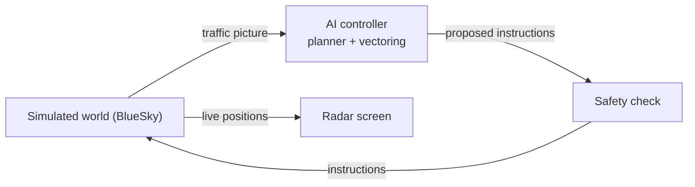

# AI Approach Controller

An open benchmark for AI approach control, and a simulated approach radar where an AI controller works arrival traffic from the holding stacks onto final while you watch. The first airport is London Gatwick (EGKK).

**End goal:** an open benchmark for AI approach control at a real, busy airport, starting with Gatwick, with our AI controller as its first entrant. The controller safely and efficiently manages all the arrival traffic, you can watch it working on a radar screen, and the benchmark scores it against real controllers handling the same traffic.

The AI starts with two aircraft and speed control only, then grows stage by stage to full vectoring, wake turbulence spacing, holds, go-arounds, runway changes and storms. It is a small neural network trained with reinforcement learning in the simulator, on a laptop, with no paid APIs.

**Status:** stage 0 prototype working. The rules controller lands arrivals released at WILLO and TIMBA on runway 26L, with no separation losses and at least 6 NM between landings, and the safety check blocks unsafe instructions. Arrivals are still made up; real OpenSky arrivals come next. There is no learned AI yet: that starts in stage 1.

## Documents

- [Project diary](diary/README.md): one entry per milestone, each with radar replays, videos, screenshots and scores
- [Project plan](docs/project-plan.md): the vision, prior work, how it works, roadmap, risks and team
- [Stage 0 spec: Gatwick](docs/stage0-gatwick-spec.md): airspace, arrival routes, holds, spacing, speeds and the rules controller

## How it works



Real Gatwick arrivals are replayed from ADS-B data up to the WILLO and TIMBA holds. From there the AI controls each aircraft until it is established on the ILS for 26L or 08R. A fixed safety check blocks any unsafe instruction. Every controller, including the real Gatwick controllers scored from the same traffic, is measured the same way.

## Repo layout

| Folder | What goes there |
| --- | --- |
| `approach/sim/` | The simulated world: BlueSky aircraft, simulated pilots, the session runner |
| `approach/scenarios.py` | The traffic for each scenario |
| `approach/scoring.py`, `approach/wake.py` | The scores every controller is measured on, and RECAT-EU wake spacing |
| `diary/` | The project diary: one folder per milestone |
| `approach/airports/` | Airports as data. `egkk/` is Gatwick |
| `approach/controllers/` | Baseline controllers: rules, imitation and random, plus the safety check |
| `approach/ai/` | The learned controller: network, scoring, training, evaluation |
| `approach/data/` | Pipelines for OpenSky ADS-B, METARs and aircraft types |
| `approach/radar/` | The radar screen and session replays |
| `scripts/` | Helper scripts, such as fetching the sector file |
| `docs/` | Plan and specs |
| `tests/` | Tests |

## Getting started

Python 3.10 or later.

```bash
python3 -m venv .venv
```

```bash
source .venv/bin/activate
```

```bash
pip install -r requirements.txt
```

```bash
./scripts/fetch_sector_file.sh
```

```bash
pytest
```

The fetch script downloads the Gatwick and navaid data from VATSIM UK's sector file into `data/external/`.

### Run a scenario

```bash
python -m approach.run --list
```

```bash
python -m approach.run two_arrivals
```

This writes `outputs/two_arrivals.html`, a radar replay you open in any browser (no server needed), plus the session log as JSON. Scroll to zoom, drag to pan.

### Record a milestone for the diary

```bash
python -m approach.milestone stage1-01-speed-only --title "Speed-only spacing" --scenarios two_arrivals --summary "What was built."
```

This runs the scenarios and saves into `diary/<date>-<name>/`: the replays, an MP4 video of each (needs Node with Playwright, and ffmpeg), a screenshot, the session logs and a diary entry draft. It also adds the scores to `diary/scores.csv` and updates the diary index. From your own computer, `./scripts/publish_milestone.sh <diary folder>` then tags the milestone and creates a GitHub release with its videos.

## Data and licences

| Source | Used for | In this repo? |
| --- | --- | --- |
| [BlueSky](https://github.com/TUDelft-CNS-ATM/bluesky) and [BlueSky-Gym](https://pypi.org/project/bluesky-gym/) (MIT) | Simulator and starter training environments | Installed as dependencies |
| [VATSIM UK sector file](https://github.com/VATSIM-UK/UK-Sector-File) (GPL-3) | Fixes, vectoring areas, minimum altitudes, arrival routes, runways | No, fetched by script |
| VATSIM UK Gatwick vMATS, UK AIP | Procedures summarised in the stage 0 spec | No, link only |
| OpenSky Network ADS-B (non-commercial research access) | Real arrivals and the real-controller baseline | No, downloaded locally |
| [atc_app](https://github.com/SNaveenMathew/atc_app) and [FlightPathAnalysis](https://github.com/SNaveenMathew/FlightPathAnalysis) (Naveen Mathew) | Prior work this project builds on | No code copied until they carry a licence |

This repo's own licence is still to be chosen (see open questions in the plan). It stays private until then.

## Team

James Le Cuirot. Collaborators welcome, see the Team section of the plan.
