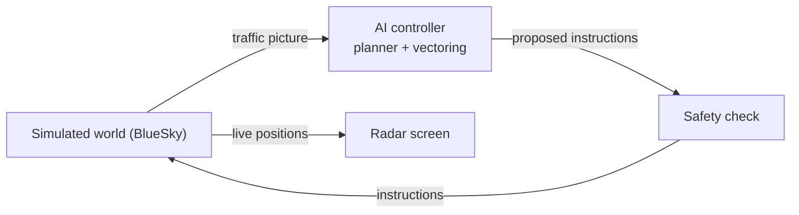

# AI Approach Controller

An open benchmark for AI approach control at London Gatwick (EGKK): a simulated approach radar that replays real arrivals, in that hour's real winds, for a controller to work onto final while you watch. Every controller is scored the same way as the real controllers who handled the same aircraft.

**End goal:** an open benchmark for AI approach control at a real, busy airport, starting with Gatwick, with our AI controller as its first entrant. The controller safely and efficiently manages all the arrival traffic, you can watch it working on a radar screen, and the benchmark scores it against real controllers handling the same traffic.

The AI will start with speed control only, then grow stage by stage to full vectoring, holds, go-arounds, runway changes and storms. It will be a small neural network trained with reinforcement learning in the simulator, on a laptop, with no paid APIs.

## Status, November 2026

The world the AI will learn in is built and running on real Gatwick traffic. **There is no learned AI yet:** a hand-written rules controller flies the traffic, as the first yardstick.

- **Real traffic:** every Gatwick arrival that adsb.lol's volunteer receivers saw on 60 chosen days between December 2023 and September 2026, 21,160 in all. Any real hour can be replayed into the simulator, each aircraft starting exactly where it really was. A quarter of the days are kept back for testing.
- **Real weather:** every session flies in that hour's real winds at every height, from NOAA's GFS weather model.
- **A fixed safety check** blocks any instruction that would break separation, a minimum altitude or the edge of Gatwick's radar manoeuvring area (RMA).
- **The real controllers are scored** on every hour of the 60 days with the same code as ours: about 18 minutes and 70 track miles per arrival from 40 NM out. On the busiest real hours the rules controller falls well behind them.
- **Next:** stage 1a, the first learned controller, which adjusts only speeds and has to beat a speed-only rules controller on the same hours.

The [November 2026 status report](https://www.lecuirot.je/projects/approach-controller/) tells the story so far, and the [project diary](diary/README.md) has a replay, a video and the scores for every milestone.

## Documents

- [Project diary](diary/README.md): one entry per milestone, each with radar replays, videos, screenshots and scores
- [Status report, November 2026](https://www.lecuirot.je/projects/approach-controller/): where the project is, with pictures and a video (the text and pictures are also in [`docs/status-report-2026-11/`](docs/status-report-2026-11/))
- [Project plan](docs/project-plan.md): the vision, prior work, how it works, roadmap, risks and team
- [Stage 0 spec: Gatwick](docs/stage0-gatwick-spec.md): airspace, arrival routes, holds, spacing, speeds and the rules controller
- [Questions for a Gatwick controller](docs/questions-for-a-gatwick-controller.md): what the simulator still guesses at

## How it works



Real Gatwick arrivals are replayed from ADS-B data until each is within 40 NM of Gatwick and at or below FL150, wherever it is: heading for a hold, on a direct or on a heading from the previous controller. From there the AI controls each aircraft until it is established on the ILS for 26L or 08R. A fixed safety check blocks any unsafe instruction. Every controller, including the real Gatwick controllers scored from the same traffic, is measured the same way.

## Repo layout

| Folder | What goes there |
| --- | --- |
| `approach/sim/` | The simulated world: BlueSky aircraft, simulated pilots, the session runner |
| `approach/scenarios.py` | The traffic for each scenario |
| `approach/scoring.py`, `approach/wake.py` | The scores every controller is measured on, and RECAT-EU wake spacing |
| `diary/` | The project diary: one folder per milestone |
| `approach/airports/` | Airports as data. `egkk/` is Gatwick |
| `approach/controllers/` | The controllers (the interface in `base.py`, the rules controller) and the safety check |
| `approach/ai/` | The learned controller, from stage 1 (empty so far) |
| `approach/data/` | Pipelines for real traffic (adsb.lol ADS-B), real winds (NOAA GFS), weather reports, real arrivals and the real-controller scores |
| `data/real/` | Every real Gatwick arrival on the chosen days, the other traffic near Gatwick, and the real controllers' scores, from adsb.lol (ODbL) |
| `approach/radar/` | The radar screen and session replays |
| `scripts/` | Helper scripts, such as fetching the sector file |
| `docs/` | Plan and specs |
| `tests/` | Tests |

## Getting started

Python 3.10 or later.

```bash
python3 -m venv .venv
```

```bash
source .venv/bin/activate
```

```bash
pip install -r requirements.txt
```

```bash
./scripts/fetch_sector_file.sh
```

```bash
pytest
```

The fetch script downloads the Gatwick and navaid data from VATSIM UK's sector file into `data/external/`.

### Run a scenario

```bash
python -m approach.run --list
```

```bash
python -m approach.run two_arrivals
```

This writes `outputs/two_arrivals.html`, a radar replay you open in any browser (no server needed), plus the session log as JSON. Scroll to zoom, drag to pan.

To fly any scenario in the real winds of a past hour (any hour since 2021, from NOAA's GFS weather model), give the UTC hour:

```bash
python -m approach.run two_arrivals --weather 2024-12-07T09
```

The first run for an hour downloads about 35 MB of wind data and keeps a small copy in `data/raw/gfs/`. The replay shows the wind at each height in its top right corner.

### Replay a real hour

```bash
python -m approach.data.real_sessions 2026-05-30T12
```

This scores the real controllers on that hour (UTC), then gives the same arrivals to our rules controller in the same winds. It writes two radar replays to `outputs/`: `real_2026-05-30T12.html`, what the real controllers did, and `rules_2026-05-30T12.html`, ours, with the real tracks in faint grey behind. Any hour of the 60 days in `data/real/egkk/days.csv` works with no ADS-B download, since their arrivals are in the repo.

### Enter your own controller

A controller is a class with a `decide(t, views)` method that is called every few seconds with what it can see and returns instructions (`approach/controllers/base.py`). Give it a name in `make_controller` (`approach/sim/session_runner.py`) and pass that name with `--controller`. Everything it says goes through the same safety check, and its sessions are scored by the same code as everyone else's (`approach/scoring.py`). `approach/controllers/rules.py` is a worked example.

### Record a milestone for the diary

```bash
python -m approach.milestone stage1-01-speed-only --title "Speed-only spacing" --scenarios two_arrivals --summary "What was built."
```

This runs the scenarios and saves into `diary/<date>-<name>/`: the replays, an MP4 video of each (needs Node with Playwright, and ffmpeg), a screenshot, the session logs and a diary entry draft. It also adds the scores to `diary/scores.csv` and updates the diary index. From your own computer, `./scripts/publish_milestone.sh <diary folder>` then tags the milestone and creates a GitHub release with its videos.

## Data and licences

| Source | Used for | In this repo? |
| --- | --- | --- |
| [BlueSky](https://github.com/TUDelft-CNS-ATM/bluesky) and [BlueSky-Gym](https://pypi.org/project/bluesky-gym/) (MIT) | Simulator and starter training environments | Installed as dependencies |
| [VATSIM UK sector file](https://github.com/VATSIM-UK/UK-Sector-File) (GPL-3) | Fixes, vectoring areas, minimum altitudes, arrival routes, runways | No, fetched by script |
| VATSIM UK Gatwick vMATS, UK AIP | Procedures summarised in the stage 0 spec | No, link only |
| [adsb.lol](https://www.adsb.lol) open ADS-B data (ODbL 1.0) | Real arrivals, the real traffic replayed into the simulator, and the real-controller baseline | Yes: the 60 days' arrivals, the other traffic near Gatwick and the scores derived from them, in `data/real/` under ODbL. The full daily files are downloaded locally |
| [NOAA GFS weather model](https://registry.opendata.aws/noaa-gfs-bdp-pds/) (public domain) | Real winds at every height, for any hour since 2021 | No, downloaded and cached locally (`data/raw/gfs/`) |
| [Iowa State University weather report archive](https://mesonet.agron.iastate.edu/request/download.phtml) | Gatwick's hourly pressure (QNH), to correct ADS-B altitudes | Only the hourly pressure, stored with each day's arrivals |
| [atc_app](https://github.com/SNaveenMathew/atc_app) and [FlightPathAnalysis](https://github.com/SNaveenMathew/FlightPathAnalysis) (Naveen Mathew) | The idea, and prior work this project builds on | No code copied until they carry a licence |

## Licence

The code is under the [MIT licence](LICENSE). The real traffic data in `data/real/` is derived from adsb.lol's open data and stays under the [ODbL 1.0](https://opendatacommons.org/licenses/odbl/1-0/): credit adsb.lol and keep anything built from it under the same licence. The VATSIM UK sector file (GPL-3) is not included; `scripts/fetch_sector_file.sh` downloads it.

## Team and getting involved

James Le Cuirot, with collaborators welcome. The biggest gap is controller knowledge: if you control Gatwick, on VATSIM or for real, [Questions for a Gatwick controller](docs/questions-for-a-gatwick-controller.md) lists what the simulator still guesses at. People working on reinforcement learning or aviation data are just as welcome. Open an issue to get in touch, and see the Team section of the [plan](docs/project-plan.md).
