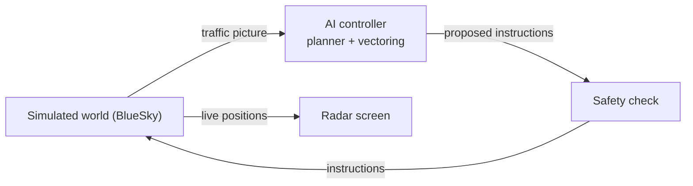

# AI Approach Controller

An open benchmark for AI approach control at London Gatwick (EGKK): a simulated approach radar that replays real arrivals, in that hour's real winds, for a controller to work onto final while you watch. Every controller is scored the same way as the real controllers who handled the same aircraft.

**End goal:** an open benchmark for AI approach control at a real, busy airport, starting with Gatwick, with our AI controller as its first entrant. The controller safely and efficiently manages all the arrival traffic, you can watch it working on a radar screen, and the benchmark scores it against real controllers handling the same traffic.

The AI will start with speed control only, then grow stage by stage to full vectoring, holds, go-arounds, runway changes and storms. It will be a small neural network trained with reinforcement learning in the simulator, on a laptop, with no paid APIs.

## Status, November 2026

The world is built and running on real Gatwick traffic, and the AI is in stage 2: vectoring aircraft onto final.

- **Real traffic:** every Gatwick arrival that adsb.lol's volunteer receivers saw on 76 chosen days between December 2023 and November 2026, 26,258 in all. Any real hour can be replayed into the simulator, each aircraft starting exactly where it really was. 30 of the days are kept back for testing.
- **Real weather and real pilots:** every session flies in that hour's real winds at every height, from NOAA's GFS weather model, with simulated pilots who turn, descend and change speed at the rates real Gatwick arrivals do.
- **A fixed safety check** blocks any instruction that would break separation, a minimum altitude or the edge of Gatwick's radar manoeuvring area (RMA).
- **The real controllers are scored** on the same hours with the same code: 17.8 minutes per arrival from handover on the 120 test sessions, with 4 losses of separation.
- **Stage 1** (speed, then the turn onto base) ended level with a good rules controller: little room above a sound rule for those alone.
- **Stage 2's controller is a look-ahead:** before giving a small change (a heading, level or speed a step off the plan, a hold at a level, an early release from a stack) it flies the change ahead in copies of the simulator with freshly drawn pilots, and makes it only if the copies come out better. On the 120 test sessions (1,785 arrivals) it landed 1,777 with 10 losses of separation, 2 go-arounds and 23.8 minutes per arrival; the rules controller it adjusts had 251 losses, 63 go-arounds and 25.4 minutes, and the real controllers 4 losses, 14 go-arounds and 17.8 minutes. Training a network by reinforcement learning, and training one to copy the look-ahead, have not yet matched it ([diary](diary/2026-11-15-stage2-02-look-ahead/README.md)).
- **The gap that is left** is time: real controllers were about 6 minutes per arrival quicker, mostly by keeping aircraft out of the holding stacks. Arrivals handed over high are the ones held: real controllers bring them almost straight in, descending faster than the simulator's pilots did at those heights. The simulated pilots now descend at the real rate for each height, and the look-ahead can take an aircraft off a stack above the lowest or bring it straight in.
- **The 120 test sessions on the updated simulator** (18 November): the look-ahead took 22.1 minutes per arrival, landed 1,781 of 1,785, with 17 losses of separation (8 away from the stacks) and 2 go-arounds. Its competitor took 24.2 minutes, with 213 losses and 51 go-arounds; the real controllers 17.8 minutes, 4 losses and 14 go-arounds. The gap to the real controllers is down from 6.0 to 4.4 minutes per arrival, but the look-ahead's losses of separation at the stacks rose from 3 to 9. Tracing them found most came just after it moved an aircraft up or down a level in its stack, a move that skipped the safety veto its releases pass; that veto is now being tried on those moves too ([plan](docs/project-plan.md#the-test-on-the-updated-simulator-18-november)).
- **Shadow mode on live traffic** (18 November): the AI flew the real Gatwick arrivals of an hour, 18:22 to 19:22 UTC, in real time from adsb.lol's live feed, while the real controllers flew the real ones. It picked out all 14 arrivals from the 145 aircraft entering the handover region, with nothing missed and nothing extra. It landed all 14 with no losses of separation, taking 20.5 minutes per arrival against the real controllers' 15.0. Most of the gap was holding: it held 8 of the 14 aircraft, and the real controllers held none ([plan](docs/project-plan.md#shadow-mode-on-the-live-feed-18-november), [run](runs/shadow/2026-11-18T1822/)).
- **Three planner fixes from the live hour** (18 and 19 November): telling a high aircraft to expedite its descent instead of holding it to lose height; bringing an aircraft handed over already lined up with the runway straight in; and landing aircraft in the order they leave the holding stacks (before, one that held could be put back ahead of one already turning onto final, the cause of most of the planner's go-arounds). On 96 practice sessions, with faster speeds when nothing waits ahead, the planner alone now takes 22.7 minutes per arrival against 26.0, with 153 losses of separation against 260 and 38 go-arounds against 99. They are being tried with the look-ahead before the next 120-session test ([plan](docs/project-plan.md#landing-in-release-order-and-straight-in-19-november)).
- **A second live hour, with the fixes** (19 November, 10:28 to 11:28 UTC): the AI took 16.3 minutes per arrival against the real controllers' 13.5, with no losses of separation or go-arounds either side: a gap of 2.8 minutes, against 5.5 on the first hour. Most of it followed from one high arrival from the south-east, held as too high where its real crew came down at about 1,650 ft/min; the aircraft behind it landed later too. One aircraft the AI was handed was a Gatwick departure levelling at 15,000 ft; the spotter now skips aircraft the feed has seen leaving Gatwick ([plan](docs/project-plan.md#the-second-live-hour-19-november), [run](runs/shadow/2026-11-19T1024/)).
- **A third live hour, on the easterly runway** (25 November, 17:09 to 18:09 UTC, runway 08R): the AI took 17.8 minutes per arrival against the real controllers' 15.3 on the 10 arrivals both flew, with no losses of separation or go-arounds either side: a gap of 2.5 minutes. Two-thirds of it came from two arrivals from the south-west, which the real controllers flew straight onto the final approach and the planner took round by way of its stack at WILLO. The spotter missed one arrival, a Ryanair 737 flying over from Stansted. Recorded from [adsb.fi](https://adsb.fi)'s feed, which needs no key, as adsb.lol's keyless allowance on this machine's shared address was used up ([plan](docs/project-plan.md#the-third-live-hour-25-november), [run](runs/shadow/2026-11-25T1708/)).
- **The 120 test sessions with the fixes** (20 November): the look-ahead took 20.5 minutes per arrival against 22.1 on 18 November, landed 1,783 of 1,785, with 8 losses of separation against 17. The real controllers took 17.8 minutes with 4 losses, so the gap is down to 2.7 minutes per arrival, and the difference in losses of separation and go-arounds is now within chance. The gap is about the same at every traffic level, quiet hours included, so what is left is how each aircraft is flown, not how busy hours are sequenced. Its go-arounds rose from 2 to 12, about as many as the real controllers' 14: 10 were aircraft kept at 180 kt on final to 7 NM whose pilots were slow to slow down. A fix that slows the final earlier, as real arrivals do, is being tried on practice hours ([plan](docs/project-plan.md#the-test-with-the-planner-fixes-20-november)).
- **The 120 test sessions with the planner changes of 21 and 22 November** (23 November): slower finals, a stack check for holders, releasing the next arrival earlier and planning landings half a mile closer. The look-ahead took 19.8 minutes per arrival against 20.5, quicker beyond chance, and landed all 1,785. Its go-arounds fell from 12 to 5 and its losses of separation rose from 8 to 11, both within chance. The gap to the real controllers is down to 2.0 minutes per arrival, and to 1.5 in the busiest hours. The planner alone, planning that close, is much less safe without the look-ahead on top. Traced: 6 of the 11 losses are a quicker descent from above onto a slower one below, which a more cautious safety check could catch; 4 of the 5 go-arounds are one planner fault, a turn started so early for a big turn that the aircraft joined final 2 NM out ([plan](docs/project-plan.md#the-test-with-the-planner-changes-of-21-and-22-november)).
- **Seen descent rates in the safety check, with the look-ahead** (24 November): on the 48 practice sessions, 4 losses of separation against 3 and otherwise the same, so not merged. Traced, one loss came from an aircraft released from a holding stack being checked as if it stayed at the stack; with that fixed as well, seen rates would have blocked it. That fix is now running on the same 48 sessions ([plan](docs/project-plan.md#seen-descent-rates-with-the-look-ahead-24-november)).
- **The safety check reviewing approach clearances** (24 November): stopped after 16 of the 48 practice sessions, with 3 losses of separation and a go-around where the run without it had 2 and none, so it could no longer win. Traced, the new loss came from an aircraft cleared for the approach 160 seconds before it caught the glide path, beyond the check's two minutes, so a clearance needs to be given nearer the capture or checked again before it ([plan](docs/project-plan.md#the-ils-clearance-reviewed-by-the-safety-check-24-november)).
- **Turning an aircraft back onto the localiser** (25 November): an aircraft that flies through the final approach line is now turned straight back onto it from the north side, as a real controller would, or brought round with its approach clearance cancelled, so it cannot catch the glide path by surprise on its way round. It is rare: 6 of 751 arrivals with the planner alone on the 48 practice sessions. With the look-ahead, the same 3 losses of separation and 19.3 minutes per arrival against 19.2. Merged, and shadow mode uses it ([plan](docs/project-plan.md#turning-an-aircraft-back-onto-the-localiser-25-november)).
- **Simulated crews whose descent rates drift, as real ones do** (25 November): measured from 5,965 real descents on 12 practice days, a crew's place among descent rates mostly fades within a minute or two (time constant about 50 seconds), where each simulated pilot kept its place for the whole flight. Simulated pilots can now drift the same way. With them, the look-ahead on the 48 practice sessions had 2 losses of separation against 3 and took 18.5 minutes per arrival against 19.3. Close landing gaps rose from 2 to 4, and from 36 to 60 with the planner alone, which is the next thing to look at. Showing the look-ahead's copies each crew's seen descent rate was tried as well, and was not adopted: 4 losses against 3. Drifting pilots are merged as an option, shadow mode uses them, and the 120 test sessions are being flown again with them ([plan](docs/project-plan.md#drifting-pilots-with-the-look-ahead-25-november)).
- **The planner expecting a quick or slow descent to fade** (25 November): with drifting crews, the planner flying alone had 83 losses of separation against 88, and 44 close landing gaps against 60. With the look-ahead on the 48 practice sessions it was 0.4 minutes per arrival quicker (18.1 against 18.5), level on losses of separation (2 each) and had 2 go-arounds against none, so it is not merged ([plan](docs/project-plan.md#the-planners-seen-descent-rate-fading-with-the-look-ahead-25-november)).
- **Planning an expedited descent on a quicker crew** (26 November): when the planner tells a high arrival to expedite, it now plans on a crew quicker than three in four, until it has seen how fast the crew really comes down. With the look-ahead on the 48 practice sessions: no losses of separation against 2, no go-arounds either way, 3 close landing gaps against 4, and 17.8 minutes per arrival against 18.5. The real controllers took 17.7 on the same hours (18.7 on runway 08R, where the AI took 20.2). Merged, and shadow mode uses it ([plan](docs/project-plan.md#planning-an-expedited-descent-on-a-quicker-crew-with-the-look-ahead-26-november)).
- **Simulated crews that start where their real crews were** (26 November): a crew handed over descending now starts at the descent rate its real crew had, then wanders as real crews' rates do. Checked on real tracks, the rate at handover tells about as much about the next few minutes in the simulator as in reality. In this closer world, on the 48 practice sessions, the planner alone did better and the AI worse: 7 losses of separation against 2 and 4 go-arounds against none (3 and 2 of them in one busy session), within or near chance, and 18.3 minutes per arrival against 18.5. Merged as the simulator option shadow mode and the next test use. A fix that lets the AI's copies start each crew from what a controller has seen of it is being tested ([plan](docs/project-plan.md#crews-that-start-where-their-real-crews-were-with-the-look-ahead-26-november)).

The [November 2026 status report](https://www.lecuirot.je/projects/approach-controller/) tells the story so far, and the [project diary](diary/README.md) has a replay, a video and the scores for every milestone.

## Documents

- [Project diary](diary/README.md): one entry per milestone, each with radar replays, videos, screenshots and scores
- [Status report, November 2026](https://www.lecuirot.je/projects/approach-controller/): where the project is, with pictures and a video (the text and pictures are also in [`docs/status-report-2026-11/`](docs/status-report-2026-11/))
- [Project plan](docs/project-plan.md): the vision, prior work, how it works, roadmap, risks and team
- [Stage 0 spec: Gatwick](docs/stage0-gatwick-spec.md): airspace, arrival routes, holds, spacing, speeds and the rules controller
- [Questions for a Gatwick controller](docs/questions-for-a-gatwick-controller.md): what the simulator still guesses at

## How it works



Real Gatwick arrivals are replayed from ADS-B data until each is within 40 NM of Gatwick and at or below FL150, wherever it is: heading for a hold, on a direct or on a heading from the previous controller. From there the AI controls each aircraft until it is established on the ILS for 26L or 08R. A fixed safety check blocks any unsafe instruction. Every controller, including the real Gatwick controllers scored from the same traffic, is measured the same way.

## Repo layout

| Folder | What goes there |
| --- | --- |
| `approach/sim/` | The simulated world: BlueSky aircraft, simulated pilots, the session runner |
| `approach/scenarios.py` | The traffic for each scenario |
| `approach/scoring.py`, `approach/wake.py` | The scores every controller is measured on, and wake turbulence spacing: the UK scheme, and RECAT-EU for days from March 2025 |
| `diary/` | The project diary: one folder per milestone |
| `approach/airports/` | Airports as data. `egkk/` is Gatwick |
| `approach/controllers/` | The controllers (the interface in `base.py`, the rules controller) and the safety check |
| `approach/ai/` | The learned controller, from stage 1 (empty so far) |
| `approach/data/` | Pipelines for real traffic (adsb.lol ADS-B), real winds (NOAA GFS), weather reports, real arrivals and the real-controller scores |
| `data/real/` | Every real Gatwick arrival on the chosen days, the other traffic near Gatwick, and the real controllers' scores, from adsb.lol (ODbL) |
| `approach/live/` | Shadow mode: a live ADS-B feed (adsb.lol or adsb.fi), picking out Gatwick arrivals as they come, and the AI flying them in real time |
| `approach/radar/` | The radar screen and session replays |
| `scripts/` | Helper scripts, such as fetching the sector file |
| `docs/` | Plan and specs |
| `tests/` | Tests |

## Getting started

Python 3.10 or later.

```bash
python3 -m venv .venv
```

```bash
source .venv/bin/activate
```

On a computer without a GPU, install the CPU build of PyTorch first; the default one downloads several gigabytes of GPU libraries:

```bash
pip install torch --index-url https://download.pytorch.org/whl/cpu
```

```bash
pip install -r requirements.txt
```

```bash
./scripts/fetch_sector_file.sh
```

```bash
pytest
```

The fetch script downloads the Gatwick and navaid data from VATSIM UK's sector file into `data/external/`.

### Run a scenario

```bash
python -m approach.run --list
```

```bash
python -m approach.run two_arrivals
```

This writes `outputs/two_arrivals.html`, a radar replay you open in any browser (no server needed), plus the session log as JSON. Scroll to zoom, drag to pan.

To fly any scenario in the real winds of a past hour (any hour since 2021, from NOAA's GFS weather model), give the UTC hour:

```bash
python -m approach.run two_arrivals --weather 2024-12-07T09
```

The first run for an hour downloads about 35 MB of wind data and keeps a small copy in `data/raw/gfs/`. The replay shows the wind at each height in its top right corner.

### Replay a real hour

```bash
python -m approach.data.real_sessions 2026-05-30T12
```

This scores the real controllers on that hour (UTC), then gives the same arrivals to our rules controller in the same winds. It writes two radar replays to `outputs/`: `real_2026-05-30T12.html`, what the real controllers did, and `rules_2026-05-30T12.html`, ours, with the real tracks in faint grey behind. Any hour of the 76 days in `data/real/egkk/days.csv` works with no ADS-B download, since their arrivals are in the repo.

### Shadow mode: the AI on live traffic

```bash
python -m approach.live.feed --out data/raw/live/egkk/today.jsonl --minutes 110
```

```bash
python -m approach.live.shadow run --feed data/raw/live/egkk/today.jsonl --minutes 60 --out runs/shadow/today
```

```bash
python -m approach.live.shadow compare --feed data/raw/live/egkk/today.jsonl --out runs/shadow/today
```

Run the first two side by side. The recorder polls [adsb.lol](https://www.adsb.lol)'s live feed around Gatwick every 5 seconds (`--every` to change it). adsb.lol now allows 500 requests a day per internet address without a key, fewer than a 110-minute recording at 5 seconds needs (1,320); a free key from adsb.lol, put in the environment variable `ADSBLOL_API_KEY`, raises that (1,000 a day by its request form: poll `--every 7`; 7,200 for those who feed it). `--source adsbfi` polls [adsb.fi](https://adsb.fi)'s open data feed instead, which serves the same fields without a key and allows one request a second, for personal, non-commercial use ([its terms](https://github.com/adsbfi/opendata)); the recording names its source, and the shadow run and `compare` credit it. The shadow run picks out each Gatwick arrival as it enters the handover region and hands it to the simulator where it really is, in the hour's forecast winds, for the look-ahead controller to fly in real time; arrivals are handed over for `--minutes`, then it carries on until they have landed. When the recorder has finished, `compare` finds the real arrivals in the recording, scores the real controllers on them with the same code, and writes `compare.json` (aircraft by aircraft) and `replay.html` (the AI's aircraft, with the real tracks in faint grey behind).

### Enter your own controller

A controller is a class with a `decide(t, views)` method that is called every few seconds with what it can see and returns instructions (`approach/controllers/base.py`). Give it a name in `make_controller` (`approach/sim/session_runner.py`) and pass that name with `--controller`. Everything it says goes through the same safety check, and its sessions are scored by the same code as everyone else's (`approach/scoring.py`). `approach/controllers/rules.py` is a worked example.

### Record a milestone for the diary

```bash
python -m approach.milestone stage1-01-speed-only --title "Speed-only spacing" --scenarios two_arrivals --summary "What was built."
```

This runs the scenarios and saves into `diary/<date>-<name>/`: the replays, an MP4 video of each (needs Node with Playwright, and ffmpeg), a screenshot, the session logs and a diary entry draft. It also adds the scores to `diary/scores.csv` and updates the diary index. From your own computer, `./scripts/publish_milestone.sh <diary folder>` then tags the milestone and creates a GitHub release with its videos.

## Data and licences

| Source | Used for | In this repo? |
| --- | --- | --- |
| [BlueSky](https://github.com/TUDelft-CNS-ATM/bluesky) and [BlueSky-Gym](https://pypi.org/project/bluesky-gym/) (MIT) | Simulator and starter training environments | Installed as dependencies |
| [VATSIM UK sector file](https://github.com/VATSIM-UK/UK-Sector-File) (GPL-3) | Fixes, vectoring areas, minimum altitudes, arrival routes, runways | No, fetched by script |
| VATSIM UK Gatwick vMATS, UK AIP | Procedures summarised in the stage 0 spec | No, link only |
| [adsb.lol](https://www.adsb.lol) open ADS-B data and live feed (ODbL 1.0) | Real arrivals, the real traffic replayed into the simulator, the real-controller baseline, and shadow mode on live traffic | Yes: the 76 days' arrivals, the other traffic near Gatwick, the scores derived from them, and the table shadow mode uses to pick out arrivals, in `data/real/` under ODbL. The full daily files, and recordings of the live feed, are kept locally |
| [adsb.fi](https://adsb.fi) open data live feed (personal, non-commercial use; [terms](https://github.com/adsbfi/opendata)) | Shadow mode on live traffic, when adsb.lol's keyless quota is used up | Only the scores derived from it, in `runs/shadow/`. Recordings of the live feed are kept locally |
| [NOAA GFS weather model](https://registry.opendata.aws/noaa-gfs-bdp-pds/) (public domain) | Real winds at every height, for any hour since 2021 | No, downloaded and cached locally (`data/raw/gfs/`) |
| [Iowa State University weather report archive](https://mesonet.agron.iastate.edu/request/download.phtml) | Gatwick's hourly pressure (QNH), to correct ADS-B altitudes | Only the hourly pressure, stored with each day's arrivals |
| [atc_app](https://github.com/SNaveenMathew/atc_app) and [FlightPathAnalysis](https://github.com/SNaveenMathew/FlightPathAnalysis) (Naveen Mathew) | The idea, and prior work this project builds on | No code copied until they carry a licence |

## Licence

The code is under the [MIT licence](LICENSE). The real traffic data in `data/real/` is derived from adsb.lol's open data and stays under the [ODbL 1.0](https://opendatacommons.org/licenses/odbl/1-0/): credit adsb.lol and keep anything built from it under the same licence. The VATSIM UK sector file (GPL-3) is not included; `scripts/fetch_sector_file.sh` downloads it.

## Team and getting involved

James Le Cuirot, with collaborators welcome. The biggest gap is controller knowledge: if you control Gatwick, on VATSIM or for real, [Questions for a Gatwick controller](docs/questions-for-a-gatwick-controller.md) lists what the simulator still guesses at. People working on reinforcement learning or aviation data are just as welcome. Open an issue to get in touch, and see the Team section of the [plan](docs/project-plan.md).
