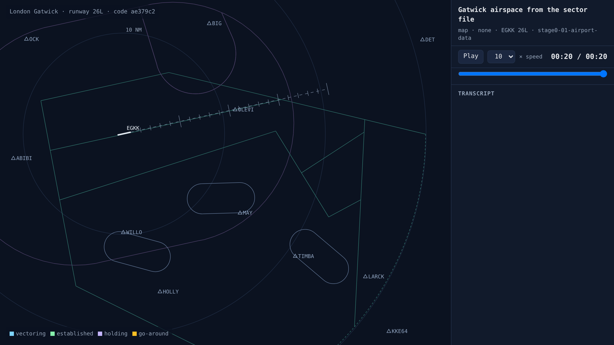

# Gatwick from the sector file

<!-- AUTO:START (regenerated by approach.milestone) -->

Milestone `stage0-01-airport-data` · 2026-11-06 · code `0eae722` (check it out with `git checkout 0eae722`)

| Scenario | What it shows | Replay | Screenshot | Video | Scores |
| --- | --- | --- | --- | --- | --- |
| `map` | Gatwick airspace from the sector file | [replay](map.html) |  | [video](map.mp4) | map only |

Open a replay file in a browser to watch it; it needs no server.

<!-- AUTO:END -->

## What was built

Gatwick's airspace is loaded from VATSIM UK's open sector file: the 26L/08R runway thresholds, the WILLO, TIMBA and MAY holds, the fixes at the ends of the arrival routes, the westerly vectoring area (RMA) and the minimum-altitude areas (SMAA). The radar replay draws them all. The 26L inbound course comes out at 257.62° true against the AIP's 257.65°, and the glide path is 3,431 ft at 10 NM. The diary tooling is also in place: every milestone now saves its replays, a screenshot, a video and its scores automatically.

## What went wrong and how it was fixed

- The far end of each holding pattern was first drawn on the wrong side, curving towards the fix instead of away from it. The turn now starts from the outbound leg, so the racetracks match the published turn directions (WILLO and MAY left, TIMBA right).
- The sector file draws its vectoring areas as loose line segments, not closed shapes. That's fine for drawing, but the safety check will need proper polygons later, which is still an open task.

## Notes

_Your own notes for the blog or video._
