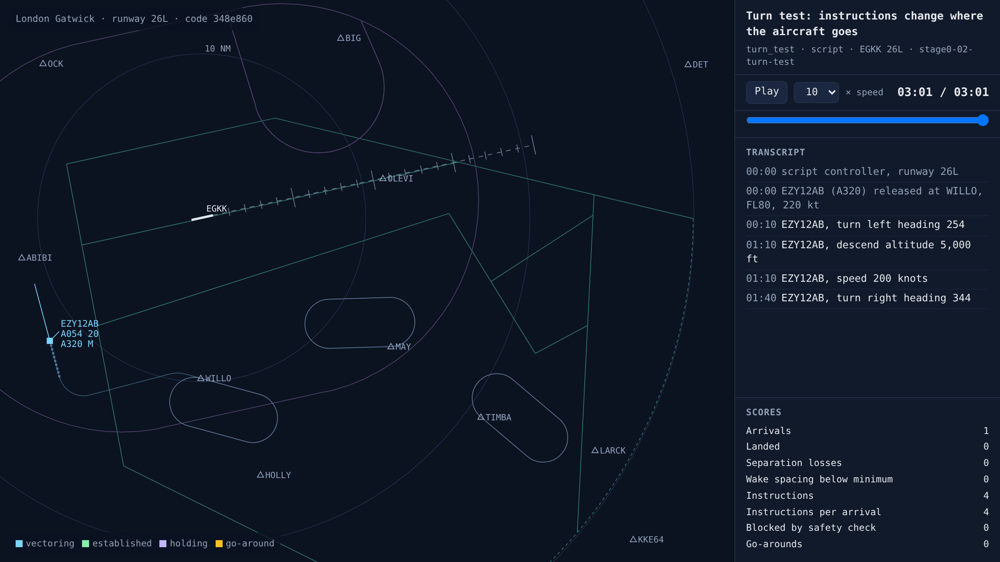

# Aircraft respond to instructions

<!-- AUTO:START (regenerated by approach.milestone) -->

Milestone `stage0-02-turn-test` · 2026-11-06 · code `348e860` (check it out with `git checkout 348e860`)

| Scenario | What it shows | Replay | Screenshot | Video | Scores |
| --- | --- | --- | --- | --- | --- |
| `turn_test` | Turn test: instructions change where the aircraft goes | [replay](turn_test.html) |  | [video](turn_test.mp4) | landed 0/1, separation losses 0, instructions 4 |

Open a replay file in a browser to watch it; it needs no server.

<!-- AUTO:END -->

## What was built

The simulated world now runs: BlueSky moves the aircraft without a display, and a simulated pilot carries out each instruction after a 3-6 second delay. In the turn test an A320 released at WILLO is turned 30° left, descended to 5,000 ft, slowed to 200 kt and turned right. The 30° turn takes about 16 seconds, about 2° a second, which is realistic for an airliner banking 25° at 220 kt (3° a second is the light-aircraft standard). Its track over the ground changes with the heading, which is exactly what atc_app's training world could not do. The transcript reads headings in magnetic, as a controller says them, while the simulation flies true headings.

## What went wrong and how it was fixed

- The plan said aircraft turn at 3° a second. BlueSky turns airliners at about 2° a second at 220 kt, because they bank about 25° rather than flying a light-aircraft "rate one" turn. That's the realistic number, so the test now accepts 1.5–3.5° a second.
- The first screenshots only showed the last 40 seconds of each track. They now draw the whole flight as a faint line, so a single picture tells the story.
- This cloud session isn't allowed to push tags or create GitHub releases, so each milestone's videos now sit in its diary folder (they're under 1 MB) and the entry records the commit to check out.

## Notes

_Your own notes for the blog or video._
