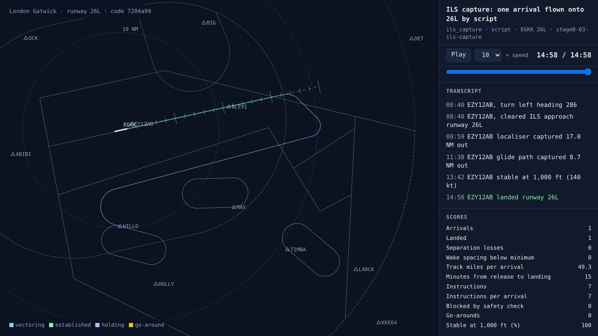

# First landing on 26L

<!-- AUTO:START (regenerated by approach.milestone) -->

Milestone `stage0-03-ils-capture` · 2026-11-06 · code `d540cb9` (check it out with `git checkout d540cb9`)

| Scenario | What it shows | Replay | Screenshot | Video | Scores |
| --- | --- | --- | --- | --- | --- |
| `ils_capture` | ILS capture: one arrival flown onto 26L by script | [replay](ils_capture.html) |  | [video](ils_capture.mp4) | landed 1/1, separation losses 0, instructions 7 |

Open a replay file in a browser to watch it; it needs no server.

<!-- AUTO:END -->

## What was built

Simulated pilots can now fly an ILS approach. In this scenario the instructions are still scripted by hand: an A320 from WILLO is sent east on a downwind leg, descended to 3,000 ft and slowed to 180 kt, turned onto a base leg, then given a 30° intercept heading and cleared for the ILS. The pilot captures the localiser 17 NM out, picks up the glide path from below at 8.7 NM, slows to 160 kt and then to its 140 kt approach speed by 4 NM, is stable at 1,000 ft and lands on 26L. Go-arounds are in place too: a pilot goes around if it is unstable at 1,000 ft, the runway is still occupied, or it gets within 2 NM of the aircraft ahead, and flies the published missed approach (straight ahead to 3,000 ft, then heading 178).

## What went wrong and how it was fixed

- The first final screenshot was empty: once the aircraft lands it is removed, so there was nothing left to draw. Screenshots now draw every aircraft's whole track, coloured by phase (blue while vectoring, green once established), and label aircraft that have landed.
- Told to fly heading 075 from WILLO, the aircraft took the shortest turn, 150° to the right through north, rather than the left turn a controller would expect. The rules controller will need to say which way to turn when a turn is that large.
- The scripted vectors intercept the localiser 17 NM out, which is a long final. The rules controller will aim for 10–12 NM.

## Notes

_Your own notes for the blog or video._
