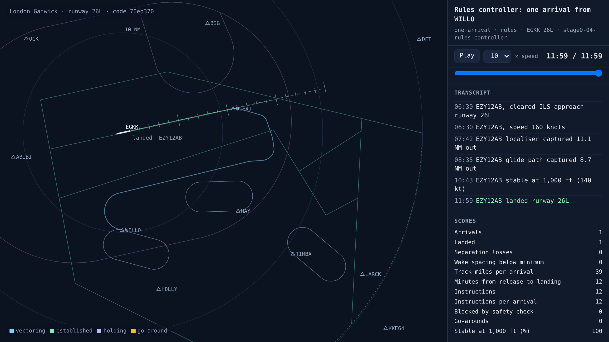
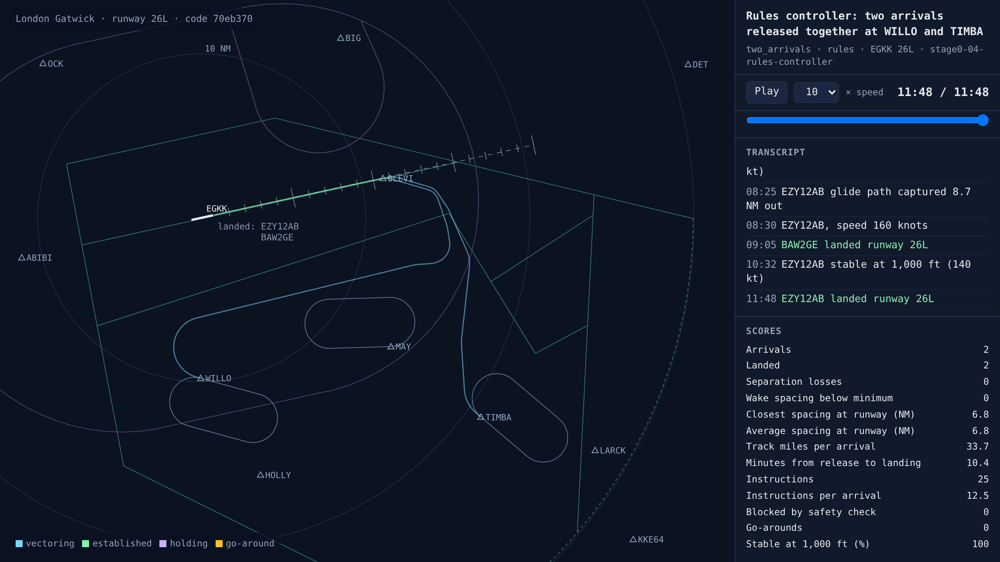

# The rules controller lands traffic on its own

<!-- AUTO:START (regenerated by approach.milestone) -->

Milestone `stage0-04-rules-controller` · 2026-11-06 · code `344df6d` (check it out with `git checkout 344df6d`)

| Scenario | What it shows | Replay | Screenshot | Video | Scores |
| --- | --- | --- | --- | --- | --- |
| `one_arrival` | Rules controller: one arrival from WILLO | [replay](one_arrival.html) |  | [video](one_arrival.mp4) | landed 1/1, separation losses 0, instructions 12 |
| `two_arrivals` | Rules controller: two arrivals released together at WILLO and TIMBA | [replay](two_arrivals.html) |  | [video](two_arrivals.mp4) | landed 2/2, separation losses 0, closest spacing at the runway 6.8 NM, instructions 25 |

Open a replay file in a browser to watch it; it needs no server.

<!-- AUTO:END -->

## What was built

Nothing is scripted any more: the rules controller decides every instruction. It works out each arrival's earliest possible landing time, puts them in order, and gives each a slot 6 NM (or the wake minimum, if larger) behind the one ahead. Each aircraft gets its own altitude on the way in, then is vectored tactically onto a downwind leg south of the centreline, turned onto base, descended to 3,000 ft, and given a 30° intercept heading and its ILS clearance. To delay an aircraft for its slot it stretches the downwind leg. With two arrivals released together, the Boeing 777 from TIMBA goes first and the A320 from WILLO lands 6.8 NM behind it, with no separation losses and both approaches stable at 1,000 ft.

## What went wrong and how it was fixed

- With three arrivals, one pair landed only 4.7 NM apart: legal behind a medium, but short of the 6 NM target. The timing model had two errors. It assumed aircraft fly at their indicated airspeed, but at 4,000–6,000 ft their true airspeed is about 15 kt faster. And it measured the path corner to corner, when aircraft actually turn early and cut each corner. With both fixed and a 0.5 NM planning margin, the closest pair is now 6.4 NM.
- A first version of the final-director step tried to space aircraft using the slot times planned earlier, which were already out of date. It now works from each aircraft's actual position on final, and only ever speeds a follower up to 180 kt or slows it to 160 kt, inside the published band.
- In the final screenshot the labels of landed aircraft piled on top of each other at the threshold. They now stack in landing order.

## Notes

_Your own notes for the blog or video._
