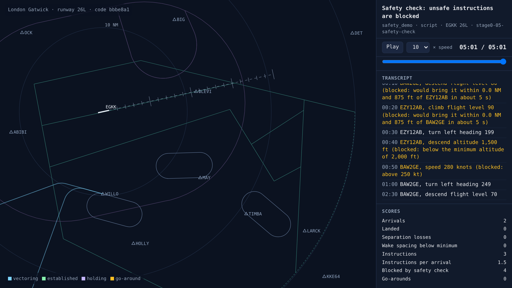
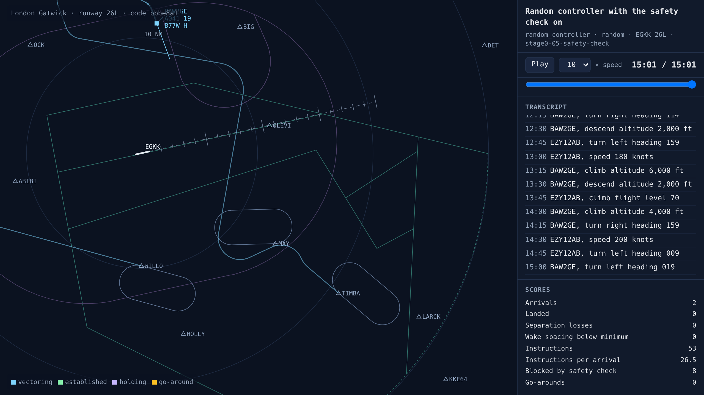

# The safety check blocks unsafe instructions

<!-- AUTO:START (regenerated by approach.milestone) -->

Milestone `stage0-05-safety-check` · 2026-11-06 · code `bbbe8a1` (check it out with `git checkout bbbe8a1`)

| Scenario | What it shows | Replay | Screenshot | Video | Scores |
| --- | --- | --- | --- | --- | --- |
| `safety_demo` | Safety check: unsafe instructions are blocked | [replay](safety_demo.html) |  | [video](safety_demo.mp4) | landed 0/2, separation losses 0, safety blocks 4, instructions 3 |
| `random_controller` | Random controller with the safety check on | [replay](random_controller.html) |  | [video](random_controller.mp4) | landed 0/2, separation losses 0, safety blocks 8, instructions 53 |

Open a replay file in a browser to watch it; it needs no server.

<!-- AUTO:END -->

## What was built

A fixed, rule-based safety check now sits between every controller and the aircraft, and it never learns. Before passing on an instruction it checks four things: altitude (not below 2,000 ft, and not below 3,000 ft more than 10 NM out), speed (160–250 kt until 4 DME), separation (looking two minutes ahead, the instruction must not bring any two aircraft within 3 NM and 1,000 ft sooner than they would otherwise get there), and airspace (no heading that leaves Gatwick's area). In the demo, two aircraft are stacked 1,000 ft apart at WILLO. Telling the upper one to descend, or the lower one to climb, is blocked because they would meet within 5 seconds. The same descent is allowed later, once they are 6 NM apart. The random-controller baseline runs with the check on: it sends one random instruction every 15 seconds, and the check blocks the ones that break the rules. Every block is logged with its reason and counted in the scores, and the scores now cover separation losses, spacing and wake minima at the runway, track miles, instructions per arrival and stable approaches.

## What went wrong and how it was fixed

- The first demo used the random controller alone. The check blocked plenty of rule-breaking instructions (speeds over 250 kt, descents below 2,000 ft), but random instructions never happened to put two aircraft on a collision course, so the separation look-ahead was never shown working. A scripted demo now tries it deliberately.
- An early version would have blocked any instruction to an aircraft that was already heading for a conflict, including the instruction meant to fix it. The check now compares the future with and without the instruction, and only blocks it if it makes a conflict happen sooner or creates a new one.
- The random baseline lands nothing, which is expected. It's the floor every real controller has to beat.

## Notes

_Your own notes for the blog or video._
