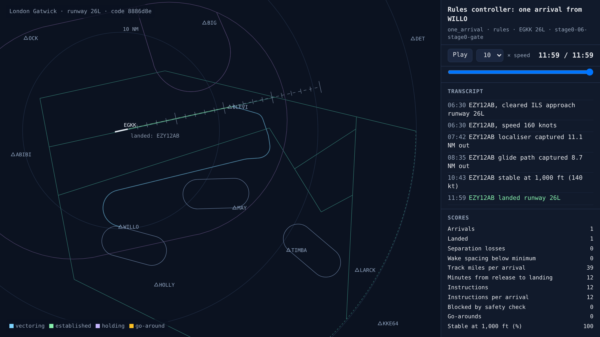
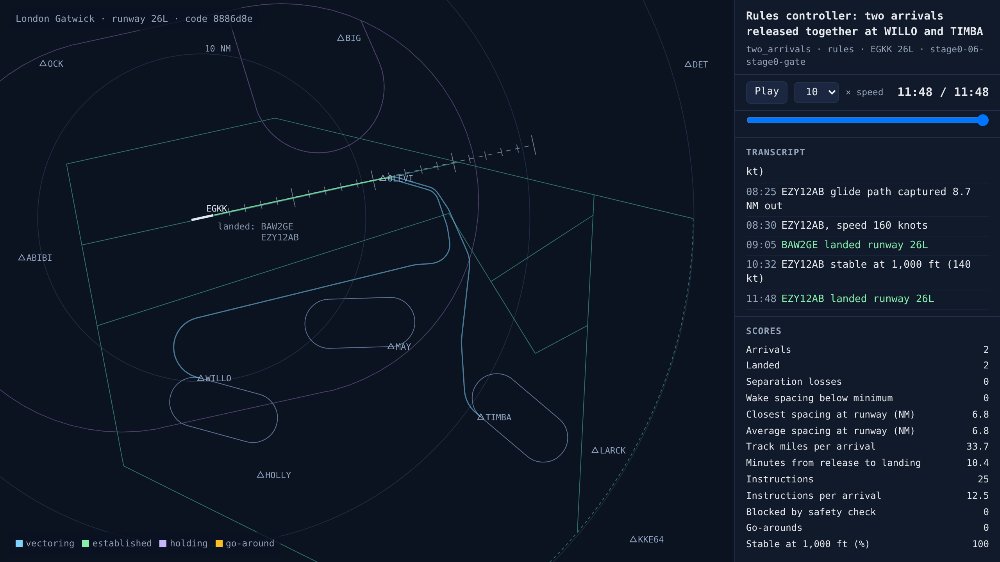
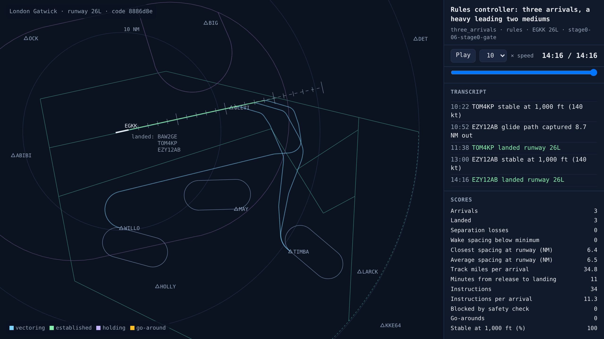
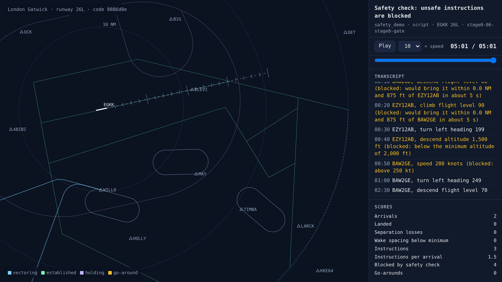

# Stage 0 complete: the gate is passed

<!-- AUTO:START (regenerated by approach.milestone) -->

Milestone `stage0-06-stage0-gate` · 2026-11-06 · code `eadbc90` (check it out with `git checkout eadbc90`)

| Scenario | What it shows | Replay | Screenshot | Video | Scores |
| --- | --- | --- | --- | --- | --- |
| `one_arrival` | Rules controller: one arrival from WILLO | [replay](one_arrival.html) |  | [video](one_arrival.mp4) | landed 1/1, separation losses 0, instructions 12 |
| `two_arrivals` | Rules controller: two arrivals released together at WILLO and TIMBA | [replay](two_arrivals.html) |  | [video](two_arrivals.mp4) | landed 2/2, separation losses 0, closest spacing at the runway 6.8 NM, instructions 25 |
| `three_arrivals` | Rules controller: three arrivals, a heavy leading two mediums | [replay](three_arrivals.html) |  | [video](three_arrivals.mp4) | landed 3/3, separation losses 0, closest spacing at the runway 6.4 NM, instructions 34 |
| `safety_demo` | Safety check: unsafe instructions are blocked | [replay](safety_demo.html) |  | [video](safety_demo.mp4) | landed 0/2, separation losses 0, safety blocks 4, instructions 3 |

Open a replay file in a browser to watch it; it needs no server.

<!-- AUTO:END -->

## What was built

Stage 0's gate was that the rules controller lands two arrivals safely, start to finish, on screen. It now does that and more. One arrival from WILLO lands in 12 minutes with 12 instructions. Two arrivals released together at WILLO and TIMBA land 6.8 NM apart. Three arrivals, a Boeing 777 followed by a 737 MAX and an A320, land at least 6.4 NM apart, clear of the wake minimum behind the heavy. Every approach is stable at 1,000 ft, there are no separation losses and no go-arounds, and the safety check blocks every unsafe instruction in its demo. Still to come in stage 0's data side: real arrivals from OpenSky instead of made-up ones, runway 08R, and scoring how real Gatwick controllers handled the same traffic.

## What went wrong and how it was fixed

- The "landed" list on the final screenshot showed aircraft in the order they first appeared, not the order they landed. It now follows landing order.
- Nothing else broke at this milestone. The fixes that got here are in the earlier entries: realistic turn rates, the timing model's corner-cutting and true airspeed, and the safety check comparing the future with and without each instruction.

## Where the rules controller breaks

Run with `python -m approach.run busy_30_per_hour` (or `busy_40_per_hour`). Arrivals alternate between WILLO and TIMBA.

| Arrivals | Rate | Landed | Separation losses | Closest spacing | Minutes per arrival |
| --- | --- | --- | --- | --- | --- |
| 8 | one every 2 min (30 an hour) | 8/8 | 0 | 6.4 NM | 14.1 |
| 12 | one every 90 s (40 an hour) | 11/12 | 3 | 5.9 NM | 15.8 |

At 40 an hour it runs out of ways to delay aircraft (it has no holds, and the downwind can only stretch so far) and out of altitudes (a fourth arrival gets the same 6,000 ft as the third).

## Why move on from stage 0: why have an agent if code can do it?

It's a fair question, and it's the central question of the project. Hand-written rules work well for the situations you think of in advance. The trouble is that each new thing needs its own rules, and those rules start interfering with each other:

- The stress test broke for two reasons, no holds and running out of altitudes. Each fix is another rule.
- Then add wind, go-arounds that need slotting back in, a runway change mid-session, a storm across the downwind, a heavy that needs a bigger gap, and an aircraft that's slow to respond. Every combination needs handling, and in practice rule-based systems get brittle and full of special cases.
- Rules are also "good enough" rather than best: first come, first served, a fixed pattern and a fixed safety margin. A learned controller might find tighter spacing, a better landing order or fewer track miles. At Gatwick, even one or two extra landings an hour would matter a lot.

## What stage 0 still leaves out

- Arrivals are made up. Real OpenSky arrivals, handed over at WILLO and TIMBA, come once historical data access is approved.
- Only runway 26L is flown. 08R uses the same code but needs its own downwind side and vectoring areas.
- There are no holds yet. With these traffic levels, stretching the downwind leg absorbs all the delay. Holding stacks are stage 4.
- The real-controller scoring (spacing, track miles and holding from real Gatwick arrivals) needs the same OpenSky data.
- The safety check uses a flat 2,000 ft minimum. The sector file's minimum-altitude areas (2,100 ft north-west, 2,300 ft north-east) are drawn on the map but not yet used.

## Notes

_Your own notes for the blog or video._
