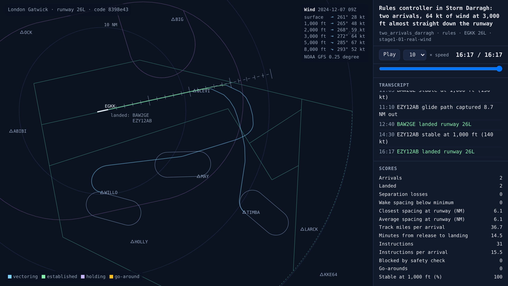
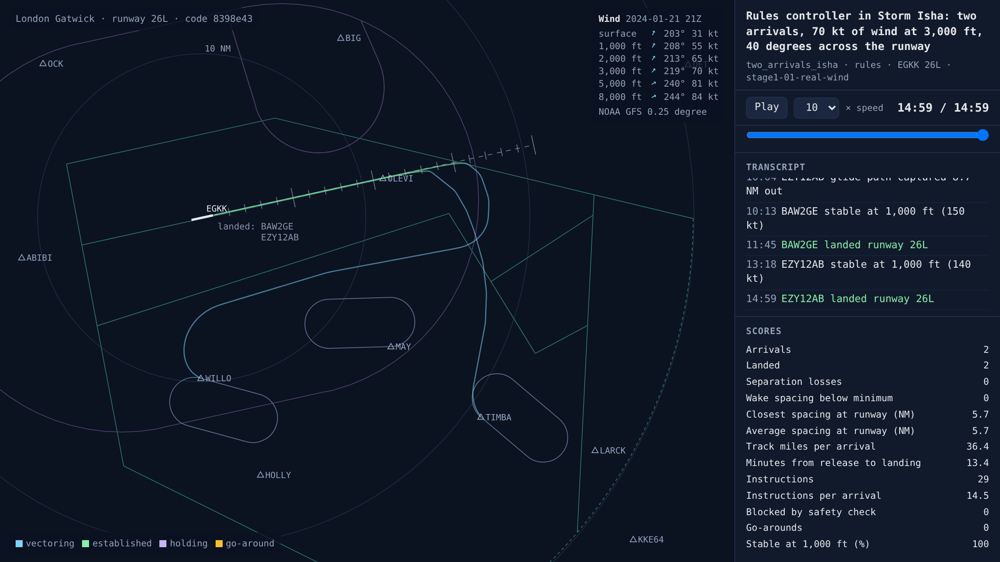
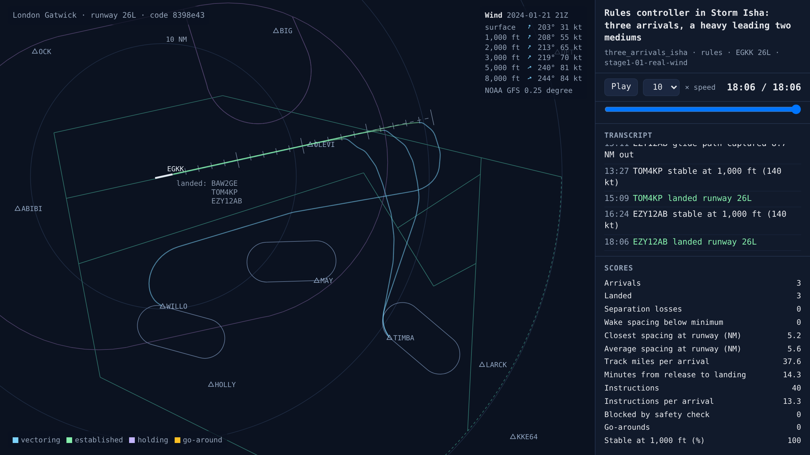

# Real winds from NOAA's weather model

<!-- AUTO:START (regenerated by approach.milestone) -->

Milestone `stage1-01-real-wind` · 2026-11-06 · code `8398e43` (check it out with `git checkout 8398e43`)

| Scenario | What it shows | Replay | Screenshot | Video | Scores |
| --- | --- | --- | --- | --- | --- |
| `two_arrivals_darragh` | Rules controller in Storm Darragh: two arrivals, 64 kt of wind at 3,000 ft almost straight down the runway | [replay](two_arrivals_darragh.html) |  | [video](two_arrivals_darragh.mp4) | landed 2/2, separation losses 0, closest spacing at the runway 6.1 NM, instructions 31, 14.5 min per arrival, wind at 3,000 ft 272°/64 kt |
| `two_arrivals_isha` | Rules controller in Storm Isha: two arrivals, 70 kt of wind at 3,000 ft, 40 degrees across the runway | [replay](two_arrivals_isha.html) |  | [video](two_arrivals_isha.mp4) | landed 2/2, separation losses 0, closest spacing at the runway 5.7 NM, instructions 29, 13.4 min per arrival, wind at 3,000 ft 219°/70 kt |
| `three_arrivals_isha` | Rules controller in Storm Isha: three arrivals, a heavy leading two mediums | [replay](three_arrivals_isha.html) |  | [video](three_arrivals_isha.mp4) | landed 3/3, separation losses 0, closest spacing at the runway 5.2 NM, instructions 40, 14.3 min per arrival, wind at 3,000 ft 219°/70 kt |

Open a replay file in a browser to watch it; it needs no server.

<!-- AUTO:END -->

## What was built

Any scenario can now fly in the real winds of any past hour since 2021, from NOAA's GFS weather model, which is free on NOAA's open data store. The wind comes at every height from the surface to about 14,000 ft, on a grid of points about 17 by 28 km apart around Gatwick, and the radar replay shows it in its top right corner. Try any hour with `python -m approach.run two_arrivals --weather 2024-12-07T09`.

GFS agrees with Gatwick's own weather reports at the surface. For Storm Darragh (7 December 2024, 09Z) it gives 261° at 28 kt against Gatwick's report of 260° at 30 kt gusting 41. For Storm Isha (21 January 2024, 21Z) it gives 203° at 31 kt against 210° at 25 kt gusting 38. Higher up the winds were far stronger: 64 kt at 3,000 ft in Darragh, almost straight down runway 26L, and 70 kt in Isha, about 40° across it.

Pilots now fly in wind as real ones do. An assigned heading drifts with the wind; on the localiser, and when flying direct to a fix, they correct for it. The safety check also allows for the wind when it predicts where each aircraft will be.

This is the first step of stage 1: the stage 0 rules controller, unchanged, in real winds. It doesn't know there is any wind.

## The rules controller in real wind

Closest spacing at the runway, and minutes from release to landing per arrival:

| Traffic | Calm day (15 Jan 2025, 12Z) | Storm Darragh | Storm Isha |
| --- | --- | --- | --- |
| Two arrivals | 7.5 NM, 10.6 min | 6.1 NM, 14.5 min | 5.7 NM, 13.4 min |
| Three arrivals, a heavy leading two mediums | 6.4 NM, 11.0 min | 6.3 NM, 15.7 min | 5.2 NM, 14.3 min |
| Busy hour: 8 arrivals, one every 2 minutes | 6.1 NM, 14.2 min | 5.8 NM, 21.4 min | 4.8 NM, 18.1 min |

Everything landed, with no separation losses, no wake infringements and no go-arounds. The busy hour in Darragh had 4 instructions blocked by the safety check (three descents into traffic and one heading out of the airspace), and in Isha 1.

- **It stays safe,** because the safety check and the final approach rules leave margin.
- **Its spacing falls short of its own 6 NM target,** down to 4.8 NM in Isha's busy hour. Its timing assumes 150 kt over the ground on final. Into a 55 kt headwind the aircraft on final are much slower over the ground, while the one behind still has the wind behind it on the downwind, so gaps planned for still air close up.
- **Every arrival takes longer:** up to half as long again in Darragh. Some of that is unavoidable (a headwind on final is slow for everyone), but it is also the cost of gaps that weren't planned for the wind.

So the rules controller is not yet a fair competitor for the AI. The next steps are the other variations, then giving it the obvious fixes (timing with the wind) and freezing it.

## What went wrong and how it was fixed

- **Instructions given together were sometimes flown in the wrong order.** Each instruction had its own random pilot delay of 3 to 6 seconds, so when the rules controller sent "turn left heading 230" and then "turn left heading 285" in one transmission, the pilot sometimes ended up on 230. In Isha that left one aircraft flying away from the localiser into a 70 kt headwind for ten minutes before it went around. Pilots now act on instructions in the order they were given. This bug was in stage 0 too. With it fixed, stage 0's no-wind results change slightly: two arrivals land 7.2 NM apart (was 6.8) with 24 instructions (was 25), three arrivals 6.6 NM apart (was 6.4) with 36 instructions (was 34), and the busy hour 6.3 NM (was 6.4). The stage 0 entries stay as they were recorded.
- **BlueSky's own GFS plugin downloads from a NOAA address that no longer exists.** NOAA's AWS store has the same model, so we download just the wind and height fields from there and give BlueSky the wind field ourselves.
- **The simulated autopilot only captured the localiser at track angles up to 50°.** In a strong crosswind a 30° intercept heading becomes a much steeper track over the ground, so one aircraft flew straight through. Real autopilots still capture and just overshoot more, so the limit is now 70°.
- **The spacing score counted an aircraft that wasn't on final.** It measured where the next aircraft was when the leader landed, even if that aircraft was going around. Only aircraft established on final count now.

## What's next

- The other variations: pilots holding their speed only within 10 kt, descent rates that vary by aircraft type and pilot, and random release times and aircraft types.
- About 200 sessions each across many real hours, not three hand-picked ones.
- Then the rules controller's fixes, and freezing it as the baseline the AI has to beat.

## Notes

_Your own notes for the blog or video._
