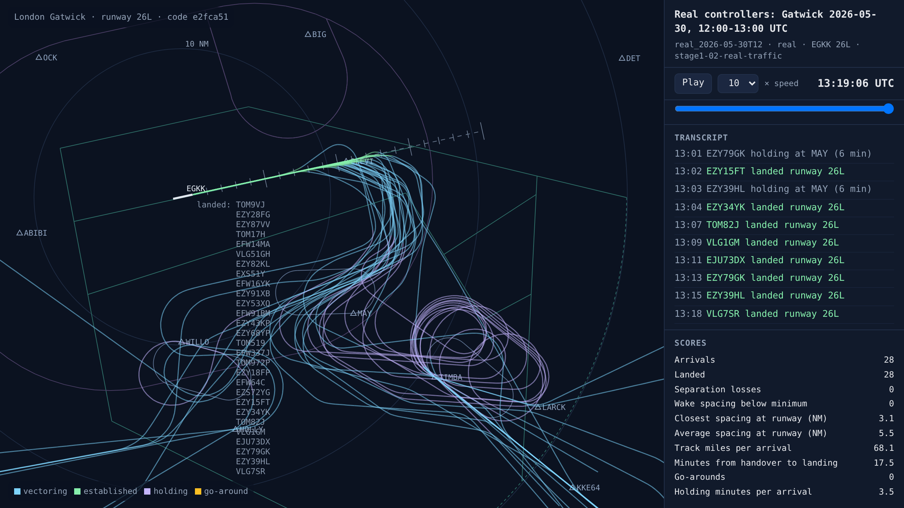
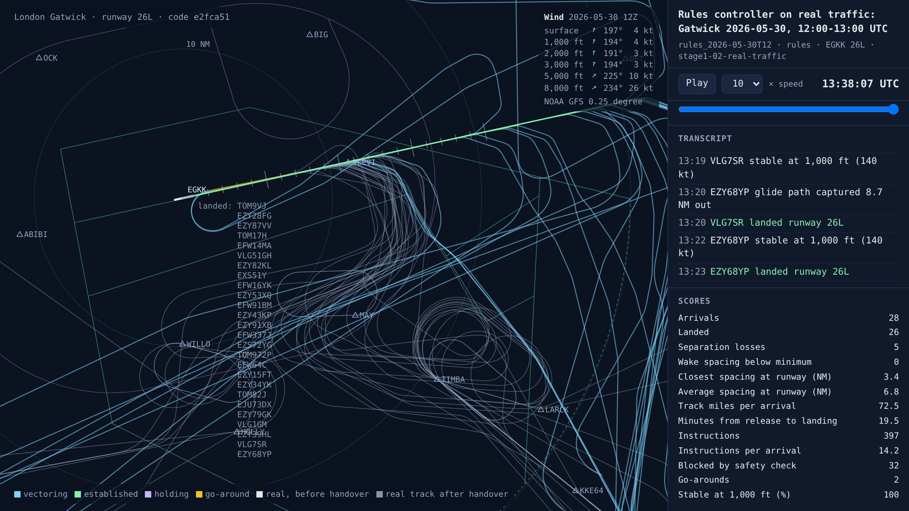
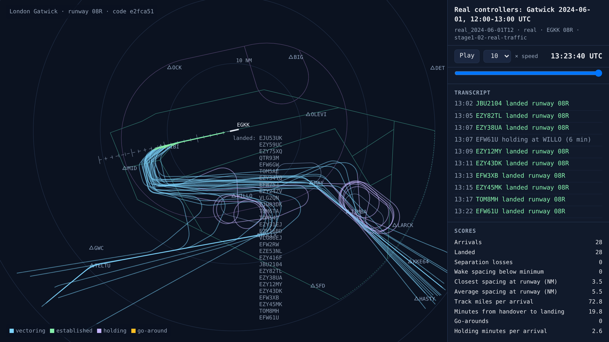
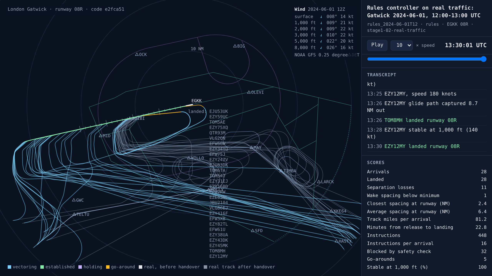
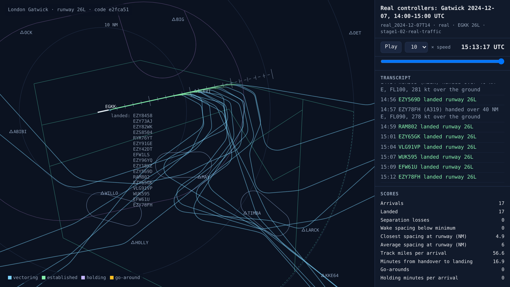
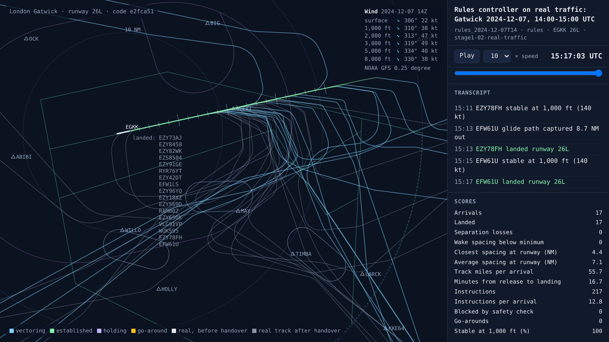

# Real Gatwick traffic: the rules controller against real controllers

<!-- AUTO:START (regenerated by approach.milestone) -->

Milestone `stage1-02-real-traffic` · 2026-11-06 · code `78215e4` (check it out with `git checkout 78215e4`)

| Scenario | What it shows | Replay | Screenshot | Video | Scores |
| --- | --- | --- | --- | --- | --- |
| `real_2026-05-30T12` | Real controllers: Gatwick 2026-05-30, 12:00-13:00 UTC | [replay](real_2026-05-30T12.html) |  | [video](real_2026-05-30T12.mp4) | landed 28/28, separation losses 0, closest spacing at the runway 3.1 NM, 17.5 min per arrival |
| `rules_2026-05-30T12` | Rules controller on real traffic: Gatwick 2026-05-30, 12:00-13:00 UTC | [replay](rules_2026-05-30T12.html) |  | [video](rules_2026-05-30T12.mp4) | landed 26/28, separation losses 5, closest spacing at the runway 3.4 NM, safety blocks 32, instructions 397, go-arounds 2, 19.5 min per arrival, wind at 3,000 ft 194°/3 kt |
| `real_2024-06-01T12` | Real controllers: Gatwick 2024-06-01, 12:00-13:00 UTC | [replay](real_2024-06-01T12.html) |  | [video](real_2024-06-01T12.mp4) | landed 28/28, separation losses 0, closest spacing at the runway 3.5 NM, 19.8 min per arrival |
| `rules_2024-06-01T12` | Rules controller on real traffic: Gatwick 2024-06-01, 12:00-13:00 UTC | [replay](rules_2024-06-01T12.html) |  | [video](rules_2024-06-01T12.mp4) | landed 28/28, separation losses 11, closest spacing at the runway 2.4 NM, safety blocks 32, instructions 448, go-arounds 5, 22.8 min per arrival, wind at 3,000 ft 010°/22 kt |
| `real_2024-12-07T14` | Real controllers: Gatwick 2024-12-07, 14:00-15:00 UTC | [replay](real_2024-12-07T14.html) |  | [video](real_2024-12-07T14.mp4) | landed 17/17, separation losses 0, closest spacing at the runway 4.9 NM, 16.9 min per arrival |
| `rules_2024-12-07T14` | Rules controller on real traffic: Gatwick 2024-12-07, 14:00-15:00 UTC | [replay](rules_2024-12-07T14.html) |  | [video](rules_2024-12-07T14.mp4) | landed 17/17, separation losses 0, closest spacing at the runway 4.4 NM, instructions 217, 16.7 min per arrival, wind at 3,000 ft 319°/49 kt |

Open a replay file in a browser to watch it; it needs no server.

<!-- AUTO:END -->

## What was built

The simulator now runs on real Gatwick traffic. It comes from [adsb.lol](https://www.adsb.lol), which publishes every aircraft its volunteer receivers see, every day since late December 2023, under an open licence (ODbL). OpenSky only gives its full data to research institutions, and the EUROCONTROL PRC dataset covers about 11 Gatwick arrivals a day, so neither was enough.

- **60 days chosen from Gatwick's weather reports:** storms, strong wind, easterly days on runway 08R, low visibility, busy summer days and ordinary days in every season. One day in four of each kind is kept for testing only. 17 have been processed so far, with 5,482 real arrivals; the rest are downloading.
- **Every arrival is found automatically:** when and where it was handed over, whether it held and for how long, any go-arounds, which runway it landed on and when it crossed the threshold, and its full track.
- **The handover is no longer at WILLO or TIMBA.** Not every arrival goes over them: some get a heading or a direct from the previous controller first. The AI now takes each one over the first time it is within 40 NM of Gatwick and at or below FL150, wherever it really is and whatever it is doing. On a busy summer day most cross that line between 36 and 45 NM out, and about a third go on to hold.
- **Real controllers are scored by the same code as ours.** A real hour is turned into the same kind of session log the simulator writes, so every number below is measured the same way for both. Their instruction counts can't be measured, because what they said isn't in the data.
- **The same hour can be run in the simulator.** Every real arrival is released at its real handover position, level, speed and track, in that hour's real winds from NOAA's weather model.
- **Ghost tracks on the radar.** In our controller's replays, each real aircraft shows in white until it is handed over. It then becomes ours, in colour, and its real track carries on in faint grey behind, so you can watch what the real controllers did with the same aircraft. The clock shows real UTC time. This is the look a live demo would have, fed by adsb.lol's live feed instead of a past day.

## The rules controller against real controllers

The same real arrivals, each hour starting empty, scored the same way:

| Real hour | Arrivals | Who | Landed | Separation losses | Go-arounds | Closest landing gap | Average gap | Minutes from handover to landing |
| --- | --- | --- | --- | --- | --- | --- | --- | --- |
| 30 May 2026, 12:00, runway 26L | 28 | Real controllers | 28 | 0 | 0 | 3.1 NM | 5.5 NM | 17.5 |
| | | Rules controller | 26 | 5 | 2 | 3.4 NM | 6.8 NM | 19.5 |
| 1 June 2024, 12:00, runway 08R | 28 | Real controllers | 28 | 0 | 0 | 3.5 NM | 5.5 NM | 19.8 |
| | | Rules controller | 28 | 11 | 5 | 2.4 NM | 6.4 NM | 22.8 |
| Storm Darragh, 7 December 2024, 14:00 | 17 | Real controllers | 17 | 0 | 0 | 4.9 NM | 6.0 NM | 16.9 |
| | | Rules controller | 17 | 0 | 0 | 4.4 NM | 7.1 NM | 16.7 |

In a quieter hour, even a storm one, the rules controller keeps up. In a real busy hour, with 28 arrivals coming from every direction and some already heading for the holds, it falls apart: separation losses, go-arounds, and arrivals taking two to three minutes longer. The real controllers handled the same aircraft with none of those. The screenshots show why: in grey, the real controllers held aircraft in tight stacks at WILLO and TIMBA. In blue, the rules controller, which has no holds, sent them on long downwind legs far to the east and north. This is the clearest evidence yet for the case for an AI: the hand-written rules that worked on made-up traffic don't cope with the real thing.

It also shows the target: real controllers land busy-hour aircraft about 5.5 NM apart on average, closest 3.1 NM, with departures in between on the single runway. The rules controller aims for 6 NM.

## How real arrivals fly

Across the 17 days so far, while descending between 10,000 and 3,000 ft:

| Type | Flights | Typical descent (ft/min) | Slowest 10% | Fastest 10% | Ground speed at 4 NM |
| --- | --- | --- | --- | --- | --- |
| A320 | 1,707 | 900 | 640 | 1,220 | 142 kt |
| A319 | 973 | 830 | 640 | 1,220 | 143 kt |
| A21N | 611 | 900 | 640 | 1,220 | 138 kt |
| B738 | 507 | 830 | 580 | 1,150 | 146 kt |
| B772 | 167 | 900 | 580 | 1,150 | 143 kt |
| B789 | 116 | 960 | 640 | 1,220 | 146 kt |

Real arrivals come down at roughly 900 ft/min, much slower than the simulator's fixed 1,500 ft/min, and the spread between slow and fast descenders is about two to one. These are the numbers for stage 1's descent-rate variation. Run `python -m approach.data.profiles <days>` for every type.

## What went wrong and how it was fixed

- **Landing times were minutes out.** Receivers often lose aircraft in the last few feet and pick them up again minutes later on the taxiway. Interpolating across that gap made landings look seconds apart. Touchdown is now worked out from the last point before the threshold and the aircraft's ground speed. The shortest gap between real landings is now 76 seconds, which is realistic.
- **Storm Darragh's day showed only 8 arrivals.** That day the receivers hardly ever saw aircraft on the ground (1 of 202 low passes), so landings weren't recognised. A track that ends lined up on final, below 1,500 ft and inside 4 NM or over the runway, now counts as a landing: 239 arrivals, with 15 go-arounds.
- **Real controllers seemed to lose separation all the time.** Most of the "losses" were pairs 2.9 NM apart on the same final, or aircraft stacked 1,000 ft apart in a hold whose reported altitudes came out a little under 1,000 ft apart. UK and EASA rules (AMC1 ATS.TR.210(c)(2)) allow 2.5 NM between aircraft established on the same final within 10 NM, where approved, and ADS-B reports altitude in 25 ft steps. The scoring now uses 2.5 NM on final and allows 100 ft for altitude reporting, for every controller. Whether Gatwick is approved for 2.5 NM still needs checking with a controller.
- **Every arrival used to start at a hold, flying the hold's inbound course.** Real arrivals now start at their real position, with the heading and airspeed that give their real track and ground speed in that hour's wind.

## What's next

- Finish the other 43 days, then score the real controllers on every hour of all 60.
- Stage 1a: the training setup, with real arrival streams, real winds and real descent rates, and the first AI trained on it.
- The live demo, later: the same radar fed by adsb.lol's live feed.

## Notes

_Your own notes for the blog or video._
