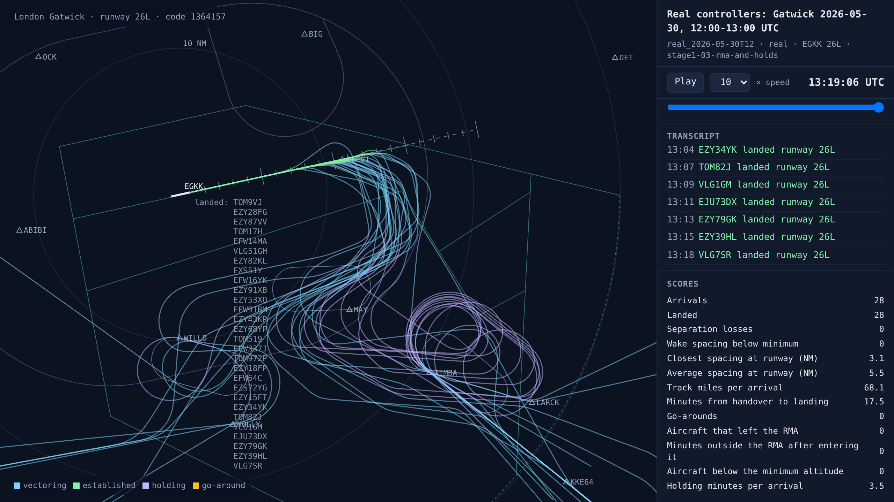
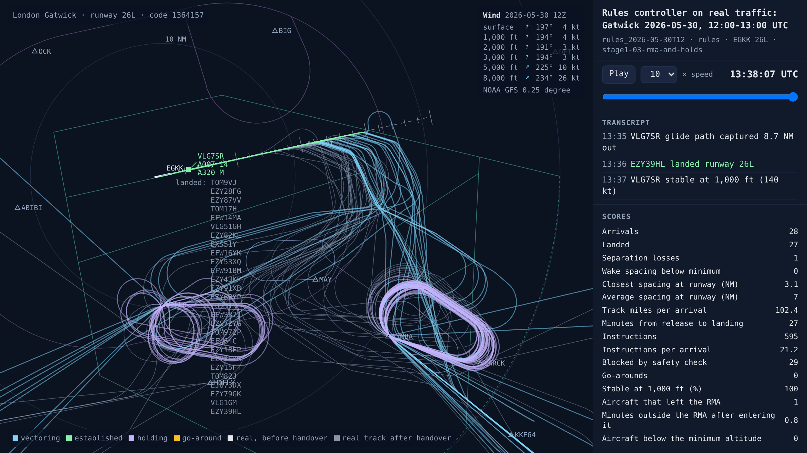
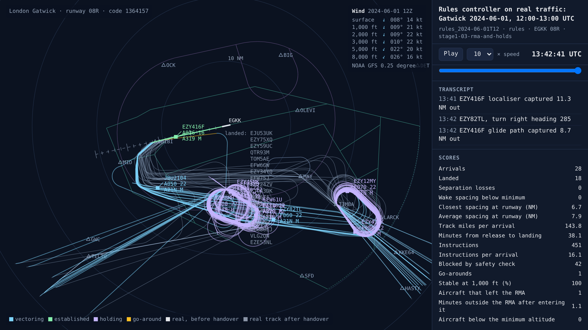
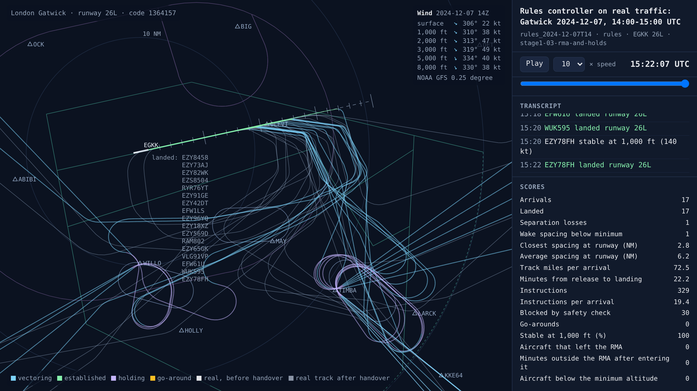
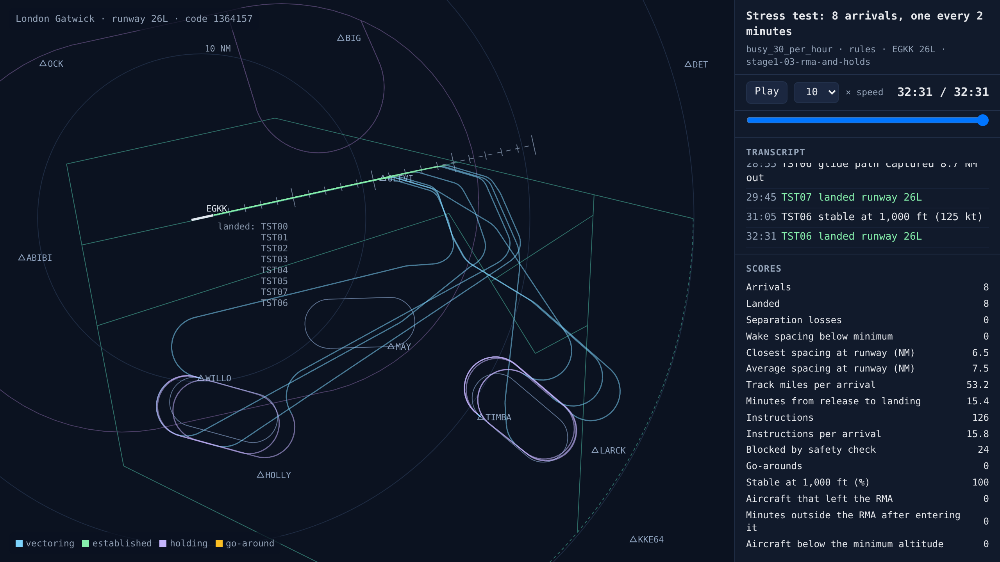
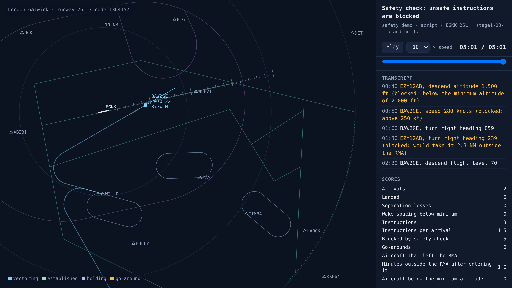

# Staying inside the RMA: holds instead of long downwinds

<!-- AUTO:START (regenerated by approach.milestone) -->

Milestone `stage1-03-rma-and-holds` · 2026-11-06 · code `25475e0` (check it out with `git checkout 25475e0`)

| Scenario | What it shows | Replay | Screenshot | Video | Scores |
| --- | --- | --- | --- | --- | --- |
| `real_2026-05-30T12` | Real controllers: Gatwick 2026-05-30, 12:00-13:00 UTC | [replay](real_2026-05-30T12.html) |  | [video](real_2026-05-30T12.mp4) | landed 28/28, separation losses 0, closest spacing at the runway 3.1 NM, 17.5 min per arrival |
| `rules_2026-05-30T12` | Rules controller on real traffic: Gatwick 2026-05-30, 12:00-13:00 UTC | [replay](rules_2026-05-30T12.html) |  | [video](rules_2026-05-30T12.mp4) | landed 27/28, separation losses 1, closest spacing at the runway 3.1 NM, safety blocks 29, instructions 595, 27.0 min per arrival, wind at 3,000 ft 194°/3 kt |
| `rules_2024-06-01T12` | Rules controller on real traffic: Gatwick 2024-06-01, 12:00-13:00 UTC | [replay](rules_2024-06-01T12.html) |  | [video](rules_2024-06-01T12.mp4) | landed 18/28, separation losses 0, closest spacing at the runway 6.7 NM, safety blocks 42, instructions 451, go-arounds 1, 38.1 min per arrival, wind at 3,000 ft 010°/22 kt |
| `rules_2024-12-07T14` | Rules controller on real traffic: Gatwick 2024-12-07, 14:00-15:00 UTC | [replay](rules_2024-12-07T14.html) |  | [video](rules_2024-12-07T14.mp4) | landed 17/17, separation losses 1, closest spacing at the runway 2.8 NM, safety blocks 30, instructions 329, 22.2 min per arrival, wind at 3,000 ft 319°/49 kt |
| `busy_30_per_hour` | Stress test: 8 arrivals, one every 2 minutes | [replay](busy_30_per_hour.html) |  | [video](busy_30_per_hour.mp4) | landed 8/8, separation losses 0, closest spacing at the runway 6.5 NM, safety blocks 24, instructions 126, 15.4 min per arrival |
| `safety_demo` | Safety check: unsafe instructions are blocked | [replay](safety_demo.html) |  | [video](safety_demo.mp4) | landed 0/2, separation losses 0, safety blocks 5, instructions 3 |

Open a replay file in a browser to watch it; it needs no server.

<!-- AUTO:END -->

## What was built

James spotted it in the last entry's videos: the rules controller was vectoring aircraft well outside Gatwick's RMA, the radar manoeuvring area, which is different for each runway direction. Outside it, aircraft can meet traffic that isn't Gatwick's.

- **The RMA and minimum-altitude areas as real areas.** The sector file draws them for display, as lines and short dashes with dividing lines inside, so they are joined up and filled. For westerlies the RMA reaches about 30 NM east and 25 NM south of Gatwick but only about 6 NM north, where Heathrow's airspace is; its northern edge meets the 26L final approach track about 22 NM out. WILLO, TIMBA and MAY are all inside it.
- **The safety check keeps vectoring inside the RMA.** Inside it, a heading must keep the aircraft inside for the next minute (or until it crosses the final approach track), and must not leave it worse off than its current heading. Outside it, an aircraft may only be turned towards it, sent direct to a fix or held. Minimum altitudes now depend on where the aircraft is and is heading: 2,000 ft inside the minimum-altitude area, 3,000 ft outside it. These apply to every controller, and the AI will learn with them from the start.
- **Holds.** The simulated pilots fly the published holds: racetracks at WILLO (left turns) and TIMBA (right turns), with one-minute legs. The rules controller now sends each arrival direct to its hold, stacks them 1,000 ft apart from FL70, and takes them off the hold only when their landing slot can be made with a downwind inside the RMA.
- **New scores, for every controller:** aircraft that left the RMA after entering it, minutes spent outside it, and aircraft that went below the minimum altitude. For real controllers, ADS-B altitudes (set to 1013 hPa) are corrected to that hour's QNH from Gatwick's weather reports first. Otherwise, on a high-pressure day, an aircraft at 3,000 ft would read about 2,430 ft and look too low.
- **Questions for a Gatwick controller** ([docs/questions-for-a-gatwick-controller.md](../../docs/questions-for-a-gatwick-controller.md)): 20 questions on what the simulator still guesses at, starting with whether an arrival can ever be vectored outside the RMA.

## Results

The same three real hours as the last entry, scored the same way:

| Real hour | Who | Landed | Separation losses | Go-arounds | Left the RMA | Minutes per arrival |
| --- | --- | --- | --- | --- | --- | --- |
| 30 May 2026, 12:00, 26L (28 arrivals) | Real controllers | 28 | 0 | 0 | 0 | 17.5 |
| | Rules controller before | 26 | 5 | 2 | 12 aircraft, 113 minutes | 19.5 |
| | Rules controller now | 27 | 1 | 0 | 1 aircraft, under a minute | 27.0 |
| 1 June 2024, 12:00, 08R (28) | Real controllers | 28 | 0 | 0 | 0 | 19.8 |
| | Rules controller before | 28 | 11 | 5 | 17 aircraft, 154 minutes | 22.8 |
| | Rules controller now | 18 in the session | 0 | 1 | 1 aircraft, about a minute | 38.1 |
| Storm Darragh, 7 December 2024, 14:00 (17) | Real controllers | 17 | 0 | 0 | 0 | 16.9 |
| | Rules controller before | 17 | 0 | 0 | 4 aircraft, 15 minutes | 16.7 |
| | Rules controller now | 17 | 1 | 0 | 0 | 22.2 |

The real controllers never left the RMA and never went below a minimum altitude in any of the three hours, which is also a good check that the areas are about right.

The rules controller is now much safer but much slower. It holds most arrivals, flies about 100 track miles each instead of the real controllers' 68, and in the busy easterly hour it can't keep up: only 18 of the 28 had landed by the end of the session. The reason is its spacing. It aims for 6 NM plus a margin, which caps it at about 23 landings an hour, while the real controllers landed 28 in the hour at about 5.5 NM apart on average. Staying inside the RMA, landing at the real rate and never losing separation, all at once, is exactly the job the AI has to learn.

The stage 0 scenarios still pass: everything lands with no separation losses, and the busy 30-an-hour test now uses holds instead of long downwinds.

## What went wrong and how it was fixed

- **The first version of the RMA rule was too strict.** It assumed an aircraft would hold each heading for two full minutes. Near the 26L final, where the RMA's northern edge is close, it blocked the turn onto base and the intercept even though the aircraft would join the localiser long before reaching the edge. Blocking those corrections also left one aircraft flying straight out of the RMA on its old heading. The rule now looks one minute ahead, stops where the path crosses the final approach track, and only blocks a heading that leaves the aircraft worse off than its current one.
- **A blocked intercept left an aircraft flying away.** When the separation check blocked the rules controller's turn onto the localiser, the controller still cleared the aircraft for the ILS and stopped watching it. On a heading 90° to the runway it couldn't capture, and it flew north out of the RMA, once as far as 158 NM. A blocked intercept now goes back to base and tries again, and an aircraft that crosses final without capturing is re-sequenced.
- **The minimum-altitude drawing has no altitudes in it.** It only draws the outline, so we use 2,000 ft inside and 3,000 ft outside until a Gatwick controller confirms the real values (question 4).

## What's next

- Put the questions to a Gatwick controller, through VATSIM UK first.
- Other traffic: replay Gatwick's departures, Heathrow's traffic and overflights from the real data as traffic we can't instruct, and score any conflict with them.
- Stage 1a: the training setup, and the first trained AI.

## Notes

_Your own notes for the blog or video._
