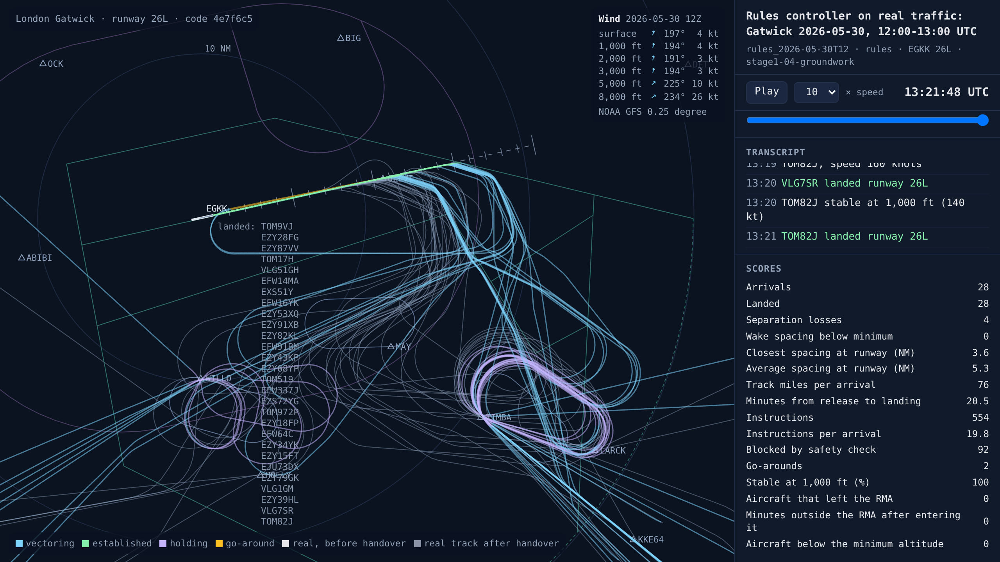
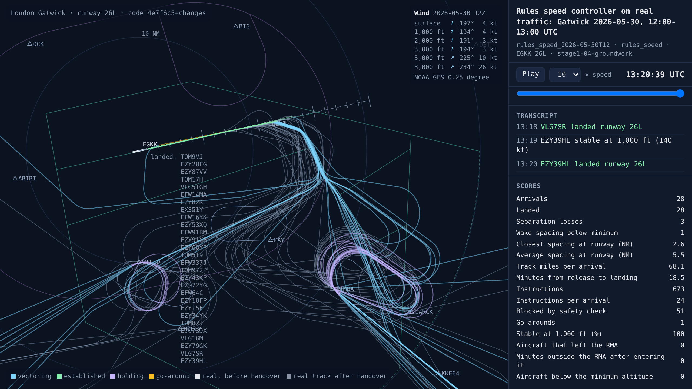
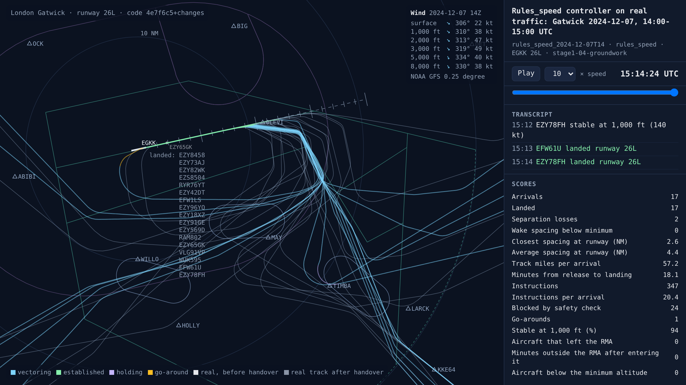

# Stage 1a groundwork: a faster simulator, the competitor and the training world

<!-- AUTO:START (regenerated by approach.milestone) -->

Milestone `stage1-04-groundwork` · 2026-11-09 · code `4e7f6c5` (check it out with `git checkout 4e7f6c5`)

| Scenario | What it shows | Replay | Screenshot | Video | Scores |
| --- | --- | --- | --- | --- | --- |
| `rules_2026-05-30T12` | Rules controller on real traffic: Gatwick 2026-05-30, 12:00-13:00 UTC | [replay](rules_2026-05-30T12.html) |  | [video](rules_2026-05-30T12.mp4) | landed 28/28, separation losses 4, closest spacing at the runway 3.6 NM, safety blocks 92, instructions 554, go-arounds 2, 20.5 min per arrival, wind at 3,000 ft 194°/3 kt |
| `rules_speed_2026-05-30T12` | Speed-only rules controller on real traffic: Gatwick 2026-05-30, 12:00-13:00 UTC | [replay](rules_speed_2026-05-30T12.html) |  | [video](rules_speed_2026-05-30T12.mp4) | landed 28/28, separation losses 3, closest spacing at the runway 2.6 NM, safety blocks 51, instructions 673, go-arounds 1, 18.5 min per arrival, wind at 3,000 ft 194°/3 kt |
| `rules_speed_2024-12-07T14` | Speed-only rules controller on real traffic: Gatwick 2024-12-07, 14:00-15:00 UTC | [replay](rules_speed_2024-12-07T14.html) |  | [video](rules_speed_2024-12-07T14.mp4) | landed 17/17, separation losses 2, closest spacing at the runway 2.6 NM, safety blocks 24, instructions 347, go-arounds 1, 18.1 min per arrival, wind at 3,000 ft 319°/49 kt |

Open a replay file in a browser to watch it; it needs no server.

<!-- AUTO:END -->

## What was built

Everything the first AI needs before it can start learning: a faster simulator, the competitor it has to beat, and the world it practises in.

- **A simulator about ten times faster.** Training needs hundreds of thousands of practice sessions, and a real hour took 2.5 minutes to simulate. Profiling showed why: BlueSky stepped 20 times per simulated second, and half its time went on looking up the wind. Stepping every 0.5 seconds, and having the simulated pilots send a heading only when it changes (each heading command costs BlueSky a wind calculation), brings a real hour down to about 16 seconds. The tests and the Storm Darragh hour give exactly the same results as before.
- **Downwinds south of the centreline.** Gatwick's departure routes are to the north, and real controllers keep arrivals south of the extended centreline: in the real data, over 99% of 26L arrivals and about 97% of 08R arrivals never go more than 1 NM north of it. The rules controller now always puts the downwind on the south side.
- **The competitor: a speed-only rules controller.** In stage 1a the AI controls only speeds, so it is measured against a hand-written controller with exactly the same job. Every arrival flies the same fixed path, joining final at 11 NM, and leaves the hold only when speed alone can make its landing slot. Every 10 seconds it steps each aircraft's speed by 10 or 20 kt towards its slot, inside the published speed bands (up to 250 kt on the downwind, 160–180 kt on base and final, the pilot's own speeds inside 7 NM). The AI gets exactly the same steps and bands, so the only difference is how they choose.
- **The training world.** Each practice session is a real hour of arrivals from the 46 training days, starting at a random minute, in real winds (sometimes another hour's) and with pilots whose delays and drift come from a fresh seed, so it never sees the same session twice. Every 10 seconds the AI looks at the aircraft in the landing sequence, in landing order, and picks a speed step for each. It sees them in relative terms: track miles to go, the gap to the aircraft ahead and how fast it is closing, the gap it needs, the gap behind, wake category, height against the 3-to-1 profile, its margins above the minimum altitude and inside the RMA, its position from the runway and the headwind. The score has a weight for every term, recorded with every run.
- **Measured speed.** The training world makes about 25 decisions a second on one core and 57 on four, while downloads were sharing the processor. A million decisions, the first training run, takes about 5 hours.
- **New test days.** Storm Bert (24 November 2024) and Storm Amy (4 October 2025) join the test set, which had no storm before, and the most recent fortnight starts a rolling test set that no version of the AI will train on.

## Results

**The speed-only competitor holds its own against the full rules controller.** On the busy hour of 30 May 2026 (a test day, so the AI never practises on it) it takes 18.5 minutes per arrival against 20.5, with 3 separation losses against 4. On the 08R busy hour of 1 June 2024 it lands 25 of 28 arrivals within the session against 17. Holding until speed alone can make the slot turns out to work better than stretching the downwind.

**But it still lets pairs close up on final.** Its closest pairs come to 2.4–2.6 NM, and it has 2 or 3 separation losses an hour on busy traffic. Stage 1a's gate asks the AI for none, with gaps closer to target and no more speed instructions.

| Hour | Controller | Landed | Separation losses | Go-arounds | Minutes per arrival |
| --- | --- | --- | --- | --- | --- |
| 30 May 2026, 12:00 | Rules controller | 28 of 28 | 4 | 2 | 20.5 |
| 30 May 2026, 12:00 | Speed-only rules controller | 28 of 28 | 3 | 1 | 18.5 |
| Storm Darragh, 7 Dec 2024, 14:00 | Speed-only rules controller | 17 of 17 | 2 | 1 | 18.1 |
| Real controllers, 30 May 2026, 12:00 | (from the ADS-B data) | 28 of 28 | 0 | 0 | 17.5 |

## What went wrong and how it was fixed

- **Single busy hours are chaotic.** The rules controller's separation losses on the 30 May hour swing between 4 and 8 from tiny changes: the time step, or whether a pilot re-sends an unchanged heading. Small differences early on snowball. So no controller is judged on one session: the AI's test flies 120 sessions from the test days, and the competitor flies exactly the same ones.
- **The training libraries started downloading the GPU build of PyTorch,** several gigabytes of NVIDIA libraries on a machine without a GPU. The CPU build is a fraction of the size, and the README now says to install it first.
- **Gatwick's weather archive asked for slower requests** (HTTP 429) while two downloads were running at once. The script that adds test days now waits and retries.

## Notes

_Your own notes for the blog or video._
