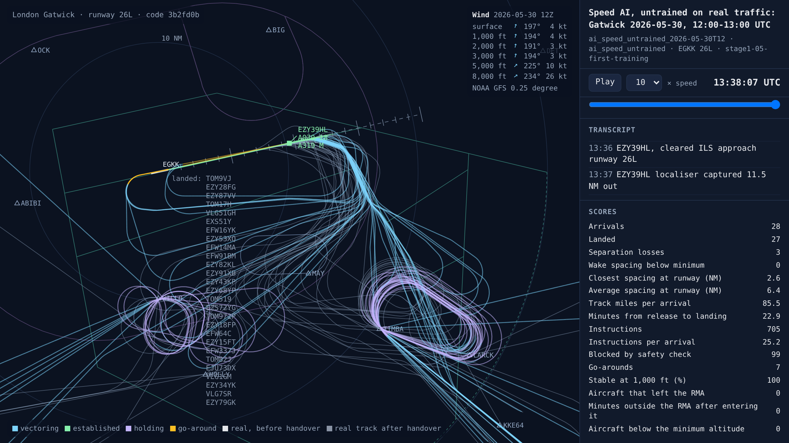
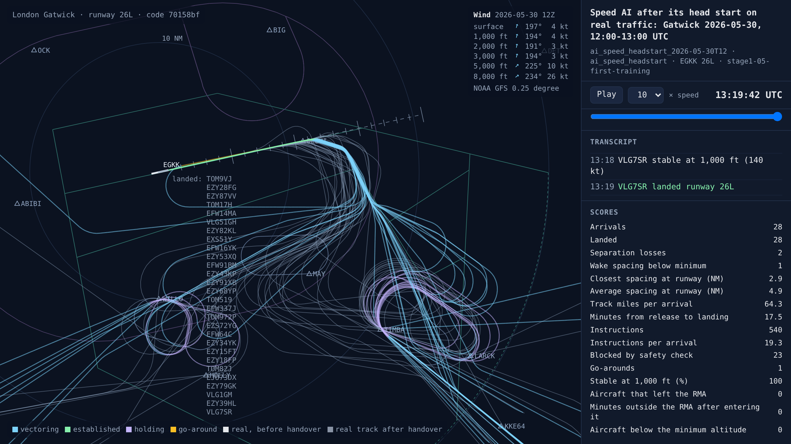
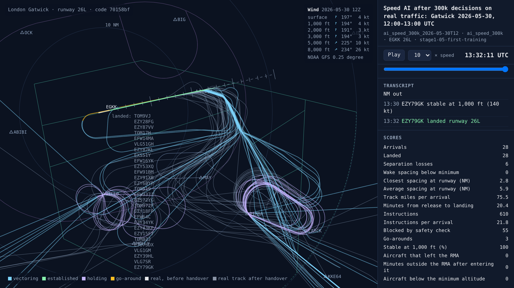
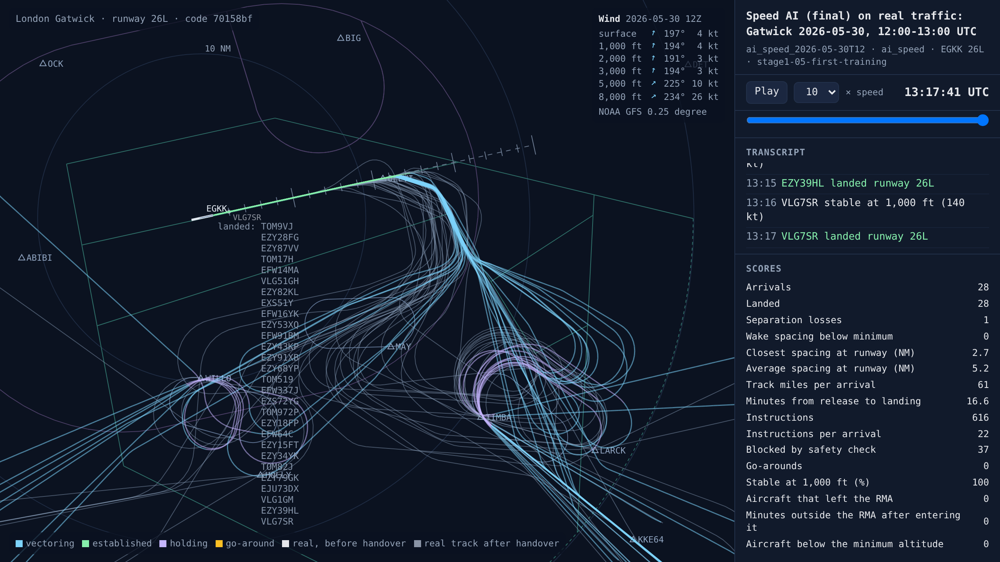
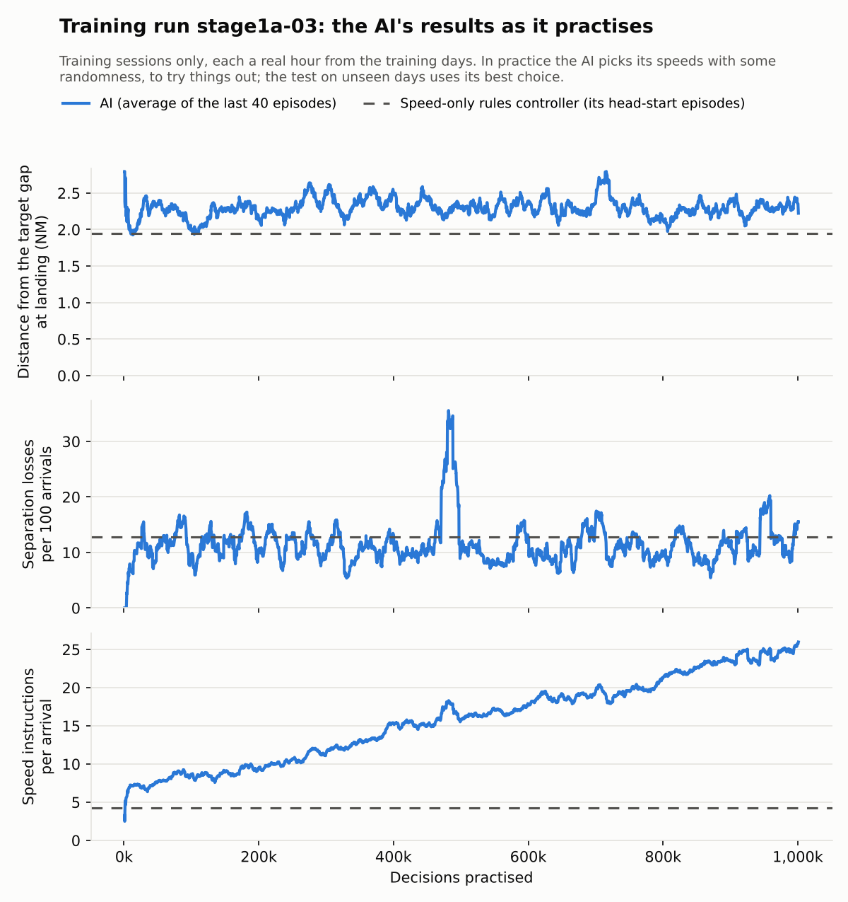

# Stage 1a, first training run: a million decisions of practice, and no better than its head start

<!-- AUTO:START (regenerated by approach.milestone) -->

Milestone `stage1-05-first-training` · 2026-11-09 · code `3b2fd0b` (check it out with `git checkout 3b2fd0b`)

| Scenario | What it shows | Replay | Screenshot | Video | Scores |
| --- | --- | --- | --- | --- | --- |
| `rules_speed_2026-05-30T12` | Speed-only rules controller on real traffic: Gatwick 2026-05-30, 12:00-13:00 UTC | [replay](rules_speed_2026-05-30T12.html) |  | [video](rules_speed_2026-05-30T12.mp4) | landed 28/28, separation losses 3, closest spacing at the runway 2.6 NM, safety blocks 41, instructions 581, go-arounds 2, 17.6 min per arrival, wind at 3,000 ft 194°/3 kt |
| `ai_speed_untrained_2026-05-30T12` | Speed AI, untrained on real traffic: Gatwick 2026-05-30, 12:00-13:00 UTC | [replay](ai_speed_untrained_2026-05-30T12.html) |  | [video](ai_speed_untrained_2026-05-30T12.mp4) | landed 27/28, separation losses 3, closest spacing at the runway 2.6 NM, safety blocks 99, instructions 705, go-arounds 7, 22.9 min per arrival, wind at 3,000 ft 194°/3 kt |
| `ai_speed_headstart_2026-05-30T12` | Speed AI after its head start on real traffic: Gatwick 2026-05-30, 12:00-13:00 UTC | [replay](ai_speed_headstart_2026-05-30T12.html) |  | [video](ai_speed_headstart_2026-05-30T12.mp4) | landed 28/28, separation losses 2, closest spacing at the runway 2.9 NM, safety blocks 23, instructions 540, go-arounds 1, 17.5 min per arrival, wind at 3,000 ft 194°/3 kt |
| `ai_speed_300k_2026-05-30T12` | Speed AI after 300k decisions on real traffic: Gatwick 2026-05-30, 12:00-13:00 UTC | [replay](ai_speed_300k_2026-05-30T12.html) |  | [video](ai_speed_300k_2026-05-30T12.mp4) | landed 28/28, separation losses 6, closest spacing at the runway 2.8 NM, safety blocks 55, instructions 610, go-arounds 3, 20.4 min per arrival, wind at 3,000 ft 194°/3 kt |
| `ai_speed_2026-05-30T12` | Speed AI (final) on real traffic: Gatwick 2026-05-30, 12:00-13:00 UTC | [replay](ai_speed_2026-05-30T12.html) |  | [video](ai_speed_2026-05-30T12.mp4) | landed 28/28, separation losses 1, closest spacing at the runway 2.7 NM, safety blocks 37, instructions 616, 16.6 min per arrival, wind at 3,000 ft 194°/3 kt |

Open a replay file in a browser to watch it; it needs no server.

<!-- AUTO:END -->

## What was done

The first AI air traffic controller in this project practised for a million decisions. Its only job is speeds, the same as the speed-only rules controller it is measured against.

- **The head start.** Before practising, the AI copied the speed-only rules controller in 48 sessions. Afterwards it chose the same speed 94% of the time, and the same speed change 90% of the time.
- **Speeds as targets.** Every 10 seconds the AI chooses a speed for each aircraft in the sequence, from 160 to 250 kt in 10 kt values, inside the band for that stage of the approach. Choosing the speed the aircraft already has means leaving it alone. This replaced "faster, slower or leave it" after the previous run (`stage1a-02`), whose AI learned to leave every speed alone.
- **The practice.** It practised for 1,000,000 decisions, about 2,400 sessions, each a real hour of arrivals from the training days. It learned with PPO, a standard method for this kind of learning, using the settings recorded in [`runs/stage1a-03/run.json`](../../runs/stage1a-03/run.json). Training took about 4.5 hours on four processor cores. Copies of the AI were saved at 10k, 100k, 300k, 500k and 750k decisions, and at the end.
- **The test.** Each copy flew the same 40 unseen sessions as the speed-only rules controller, with the same hours, start minutes, winds and pilots. The sessions come from the test days and the most recent fortnight, which no version of the AI trains on.

The runs before this one, and why they were stopped, are in [the training runs log](../training-runs.csv).

## Results

**No copy passes stage 1a's gate,** and practice did not make the AI better than its head start.

| Measure (40 unseen sessions) | Head start | 100k | 300k | 500k | 750k | Final | Speed-only rules controller |
| --- | --- | --- | --- | --- | --- | --- | --- |
| Separation losses | **46** | 52 | 97 | 53 | 53 | 52 | 56 |
| Gaps inside the minimum | 22 | 25 | 35 | 22 | 21 | **18** | 23 |
| Gap at landing, distance from target | **2.36 NM** | 2.41 NM | 2.68 NM | 2.51 NM | 2.44 NM | **2.36 NM** | 2.44 NM |
| Go-arounds | 26 | 31 | 49 | 30 | 23 | **22** | 27 |
| Wake infringements | 2 | 2 | 4 | 2 | 2 | 2 | 2 |
| Speed instructions per arrival | **3.6** | 3.7 | 3.9 | 4.1 | 4.3 | 4.7 | 3.9 |
| Landed | 535 | 530 | 529 | 524 | 531 | 531 | 533 |

The gate needs no separation losses, no wake infringements, gaps closer to target than the speed-only controller and no more instructions. No copy passes it.

**Most of these differences could be chance.** Separation losses vary a lot from one session to the next, so over 40 sessions a total difference of up to about 20 losses could be luck alone. Only the 300k copy is clearly different, and it is worse. The head start's 46 against 56 does not show that it beats the speed-only controller, which the run record said at the time. Later tests need more sessions.

**In practice, it gave more and more instructions.** Its gaps and losses in practice stayed flat for the whole run. Its speed instructions climbed steadily, from 7 to 25 per arrival. The test shows a gentler version of the same thing: there, the AI always takes the choice it thinks best, and its instructions rose from 3.6 to 4.7 per arrival.

**On the busy hour of 30 May 2026** (the replays above), the final copy did well: 1 separation loss, no go-arounds and 16.6 minutes per arrival, against the speed-only controller's 3 losses, 2 go-arounds and 17.6 minutes. The 300k copy had 6 losses. But a single busy hour swings a lot from small differences, so this hour on its own is not evidence that the final copy is better.

## What went wrong

- **The AI became more random as it practised.** After the head start, the AI's first choice for an aircraft's speed carried 95% of its weight. By the end it carried 57%.

  PPO gives the AI a small reward for keeping its options open, so that it keeps trying new things. Here that reward is counted over all 16 aircraft places at every decision. That includes empty places and aircraft whose speed the controller does not give, where the choice makes no difference. So the pull towards randomness was many times stronger than the setting suggests, and nothing pulled back hard enough.
- **One score for the whole sky.** Each decision is up to 16 speed choices made at once, and they all share one score. Losses are rare, so the AI cannot tell which of its choices led to one. The signal to learn from is weak, and the pull towards randomness wins.
- **About a third of the separation losses cannot be fixed with speed.** The speed-only controller's 56 losses in the test break down like this:

  | Where | Losses | Can speed fix it? |
  | --- | --- | --- |
  | One or both aircraft in the hold | 16 | No |
  | Inside 7 NM on final, where pilots fly their own speeds | 10 | Only by leaving a bigger gap before 7 NM |
  | Both aircraft at a stage where the controller gives speeds | 30 | Yes |

  The hold losses come from how the planner runs the holding stack.
  - It re-orders the levels when the landing order changes, so two aircraft swap levels and pass through each other.
  - It descends an aircraft into a level before the one below has left it.
  - It sometimes releases a higher aircraft before a lower one, which then descends through the aircraft below.

  Real controllers give a level only once it is empty, and release the bottom of the stack first. While the stack works like this, no speed-only controller can pass a gate that asks for no losses. The AI is also penalised for losses it cannot affect, which adds noise to its score.
- **The cloud machine was restarted in the middle of the run.** At about 19:00 the session was idle, and the machine was taken back with training 181k decisions in. Training carried on from the 100k copy. The 81k decisions in between are set aside in [`episodes_lost_100k-181k.csv`](../../runs/stage1a-03/episodes_lost_100k-181k.csv), so the learning chart is one continuous run. Training now also saves a working copy every 50k decisions. A watcher keeps the session busy while training runs.

## What's next

Proposed for the next run, `stage1a-04`:

1. **Fix the hold.** Give a level only once it is empty, keep the order in the stack, and release the lowest aircraft first.
2. **Keep the AI close to its head start while it practises.** Penalise it for moving away from what it learned by copying, and fade the penalty out as it improves.
3. **Make the reward for keeping options open smaller,** and count it only for aircraft whose speed the AI gives.
4. **Test on more sessions,** so that a real difference stands out from the noise.

## Notes

_Your own notes for the blog or video._
