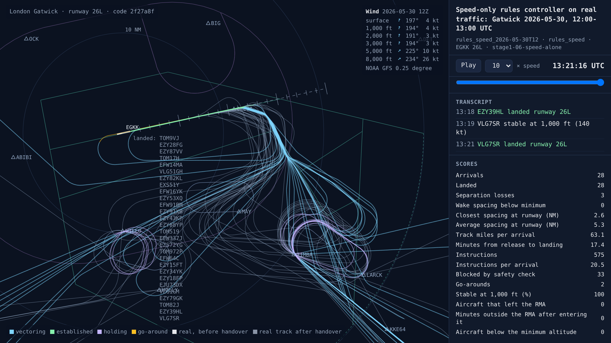
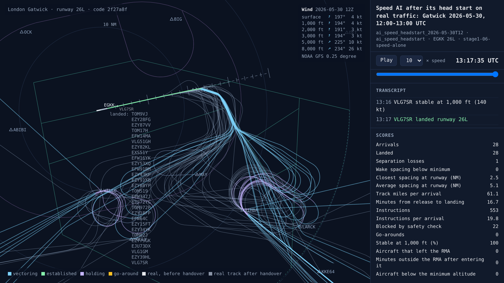
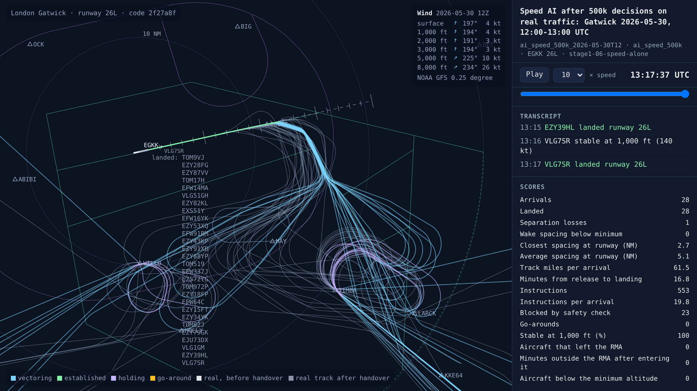
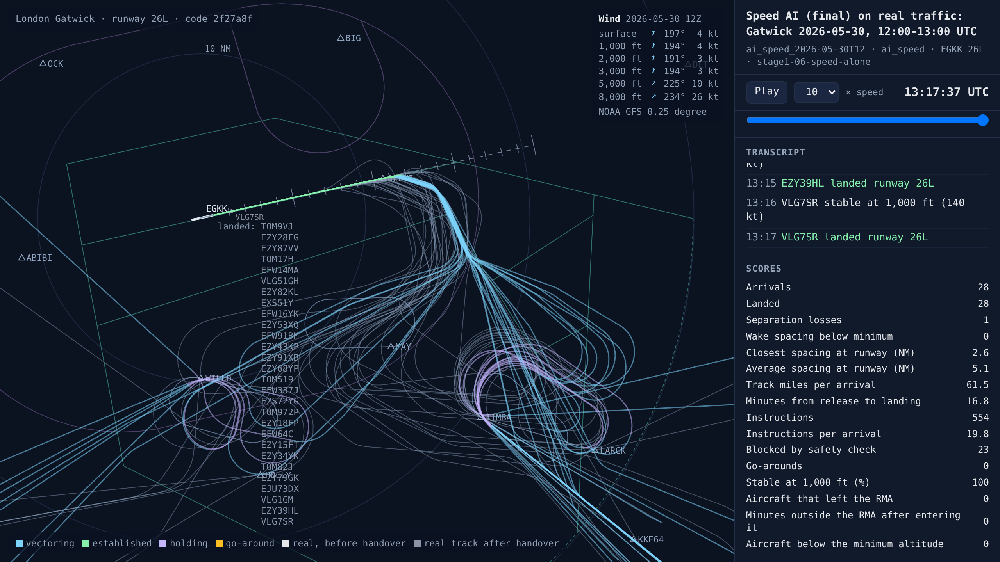
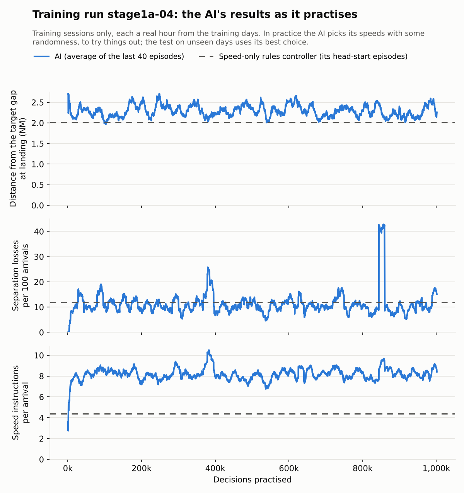

# Stage 1a, second training run: stable, level with the speed rule, and what speed alone can do

<!-- AUTO:START (regenerated by approach.milestone) -->

Milestone `stage1-06-speed-alone` · 2026-11-10 · code `2f27a8f` (check it out with `git checkout 2f27a8f`)

| Scenario | What it shows | Replay | Screenshot | Video | Scores |
| --- | --- | --- | --- | --- | --- |
| `rules_speed_2026-05-30T12` | Speed-only rules controller on real traffic: Gatwick 2026-05-30, 12:00-13:00 UTC | [replay](rules_speed_2026-05-30T12.html) |  | [video](rules_speed_2026-05-30T12.mp4) | landed 28/28, separation losses 3, closest spacing at the runway 2.6 NM, safety blocks 33, instructions 575, go-arounds 2, 17.4 min per arrival, wind at 3,000 ft 194°/3 kt |
| `ai_speed_headstart_2026-05-30T12` | Speed AI after its head start on real traffic: Gatwick 2026-05-30, 12:00-13:00 UTC | [replay](ai_speed_headstart_2026-05-30T12.html) |  | [video](ai_speed_headstart_2026-05-30T12.mp4) | landed 28/28, separation losses 1, closest spacing at the runway 2.5 NM, safety blocks 22, instructions 553, 16.7 min per arrival, wind at 3,000 ft 194°/3 kt |
| `ai_speed_500k_2026-05-30T12` | Speed AI after 500k decisions on real traffic: Gatwick 2026-05-30, 12:00-13:00 UTC | [replay](ai_speed_500k_2026-05-30T12.html) |  | [video](ai_speed_500k_2026-05-30T12.mp4) | landed 28/28, separation losses 1, closest spacing at the runway 2.7 NM, safety blocks 23, instructions 553, 16.8 min per arrival, wind at 3,000 ft 194°/3 kt |
| `ai_speed_2026-05-30T12` | Speed AI (final) on real traffic: Gatwick 2026-05-30, 12:00-13:00 UTC | [replay](ai_speed_2026-05-30T12.html) |  | [video](ai_speed_2026-05-30T12.mp4) | landed 28/28, separation losses 1, closest spacing at the runway 2.6 NM, safety blocks 23, instructions 554, 16.8 min per arrival, wind at 3,000 ft 194°/3 kt |

Open a replay file in a browser to watch it; it needs no server.

<!-- AUTO:END -->

## What was done

The second full training run of stage 1a (`stage1a-04`). Its job is the same as the first run's: give each aircraft a speed, on fixed paths. It ran with four changes made after the first run ([diary entry of 9 November](../2026-11-09-stage1-05-first-training/README.md)).

- **Holding stacks that work like real ones.** Aircraft join first come, first served, and the lowest leaves first. No aircraft is given a level until the aircraft below it nearby has left it, and an aircraft heading for a level that is taken nearby is climbed to its own. Several versions were tested on the nine test sessions with the most trouble at the stacks. Losses at the stacks:

  | Version | Losses at the stacks |
  | --- | --- |
  | Before the fix | 16 |
  | First come, first served, 6 NM to vacate | 12 |
  | … and climb out of a taken level | 11 |
  | … and leave the stack without waiting (kept) | 9 |
  | Ordering the stack by height | 16 |
  | 4, 8 or 10 NM to vacate | 14, 17, 19 |

  The rest mostly come from real arrivals handed over at the stack's levels. The training world and the test now count losses at the stacks separately.
- **Only the choices that matter count.** A place in the AI's list may be empty, or hold an aircraft whose speed isn't the controller's to give (holding, or inside 7 NM on final). Those places no longer count in what the AI learns from, or in how uncertain it is.
- **It stays close to its head start.** Moving away from the copy it made of the speed-only rules controller carries a penalty. The penalty is the divergence between the two (KL), and it fades from 0.5 to 0.05 over the run. The reward for keeping its options open is a fifth of what it was.
- **Wider tests.** Each copy flew 120 unseen sessions instead of 40. Every total is given as the AI minus the speed-only rules controller, with a 95% range, so that a real difference can be told apart from chance.

It practised for 1,000,000 decisions over 5.7 hours. The settings are in [`runs/stage1a-04/run.json`](../../runs/stage1a-04/run.json).

## Results

**No copy differs from the speed-only rules controller by more than chance, and the gate is not passed.**

| 120 unseen sessions | Head start | 100k | 300k | 500k | 750k | Final | Speed-only rules controller |
| --- | --- | --- | --- | --- | --- | --- | --- |
| Separation losses | 168 | 181 | 176 | 189 | 172 | 167 | 179 |
| … at the holding stacks | 33 | 37 | 40 | 42 | 36 | 38 | 40 |
| Gaps inside the minimum | 74 | 81 | 74 | 81 | 80 | 80 | 91 |
| Gap at landing, distance from target | 2.38 NM | 2.39 NM | 2.40 NM | 2.36 NM | 2.40 NM | 2.40 NM | 2.42 NM |
| Wake infringements | 11 | 9 | 13 | 12 | 10 | 11 | 11 |
| Go-arounds | 107 | 99 | 102 | 111 | 105 | 95 | 101 |
| Speed instructions per arrival | 4.0 | 4.1 | 4.0 | 4.0 | 4.0 | 4.2 | 3.8 |

The final copy has 12 fewer separation losses than the speed-only controller, inside a 95% range of ±28.

**This time the AI stayed stable.** In practice its instructions held at about 8 per arrival, where in the first run they climbed from 7 to 25 as it grew more random. It also stayed close to its head start. But practice did not make it better than its head start either: its losses in practice stayed at 10 to 12 per 100 arrivals for the whole run.

**How much does speed matter?** On the same 120 sessions, every speed was also left alone, with only the band edges applied ([`scripts/leave_alone_baseline.py`](../../scripts/leave_alone_baseline.py)):

| 120 unseen sessions | Speeds left alone | Speed-only rules controller | Beyond chance? |
| --- | --- | --- | --- |
| Gaps inside the minimum | 222 | 91 | yes |
| Wake infringements | 25 | 11 | yes |
| Go-arounds | 139 | 101 | yes |
| Separation losses | 218 | 179 | no (+39, range ±47) |

Speed control matters a lot for the gaps: leaving speeds alone more than doubles the gaps inside the minimum. But about 180 of the losses happen whatever the speeds, at the holding stacks and on final inside 7 NM, where pilots fly their own speeds.

**What stage 1a shows.** On fixed paths, an AI that controls only speeds learns to match a good speed rule and stays stable doing it. There is little room to beat that rule, so practice can't find an improvement through the noise. Stage 1a's gate asked for no separation losses, which no speed controller can reach. The losses are decided by the controls that set the spacing: when an aircraft leaves the hold, and how long its path is (when it turns base). That is stage 1b.

On the busy hour of 30 May 2026 (the replays above), every copy of the AI had 1 separation loss against the speed-only controller's 3. A single hour swings a lot from small differences, so the 120-session test is the measure.

## What went wrong

- **The first fix to the holding stacks made things worse.** Ordering the stack by height, waiting 10 NM for a level to be vacated, and holding aircraft that leave the stack until the level below is free sounded right together. Together they gave 29 losses near the stacks on the 40 test sessions, against 11 for the first version. Testing each part on its own found which helped and which hurt.
- **One practice session was impossible.** A quarter of practice sessions use another hour's wind for variety. One paired a summer day's traffic on runway 08R with Storm Darragh's wind, a 17 kt tailwind on final. It gave 2 landings, 30 go-arounds and 215 separation losses: the spike in the learning chart at about 850k decisions. A borrowed wind must now have a tailwind of 15 kt or less along the runway, from 1,000 to 3,000 ft. The test sessions always use their own hour's wind, so the test results are unaffected.
- **My guess about speed was wrong.** Before the leave-alone test I expected speed to barely matter at all, from an earlier run whose AI left every speed alone and did about as well. It does matter, for the gaps. What it can't touch is most of the separation losses.

## What's next

Proposed: stage 1b, in which the AI also decides when each aircraft turns from the downwind onto base, which is how controllers stretch or shorten a path, with the full rules controller as its competitor, and gates that ask for what the AI's controls can reach, with losses at the holding stacks reported apart.

## Notes

_Your own notes for the blog or video._
