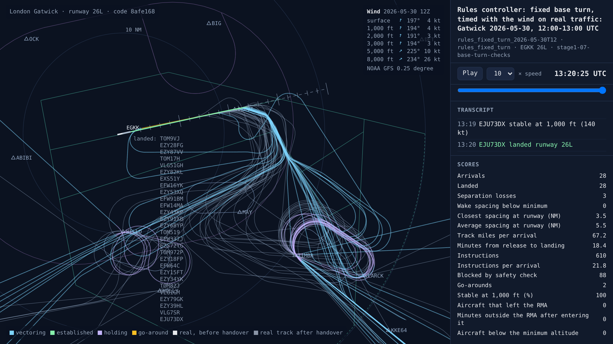
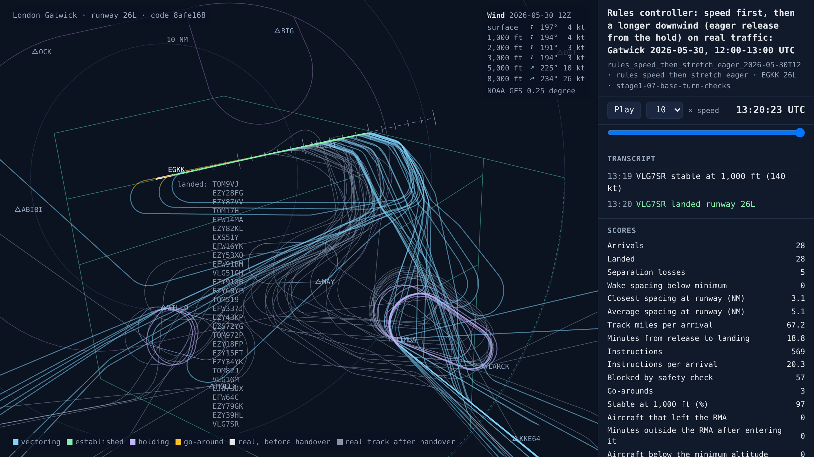
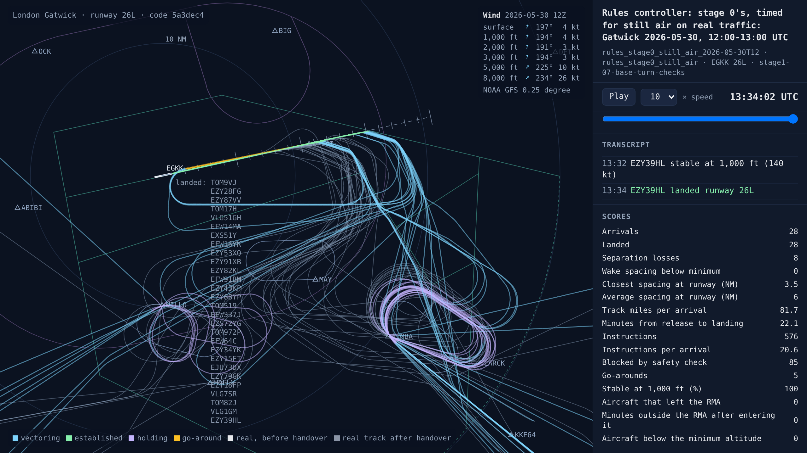
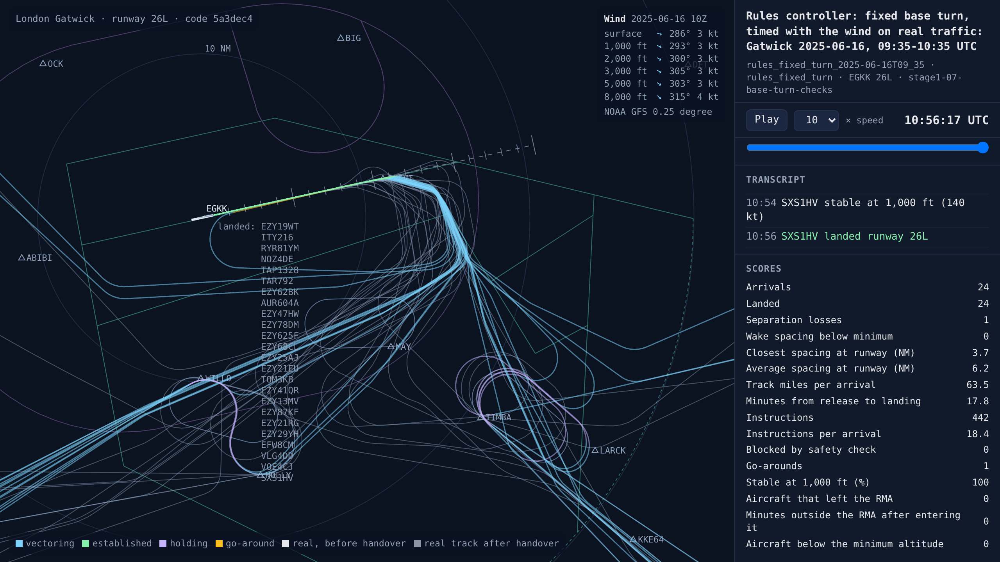
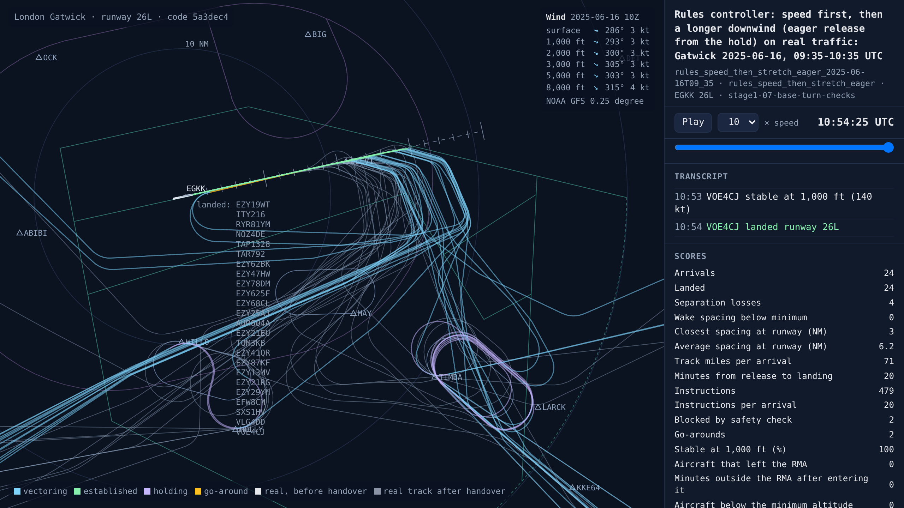

# Stage 1b checks: the wind, the base turn and the rules controller to beat

<!-- AUTO:START (regenerated by approach.milestone) -->

Milestone `stage1-07-base-turn-checks` · 2026-11-10 · code `8afe168` (check it out with `git checkout 8afe168`)

| Scenario | What it shows | Replay | Screenshot | Video | Scores |
| --- | --- | --- | --- | --- | --- |
| `rules_fixed_turn_2026-05-30T12` | Rules controller: fixed base turn, timed with the wind on real traffic: Gatwick 2026-05-30, 12:00-13:00 UTC | [replay](rules_fixed_turn_2026-05-30T12.html) |  | [video](rules_fixed_turn_2026-05-30T12.mp4) | landed 28/28, separation losses 3, closest spacing at the runway 3.5 NM, safety blocks 88, instructions 610, go-arounds 2, 18.4 min per arrival, wind at 3,000 ft 194°/3 kt |
| `rules_speed_then_stretch_eager_2026-05-30T12` | Rules controller: speed first, then a longer downwind (eager release from the hold) on real traffic: Gatwick 2026-05-30, 12:00-13:00 UTC | [replay](rules_speed_then_stretch_eager_2026-05-30T12.html) |  | [video](rules_speed_then_stretch_eager_2026-05-30T12.mp4) | landed 28/28, separation losses 5, closest spacing at the runway 3.1 NM, safety blocks 57, instructions 569, go-arounds 3, 18.8 min per arrival, wind at 3,000 ft 194°/3 kt |
| `rules_stage0_still_air_2026-05-30T12` | Rules controller: stage 0's, timed for still air on real traffic: Gatwick 2026-05-30, 12:00-13:00 UTC | [replay](rules_stage0_still_air_2026-05-30T12.html) |  | [video](rules_stage0_still_air_2026-05-30T12.mp4) | landed 28/28, separation losses 8, closest spacing at the runway 3.5 NM, safety blocks 85, instructions 576, go-arounds 5, 22.1 min per arrival, wind at 3,000 ft 194°/3 kt |
| `rules_fixed_turn_2025-06-16T09_35` | Rules controller: fixed base turn, timed with the wind on real traffic: Gatwick 2025-06-16, 09:35-10:35 UTC | [replay](rules_fixed_turn_2025-06-16T09_35.html) |  | [video](rules_fixed_turn_2025-06-16T09_35.mp4) | landed 24/24, separation losses 1, closest spacing at the runway 3.7 NM, instructions 442, go-arounds 1, 17.8 min per arrival, wind at 3,000 ft 305°/3 kt |
| `rules_speed_then_stretch_eager_2025-06-16T09_35` | Rules controller: speed first, then a longer downwind (eager release from the hold) on real traffic: Gatwick 2025-06-16, 09:35-10:35 UTC | [replay](rules_speed_then_stretch_eager_2025-06-16T09_35.html) |  | [video](rules_speed_then_stretch_eager_2025-06-16T09_35.mp4) | landed 24/24, separation losses 4, closest spacing at the runway 3.0 NM, safety blocks 2, instructions 479, go-arounds 2, 20.0 min per arrival, wind at 3,000 ft 305°/3 kt |

Open a replay file in a browser to watch it; it needs no server.

<!-- AUTO:END -->

## What was done

Before building stage 1b's AI, two checks on the rules controller: how much the base turn matters, and how good the controller the AI has to beat would be. Every version flew the same 120 test sessions as stage 1a's tests, with no AI ([`scripts/compare_controllers.py`](../../scripts/compare_controllers.py), versions in [`approach/controllers/versions.py`](../../approach/controllers/versions.py)).

- **Timing with the wind.** Stage 0's rules controller timed every leg, and turned the gap in miles into a gap in time, as if in still air. A new switch times them with the wind at the aircraft. It is off by default, so earlier results still reproduce.
- **Speed first, then a longer downwind.** A new rule: every aircraft turns base at the fixed point unless it has more delay to lose than speed can absorb (about 90 seconds), and then its downwind runs longer. It leaves the hold either carefully (when its slot can be made on the fixed path with speed) or eagerly (when it can be made with the longest downwind and speed).

## Results

| 120 test sessions, rules controllers only | Separation losses | … at the stacks | Gaps inside the minimum | Go-arounds | Landed |
| --- | --- | --- | --- | --- | --- |
| Stage 1a's speed-only controller (still air) | 179 | 40 | 91 | 101 | 1,751 |
| Fixed base turn, still air (a control: should match the line above) | 208 | 47 | 105 | 94 | 1,749 |
| **Fixed base turn, timed with the wind** | **113** | 50 | 36 | 51 | 1,695 |
| Speed first, then a longer downwind, careful release | 117 | 49 | 35 | **46** | 1,695 |
| Speed first, then a longer downwind, eager release | 160 | 44 | 62 | 76 | **1,752** |
| Base turn planned to the slot, with the wind | 162 | 57 | 54 | 62 | 1,665 |
| … with stage 0's final director | 160 | 53 | **24** | 53 | 1,662 |
| Stage 0's controller (planned base turn, final director, still air) | 299 | 81 | 54 | 116 | 1,703 |

- **Timing with the wind is the biggest improvement so far.** The fixed base turn timed with the wind has 95 fewer separation losses than the same controller timed for still air (95% range ±50), 69 fewer gaps inside the minimum and 43 fewer go-arounds. For stage 0's controller the wind saves 139 losses. The cost is about 3% fewer landings within the hour: in a headwind the same distance takes longer, so the gaps in time are bigger.
- **The base turn, used by rules, gives a trade-off, not a gain.** Used only when speed can't absorb the delay, it is hardly needed and changes nothing (117 losses against 113, range ±9). Used to release aircraft from the hold sooner, it lands 57 more aircraft (1,752, back to the speed-only controller's level, range ±55), but with 47 more losses (range ±29), 26 more gaps inside the minimum and 25 more go-arounds. Most of the extra losses in the three sessions where it did worst were on the downwind (9 of 21): more aircraft on the downwind at once, at the same level.
- **The rule that plans every base turn to the slot is worse than a fixed turn** (160 losses against 113, range ±41): it releases aircraft from the hold eagerly, plans tighter gaps and leaves speeds at standard values.
- **The controller to beat** is the fixed base turn timed with the wind: the fewest losses, and much better than stage 1a's competitor (113 against 179 losses).

**What it means for stage 1b.** The rules sit at two ends of a trade-off: careful (113 losses, 1,695 landed) or eager (160 losses, 1,752 landed). The room for an AI is to beat that line: as many landings as the eager rule with as few losses as the careful one, by choosing which aircraft to release early and whose downwind to stretch. That is a harder target than stage 1a's, and a more useful one.

**The replays above** show the busy hour of 30 May 2026 flown by the fixed turn with the wind, the eager version and stage 0's controller, and the session where the eager version did worst against the fixed turn (16 June 2025, 09:35), flown by both.

## What went wrong

- **Stage 1a trained in a world timed for still air.** Its planner released aircraft and set landing slots without the wind, a source of losses that speed couldn't fix. Timing with the wind does more for the rules controller than practice did for the AI.

## Notes

_Your own notes for the blog or video._
