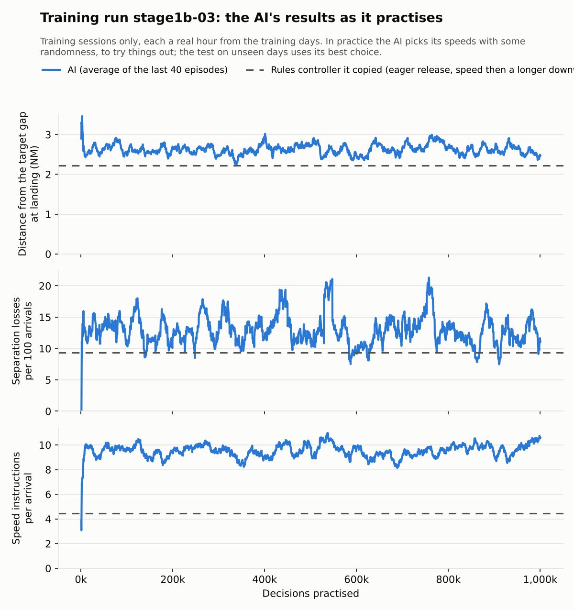

# Stage 1b: the AI turns aircraft onto base, and stage 1 ends level with the rules

<!-- AUTO:START (regenerated by approach.milestone) -->

Milestone `stage1-08-base-turn-ai` · 2026-11-11 · code `dcbbcda` (check it out with `git checkout dcbbcda`)

| Scenario | What it shows | Replay | Screenshot | Video | Scores |
| --- | --- | --- | --- | --- | --- |
| `rules_speed_then_stretch_eager_2026-05-30T12` | Rules controller: speed first, then a longer downwind (eager release from the hold) on real traffic: Gatwick 2026-05-30, 12:00-13:00 UTC | [replay](rules_speed_then_stretch_eager_2026-05-30T12.html) |  | [video](rules_speed_then_stretch_eager_2026-05-30T12.mp4) | landed 28/28, separation losses 5, closest spacing at the runway 3.1 NM, safety blocks 57, instructions 569, go-arounds 3, 18.8 min per arrival, wind at 3,000 ft 194°/3 kt |
| `ai_base_headstart_2026-05-30T12` | Base-turn AI after its head start on real traffic: Gatwick 2026-05-30, 12:00-13:00 UTC | [replay](ai_base_headstart_2026-05-30T12.html) |  | [video](ai_base_headstart_2026-05-30T12.mp4) | landed 28/28, separation losses 5, closest spacing at the runway 3.1 NM, safety blocks 41, instructions 592, go-arounds 3, 19.2 min per arrival, wind at 3,000 ft 194°/3 kt |
| `ai_base_2026-05-30T12` | Base-turn AI (final) on real traffic: Gatwick 2026-05-30, 12:00-13:00 UTC | [replay](ai_base_2026-05-30T12.html) |  | [video](ai_base_2026-05-30T12.mp4) | landed 28/28, separation losses 6, closest spacing at the runway 3.1 NM, safety blocks 51, instructions 636, go-arounds 3, 18.9 min per arrival, wind at 3,000 ft 194°/3 kt |

Open a replay file in a browser to watch it; it needs no server.

<!-- AUTO:END -->

## What was done

Stage 1b gave the AI the controller's main spacing tool: when each aircraft turns from the downwind onto base. It works in the world the checks pointed to ([diary entry of 10 November](../2026-11-10-stage1-07-base-turn-checks/README.md)): everything timed with the wind, and aircraft released from the hold eagerly, as soon as their slot can be made with the longest downwind and speed. The rule for that world (speed first, then a longer downwind) lands as many aircraft as stage 1a's controller but has 47 more separation losses than releasing carefully. The AI's job was to keep the throughput and lose fewer separations.

Three training runs, each fixing what the last one showed:

- **stage1b-01: "turn now" or "wait".** Its head start copied the rule, but tested on 120 sessions it flew much worse than the rule: 217 losses against 150, 126 go-arounds against 64. With turns counted ten times it turned too early; counted once, it never learned when the rule turns. Stopped at the head start's test.
- **stage1b-02: the planner's turn shown to the AI.** It also saw how far each aircraft was from the planner's turn point, and whether the planner would turn it in the next 10 seconds; the head start then copied 89% of the rule's turns and 98% of its waits. Practice made it worse (204 losses after 300k decisions). A third of its turns (105 of 320 on 20 sessions) were made for it at the RMA edge: once it missed the planner's point it never turned, because copying the rule had shown it no aircraft that had passed that point. Those aircraft joined final late and close: 17 go-arounds for being too close to the aircraft ahead, against the rule's 6.
- **stage1b-03: the planner's turn as the default.** For each aircraft on the downwind the AI chooses: as planned (the planner turns it at its point), turn now, or not yet (the turn becomes the AI's). Copying the rule is then exact: "as planned" flies the busy hour of 30 May 2026 the same as the rule. It practised for a million decisions; the machine was restarted twice and training carried on from its working copies.

## Results

**stage1b-03 ends level with the rule it copied. The gate is not passed.**

| 120 unseen sessions | Head start | 100k | 500k | 750k | Final | Eager rule | Careful rule |
| --- | --- | --- | --- | --- | --- | --- | --- |
| Separation losses | 141 | 146 | 141 | 157 | 145 | 150 | 113 |
| … at the holding stacks | 33 | 37 | 32 | 38 | 39 | 38 | 50 |
| Go-arounds | 72 | 74 | 71 | 74 | 68 | 64 | 51 |
| Gaps inside the minimum | 60 | 65 | 68 | 61 | 62 | 60 | 36 |
| Landed | 1,742 | 1,737 | 1,735 | 1,735 | 1,737 | 1,739 | 1,695 |

The careful rule's figures are from the checks, on the same sessions. No copy differs from the eager rule beyond chance (for the final copy: 5 fewer losses, range ±30).

**What practice did.** In practice the AI chose "turn now" about once in ten aircraft, which is close to the share left open for trying it, and "not yet" almost never: it only acts in the 10 seconds before the planner would turn an aircraft, so it was hardly ever tried, and the AI couldn't learn whether a longer downwind pays. Its losses in practice stayed at 11 to 13 per 100 arrivals.

**The replays above** show the busy hour flown by the eager rule, the head start and the final AI: all three land 28 of 28, with 5, 5 and 6 separation losses.

## What stage 1 shows

- **Timing with the wind matters more than anything the AI learned.** It cut the rules controller's losses by about 40%. Stage 1a's AI was trained in a world timed for still air and could not fix that with speed.
- **Speed alone matches a good rule but cannot beat it.** Most losses happen at the holding stacks and on final, where speed can't reach.
- **The base turn trades losses for landings,** and the AI did not find a better point on that trade-off than the rule. With the planner's turn as the default it stays level with the rule; the choice to fly on was too rarely tried to be learned.
- **How to build the AI:** let the planner propose and the AI adjust. Copying a rule step by step fails as soon as the AI meets a moment the rule never showed it.

## What went wrong

- **The head start's weights.** Counting the rule's turns ten times made the AI turn too early; counting them once let 16 speed choices a step drown them out. Counting every turn-or-wait choice ten times, turns and waits alike, worked.
- **The distance to the planner's turn** was first measured along the runway line, which is wrong for aircraft reaching the downwind from the side; it is now the distance to the turn point itself.
- **The machine was restarted three times overnight,** once while a watcher was running. Training carried on from its working copies each time, losing at most 27k decisions.

## What's next

Stage 1's time box is used. Stage 2 gives the AI headings, altitudes and speeds, with the planner proposing and the AI adjusting, timed with the wind, tested on 120 sessions with ranges, and built after reading Project Bluebird's open training environments (see the plan's "Before stage 2").

## Notes

_Your own notes for the blog or video._
