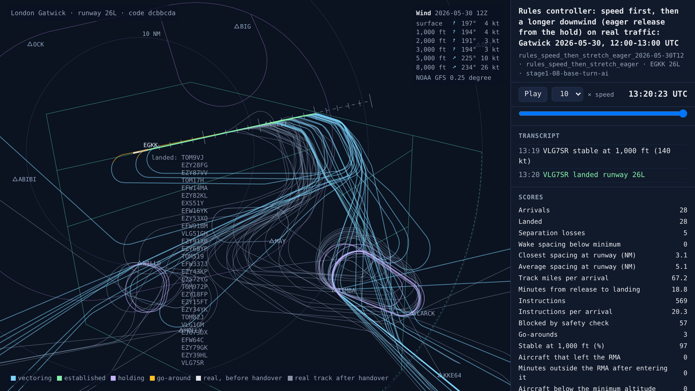
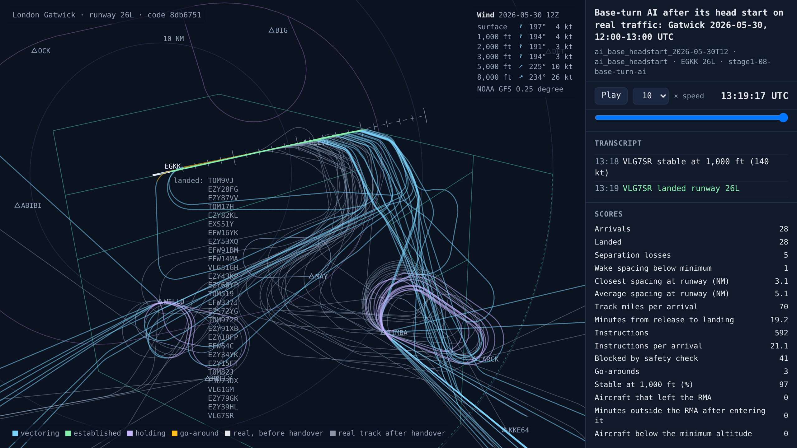
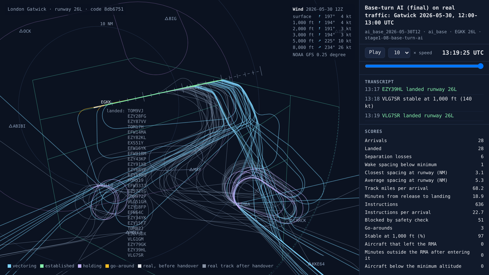

# Stage 1b: the AI turns aircraft onto base, and stage 1 ends level with the rules

<!-- AUTO:START (regenerated by approach.milestone) -->

Milestone `stage1-08-base-turn-ai` · 2026-11-11 · code `dcbbcda` (check it out with `git checkout dcbbcda`)

| Scenario | What it shows | Replay | Screenshot | Video | Scores |
| --- | --- | --- | --- | --- | --- |
| `rules_speed_then_stretch_eager_2026-05-30T12` | Rules controller: speed first, then a longer downwind (eager release from the hold) on real traffic: Gatwick 2026-05-30, 12:00-13:00 UTC | [replay](rules_speed_then_stretch_eager_2026-05-30T12.html) |  | [video](rules_speed_then_stretch_eager_2026-05-30T12.mp4) | landed 28/28, separation losses 5, closest spacing at the runway 3.1 NM, safety blocks 57, instructions 569, go-arounds 3, 18.8 min per arrival, wind at 3,000 ft 194°/3 kt |
| `ai_base_headstart_2026-05-30T12` | Base-turn AI after its head start on real traffic: Gatwick 2026-05-30, 12:00-13:00 UTC | [replay](ai_base_headstart_2026-05-30T12.html) |  | [video](ai_base_headstart_2026-05-30T12.mp4) | landed 28/28, separation losses 5, closest spacing at the runway 3.1 NM, safety blocks 41, instructions 592, go-arounds 3, 19.2 min per arrival, wind at 3,000 ft 194°/3 kt |
| `ai_base_2026-05-30T12` | Base-turn AI (final) on real traffic: Gatwick 2026-05-30, 12:00-13:00 UTC | [replay](ai_base_2026-05-30T12.html) |  | [video](ai_base_2026-05-30T12.mp4) | landed 28/28, separation losses 6, closest spacing at the runway 3.1 NM, safety blocks 51, instructions 636, go-arounds 3, 18.9 min per arrival, wind at 3,000 ft 194°/3 kt |

Open a replay file in a browser to watch it; it needs no server.

<!-- AUTO:END -->

## What was built

_To write._

## What went wrong and how it was fixed

_To write._

## Notes

_Your own notes for the blog or video._
