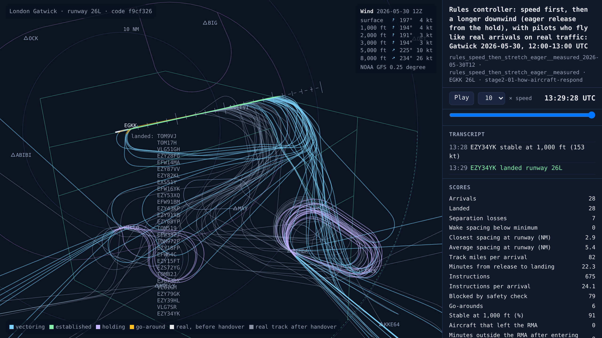
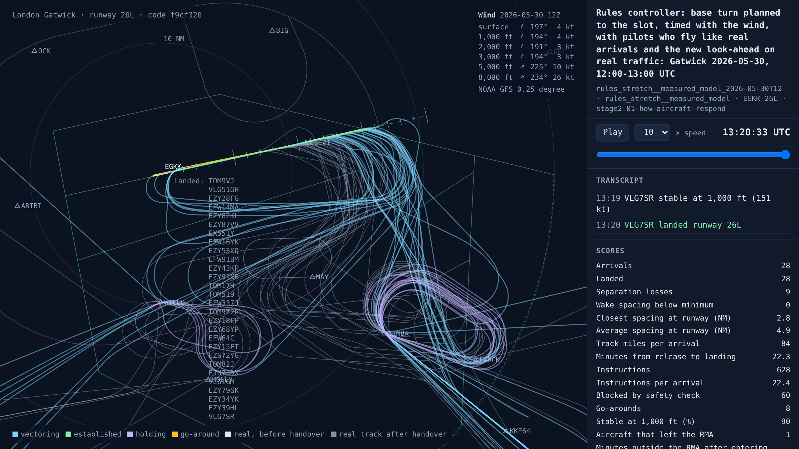

# Stage 2 begins: how real aircraft respond, and a simulator that flies like them

<!-- AUTO:START (regenerated by approach.milestone) -->

Milestone `stage2-01-how-aircraft-respond` · 2026-11-11 · code `f9cf326` (check it out with `git checkout f9cf326`)

| Scenario | What it shows | Replay | Screenshot | Video | Scores |
| --- | --- | --- | --- | --- | --- |
| `rules_speed_then_stretch_eager__measured_2026-05-30T12` | Rules controller: speed first, then a longer downwind (eager release from the hold), with pilots who fly like real arrivals on real traffic: Gatwick 2026-05-30, 12:00-13:00 UTC | [replay](rules_speed_then_stretch_eager__measured_2026-05-30T12.html) |  | [video](rules_speed_then_stretch_eager__measured_2026-05-30T12.mp4) | landed 28/28, separation losses 7, closest spacing at the runway 2.9 NM, safety blocks 79, instructions 675, go-arounds 6, 22.3 min per arrival, wind at 3,000 ft 194°/3 kt |
| `rules_stretch__measured_model_2026-05-30T12` | Rules controller: base turn planned to the slot, timed with the wind, with pilots who fly like real arrivals and the new look-ahead on real traffic: Gatwick 2026-05-30, 12:00-13:00 UTC | [replay](rules_stretch__measured_model_2026-05-30T12.html) |  | [video](rules_stretch__measured_model_2026-05-30T12.mp4) | landed 28/28, separation losses 9, closest spacing at the runway 2.8 NM, safety blocks 60, instructions 628, go-arounds 8, 22.3 min per arrival, wind at 3,000 ft 194°/3 kt |

Open a replay file in a browser to watch it; it needs no server.

<!-- AUTO:END -->

## What was done

Stage 2 is where the AI starts giving headings, levels and speeds. The plan's first step is a model of how aircraft respond to an instruction. Building it showed that the simulator's aircraft didn't respond like real ones.

**The simulator's pilots were too good.** The plan said pilots already held their speed only within ±10 kt and descended at real Gatwick rates. Neither had been built. The only variation was a 3 to 6 second delay before a pilot acted. BlueSky's aircraft, as the project used them, all descended at exactly 1,500 ft/min and slowed down at 2 to 3 kt a second.

**How real aircraft respond.** `approach.data.response` measures the 16,000 arrivals on the 46 training days (the test days stay unseen). The ADS-B data has no instructions in it, but it shows what aircraft do once they have one. The heading comes from the track and the GFS wind, and the indicated airspeed from the ground speed, the wind and the altitude. Ranges are the 10th to 90th percentiles:

| | Real arrivals | BlueSky, as used in stage 1 |
| --- | --- | --- |
| Bank in turns over 45° | 22.8° (20.5 to 24.7) | 25° |
| Bank in turns of 15 to 25° | 13.6° | 25° |
| Descent rate, per flight | 900 ft/min (630 to 1,230) | 1,500 ft/min, every flight |
| Slowing down, level | 0.64 kt/s (0.37 to 0.88) | 2 to 3 kt/s |
| Slowing down, descending or on final | 0.47 kt/s (0.32 to 0.63) | 2 to 3 kt/s |
| Speeding up | 0.40 kt/s (0.28 to 0.61) | |

Aircraft type barely changes the descent rate: every common type has a median between 820 and 1,000 ft/min. Small turns are flown with much less bank: about 10° for a 10 to 15° turn, as autopilots bank in proportion to the heading still to turn.

**Pilots who fly like real arrivals.** With `World(pilots="measured")` each pilot gets its own bank limit, descent rate and rates of slowing down and speeding up, drawn from those measurements. It banks 1.2° for every degree of heading still to turn, up to its limit. Measured the same way as the real turns, simulated turns of 20, 35, 60 and 120° then bank 14, 19, 22.5 and 23°; real turns of those sizes bank 13.6, 19.3, 22.4 and 23.7°. BlueSky's pilots stay the default, so every earlier result still reproduces.

**The model of how aircraft respond** (`approach.response`) predicts each aircraft's next two minutes as 32 draws of a whole future. Each draw is flown by its own pilot from the same measurements: the response delay, the bank, the descent rate and the rates of speed change. It flies the ILS as the simulated pilots do. Two minutes after an instruction, its best guess (the average of its draws) is this far out:

| In the simulator, 320 random instructions | Model | Old look-ahead | Constant velocity |
| --- | --- | --- | --- |
| After a turn | 0.06 NM | 0.28 NM | 2.6 NM |
| After a speed change | 0.05 NM | 0.52 NM | 0.52 NM |
| Height after a level change (average miss of the draws, CRPS) | 75 ft | 257 ft | 1,282 ft |
| Truth inside the middle 80% of the draws | 79% sideways, 93% in height | | |

| On real tracks from the test days, 2,306 changes | Model | Old look-ahead | Constant velocity |
| --- | --- | --- | --- |
| After a turn | 0.70 NM | 0.96 NM | 6.3 NM |
| After a speed change | 0.66 NM | 1.27 NM | 1.55 NM |
| Height after starting a descent | 330 ft | 1,176 ft | 1,322 ft |
| Truth inside the middle 80% of the draws | 45% sideways, 82% in height | | |

The real tracks are taken from where each change starts, with the heading, level and speed the aircraft ended with as its clearance, so the pilot's response delay is left out (it isn't in the data). The draws there include a forecast-wind error of 8 kt and a speed error of 15 kt, set on the training days. Even so, real aircraft vary more sideways than the draws allow. That matters for the live feed later, not for the simulator.

**The safety check's look-ahead.** On 500 close encounters in the simulator, with real winds and measured pilots, 101 pairs lost separation within two minutes:

| | Caught | Missed | False alarms |
| --- | --- | --- | --- |
| Old look-ahead | 90 | 11 | 4 |
| Model, typical pilot | 98 | 3 | 3 |
| Model, 32 draws (alarm at 10% chance or more) | 99 | 2 | 7 |

The model's chances mean what they say: pairs it gave no chance lost separation 0.3% of the time, pairs at 25 to 75% lost it 60% of the time, and pairs at 100% always did. [Project Bluebird's geometric safety filter](https://github.com/project-bluebird/geometric_safety) (MIT licence, George De Ath, University of Exeter) certified 364 pairs safe, and none of them lost separation, even though its motion class has no response delay. It is a sound, quick first pass that clears about three quarters of pairs before a look-ahead needs to run. The safety check can now use the model (`lookahead="model"`), which makes a session about a third slower; the old look-ahead stays the default.

## What realistic pilots do to the rules controllers

The replays above fly the busy hour of 30 May 2026 with measured pilots. The eager rule from stage 1b still lands all 28, but with 7 separation losses instead of 5, 6 go-arounds instead of 3, and 22.3 minutes per arrival instead of 18.8 (the real controllers took 17.5). The rule that plans the base turn to the slot, with the new look-ahead, has 9 losses and 8 go-arounds.

A first run over the 120 test sessions, before the bank angle was refined, was worse: the fixed-turn rule's go-arounds went from 51 to 316 and its losses from 113 to 285. Two things go wrong. The rules controller gives the descent to 3,000 ft at the turn onto base, which was enough at 1,500 ft/min. At real rates aircraft reach the localiser too high, can't get down onto the glide path, and are unstable at 1,000 ft. And the holding stacks empty slowly, because aircraft take longer to vacate each level. The replays show the extra holding.

## What went wrong

- **The plan said something had been built when it hadn't.** The plan now says what stage 1 actually ran with. Stage 1's comparisons between the AI and the rules are still fair, because both flew the same simulator, but speed control took effect four to five times faster than it would in reality.
- **The first measured pilots banked the same for every turn.** The real data shows small turns flown with much less bank, which matters for stage 2's 5 and 10° adjustments, so bank now follows the heading still to turn.
- **The first check on real tracks scored a turn on its height too,** where the unknown moment a descent began made every model look bad. Each change is now scored on its own: turns and speed changes sideways and along the track, descents in height.
- **The encounter test spent most of its time downloading winds** for test-day hours that weren't saved yet. It now uses only hours whose winds are already here.

## What's next

The competitor for stage 2: the rules controller with the fixes realistic pilots need. That means descents planned from each aircraft's distance to go at a real rate (about 3 NM per 1,000 ft, with a margin), slowing down earlier, and holding stacks that allow for real descent rates. Then the rules controllers fly the 120 test sessions with measured pilots, before the AI's vectoring choices go into the training world.
