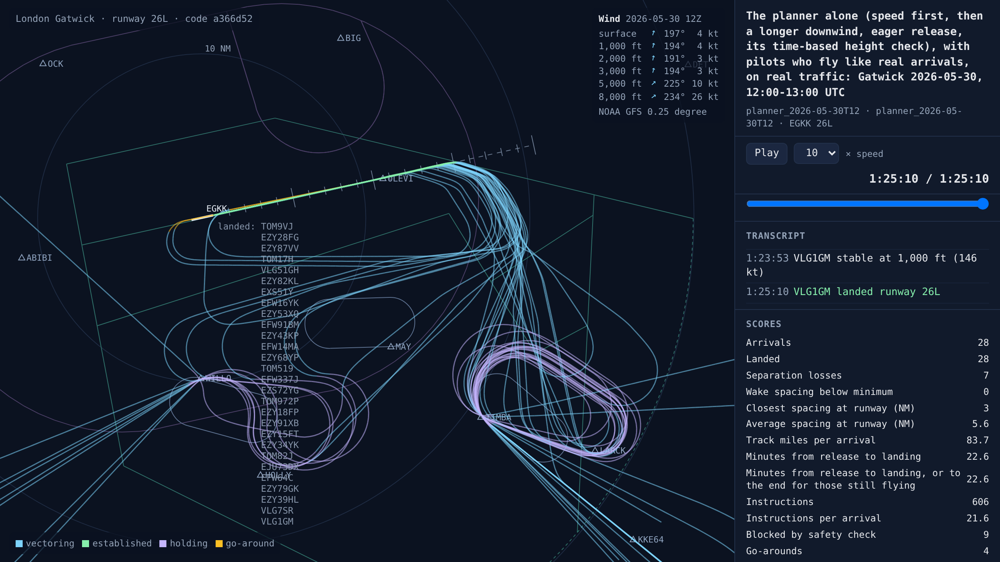
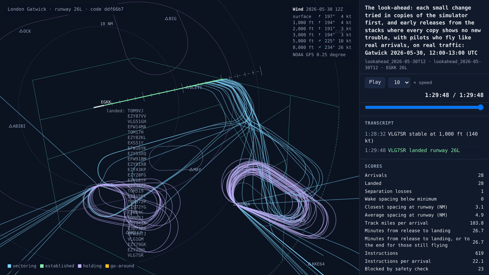

# Stage 2: the look-ahead, three simulator bugs, and where the minutes go

<!-- AUTO:START (regenerated by approach.milestone) -->

Milestone `stage2-02-look-ahead` · 2026-11-15 · code `a366d52` (check it out with `git checkout a366d52`)

| Scenario | What it shows | Replay | Screenshot | Video | Scores |
| --- | --- | --- | --- | --- | --- |
| `planner_2026-05-30T12` | The planner alone (speed first, then a longer downwind, eager release, its time-based height check), with pilots who fly like real arrivals, on real traffic: Gatwick 2026-05-30, 12:00-13:00 UTC | [replay](planner_2026-05-30T12.html) |  | [video](planner_2026-05-30T12.mp4) | landed 28/28, separation losses 7, closest spacing at the runway 3.0 NM, safety blocks 9, instructions 606, go-arounds 4, 22.6 min per arrival, wind at 3,000 ft 194°/3 kt |
| `lookahead_2026-05-30T12` | The look-ahead: each small change tried in copies of the simulator first, and early releases from the stacks where every copy shows no new trouble, on the same hour | [replay](lookahead_2026-05-30T12.html) |  | [video](lookahead_2026-05-30T12.mp4) | landed 28/28, separation losses 1, closest spacing at the runway 3.1 NM, safety blocks 23, instructions 619, 26.7 min per arrival, wind at 3,000 ft 194°/3 kt |

Open a replay file in a browser to watch it; it needs no server.

<!-- AUTO:END -->

## What was done

**Three training runs that learned nothing new.** Stage 2's AI (`stage2-01` to `stage2-03`) started from a head start that copies the planner ("as planned") and practised adjusting its headings, levels and speeds. None moved away from "as planned" in a way that showed in the test: with the planner's own choice always available and a small cost for every instruction, practice never found a change worth its risk often enough to learn it.

**The look-ahead.** So the next controller tries changes before it makes them. Every 30 seconds it forks copies of the simulator, flies each candidate change 7 minutes ahead in three of them, each with freshly drawn pilots, and keeps a change only if it beats "as planned" by a margin across the copies. The moves are small: a heading, level or speed a step off the plan, holding an aircraft at a level in its stack, a longer downwind. On the 120 test sessions (with the simulator as it was before 15 November) it had 8 losses of separation against the competitor's 259, and no go-arounds against 67, but took 25.7 minutes per arrival against 24.7. The real controllers took 17.8.

Quick copies made it affordable: a cheaper fork of the simulator (the same wind arithmetic without the checks, a 1-second step) reached the same verdict as a full copy 97% of the time, 1.6 times faster.

**A network that copies the look-ahead** would be cheaper still to run. Trained on the look-ahead's choices, it learned to undo moves but not to see trouble coming. Given the look-ahead's view of trouble as an input, it did better: 105 losses of separation on the 120 test sessions against the competitor's 259, but far from the look-ahead's 8.

**Releasing early from the stacks.** The look-ahead's new move takes the lowest aircraft off its stack now, though the planner would keep it. Releases are judged over 15 minutes and vetoed if any copy shows new trouble. On 12 practice hours it saved 3 minutes per arrival, but with 9 go-arounds where there had been none. Replaying the two worst hours showed why: aircraft released while too high to get down in time. With the planner's height check on every early release the go-arounds went, and so did most of the saving.

**Three bugs in the simulator.** One practice hour then landed only 14 of its 22 aircraft. Tracing it found:

- **A pilot stuck turning in a hold.** It turned onto the outbound leg in calm air and descended into a 37 kt wind. BlueSky's autopilot kept its track by pointing into the wind, so its heading stayed 5.7° off, and the pilot waited for the heading to come within 5° before starting the timed leg. It flew outbound for 18 minutes, 85 NM, and took 22 more to come back. It was first in the queue, so no one behind it was released, and the runway sat idle for 25 minutes. A turn in a hold now ends on the heading or the track.
- **Two aircraft with one callsign.** Scanning 240 practice hours for aircraft lost in a hold found one 139 NM from its stack. A second airframe broadcasting the same callsign had been handed over, and the simulator gave the first aircraft's pilot to the newcomer. This happens 5 times in 76 days of real traffic. Each aircraft now gets its own name.
- **No wind above about 13,400 ft.** The weather model's top level is about 13,400 ft, and above it BlueSky had no wind at all. Arrivals are handed over around FL150, so they flew in calm air, then met the full wind lower down; that is what turned the stuck pilot's heading. The top level's wind now holds above it, as the planner and the safety check already assumed.

Minutes per arrival also counted only the aircraft that had landed when a session ended, so a controller that left aircraft in the air looked quicker. A second figure now counts every aircraft to its landing or to the end.

**Where the minutes go.** On the fixed simulator the look-ahead was far safer than the competitor but no quicker. The gap to the real controllers is there even in the quietest hours (13.5 against 18.8 minutes with 1 to 6 arrivals) and grows to 8 minutes in the busiest. Most of it is lost before an aircraft leaves its stack:

- 72% of the planner's arrivals hold, 13% of the real ones, and only 3% of its holding happens with nothing on the approach: it holds because it believes the approach is full.
- In busy spells its landings are 3.8 minutes apart on average, the real controllers' 2.8, and the long gaps were already planned when the follower left its stack, because it left late.
- The next aircraft is held back most often because it is "too high to get down in time" (36% of the minutes), then because the aircraft ahead of it in the queue is still holding.

The height check worked in miles at the aircraft's ground speed of the moment, which in a hold swings with the wind from leg to leg. Judged by time instead, at the speeds the aircraft will fly on its path in the wind:

| | Minutes per arrival, every aircraft | Landed | Losses of separation | Go-arounds | Gaps inside the minimum |
| --- | --- | --- | --- | --- | --- |
| **12 practice hours used for tuning** | | (of 182) | | | |
| Planner, as it was | 25.9 | 176 | 30 | 8 | 8 |
| Look-ahead, as it was | 25.7 | 182 | 2 | 1 | 1 |
| Look-ahead with early releases, distance check | 25.5 | 180 | 1 | 1 | 0 |
| Look-ahead with early releases, time check | **23.6** | 181 | 2 | 1 | 0 |
| **24 fresh practice hours** | | (of 401) | | | |
| Planner, as it was | 27.5 | 391 | 86 | 29 | 13 |
| Planner, time check | 25.7 | 398 | 63 | 16 | 13 |
| Look-ahead, as it was | 26.6 | 397 | 4 | 0 | 0 |
| Look-ahead with early releases, time check | **24.1** | **401** | 7 | **0** | **0** |

On the fresh hours the new look-ahead is 2.25 minutes per arrival quicker than the look-ahead as it was (quicker in 20 of the 23 hours with traffic) and 1.6 quicker than the planner with the same check (quicker in 13, slower in 8). The big gains are in busy hours where the planner gets into trouble.

**The busy hour of 30 May** (the replays above) is one where it is slower: 26.7 minutes per arrival against the planner's 22.6, but with 1 loss of separation against 7, no go-arounds against 4, and no gaps inside the minimum against 3. The real controllers took 17.5 minutes with no losses.

**The 120 test sessions** (16 November), on the fixed simulator, every aircraft counted (1,785 arrivals):

| | Minutes per arrival | Landed | Losses of separation | Go-arounds | Gaps inside the minimum | Wake infringements |
| --- | --- | --- | --- | --- | --- | --- |
| Look-ahead with early releases, time check | **23.8** | **1,777** | 10 | **2** | 2 | 1 |
| Planner, time check (its competitor) | 25.4 | 1,711 | 251 | 63 | 60 | 9 |
| Planner, as it was | 25.9 | 1,713 | 258 | 65 | 64 | 9 |
| Real controllers | 17.8 | 1,776 | 4 | 14 | 0 | 0 |

Against its competitor every difference is beyond chance: 1.6 minutes per arrival quicker, 241 fewer losses of separation, 61 fewer go-arounds. Against the real controllers it has fewer go-arounds and a similar number of losses of separation (the difference is within chance), but takes 6 minutes per arrival longer. Why, and what was tried overnight, is in the [plan](../../docs/project-plan.md#the-test-on-the-fixed-simulator-and-why-high-arrivals-hold-16-november): the planner holds most aircraft handed over high, where real controllers bring them straight in with a fast descent.

## What went wrong and how it was fixed

- The early releases' saving came with go-arounds; the height check on releases removed both. The time-based height check gave most of the saving back, safely.
- One practice hour's result rested on a simulator bug, and finding it found two more. All three are fixed with tests, and every comparison here was flown again on the fixed simulator.
- Minutes per arrival flattered controllers that left aircraft flying; the new figure counts everyone.

## Next

Pilots who descend at the real rate for their height (faster higher up), measured from the real arrivals, in the simulator. Then the decisions that keep real arrivals out of the stacks, given to the look-ahead: releases from above the lowest level of a stack when an aircraft can be taken off laterally clear of the one below, and a route straight to base for a high arrival that can make its slot.

## Notes

_Your own notes for the blog or video._
