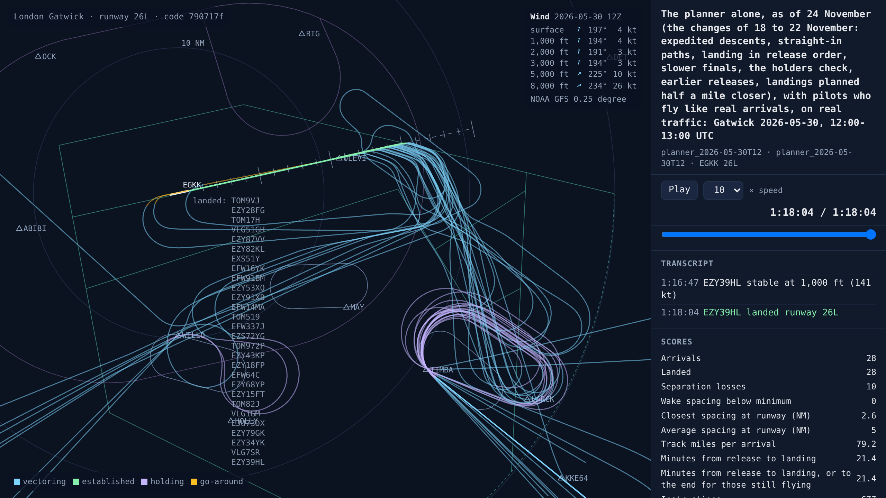
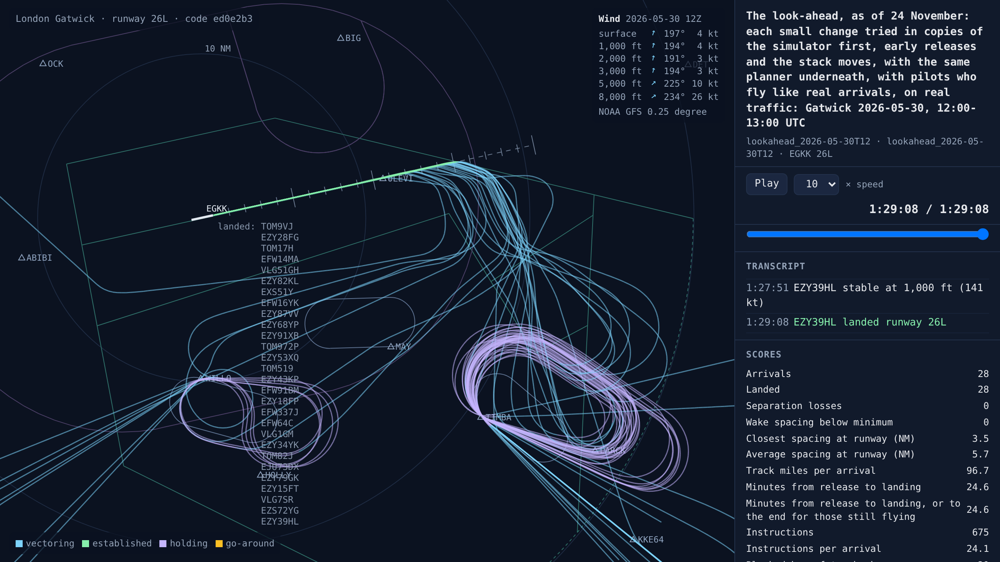

# Stage 2: live traffic in shadow, what it taught the planner, and a stricter safety check

<!-- AUTO:START (regenerated by approach.milestone) -->

Milestone `stage2-03-live-shadow` · 2026-11-24 · code `790717f` (check it out with `git checkout 790717f`)

| Scenario | What it shows | Replay | Screenshot | Video | Scores |
| --- | --- | --- | --- | --- | --- |
| `planner_2026-05-30T12` | The planner alone, as of 24 November (the changes of 18 to 22 November: expedited descents, straight-in paths, landing in release order, slower finals, the holders check, earlier releases, landings planned half a mile closer), with pilots who fly like real arrivals, on real traffic: Gatwick 2026-05-30, 12:00-13:00 UTC | [replay](planner_2026-05-30T12.html) |  | [video](planner_2026-05-30T12.mp4) | landed 28/28, separation losses 10, closest spacing at the runway 2.6 NM, safety blocks 107, instructions 677, go-arounds 3, 21.4 min per arrival, wind at 3,000 ft 194°/3 kt |
| `lookahead_2026-05-30T12` | The look-ahead, as of 24 November: each small change tried in copies of the simulator first, early releases and the stack moves, with the same planner underneath, on the same hour | [replay](lookahead_2026-05-30T12.html) |  | [video](lookahead_2026-05-30T12.mp4) | landed 28/28, separation losses 0, closest spacing at the runway 3.5 NM, safety blocks 39, instructions 675, 24.6 min per arrival, wind at 3,000 ft 194°/3 kt |

Open a replay file in a browser to watch it; it needs no server. (The look-ahead's log names commit `ed0e2b3`, which differs from `790717f` only in the shadow-mode files.)

<!-- AUTO:END -->

## What was done

**Shadow mode: the AI on live traffic** (18 November). [adsb.lol](https://www.adsb.lol) is a free, public feed of real aircraft positions. In shadow mode the AI watches it live around Gatwick, picks out each real arrival as it reaches the handover point (40 NM, below 15,000 ft), and flies a copy of it in the simulator, in real time, giving its own instructions, while the real controllers handle the real aircraft. Nothing it does reaches a real aircraft. Afterwards each arrival's time from handover to landing is compared with what really happened.

On the first hour, 18:22 to 19:22 UTC, it picked out all 14 arrivals from the 145 aircraft that entered the handover region, with none missed and none extra. It landed all 14 with no losses of separation, but took 20.5 minutes per arrival against the real controllers' 15.0. Most of the difference was holding: it held 8 of the 14, and the real controllers held none. Replay: [`runs/shadow/2026-11-18T1822/replay.html`](../../runs/shadow/2026-11-18T1822/replay.html), with the real tracks in faint grey behind.

**Three planner fixes from that hour** (18 and 19 November):

- A high aircraft is told to expedite its descent, instead of being held to lose height.
- An aircraft handed over already lined up with the runway is brought straight in.
- Aircraft land in the order they leave the holding stacks. Before, one that had held could be put back ahead of one already turning onto final; that caused most of the planner's go-arounds.

On 96 practice sessions, with faster speeds when nothing waits ahead, the planner alone took 22.7 minutes per arrival against 26.0, with 153 losses of separation against 260 and 38 go-arounds against 99.

**A second live hour, with the fixes** (19 November, 10:28 to 11:28 UTC). The AI took 16.3 minutes per arrival against the real controllers' 13.5, with no losses of separation or go-arounds on either side: a gap of 2.8 minutes, against 5.5 on the first hour. Most of what was left came from one high arrival from the south-east, held as too high where its real crew came down at about 1,650 ft/min; the aircraft behind it landed later too. One aircraft it was handed was a Gatwick departure levelling at 15,000 ft, so the spotter now skips aircraft the feed has seen leaving Gatwick. Replay: [`runs/shadow/2026-11-19T1024/replay.html`](../../runs/shadow/2026-11-19T1024/replay.html).

**The 120 test sessions with the fixes** (20 November): 20.5 minutes per arrival against 22.1 two days before, 1,783 of 1,785 landed, 8 losses of separation against 17. The real controllers take 17.8 minutes with 4 losses, so the gap was down to 2.7 minutes per arrival. Go-arounds rose from 2 to 12; 10 of them were aircraft kept at 180 kt on final to 7 NM whose pilots were slow to slow down.

**Four more planner changes, tried on practice hours first** (21 and 22 November): a slower final, as real arrivals fly it; a stack check that keeps an arrival above every level an aircraft holding in its stack is cleared to; releasing the next arrival a little earlier; and planning landings half a mile closer. Then the 120 test sessions again (23 November):

| | Minutes per arrival | Landed (of 1,785) | Losses of separation | Go-arounds | Gaps inside the minimum |
| --- | --- | --- | --- | --- | --- |
| Look-ahead, 23 November | **19.8** | **1,785** | 11 | **5** | 2 |
| The planner under it, alone | 20.1 | 1,779 | 172 | 64 | 84 |
| Real controllers | 17.8 | 1,776 | 4 | 14 | 0 |
| *Look-ahead, 20 November* | 20.5 | 1,783 | 8 | 12 | 1 |

It is 0.7 minutes per arrival quicker than on 20 November, beyond chance, and the gap to the real controllers is down to 2.0 minutes per arrival, and 1.5 in the busiest hours. Its 11 losses of separation against their 4, and its 5 go-arounds against their 14, are both within chance. Planning that close, the planner on its own is much less safe; the look-ahead on top takes away 161 of its 172 losses of separation, so the look-ahead is now what keeps the spacing.

Each of the 11 losses was flown again and traced, for diagnosis only (nothing is tuned on the test hours). Six were a quicker descent from above onto a slower one below, where the safety check took the lower aircraft to be descending at a typical rate when it was coming down more slowly. Two were a holding aircraft's turn in its hold, which the check didn't foresee. One was a stack level changed back and forth. Two were aircraft released onto the one ahead, one of them cleared for the approach and catching the glide path onto it. Four of the five go-arounds were one planner fault: a turn started so early, for a big turn from inside the downwind, that the aircraft joined final 2 NM out.

**A stricter safety check, on practice hours only** (24 November). Each change runs on the same 48 practice sessions and is kept only if it gives fewer losses of separation and is no worse otherwise:

- *Each aircraft's seen descent rate* instead of a typical one: 4 losses against 3, so not kept. Tracing the extra one found something else: an aircraft turned out of a holding stack was checked as if it stayed circling at its fix. With that fixed as well, the seen rates would have blocked it. That combination is running now.
- *Checking approach clearances* as well as headings and levels: stopped after 16 sessions, with 3 losses and a go-around where the run without it had 2 and none. Re-flying the new loss showed an aircraft that went through the final approach line without locking on, was brought round again still cleared, and locked on 160 seconds later on its way round, descending onto the aircraft behind. The check looks 2 minutes ahead, so the descent was beyond it.

**What to do when an aircraft goes through the localiser** follows from that. The planner now turns it straight back to intercept from the north side at 30°, as a real controller would. Arrivals come onto final from the south, because the departure routes are to the north, so an overshoot is always to the north, on either runway. It does this only if the aircraft would still lock on at least 6 NM out, not too high, and land the spacing minimum ahead of the aircraft behind. Otherwise it is brought round again, now with its approach clearance cancelled, a new instruction in the simulator. It runs on the 48 practice sessions after the current run.

**The busy hour of 30 May, again** (the replays above), as in the last entry. The simulator has changed since too (pilots descend at the real rate for their height), so this is not only the controllers' doing:

| | Minutes per arrival | Losses of separation | Go-arounds | Gaps inside the minimum | Closest at the runway | Track miles per arrival |
| --- | --- | --- | --- | --- | --- | --- |
| Look-ahead, 24 November | 24.6 | **0** | **0** | **0** | 3.5 NM | 96.7 |
| Look-ahead, 15 November | 26.7 | 1 | 0 | 0 | 3.1 NM | 103.8 |
| Planner alone, 24 November | 21.4 | 10 | 3 | 6 | 2.6 NM | 79.2 |
| Planner alone, 15 November | 22.6 | 7 | 4 | 3 | 3.0 NM | 83.7 |
| Real controllers | 17.5 | 0 | | | | |

On this hour the look-ahead is 2.1 minutes per arrival quicker than on 15 November and kept every gap. But it is still 7 minutes slower than the real controllers, against 2.0 on average over the test: this busy hour remains one of its worst. The planner alone is quicker still, with 10 losses of separation. That is what planning landings half a mile closer does without the look-ahead's checks on top.

## What went wrong and how it was fixed

- On the first live hour the planner held 8 of 14 arrivals where the real controllers held none. It held high arrivals to lose height; it now asks them to expedite, or brings them straight in.
- A departure was handed over as an arrival on the second live hour. The spotter now skips aircraft the feed has seen leaving Gatwick.
- The fixes brought go-arounds from fast finals on the 20 November test (12). A slower final, as real arrivals fly it, brought them down to 5.
- Two first explanations of traced losses were wrong. One blamed the check's typical pilot, but rebuilding the moment in a test showed the real cause: the released aircraft was checked as if it were still at its holding fix. The other read a counter as a blocked clearance; flying the session again showed none was blocked. Both were corrected in the plan.
- Changes to the safety check that sound safer have not always been safer once the whole session is flown, because the AI then chooses differently from the start. Each one is now kept only if 48 practice sessions show fewer losses and nothing worse.
- adsb.lol now limits its live feed without a key to 500 requests a day per internet address, fewer than a live hour needs. The recorder can now send a free key, and the next live hour waits for one.

## Next

1. The results of the two practice runs: the holding-stack fix with seen descent rates, then the turn back onto the localiser.
2. A third live hour with whatever passes, once there is an adsb.lol key.
3. Holding aircraft moving round their hold in the safety check's model.
4. A different design to stop stack levels being changed back and forth, such as a minimum time before a move is taken back.
5. A path for an aircraft that starts inside its downwind, for the last of the go-arounds.

The live tracks in the shadow-mode replays come from [adsb.lol](https://www.adsb.lol)'s feed, under the Open Database License (ODbL 1.0).

## Notes

_Your own notes for the blog or video._
