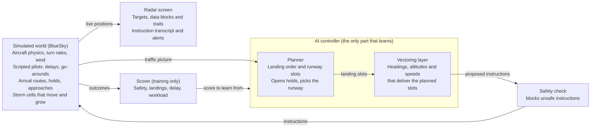

# AI Approach Controller — Project Plan

Snapshot of the shared project plan, 6 November 2026 · James Le Cuirot

We build an open benchmark for AI approach control at Gatwick, and an AI controller that works arrival traffic onto final while we watch it on a radar screen. It starts with speed control only, then grows stage by stage to vectoring, wake spacing, holds, go-arounds, runway changes and storms.

**End goal:** an open benchmark for AI approach control at a real, busy airport, starting with Gatwick, with our AI controller as its first entrant. The controller safely and efficiently manages all the arrival traffic, you can watch it working on a radar screen, and the benchmark scores it against real controllers handling the same traffic. The aim is for it to match, and ideally beat, those controllers.

## What you'll watch

The finished demo is a radar scope showing an approach sector during a busy hour, with the AI working every arrival from the moment it is handed over to the runway. Each target has a data block (callsign, altitude, speed) and a trail. The AI's instructions scroll in a transcript, for example "DAL123, turn left heading 250, descend and maintain 4,000". Conflict alerts and storm cells are drawn on the scope, and so is the AI's plan: its landing sequence, the gap it is aiming for behind each aircraft and where it expects each one to go.

Everything on screen is either a problem the world creates or a decision the AI makes. Keeping the two apart is also how we build and test it: the world's behaviour is scripted, and the AI is the part being trained.

| The world throws at it | The AI decides |
| --- | --- |
| Arrivals in a steady stream, sometimes in bunches | The landing order and each aircraft's slot |
| An aircraft that ends up too high or too fast | Re-vectoring it for a longer path or another try |
| A go-around (the simulated pilot calls it when the approach is unstable) | Where to slot that aircraft back into the sequence |
| More traffic than the runway can take | When to open a published hold, then pulling aircraft from the stack in order |
| Heavy aircraft with a large wake | Bigger gaps behind them on final |
| A wind shift that favours the other runway | When to change runways, and how to re-sequence |
| A storm cell drifting across the approach | Vectoring around it, or delay vectors |

A later nice-to-have is a synthetic voice reading the instructions aloud, so the demo sounds like a real frequency.

## Prior work and what's new

Others have built pieces of an AI approach controller, but we found no work that combines vectoring, sequencing, holds, go-arounds, wake spacing, runway changes and weather in one controller at a real airport. The closest are a 2026 comparison of rule-based and reinforcement-learning control in terminal airspace, a 2025 Taiwanese thesis that automates approach control at Tokyo Haneda, NTU Singapore's arrival-sequencing research, and the UK's Project Bluebird, which targets en-route airspace.

### NTU Singapore (ATMRI)

The Air Traffic Management Research Institute, led by Sameer Alam, is the most active group on AI for terminal-area control. Its work has two strands: automating arrival sequencing, and learning from how human controllers decide.

| Work | What it does | What it leaves open |
| --- | --- | --- |
| [Jiang, Lim, Pham, Dhief, Alam et al., SESAR 2024](https://www.sesarju.eu/sites/default/files/documents/sid/2024/papers/SIDs_2024_paper_072%20final.pdf) | Reinforcement learning suggests direct-to routes to the initial approach fix, for conflict-free arrival sequencing in the Tianjin multi-airport terminal area. A training speed-up cut training time by 82% | One kind of instruction, advisory only. No vectoring to final, holds or go-arounds |
| Dhief, Feroskhan, Alam et al., CEC 2023 † | Optimises the landing sequence under RECAT-EU wake categories, then generates vectors so each flight absorbs its delay before the final approach fix. 50 arrivals sequenced in 16 seconds, 85% of delay absorbed | Optimisation, not learning. No live re-planning around go-arounds or weather |
| Lim, Alam, Dhief, Schultz, J. Air Transport Management 2022 † | Predicts holding and terminal-area delay with machine learning, then slows flights en route so less holding is needed | Works upstream of the approach controller, not on it |
| Guleria, Pham, Alam et al., 2021 and 2024 † | Learns which aircraft controllers move to resolve conflicts, from human-in-the-loop simulations (about 95% accuracy), then copies their strategies by behaviour cloning | Conflict resolution only, not approach sequencing |
| Pham, Alam, Duong, Complexity 2020 † | Extracts controller instructions (heading, speed, vertical changes) from surveillance data and predicts them | Prediction, not control |

### Others

| Work | What it does | What it leaves open |
| --- | --- | --- |
| [Han Lu, 2026](https://www.researchgate.net/publication/403995945_Assessment_of_Rule-Based_and_Reinforcement_Learning_Control_Methods_with_Evaluation_of_Reward_Parameters_in_Terminal_Space_Empirical_Comparison_Using_ADS-B_Data), "Assessment of Rule-Based and Reinforcement Learning Control Methods with Evaluation of Reward Parameters in Terminal Space: Empirical Comparison Using ADS-B Data" † | Compares rule-based and reinforcement-learning control in terminal airspace using ADS-B data, including how reward settings matter | Not yet read. Probably the closest single paper to stages 1–3 |
| [Chen, "Auto-ATC", master's thesis, National Taiwan University, 2025](https://tdr.lib.ntu.edu.tw/jspui/handle/123456789/98584) | Predicts each aircraft's trajectory with a diffusion-transformer trained on OpenSky data, then turns the predictions into instructions with rules. Tested in a modified OpenScope simulator on a Tokyo Haneda scenario, landing about 95% of aircraft | Copies past trajectories rather than learning from practice. One aircraft at a time, and no comparison with real controllers |
| Groh and Lehrmann, "ApproachNet: Physics-Grounded Safety Layers for Data-Driven Aircraft Approach Control", 14th OpenSky Symposium, 2026 † | Safety layers based on physics around a data-driven approach controller | Not yet read. Its safety-layer idea may suit our design |
| [Jager and Szabo, Applied Sciences, 2025](https://www.mdpi.com/2076-3417/15/12/6414), "Air Traffic Simulation Framework for Testing Automated Air Traffic Control Solutions" † | A simulation framework for testing automated air traffic control | Not yet read. Must be compared with our open environment |
| Fustagueras, Waltert, Olive and Jarry, "Inferred Tactical Command Sampling for Stochastic Vertical Profile Generation Using ADS-B Data", 14th OpenSky Symposium, 2026 † | Infers controllers' tactical commands from ADS-B to generate realistic vertical profiles | A route to learning from real controllers |
| [Project Bluebird](https://www.nats.aero/about-us/research/n/project-bluebird/): NATS, Alan Turing Institute, University of Exeter, 2021–2026 | AI agents for tactical control on BluebirdDT, a digital twin of UK airspace, with a shadow trial against human controllers planned for 2026. Its 2026 papers cover a [rules-based agent for en-route airspace](https://arxiv.org/abs/2601.04285) and [reinforcement-learning agents that bundle small actions into fewer clearances](https://arxiv.org/abs/2601.04287) | En-route, not approach. Built on NATS data, so not open |
| [Zhu et al., Transportation Research Part E, 2026](https://research.polyu.edu.hk/en/publications/priority-driven-reinforcement-learning-for-multi-aircraft-traject/) (Hong Kong PolyU) | Reinforcement learning plans arrival trajectories around moving weather from radar data, on Hong Kong's approach procedures | Plans trajectories rather than giving controller instructions. No holds or runway changes |
| Holding studies: [Vella, Gauci, Dingli, J. Open Aviation Science, 2025](https://journals.open.tudelft.nl/joas/article/view/7890); Olive, Basora, Sun and Spinielli, 12th OpenSky Symposium, 2024 †; Dalmau, Very and Jarry, 11th OpenSky Symposium, 2023 † | Predict Heathrow holding times from OpenSky data (about 1.5 minutes average error), detect holding patterns with machine learning, and explain the causes and environmental cost of holding | Holding prediction on its own is well covered |
| Brittain and Wei, 2019 † | Multi-agent reinforcement learning resolves conflicts in a busy en-route sector in BlueSky | En-route, no landings |
| BlueSky-Gym (TU Delft) | Small training environments for merging, obstacles and descent | Building blocks, not an airport |
| BeyondATC and SayIntentions.AI † | Commercial AI air traffic control for flight-sim pilots | Talks to the person flying. Does not learn to manage traffic |

† Details from abstracts and listings found in search, not yet read in full.

### What this project adds

1. **The whole approach job in one controller**, learned stage by stage: vectoring, sequencing, holds, go-arounds, wake spacing, runway changes and weather. Each work above covers one or two of these. Auto-ATC comes closest, but works one aircraft at a time and turns its predictions into instructions with fixed rules.
2. **An open benchmark at a busy real airport.** The same real traffic, scoring and baselines for every controller, so results can be compared. Today each paper tests in its own simulator and scenarios, Bluebird is closed, and most papers release no code.
3. **AI against human controllers on identical scenarios, published openly**, using VATSIM controllers and possibly Gatwick's own.
4. **Moving a trained controller to a new airport,** which none of the works above attempt.

### What we can reuse

- **AI training:** Bluebird's bundling of small actions into fewer clearances, to cut instruction counts. NTU's behaviour cloning, to warm-start the AI from real controllers before practice.
- **Data and baselines:** the Malta holding-time method, already applied to London airspace with OpenSky data, for Gatwick's WILLO and TIMBA stacks. NTU's extraction of controller instructions from surveillance data, to recover how Gatwick controllers actually vectored.
- **A stronger baseline:** NTU's sequencing-and-vectoring optimiser is a tougher non-AI bar than our hand-written rules controller.

This comes from a targeted search on 5 November 2026 and OpenSky's list of publications using its data, not a systematic review. Reading the closest papers in full is the next step before claiming any of the above is a first.

## How it works

Three pieces run together: the simulated world, the AI controller and the radar screen, with a fixed safety check between the controller and the aircraft. The controller has two layers, matching how a real controller thinks: first the plan, then the instructions that deliver it.

Both layers start as hand-written rules. The vectoring layer is replaced by a learned model first (stages 1–3) and the planner once holds arrive (stage 4), so there is a working controller to watch at every stage.

**One controller, and logs it can't touch.** A single AI controller works all the traffic, as one approach controller does today. A team of agents, one per aircraft, is a later comparison (see Roadmap). The session log is written only by the simulated world and the safety check, never by the controller, like a flight data recorder the crew can't switch off. Each log's checksum is saved with its scores, so a log changed afterwards would show.

**Two real jobs.** At Gatwick the work is split between two controllers. The Intermediate Director takes aircraft off the WILLO and TIMBA stacks and merges them into one stream, around Mayfield for westerlies and just north of WILLO for easterlies. Traffic is turned onto base and handed on descending to 4,000 ft at 210 kt or less. The Final Director puts the stream onto the ILS. Our planner and vectoring layers follow the same split, and our single AI does both jobs, which the benchmark says when it compares it with the real controllers. These details come from controller guides and are to be confirmed by a Gatwick controller.

## Why have an agent if code can do it?

It's a fair question, and it's the central question of the project. Stage 0's hand-written rules controller handled about 30 arrivals an hour of clean, made-up traffic, then broke at about 40 an hour (scenarios `busy_30_per_hour` and `busy_40_per_hour`). Hand-written rules work well for the situations you think of in advance. The trouble is that each new thing needs its own rules, and those rules start interfering with each other:

- The stress test broke for two reasons, no holds and running out of altitudes. Each fix is another rule.
- Then add wind, go-arounds that need slotting back in, a runway change mid-session, a storm across the downwind, a heavy that needs a bigger gap, and an aircraft that's slow to respond. Every combination needs handling, and in practice rule-based systems get brittle and full of special cases.
- Rules are also "good enough" rather than best: first come, first served, a fixed pattern and a fixed safety margin. A learned controller might find tighter spacing, a better landing order or fewer track miles. At Gatwick, even one or two extra landings an hour would matter a lot.
- An agent that learns from practice rather than by copying people isn't limited to what controllers already do. Game-playing AIs such as AlphaGo found moves no human played, and an approach controller might likewise find spacing or sequencing that controllers don't use. It is also tested on situations real days rarely show, such as rescuing a sequence that has gone wrong.

## How the AI learns

The AI learns by practising: it works thousands of simulated sessions, each one is scored, and over time it keeps doing what scores well. At first its instructions are close to random. A simulated hour of traffic runs in seconds, so millions of practice decisions are realistic on a laptop.

| Scored item | Effect on score | Why |
| --- | --- | --- |
| Loss of separation (under 3 NM and 1,000 ft, or under the wake minimum on final) | Large penalty | Safety comes before everything else |
| Entering a storm cell | Large penalty | Aircraft must be kept clear of weather |
| Unstable approach or go-around | Medium penalty | Teaches it to deliver aircraft at the right height and speed |
| Aircraft landed | Reward | The point of the job |
| Each minute an aircraft spends in the sector | Small cost | Stops it parking everyone in a hold forever |
| Each instruction issued | Small cost | Rewards fewer, cleaner instructions, as a good controller gives |
| Instruction blocked by the safety check | Medium penalty | Teaches it not to lean on the safety net |
| Spacing on target and aircraft on profile, every few seconds | Small reward along the way | The result of a decision can take minutes to show: a descent started late at 30 NM only goes wrong at 5 NM. Small rewards along the way make it easier to learn which decision was to blame |

The score is a number, and the AI will do whatever pushes it up, even something silly (reward hacking). Only punish separation losses and it leaves everyone in the hold: no conflicts, no landings. Only reward landings and it rushes aircraft in too close. So the terms pull against each other, the safety check stops the worst actions outright, and every run is checked as described under Training process. The costs for time and track miles stay small: at a busy airport, sending aircraft the long way round is how a good sequence is built, and the score mustn't punish it.

Design choices made up front, so later stages don't force a rewrite:

- **Relative inputs.** The AI sees each aircraft as a controller does: the gap to the one ahead and how fast it is closing, the gap it needs, track miles to touchdown, height and speed against the profile, and its margins above the minimum altitude and inside the RMA. Positions are measured from the runway in use, not as latitude and longitude. "A medium 4 NM behind a heavy and closing" then means the same thing wherever it happens, which helps the AI cope with traffic it hasn't seen and keeps a move to another airport possible. Which inputs work best is tested, not assumed: each stage compares the chosen set with a fuller one on the test days.
- **Any number of aircraft.** Each aircraft is described the same way and the model looks across the whole list, so it works the same with 2 aircraft or 30, and the order of the list doesn't matter. The alternative, a fixed view of the nearest few aircraft, is simpler but caps how many it can see.
- **Realistic timing.** In stage 1 the AI looks at the traffic every 10 seconds. "Do nothing" is always a valid choice and every instruction has a small cost, so it learns its own rhythm: quiet when the picture is fine, busy when it isn't, as a controller works. Shorter intervals are tried once training works. Aircraft turn at the standard 3° per second, and simulated pilots take a few seconds to respond.
- **Realistic instructions.** Speeds in 10 kt steps and headings in 5° steps, as controllers give them. Finer steps (2–3 kt, 2°) are a later experiment: aircraft can't hold speed that precisely, and unusual values such as heading 247 bring more readback errors, which the simulated pilots will make.
- **Same physics in training and on screen.** The world the AI practises in is the world we watch.
- **Model-free first, model-based later.** Stage 1 uses PPO (a standard reinforcement-learning method), with a small network of tens of thousands of parameters and no GPU. The long-term direction is model-based learning, which is closest to a controller's mental picture of where the traffic will be: a learned model predicts how each aircraft will move after an instruction, and the AI plans ahead with it. That model arrives in stage 2, then a fully model-based method such as DreamerV3 is compared with PPO.
- **Scaled scores.** Raw scores are scaled down before training, the fix atc_app needed when its training became unstable.
- **Any airport.** Airports plug in as data (runways, arrivals, holds, approaches, minimum altitudes), so Gatwick is the first airport rather than the only one. Local facts are never learned: the safety check enforces them and the AI sees them as inputs, such as "800 ft above the minimum altitude".
- **A safety check outside the AI.** A fixed, rule-based check sits between the AI and the aircraft and blocks any instruction that would break separation, terrain or airspace limits. The AI trains with it in place, and every block is counted and reported, so it is clear how much the AI relied on it. It knows each runway's RMA (radar manoeuvring area): once inside it, an aircraft may not be vectored out, and outside it an aircraft may only be turned towards it, sent direct to a fix or held. It also applies the minimum altitude for where each aircraft is, and keeps vectored arrivals south of the extended centreline, away from the departure routes to the north. Real controllers do the same: in our data, over 99% of 26L arrivals and about 97% of 08R arrivals never went more than 1 NM north of it.

## Training process

The AI learns mostly by trial and error in the simulator, with a head start from the rules controller. Real data supplies the traffic it practises on and the controllers it is compared with.

**What the AI sees and does.** Every 10 seconds in stage 1, and more often later, it gets the traffic picture in relative terms (see Relative inputs above), plus the runway in use, the wind and the airspace limits. Once pilots can make mistakes it also sees the last few moments, so it can notice an aircraft that isn't doing what it was told. It answers with instructions (heading, altitude, speed, hold, cleared for the approach) or with nothing. The scoring above tells it afterwards how well that went.

1. **Start small and build up.** Each roadmap stage adds one thing and starts from the previous stage's model, the way a trainee builds up (curriculum learning).
2. **Head start from the rules controller.** At the start of each stage the AI briefly copies the rules controller (behaviour cloning), so it doesn't begin from random instructions.
3. **Practice.** Many simulations run in parallel. In each one the AI makes its own decisions and is scored, and training nudges it towards what scored well (PPO). This is where it can overtake the rules controller.
4. **Check.** Test it on days it never practised on, and watch replays as well as scores.

**Never the same session twice.** An agent that practises the same traffic learns that traffic, not the job. So training takes a different real hour each time, from the training days, with that hour's or another hour's real winds, varied pilots and a varied start time. The test days are never used for practice. There is plenty of real data: adsb.lol has every day since late December 2023, so more days can be added whenever training needs them.

**Two test sets.** One day in four of each kind (storms, strong wind, easterlies, fog, busy summer, ordinary) is kept back for testing only, which is 14 of the 60 days. Both storm days fell into training, so a storm day still needs adding to the test set. And because new days keep arriving, the most recent weeks make a second test set that rolls forward and that no version of the agent has ever seen, which is closest to real use. Before it is used, it is checked for a spread of weather and both runway directions, since recent weeks can all look alike.

**Tuning the score, and catching tricks.** The score is a small function with a weight for each term. Each round goes the same way: train, test on the held-back days, look at each measure on its own and at the replays, close any loophole that has appeared, and train again. Separate measures stop a good total from hiding one that got worse: landings per hour, time in the hold and separation losses are always tracked on their own. A brilliant score whose traffic flow looks nothing like real Gatwick's is treated as suspicious. Every training run is recorded with its weights, seed, code version and results, alongside the diary's scores.

Where real data fits:

- **Traffic:** real Gatwick arrival streams for practice and testing: their times, types, mixes and bunching. Each arrival is handed to our controller the first time it is within 40 NM and at or below FL150. That handover point is our assumption: in reality it depends on what the previous sector has arranged, so it is one of the questions for a Gatwick controller. Guides describe it this way: London Terminal Control offers each arrival at the stack, at the level above the highest aircraft holding (or minimum stack level plus 1,000 ft if nobody is holding), and tells it to hold; approach cancels the hold when it takes the aircraft off. In heavy holding, Terminal Control keeps the upper levels and passes aircraft down as they descend.
- **Comparison:** the same days, as handled by real controllers.
- **Optional teacher:** controller instructions inferred from ADS-B (turns, level-offs, speed changes), as NTU Singapore has done, as an extra head start. It is not the main teacher. ADS-B shows what aircraft did, not what controllers said, so instructions have to be guessed. Copying people caps the agent at their level and brings their habits with it. And real days are mostly tidy, so they rarely show a messy sequence being rescued.

Copying alone can only match the controllers it watched, and never learns what happens after a bad decision. Trial and error alone starts slow and random, and may find odd strategies. Practice in the simulator does the main teaching, with the real controllers as the yardstick.

## Simulated pilots

The agent will exploit any flaw in the simulator, such as pilots who respond instantly or descend better than real aircraft. So the simulated pilots are built to be as imperfect as real ones:

- **Delays and drift,** already in: pilots respond after a few seconds and hold an assigned speed only within ±10 kt, and descent rates come from real Gatwick arrivals.
- **Occasional mistakes, at realistic rates:** turning the wrong way, a level bust (cleared to 3,000 ft but descending to 2,000 ft), and readback errors, more often on unusual values. The rates come from published studies, not guesses.
- **Readbacks.** Pilots read each instruction back, sometimes wrongly, and the controller hears the readback. Our simulator doesn't have readbacks yet, so this is new work. The agent needs to hear them as an input too.

Controllers catch these by watching that each aircraft does what it was told (conformance monitoring), and the agent has to learn the same. A new measure, how long it takes to spot and correct a deviation, counts it. Every controller, human or AI, gets the same mistakes in the same session, because they come from the session's seed. Mistakes start in stage 2, once the agent gives headings and levels.

## Controller tools

Real controllers work with support tools, and the benchmark gives the same tools to a human and to the AI, since removing them would handicap the human and make the comparison meaningless:

The tools work on two horizons: a last-minute safety net about two minutes ahead, and medium-term planning tools ten minutes ahead.

| Tool | Horizon | What it does |
| --- | --- | --- |
| STCA (short-term conflict alert) | About 2 minutes | Flags a pair of tracks likely to conflict, laterally and vertically, with a flashing border round their labels. A separate alert fires if separation is actually lost. It also covers traffic the sector doesn't control, and brings a filtered-out track back onto the display |
| Sector conflict tool | 10 minutes, 10 NM | A chart of time against closest distance for every pair of the sector's flights, with a dotted line at the separation minimum. Pairs that would break it show red, the rest green. For a red pair the time shown is when separation is first lost, since that is when action is needed |
| Vertical assistance window | 10 minutes | For the selected flight, a side view of time against level: its own profile, and the flights that come within 10 NM of it (green) or within the separation minimum (red), including traffic the sector doesn't control |
| Traffic probe | While a clearance is being chosen | The two medium-term tools re-run for a clearance being considered, before it is given, so the controller sees what it would cause |
| Vector lines and halos | A few minutes | Where each aircraft will be, and a ring of the separation minimum around a chosen aircraft |

All of these reuse one prediction: "if this aircraft did X, who would it come close to?" Each tool is mostly a different display of it. The medium-term tools describe how it works: a flight's path follows its heading if it is on one and its route if not, and vertically it covers the band from its current level to its cleared level. Two flights conflict when their paths come within 10 NM in the next 10 minutes and their level bands overlap. We build that prediction on the safety check's existing look-ahead, which already handles a proposed heading, the wind and holds, and add cleared levels and routes. BlueSky has conflict detection built in, but it is switched off by default and projects every aircraft in a straight line at its current track and vertical speed (default 5 NM, 1,000 ft, 5-minute look-ahead, adjustable per aircraft). It doesn't know about cleared levels, turns, the ILS or holds, so an aircraft descending to level off 1,000 ft above another would set it off. It is used as a cross-check.

For the AI, the tools become inputs, such as the predicted closest approach to each other aircraft, and the probe lets it check a clearance before giving it. For people, they double as the controller explainability layer below. The benchmark can be run with and without the tools. STCA alerts per hour become a measure for our controllers, not a large penalty: STCA can alert even when separation is already assured, and a heavy penalty would teach the AI to be over-cautious. They aren't computed for the real controllers, because the real STCA settings aren't known; that is a question for a Gatwick controller. STCA comes first, in stage 2, when the AI starts vectoring, and the medium-term tools follow.

## Explainability

People need to see why the AI made each call, at three levels:

- **Developers.** Plot the AI's own running estimate of how well the session is going (the critic's value) along each replay, to see when it "thought" things were going wrong. Change one input, such as the wind, and see whether its decisions change, to find what it relies on.
- **Controllers.** Show intent, not maths: the planned landing sequence, the gap it is aiming for behind each aircraft, and where it expects each one to go. A controller can then spot a bad plan before anything happens and step in. The radar screen gets a mode where a person takes over one aircraft or the whole session from the AI. Model-based learning helps here, since there is a real prediction to show.
- **Regulators.** Logs the AI can't touch, exact replay of any session from its seed, and a safety check small and simple enough to verify on its own. Even if the network is hard to explain, the part guaranteeing safety isn't.

## Measuring success

The AI succeeds when it is never unsafe, lands traffic at least as efficiently as a hand-written rules controller, and matches or beats what real controllers achieve. Every measure is tracked across many sessions, never a single run.

| Measure | Target | Compared against |
| --- | --- | --- |
| Separation losses per 100 sessions | 0 | Hard requirement at every stage |
| Arrival pairs meeting the wake minimum on final | 100% | Hard requirement from stage 3 |
| Approaches stable at 1,000 ft | 95% or more | Rules controller |
| Average gap above the minimum at the runway | Smaller than the rules controller | Rules controller and real controllers |
| Landings per hour at a given demand | Equal to or above the rules controller | Rules controller and real controllers |
| Extra track miles and delay per arrival | Below the rules controller | Rules controller and real controllers |
| Instructions per arrival | Below the rules controller | Rules controller |
| STCA alerts per hour | Below the rules controller | Rules controller, from stage 2 |
| Time to spot and correct a pilot's deviation | Shorter than the rules controller | Rules controller, from stage 2 |

Five baselines put the numbers in context:

1. **Random controller.** A sanity floor: if the AI can't beat random instructions, something is broken.
2. **Rules controller.** Hand-written in stage 0. It assigns landing slots and vectors tactically to hit them. This is the bar the AI must clear.
3. **Imitation controller.** Copies how aircraft were actually flown in the ADS-B data, as Auto-ATC does. Shows whether learning from practice beats copying, and puts the work directly alongside the closest existing system.
4. **Real controllers, recorded.** Measured from real ADS-B arrivals at Gatwick: spacing achieved on final, track miles flown, time in holds. Because the AI works the same recorded arrivals from the boundary, each replayed day is a direct comparison: identical traffic, handled once by the AI and once by real controllers.
5. **Real controllers, live.** If Gatwick's approach controllers at NATS agree, they work the same scenarios on our radar screen and are scored exactly as the AI is. This is the strongest comparison, and the hardest to arrange. It comes late in the project, and is set up as controllers are assessed in training simulators:
   - **The same scenario and seed** for the human and the AI, with the same tools.
   - **Several controllers,** since people vary, each given a scenario they haven't seen before, which the AI then flies too. Repeating a scenario inflates a person's score.
   - **Varied conditions:** weather, emergencies, go-arounds and low visibility. These are where the most will be learned, since that is where the AI is likely weakest and people strongest.
   - **Fallbacks:** VATSIM UK's volunteer controllers if Gatwick's aren't available, or controllers at another airport such as Jersey if a Gatwick simulator isn't.

The targets are starting points, to be tuned once we see real numbers.

## Roadmap

Eight stages take the project from two aircraft to the full demo, then to a second airport. Each stage adds one new thing to watch and ends in a gate: a test from Measuring success that must pass before the next stage starts.

| Stage | What's new on screen | Gate to pass |
| --- | --- | --- |
| 0 · Foundations | Simulator, safety check, radar screen and rules controller; real controllers scored | The rules controller lands two arrivals safely, start to finish, on screen |
| 1 · Speed, then base turns | 1a: the AI adjusts only speeds. 1b: it also chooses when each aircraft turns base. Wind, pilot speed (±10 kt) and descent rates vary | The AI's spacing on final beats the rules controller's |
| 2 · Vectoring onto final | Downwind, base and intercept, using headings in 5° steps, altitudes and speeds. First a learned model of how each aircraft moves after an instruction, which the AI then plans with. STCA on the scope, and pilots who sometimes make mistakes | 95% of approaches stable at 1,000 ft, every intercept at 45° or less |
| 3 · Traffic and wake | A busy hour of arrivals in mixed sizes, with bigger gaps behind heavy aircraft (time-based on days from March 2025), and the other real traffic (Gatwick departures, Heathrow, overflights) replayed around them | No separation losses, with each other or with the other traffic, and every pair at its wake minimum, over 100 sessions |
| 4 · Holds, go-arounds and emergencies | Holds stack up at peak demand and empty in order; go-arounds are re-sequenced; an emergency or priority aircraft is moved to the front | Stacks built and emptied in order, every priority aircraft landed first, with no separation losses |
| 5 · Runway change and low visibility | A wind shift mid-session; the AI switches runways and re-sequences the traffic. Low visibility procedures, with their larger spacing | Runway change completed, and low-visibility spacing kept, with no separation losses |
| 6 · Storms: the end vision | Moving storm cells; aircraft vectored around them or given delay vectors | No aircraft enters a storm cell, with no separation losses |
| 7 · Second airport (still open) | The Gatwick-trained AI moved to another airport, with a new layout. Geneva, with its terrain, and Jersey, with less traffic, more turboprops and one runway, are both candidates | — |

**Other traffic.** The real data already holds the aircraft we don't control: Gatwick's departures, Heathrow's traffic and overflights. They come in three steps. First, replay them along their real tracks as traffic we can't instruct, so the safety check and the scores see any conflict with them; they don't react to us, so this measures risk rather than modelling it. Second, mark the areas and levels they use (departure routes, Heathrow's airspace to the north) as no-go volumes in the safety check, once a Gatwick controller has said which matter. Guides give a start: Gatwick's departures fly their routes through the RMA and normally stay below 6,000 ft until they have left it, so arrivals stay at or above minimum stack level until clear of the departure routes, and on easterlies the Seaford departures are worked by approach and climbed to 6,000 ft. Third, with the runway model, simulate Gatwick's departures on their real departure routes and times, so they also take their real slots on the runway. The gaps real controllers leave for departures behave as times, not distances, both before and after March 2025: about 2.5 minutes for one departure and 3.5 for two, so in a headwind the distance closes up.

**Moving to another airport.** Only the skill should carry over, not local knowledge. Runway directions, stack levels, minimum altitudes and holds are loaded as data for each airport, and the safety check enforces them. The skill (spacing, energy, sequencing) carries over if the AI's inputs are relative, which is why they are relative from the start. Expect a short top-up of practice at the new airport, like a controller's local validation but much shorter. A true generalist would practise on many airspaces from the start, even made-up ones, so it can't memorise Gatwick. For now the project trains at Gatwick only.

**Later comparisons and ideas,** once the single AI controller works:

- **A team of agents** against the single controller. The natural first team is two, an Intermediate and a Final Director, as Gatwick splits the job today; one agent per aircraft is a further step. This could change how AI air traffic control is done, but is much harder to train stably.
- **A fully model-based method** (such as DreamerV3) against PPO with a learned prediction model.
- **Finer instruction steps** (2–3 kt, 2°) against the standard 10 kt and 5°, with the extra readback errors counted.
- **The benchmark with and without controller tools,** for both the AI and people.

Stage 1 can start from BlueSky-Gym's MergeEnv and stage 6 from its StaticObstacleEnv, which shortens both. Stage 2's gate uses the European limit of joining final at an angle of 45° or less (EASA AMC2 ATS.TR.155). How long each stage takes depends on who joins the team, one of the open questions.

## How stage 0 was built

The first plan was to rebuild atc_app's training world on BlueSky, retrain its agent and rerun its benchmark, then add Gatwick. Stage 0 went straight to Gatwick instead, which got to a working benchmark sooner:

1. **A closed-loop world on BlueSky,** where instructions take effect at real turn and climb rates, with simulated pilots, holds and the ILS.
2. **Gatwick as data:** its airspace, holds, RMAs and minimum-altitude areas from VATSIM UK's sector file, and its procedures from VATSIM UK's guides and the UK AIP.
3. **The rules controller, the safety check and the radar replay.**
4. **The data side:** every arrival on 60 chosen days from adsb.lol, real winds from NOAA's GFS, and the real controllers scored on every hour with the same code.

The [project diary](../diary/README.md) records each step. Retraining atc_app's agent in our world, and offering the world back to atc_app, remain open to its author if he is interested. Nothing depends on them.

## Gatwick stage 0 spec

The full spec is in [stage0-gatwick-spec.md](stage0-gatwick-spec.md). Stage 0 hands each real arrival to the AI the first time it is within 40 NM of Gatwick and at or below FL150, and ends when the aircraft is established on the ILS for 26L or 08R. It is built from VATSIM UK's Gatwick procedures and the UK AIP.

## Stage 1: speed, then base turns

Stage 1 puts the first learning agent in charge of one thing at a time: speed in 1a, then speed and when to turn base in 1b. The rules controller keeps the routing, altitudes, landing order and ILS clearances. The agent's job is to deliver each aircraft exactly the required gap behind the one ahead: 3 NM, or the wake minimum if larger. Departures aren't modelled yet, so there are no 6 or 8 NM gaps to leave for them. Speed first keeps the learning problem small and proves the training setup, but it isn't how controllers mainly space traffic: they mostly use vectors, which is why 1b follows quickly.

### A less tidy world

Stage 0's world had no variation, so timing was easy. Stage 1 adds the following, and the rules controller faces exactly the same conditions:

| Variation | Range | Why it matters |
| --- | --- | --- |
| Wind | Real winds at every height from NOAA's GFS weather model: the same hour as the real traffic for benchmark sessions, hours from past years for training | Changes ground speed, so timing that works in still air comes out wrong |
| Pilot speed | Assigned speed held only within ±10 kt | Gaps drift, so the controller has to keep correcting |
| Descent rate | From real Gatwick arrivals: typically 800–1,000 ft/min when descending, with the slowest tenth of flights near 550 and the fastest near 1,300, varying by type | A slow descender can reach the intercept too high and have to go around, so its descent must start earlier |
| Release times and aircraft types | Real arrival streams from the training days, a different hour each session, plus random made-up traffic for extra variety | The agent can't memorise one traffic pattern |

The wind needs no made-up range: it is whatever Gatwick actually had. Strong wind is rare (since mid-2023 Gatwick's reported surface wind reached 15 kt only 4% of the time), so training includes extra windy hours. Descent rates come from real arrivals too; start with the real spread, then widen it once the agent copes.

### First: the rules controller in the new world

Before any learning, the stage 0 rules controller flies stage 0's scenarios in the new conditions, about 200 sessions each, and the results go in the diary. Stage 0's own results stand: every variation is a switch, off by default, so they still reproduce.

Then the rules controller gets the fixes any competent programmer would make, such as timing with the wind rather than still air and starting descents earlier with a margin, and is frozen. That frozen version is what the agent has to beat: beating a rules controller that ignores the wind would prove nothing. Recording both versions also adds to the case for an agent, since every fix is another rule.

### 1a: speed only

- **What the agent does:** every 10 seconds, for each aircraft, speed up or slow down by 10 or 20 kt, or leave it alone. Leaving it alone is the default, and every speed instruction has a small cost. Speeds stay within the published bands (up to 250 kt on the downwind, 160–180 kt on base and intercept, 160 kt by 7 NM), and everything goes through the safety check.
- **What it sees, for each aircraft, in relative terms:**
  - planned track miles to touchdown, from the rules controller's path, updated whenever that path changes, and the time to go
  - its speed, and how fast it is closing on the aircraft ahead
  - the gap to the aircraft ahead, the gap it needs (3 NM, or the wake minimum if larger), and the gap to the aircraft behind
  - its wake category
  - its height and speed against the planned descent (its energy, like a controller's three-to-one check). The planned descent follows a controller's rule of thumb: continuous descent to be established on the ILS at 3,000 ft, normally no lower than 6,000 ft at 20 NM from touchdown. It is a rough guide to whether an aircraft is on the right path, not a target or a gate
  - its margins: height above the minimum altitude, and distance inside the RMA
  - its position measured from the runway in use, and the wind along its path

  No memory of past moments yet: pilots don't make mistakes until stage 2. The gaps are distances: time-based spacing only changes the gaps behind heavy and super aircraft (see Open questions), which come in stage 3.
- **Paths are fixed,** with every downwind south of the extended centreline, so speed is the only lever. The traffic is arranged so that speed alone can make the gaps, which is up to about 2 minutes of delay per aircraft.
- **Competitor:** a speed-only rules controller on the same paths.

### 1b: speed plus when to turn base

- **Adds one decision per aircraft:** when to turn from the downwind onto base, which lengthens or shortens its path. That is how controllers absorb larger delays.
- **Allows real bunches of arrivals,** up to the busy-hour stress tests.
- **Competitor:** the full stage 0 rules controller, which stretches the downwind.

### Training and testing

1. A head start: the agent first copies the rules controller.
2. Practice with PPO, many simulations in parallel, never the same session twice.
3. Scoring:
   - a reward per landing
   - a penalty for how far each gap is from the target, much larger if too close
   - small rewards along the way for gaps on target and aircraft on profile
   - small costs per instruction and per minute in the sector
   - large penalties for separation losses, blocked instructions and go-arounds, including those caused by arriving too high
4. Testing on about 200 sessions the agent never practised on, from the 14 held-back days and the most recent weeks.
5. Every run recorded with its reward weights, seed, code version and results, so each change to the score can be traced to its effect.

**Gates.** 1a: across the test sessions, gaps closer to the target than the speed-only rules controller, with no separation losses, no wake infringements and no more speed instructions. 1b: the same against the full rules controller, plus more landings per hour on the busy-hour stress tests.

**Diary.** "Watching it learn": the same scenario recorded at 0, 10,000, 100,000 and 1 million practice decisions, from near-random speed changes to clean, even gaps.

**Training time, measured.** With BlueSky stepping every 0.5 s (which gives the same results as its default 0.05 s on the tests and the Storm Darragh hour), the training world makes about 25 decisions a second on one core and 57 on four, while downloads shared the processor. A million decisions is about 5 hours of simulation on a 4-core computer, a little more with the learning. Data: a million decisions at one every 10 seconds is about 2,800 hours of traffic, nearly three times the 1,050 hours on the 46 training days. Each hour is varied every time it is used (winds, pilots, start time), and more days can be downloaded from adsb.lol if the agent starts to learn the traffic rather than the job.

## Tools and data

Everything needed is free and open source, so the project runs on a laptop with no paid data or licences.

| Piece | Tool | What it gives us |
| --- | --- | --- |
| Simulator | [BlueSky](https://github.com/TUDelft-CNS-ATM/bluesky) 1.1.1 (TU Delft), MIT licence | Aircraft physics and autopilot, navigation data, wind, and a built-in radar display |
| Starter environments | [BlueSky-Gym](https://pypi.org/project/bluesky-gym/) 0.2.0, MIT licence | Ready-made training worlds: MergeEnv (arrivals merging, a head start on stage 1), StaticObstacleEnv (routing around no-go areas, a head start on storms), DescentEnv |
| Training | Stable-Baselines3 and PyTorch | A tested PPO implementation, so we write the world and scoring, not the learning algorithm |
| Model-based learning (later) | A learned prediction model in PyTorch, then an open-source implementation of a method such as DreamerV3 | Prediction of how each aircraft moves after an instruction, to plan with. May need a GPU |
| Conflict detection | Our own look-ahead, from the safety check, with BlueSky's built-in conflict detection as a cross-check | The single "if this aircraft did X" prediction behind STCA, the traffic probe and the other controller tools |
| Radar display | BlueSky's radar first, then our own browser radar scope | BlueSky's display is enough for stages 0–2. The demo gets a custom scope with data blocks, trails, the instruction transcript and storm overlays, plus a mode where a person gives the instructions instead of the AI. OpenScope, the open-source browser simulator Auto-ATC used, is worth checking as a ready-made scope |
| Procedures | Gatwick's published procedures from the UK AIP (NATS) | Arrivals, the WILLO and TIMBA holds, and approaches to 26L and 08R |
| Airspace data | [VATSIM UK sector file](https://github.com/VATSIM-UK/UK-Sector-File), GPL-3 | Fix coordinates, vectoring-area and minimum-altitude shapes, arrival routes and runways, already in coordinates. Downloaded by script, not committed |
| Controller procedures | VATSIM UK controller guides and forums | How Gatwick traffic is vectored in practice: speed control, when holds are used. Written for the simulation network, so check details against the UK AIP |
| Real traffic | [adsb.lol](https://www.adsb.lol)'s open ADS-B data (ODbL 1.0), with [FlightPathAnalysis](https://github.com/SNaveenMathew/FlightPathAnalysis) for cleaning if needed | Every Gatwick arrival every day since late December 2023, with tracks every few seconds: real arrival streams for the simulator, and the real-controller baseline. Its live feed could drive a live demo |
| Weather | Wind from [NOAA's GFS weather model](https://registry.opendata.aws/noaa-gfs-bdp-pds/) (public domain, free on NOAA's open data store). Simulated storm cells first | Real winds at every height for any hour since 2021, downloaded once and kept locally. Storms start as moving no-go shapes that grow and drift; real storm data is a later option |

## Relationship to atc_app

This project lives in its own repo and contributes fixes back to [atc_app](https://github.com/SNaveenMathew/atc_app), whose author invites collaborators. Building on it directly would mean rewriting its core first, because of one thing found when reading its code:

- **Turns and speed changes have no effect in training.** The training world replays recorded tracks, so a heading or speed instruction changes the number on the aircraft but not where it goes next. Only altitude instructions have any effect.

The simulated world built in stage 0, where aircraft actually respond to instructions, fixes this. Offering it upstream as a pull request is a real contribution and costs little extra work. Open an issue with the author first, so the change fits their plans.

Neither atc_app nor FlightPathAnalysis has a licence file yet, so their code is not copied into this repo until the author adds one or gives permission.

The project also stays separate from CitadelAero for now, as an independent research project. Both BlueSky and BlueSky-Gym are MIT licensed, so nothing stops the work moving closer later if it proves useful.

## Risks

The biggest risk is that one AI can't learn the whole job at once. The two-layer design and stage-by-stage plan exist to contain it.

| Risk | Why it matters | Fallback |
| --- | --- | --- |
| The AI can't learn the full job end to end | Holds, sequencing and vectoring together is research-level hard | Keep the planner and vectoring layers separate. Either can stay rules-based while the other is learned |
| The AI games the score | It may find tricks such as holding everyone to avoid conflicts, or sending aircraft out of the sector | Time costs and landing rewards in the score. Track each measure on its own, compare the traffic flow with the real controllers', and watch replays of every new model, not just its numbers |
| The AI learns one scenario, not the job | It looks good on the traffic it practised and fails on new days | Never the same session twice, held-back test days, and a rolling test set of the most recent weeks |
| The simulator is too perfect | Simulated pilots that never lag or overshoot make the AI look better than it is | Response delays, speed drift and real descent rates, then pilot mistakes and readback errors at realistic rates. Check against real ADS-B arrivals |
| Training is too slow on a laptop | Later stages need far more practice sessions, and model-based methods more computing power | Keep the model small and run many simulations in parallel. Rent a cloud machine once a training run takes longer than a night, or a method needs a GPU |
| It runs out of steam as a side project | Months of evenings with nothing to show | Every stage ends in something watchable. Stopping after any stage still leaves a demo |
| Controllers can't take part in live sessions | Live sessions need their employer's agreement and their own time | Compare against recorded ADS-B traffic instead, or invite volunteer controllers from VATSIM, the online flight-simulation network |

## Team

The work splits into four workstreams that one person each can own, so a team of three or four can work in parallel. Possible fits so far:

| Workstream | What it covers | Possible fit |
| --- | --- | --- |
| Simulated world | Gatwick airspace and procedures, scripted pilots, wind and storms | James, using the UK AIP and VATSIM material |
| AI training | Scoring, the model, training runs | Open |
| Data and baselines | Open ADS-B data for Gatwick, the real-controller baseline, the metrics | Open |
| Radar screen | The scope, the instruction transcript, the controller tools, the AI's plan on screen, and the modes for human controllers, including taking over from the AI | Open |

A controller is the biggest gap. [Questions for a Gatwick controller](questions-for-a-gatwick-controller.md) lists what the simulator, safety check and scoring currently guess at, starting with whether arrivals can ever be vectored outside the RMA. VATSIM UK's Gatwick controllers and mentors are the first people to ask; a real controller later, to check realism before the benchmark is published.

## Publications

Each stage produces a result worth publishing, so the project can put out papers as it goes rather than one at the end. Preprints go on arXiv first, with the code and environment open so others can reproduce the results.

| Paper | Comes from | Lead workstream | Possible venue |
| --- | --- | --- | --- |
| How well do real controllers do? Scoring Gatwick approach control from open ADS-B data: spacing at the threshold, track miles and holding, for every arrival | Data side, from the start | Data and baselines | OpenSky Symposium (proceedings in the Journal of Open Aviation Science) |
| An open Gatwick approach benchmark: real procedures, replayed real arrivals, standard scenarios and scoring, and rules and real-controller baselines | Stages 0–2 | Simulated world | SESAR Innovation Days, or the Journal of Open Aviation Science |
| Learning to vector arrivals onto final at Gatwick: RL against a rules controller and real controllers on identical traffic | Stages 1–3 | AI training | SESAR Innovation Days, or ICRAT (International Conference on Research in Air Transportation) |
| A two-layer AI approach controller handling holds, go-arounds, runway changes and storms | Stages 4–6 | AI training and simulated world | ICRAT, the USA/Europe ATM R&D Seminar, or a journal such as Transportation Research Part C |
| AI and human controllers on the same traffic: a live comparison with VATSIM controllers, and possibly NATS | Live baseline | Whole team | ICRAT or the ATM R&D Seminar |
| Does an approach controller trained at Gatwick work at another airport? | Stage 7 | AI training | Journal paper |

- **Authorship follows the workstreams.** Whoever leads a paper is first author, and everyone who contributed is a co-author.
- **Data and acknowledgements.** adsb.lol's data is under the ODbL, so any dataset we publish from it credits adsb.lol and stays under the same licence. VATSIM UK material and the sector file need acknowledging, and live sessions need each controller's consent.
- **Deadlines change each year,** so check the calls for papers once a result is close.
- **Not papers on their own.** The atc_app fix is a contribution to Naveen's repo and a blog post. Gatwick holding prediction is already well studied at other airports, so holding is measured inside the real-controller scoring paper instead.
- **Rigour decides the AI papers.** Many training runs, test days kept apart from practice days, and the same scoring for every controller. Without these they read as another reinforcement-learning air traffic control paper, and they must be positioned against Han Lu's paper and Auto-ATC.

## Decisions

| Question | Decision |
| --- | --- |
| Airport | London Gatwick only for now: one of the busiest single-runway airports, with daily holding at WILLO and TIMBA and runway changes between 26L and 08R. A second airport is left open for stage 7; Geneva and Jersey are candidates. The AI's inputs stay relative so a move remains possible |
| Repo | A personal GitHub repo, `jameslecuirot/ai-approach-controller`, public from November 2026 |
| Licence | MIT for the code. The real traffic data in `data/real/` stays under adsb.lol's ODbL. The VATSIM UK sector file (GPL-3) is fetched by script, not bundled |
| Synthetic voice | Not now. A possible nice-to-have later |
| Arrival traffic | Real Gatwick arrivals from adsb.lol's open ADS-B data (ODbL), every day since late December 2023. The AI takes over each aircraft the first time it is within 40 NM and at or below FL150, wherever it is: heading for a hold, on a direct or on a heading from the previous controller. OpenSky's full data is only for research institutions, and the EUROCONTROL PRC 2024 dataset covers only a few percent of Gatwick's flights |
| Live demo | Possible with adsb.lol's free live feed: aircraft arrive live and change colour when the AI takes them over, with the real track continuing in faint grey behind. The radar replay already does this for past days |
| The AI model | A small neural network trained locally with reinforcement learning. No paid APIs. Model-free (PPO) first; model-based learning is the long-term direction, starting with a learned prediction model in stage 2 |
| One controller or many | One AI controller for all the traffic, as approach control works today. A team of agents is a later comparison |
| Role of real data | Realistic traffic and the yardstick, not the main teacher. The AI learns mainly by practice in the simulator; copying real controllers is an optional head start |
| Target | Match, and ideally beat, real controllers on the same traffic |
| Session logs | Written only by the simulated world and the safety check, never the AI, with a checksum saved alongside the scores |
| Controller tools | The same tools for people and the AI (STCA, traffic probe, sector conflict tool, vertical assistance window, vector lines, halos), with the option of running the benchmark without them |
| Decision interval | 10 seconds in stage 1, with "do nothing" always valid; shorter intervals tried once training works |
| Wake turbulence scheme | Each real day uses the scheme in force at Gatwick that day: the UK categories and final-approach minima (CAP 493) before 26 March 2025, and RECAT-EU from then, when NATS moved Gatwick to time-based separation. Made-up scenarios use the UK scheme. Types are categorised from the CAA's UK list, which covers every type in our data. Spacing is checked on final only |
| Project framing | Benchmark first: an open Gatwick benchmark with real traffic and real-controller scores, with our AI as its first entrant. Adds real-controller scoring as the first result, a safety check, and an imitation baseline. Decided after reviewing OpenSky's publication list |

## Open questions

- [ ] **Who joins the team, and with how much time?** This sets the timeline. Candidates and workstreams are listed in Team.
- [ ] **Laptop or cloud?** Start on laptops. A cloud machine becomes worth it once a training run takes longer than a night, a method needs a GPU, or several people are training models.
- [ ] **The learned prediction model and model-based learning:** what the prediction model predicts and how far ahead (stage 2), and which model-based method to compare with PPO afterwards.
- [ ] **A team of agents:** how they would coordinate, for the later comparison with the single controller.
- [ ] **Where does Gatwick take arrivals over?** We assume within 40 NM and at or below FL150, but it depends on what the previous sector has arranged. A question for a Gatwick controller.
- [ ] **STCA settings at Gatwick:** look-ahead and thresholds, before STCA alerts become a score. A question for a Gatwick controller; James is gathering details of how STCA and the vertical assistance window work.
- [ ] **Pilot mistakes:** realistic rates of wrong-way turns, level busts and readback errors, from published studies, and how readbacks are shown to the AI.
- [ ] **A storm day for the test set:** both storm days are training days.
- [ ] **Read the closest papers in full:** Han Lu (2026), ApproachNet (2026), Auto-ATC (2025), the Applied Sciences framework (2025), and NTU's arrival-sequencing work.
- [ ] **OpenScope as the radar screen?** Check its licence, whether it has Gatwick, and how it would connect to BlueSky.
- [ ] **Does Gatwick use 2.5 NM on final?** UK and EASA rules (AMC1 ATS.TR.210(c)(2)) allow 2.5 NM between aircraft established on the same final within 10 NM, where approved, and real Gatwick pairs at 2.5–3 NM appear in the data. The scoring allows it for every controller; confirm with a Gatwick controller.
- [ ] **Wake turbulence at Gatwick:** the exact date it moved from the UK scheme to RECAT-EU with time-based separation (we use 26 March 2025, the day NATS announced it), and whether wake minima matter anywhere but on final. Under the UK scheme the real controllers' spacing falls short ten times as often after that date as before, which supports the switch.
- [ ] **Time-based spacing behind heavy and super aircraft, for stage 3.** Checked against the real data with `scripts/time_based_check.py`, using the reported headwind along the runway. Behind a heavy or super, with no departure in between, the distance used to stay fixed as the headwind grew; since March 2025 it shrinks by about 1 NM for every 10 kt of headwind while the time stays level (86 pairs, so the range is wide: 0.1 to 1.9 NM). Lower medium behind lower medium, most of the traffic, behaves the same in both periods, as expected: its minimum is the 3 NM radar minimum, which is a distance, and its closest pairs sit just above 3 NM in any wind. So stage 1a keeps distances, and stage 3 adds time-based spacing for wake pairs on days from March 2025, its reference conditions set from this data.
- [ ] **Where real aircraft join final:** our downwinds join at 11–14 NM; a guide says 8–12 NM. Check against the ADS-B data before changing anything.

## Sources

- [Building an ATC RL agent](https://snaveenmathew.github.io/tech_non_tech_blog/2026/09/12/Building-an-ATC-RL-agent.html), Naveen Mathew, Sep 2026
- [Flight Path Templates](https://snaveenmathew.github.io/tech_non_tech_blog/2026/10/31/Flight-Path-Templates.html), Naveen Mathew, Oct 2026
- [atc_app](https://github.com/SNaveenMathew/atc_app) repo (code read at its latest commit, Sep 11 2026)
- [FlightPathAnalysis](https://github.com/SNaveenMathew/FlightPathAnalysis) repo
- [BlueSky](https://github.com/TUDelft-CNS-ATM/bluesky): package 1.1.1 inspected for function names, licence and its built-in conflict detection
- [Mastering Diverse Domains through World Models](https://arxiv.org/abs/2301.04104) (DreamerV3), Hafner et al., arXiv, 2023
- [UK wake turbulence categories](https://www.caa.co.uk/commercial-industry/airspace/air-traffic-management-and-air-navigational-services/air-navigation-services/uk-wake-turbulence-categories/), UK CAA, and its UK Wake Turbulence Categorisation list (V7, August 2025)
- [RA 3277 Wake Turbulence](https://assets.publishing.service.gov.uk/media/65770b32455822000d6e0d39/RA3277_Issue_3.pdf), Military Aviation Authority, Issue 3: reproduces CAP 493's UK categories and final-approach minima
- [NATS introduces world-first aircraft separation system at Gatwick](https://www.nats.aero/news/nats-introduces-world-first-aircraft-separation-system-at-gatwick-cutting-carbon-emissions-and-boosting-on-time-performance/), NATS, 26 March 2025, and [London Gatwick implementing time-based separation](https://flightglobal.com/air-transport/london-gatwick-implementing-time-based-separation-on-single-mixed-mode-runway/162383.article), FlightGlobal, 28 March 2025 (Eurocontrol's recategorised minima)
- [BlueSky-Gym](https://pypi.org/project/bluesky-gym/): package 0.2.0 inspected for its environments and licence
- [Jiang et al., Direct-to Initial Approach Fix](https://www.sesarju.eu/sites/default/files/documents/sid/2024/papers/SIDs_2024_paper_072%20final.pdf), SESAR Innovation Days 2024
- [Project Bluebird](https://www.nats.aero/about-us/research/n/project-bluebird/), NATS
- [A Future Capabilities Agent for Tactical Air Traffic Control](https://arxiv.org/abs/2601.04285), arXiv, Jan 2026
- [Online Action-Stacking Improves Reinforcement Learning Performance for Air Traffic Control](https://arxiv.org/abs/2601.04287), arXiv, Jan 2026
- [Priority-driven reinforcement learning under dynamic weather hazards](https://research.polyu.edu.hk/en/publications/priority-driven-reinforcement-learning-for-multi-aircraft-traject/), Hong Kong PolyU, 2026
- [Data-Driven Prediction of Aircraft Holding Times Using OpenSky Data](https://journals.open.tudelft.nl/joas/article/view/7890), J. Open Aviation Science, 2025
- [The Hybrid AI-Human Air Traffic Management](https://www.eurocontrol.int/sites/default/files/2021-03/fly-ai-webinar-2-ntu.pdf), Sameer Alam, EUROCONTROL FLY AI webinar, 2021
- [adsb.lol open historical data](https://www.adsb.lol/docs/open-data/historical/) (ODbL 1.0)
- [OpenSky Network: publications using OpenSky data](https://opensky-network.org/about/publications) and [scientific datasets](https://opensky-network.org/data/scientific)
- [Auto-ATC: A Diffusion-Transformer-Based Automatic Air Traffic Control System](https://tdr.lib.ntu.edu.tw/jspui/handle/123456789/98584), master's thesis, National Taiwan University, 2025
- [NOAA Global Forecast System on AWS open data](https://registry.opendata.aws/noaa-gfs-bdp-pds/): 0.25 degree winds, checked against Gatwick's METARs
- [Iowa State University METAR archive](https://mesonet.agron.iastate.edu/request/download.phtml): Gatwick's reported surface wind since mid-2023
