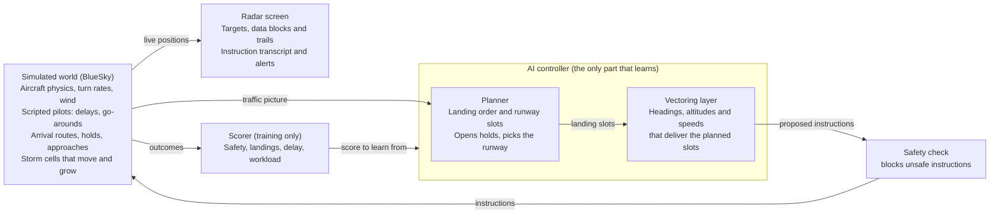

# AI Approach Controller — Project Plan

Snapshot of the shared project plan, 5 November 2026 · James Le Cuirot

We build an open benchmark for AI approach control at Gatwick, and an AI controller that works arrival traffic from the arrival fixes onto final while we watch it on a radar screen. It starts with two aircraft and speed control only, then grows stage by stage to wake spacing, holds, go-arounds, runway changes and storms.

**End goal:** an open benchmark for AI approach control at a real, busy airport, starting with Gatwick, with our AI controller as its first entrant. The controller safely and efficiently manages all the arrival traffic, you can watch it working on a radar screen, and the benchmark scores it against real controllers handling the same traffic.

## What you'll watch

The finished demo is a radar scope showing an approach sector during a busy hour, with the AI working every arrival from the arrival fixes to the runway. Each target has a data block (callsign, altitude, speed) and a trail. The AI's instructions scroll in a transcript, for example "DAL123, turn left heading 250, descend and maintain 4,000". Conflict alerts and storm cells are drawn on the scope.

Everything on screen is either a problem the world creates or a decision the AI makes. Keeping the two apart is also how we build and test it: the world's behaviour is scripted, and the AI is the part being trained.

| The world throws at it | The AI decides |
| --- | --- |
| Arrivals in a steady stream, sometimes in bunches | The landing order and each aircraft's slot |
| An aircraft that ends up too high or too fast | Re-vectoring it for a longer path or another try |
| A go-around (the simulated pilot calls it when the approach is unstable) | Where to slot that aircraft back into the sequence |
| More traffic than the runway can take | When to open a published hold, then pulling aircraft from the stack in order |
| Heavy aircraft with a large wake | Bigger gaps behind them on final |
| A wind shift that favours the other runway | When to change runways, and how to re-sequence |
| A storm cell drifting across the approach | Vectoring around it, or delay vectors |

A later nice-to-have is a synthetic voice reading the instructions aloud, so the demo sounds like a real frequency.

## Prior work and what's new

Others have built pieces of an AI approach controller, but we found no work that combines vectoring, sequencing, holds, go-arounds, wake spacing, runway changes and weather in one controller at a real airport. The closest are a 2026 comparison of rule-based and reinforcement-learning control in terminal airspace, a 2025 Taiwanese thesis that automates approach control at Tokyo Haneda, NTU Singapore's arrival-sequencing research, and the UK's Project Bluebird, which targets en-route airspace.

### NTU Singapore (ATMRI)

The Air Traffic Management Research Institute, led by Sameer Alam, is the most active group on AI for terminal-area control. Its work has two strands: automating arrival sequencing, and learning from how human controllers decide.

| Work | What it does | What it leaves open |
| --- | --- | --- |
| [Jiang, Lim, Pham, Dhief, Alam et al., SESAR 2024](https://www.sesarju.eu/sites/default/files/documents/sid/2024/papers/SIDs_2024_paper_072%20final.pdf) | Reinforcement learning suggests direct-to routes to the initial approach fix, for conflict-free arrival sequencing in the Tianjin multi-airport terminal area. A training speed-up cut training time by 82% | One kind of instruction, advisory only. No vectoring to final, holds or go-arounds |
| Dhief, Feroskhan, Alam et al., CEC 2023 † | Optimises the landing sequence under RECAT-EU wake categories, then generates vectors so each flight absorbs its delay before the final approach fix. 50 arrivals sequenced in 16 seconds, 85% of delay absorbed | Optimisation, not learning. No live re-planning around go-arounds or weather |
| Lim, Alam, Dhief, Schultz, J. Air Transport Management 2022 † | Predicts holding and terminal-area delay with machine learning, then slows flights en route so less holding is needed | Works upstream of the approach controller, not on it |
| Guleria, Pham, Alam et al., 2021 and 2024 † | Learns which aircraft controllers move to resolve conflicts, from human-in-the-loop simulations (about 95% accuracy), then copies their strategies by behaviour cloning | Conflict resolution only, not approach sequencing |
| Pham, Alam, Duong, Complexity 2020 † | Extracts controller instructions (heading, speed, vertical changes) from surveillance data and predicts them | Prediction, not control |

### Others

| Work | What it does | What it leaves open |
| --- | --- | --- |
| [Han Lu, 2026](https://www.researchgate.net/publication/403995945_Assessment_of_Rule-Based_and_Reinforcement_Learning_Control_Methods_with_Evaluation_of_Reward_Parameters_in_Terminal_Space_Empirical_Comparison_Using_ADS-B_Data), "Assessment of Rule-Based and Reinforcement Learning Control Methods with Evaluation of Reward Parameters in Terminal Space: Empirical Comparison Using ADS-B Data" † | Compares rule-based and reinforcement-learning control in terminal airspace using ADS-B data, including how reward settings matter | Not yet read. Probably the closest single paper to stages 1–3 |
| [Chen, "Auto-ATC", master's thesis, National Taiwan University, 2025](https://tdr.lib.ntu.edu.tw/jspui/handle/123456789/98584) | Predicts each aircraft's trajectory with a diffusion-transformer trained on OpenSky data, then turns the predictions into instructions with rules. Tested in a modified OpenScope simulator on a Tokyo Haneda scenario, landing about 95% of aircraft | Copies past trajectories rather than learning from practice. One aircraft at a time, and no comparison with real controllers |
| Groh and Lehrmann, "ApproachNet: Physics-Grounded Safety Layers for Data-Driven Aircraft Approach Control", 14th OpenSky Symposium, 2026 † | Safety layers based on physics around a data-driven approach controller | Not yet read. Its safety-layer idea may suit our design |
| [Jager and Szabo, Applied Sciences, 2025](https://www.mdpi.com/2076-3417/15/12/6414), "Air Traffic Simulation Framework for Testing Automated Air Traffic Control Solutions" † | A simulation framework for testing automated air traffic control | Not yet read. Must be compared with our open environment |
| Fustagueras, Waltert, Olive and Jarry, "Inferred Tactical Command Sampling for Stochastic Vertical Profile Generation Using ADS-B Data", 14th OpenSky Symposium, 2026 † | Infers controllers' tactical commands from ADS-B to generate realistic vertical profiles | A route to learning from real controllers |
| [Project Bluebird](https://www.nats.aero/about-us/research/n/project-bluebird/): NATS, Alan Turing Institute, University of Exeter, 2021–2026 | AI agents for tactical control on BluebirdDT, a digital twin of UK airspace, with a shadow trial against human controllers planned for 2026. Its 2026 papers cover a [rules-based agent for en-route airspace](https://arxiv.org/abs/2601.04285) and [reinforcement-learning agents that bundle small actions into fewer clearances](https://arxiv.org/abs/2601.04287) | En-route, not approach. Built on NATS data, so not open |
| [Zhu et al., Transportation Research Part E, 2026](https://research.polyu.edu.hk/en/publications/priority-driven-reinforcement-learning-for-multi-aircraft-traject/) (Hong Kong PolyU) | Reinforcement learning plans arrival trajectories around moving weather from radar data, on Hong Kong's approach procedures | Plans trajectories rather than giving controller instructions. No holds or runway changes |
| Holding studies: [Vella, Gauci, Dingli, J. Open Aviation Science, 2025](https://journals.open.tudelft.nl/joas/article/view/7890); Olive, Basora, Sun and Spinielli, 12th OpenSky Symposium, 2024 †; Dalmau, Very and Jarry, 11th OpenSky Symposium, 2023 † | Predict Heathrow holding times from OpenSky data (about 1.5 minutes average error), detect holding patterns with machine learning, and explain the causes and environmental cost of holding | Holding prediction on its own is well covered |
| Brittain and Wei, 2019 † | Multi-agent reinforcement learning resolves conflicts in a busy en-route sector in BlueSky | En-route, no landings |
| BlueSky-Gym (TU Delft) | Small training environments for merging, obstacles and descent | Building blocks, not an airport |
| BeyondATC and SayIntentions.AI † | Commercial AI air traffic control for flight-sim pilots | Talks to the person flying. Does not learn to manage traffic |

† Details from abstracts and listings found in search, not yet read in full.

### What this project adds

1. **The whole approach job in one controller**, learned stage by stage: vectoring, sequencing, holds, go-arounds, wake spacing, runway changes and weather. Each work above covers one or two of these. Auto-ATC comes closest, but works one aircraft at a time and turns its predictions into instructions with fixed rules.
2. **An open benchmark at a busy real airport.** The same real traffic, scoring and baselines for every controller, so results can be compared. Today each paper tests in its own simulator and scenarios, Bluebird is closed, and most papers release no code.
3. **AI against human controllers on identical scenarios, published openly**, using VATSIM controllers and possibly Gatwick's own.
4. **Moving a trained controller to a new airport** (Gatwick to Geneva), which none of the works above attempt.

### What we can reuse

- **AI training:** Bluebird's bundling of small actions into fewer clearances, to cut instruction counts. NTU's behaviour cloning, to warm-start the AI from real controllers before practice.
- **Data and baselines:** the Malta holding-time method, already applied to London airspace with OpenSky data, for Gatwick's WILLO and TIMBA stacks. NTU's extraction of controller instructions from surveillance data, to recover how Gatwick controllers actually vectored.
- **A stronger baseline:** NTU's sequencing-and-vectoring optimiser is a tougher non-AI bar than our hand-written rules controller.

This comes from a targeted search on 5 November 2026 and OpenSky's list of publications using its data, not a systematic review. Reading the closest papers in full is the next step before claiming any of the above is a first.

## How it works

Three pieces run together: the simulated world, the AI controller and the radar screen, with a fixed safety check between the controller and the aircraft. The controller has two layers, matching how a real controller thinks: first the plan, then the instructions that deliver it.

Both layers start as hand-written rules. The vectoring layer is replaced by a learned model first (stages 1–3) and the planner once holds arrive (stage 4), so there is a working controller to watch at every stage.

## Why have an agent if code can do it?

It's a fair question, and it's the central question of the project. Stage 0's hand-written rules controller handled about 30 arrivals an hour of clean, made-up traffic, then broke at about 40 an hour (scenarios `busy_30_per_hour` and `busy_40_per_hour`). Hand-written rules work well for the situations you think of in advance. The trouble is that each new thing needs its own rules, and those rules start interfering with each other:

- The stress test broke for two reasons, no holds and running out of altitudes. Each fix is another rule.
- Then add wind, go-arounds that need slotting back in, a runway change mid-session, a storm across the downwind, a heavy that needs a bigger gap, and an aircraft that's slow to respond. Every combination needs handling, and in practice rule-based systems get brittle and full of special cases.
- Rules are also "good enough" rather than best: first come, first served, a fixed pattern and a fixed safety margin. A learned controller might find tighter spacing, a better landing order or fewer track miles. At Gatwick, even one or two extra landings an hour would matter a lot.

## How the AI learns

The AI learns by practising: it works thousands of simulated sessions, each one is scored, and over time it keeps doing what scores well. At first its instructions are close to random. A simulated hour of traffic runs in seconds, so millions of practice decisions are realistic on a laptop.

| Scored item | Effect on score | Why |
| --- | --- | --- |
| Loss of separation (under 3 NM and 1,000 ft, or under the wake minimum on final) | Large penalty | Safety comes before everything else |
| Entering a storm cell | Large penalty | Aircraft must be kept clear of weather |
| Unstable approach or go-around | Medium penalty | Teaches it to deliver aircraft at the right height and speed |
| Aircraft landed | Reward | The point of the job |
| Each minute an aircraft spends in the sector | Small cost | Stops it parking everyone in a hold forever |
| Each instruction issued | Small cost | Rewards fewer, cleaner instructions, as a good controller gives |
| Instruction blocked by the safety check | Medium penalty | Teaches it not to lean on the safety net |

Design choices made up front, so later stages don't force a rewrite:

- **Any number of aircraft.** Each aircraft is described separately and the model looks across them, instead of a fixed list of slots.
- **Realistic timing.** The AI decides every 10 seconds or so, aircraft turn at the standard 3° per second, and simulated pilots take a few seconds to respond.
- **Same physics in training and on screen.** The world the AI practises in is the world we watch. This is the main flaw in atc_app today.
- **Small model.** Tens of thousands of parameters, trained with PPO (a standard reinforcement-learning method). No GPU needed for the early stages.
- **Scaled scores.** Raw scores are scaled down before training, the fix atc_app needed when its training became unstable.
- **Any airport.** Airports plug in as data (runways, arrivals, holds, approaches), so Gatwick is the first airport rather than the only one. Naveen's JFK data and Geneva in stage 7 use the same code.
- **A safety check outside the AI.** A fixed, rule-based check sits between the AI and the aircraft and blocks any instruction that would break separation, terrain or airspace limits. The AI trains with it in place, and every block is counted and reported, so it is clear how much the AI relied on it. It knows each runway's RMA (radar manoeuvring area): once inside it, an aircraft may not be vectored out, and outside it an aircraft may only be turned towards it, sent direct to a fix or held. It also applies the minimum altitude for where each aircraft is.

## Training process

The AI learns mostly by trial and error in the simulator, with a head start from the rules controller. Real data supplies the traffic it practises on and the controllers it is compared with.

**What the AI sees and does.** Every 10 seconds or so it gets the traffic picture: each aircraft's position, altitude, speed, heading and wake category, its distance to the runway and to the aircraft ahead, and the airspace limits. It answers with instructions: heading, altitude, speed, hold, or cleared for the approach. The scoring above tells it afterwards how well that went.

1. **Start tiny and build up.** One aircraft, one runway and no wind, learning only to get established on the ILS. Each roadmap stage adds one thing and starts from the previous stage's model, the way a trainee builds up (curriculum learning).
2. **Head start from the rules controller.** At the start of each stage the AI briefly copies the rules controller (behaviour cloning), so it doesn't begin from random instructions.
3. **Practice.** Many simulations run in parallel. In each one the AI makes its own decisions and is scored, and training nudges it towards what scored well (PPO). This is where it can overtake the rules controller.
4. **Check.** Test it on scenarios it never practised on, and watch replays as well as scores.

Where real data fits:

- **Traffic:** real Gatwick arrival streams handed over at WILLO and TIMBA, for practice and testing. Some real days are kept back for testing only.
- **Comparison:** the same days, as handled by real controllers.
- **Optional teacher:** controller instructions inferred from ADS-B (turns, level-offs, speed changes), as NTU Singapore has done. ADS-B shows what aircraft did, not what controllers said, so this is noisy: a later experiment or an extra head start, not the main training.

Copying alone can only match the controllers it watched, and never learns what happens after a bad decision. Trial and error alone starts slow and random, and may find odd strategies. The mix gets the best of both.

## Measuring success

The AI succeeds when it is never unsafe and lands traffic at least as efficiently as a hand-written rules controller, and gets close to what real controllers achieve. Every measure is tracked across many sessions, never a single run.

| Measure | Target | Compared against |
| --- | --- | --- |
| Separation losses per 100 sessions | 0 | Hard requirement at every stage |
| Arrival pairs meeting the wake minimum on final | 100% | Hard requirement from stage 3 |
| Approaches stable at 1,000 ft | 95% or more | Rules controller |
| Average gap above the minimum at the runway | Smaller than the rules controller | Rules controller and real controllers |
| Landings per hour at a given demand | Equal to or above the rules controller | Rules controller and real controllers |
| Extra track miles and delay per arrival | Below the rules controller | Rules controller and real controllers |
| Instructions per arrival | Below the rules controller | Rules controller |

Five baselines put the numbers in context:

1. **Random controller.** A sanity floor: if the AI can't beat random instructions, something is broken.
2. **Rules controller.** Hand-written in stage 0. It assigns landing slots and vectors tactically to hit them. This is the bar the AI must clear.
3. **Imitation controller.** Copies how aircraft were actually flown in the ADS-B data, as Auto-ATC does. Shows whether learning from practice beats copying, and puts the work directly alongside the closest existing system.
4. **Real controllers, recorded.** Measured from real ADS-B arrivals at Gatwick: spacing achieved on final, track miles flown, time in holds. Because the AI works the same recorded arrivals from the boundary, each replayed day is a direct comparison: identical traffic, handled once by the AI and once by real controllers.
5. **Real controllers, live.** If Gatwick's approach controllers at NATS agree, they work the same scenarios on our radar screen and are scored exactly as the AI is. This is the strongest comparison, and the hardest to arrange.

The targets are starting points, to be tuned once we see real numbers.

## Roadmap

Eight stages take the project from two aircraft to the full demo, then to a second airport. Each stage adds one new thing to watch and ends in a gate: a test from Measuring success that must pass before the next stage starts.

| Stage | What's new on screen | Gate to pass |
| --- | --- | --- |
| 0 · Foundations | Simulator, safety check, radar screen and rules controller; real controllers scored | The rules controller lands two arrivals safely, start to finish, on screen |
| 1 · Speed, then base turns | 1a: the AI adjusts only speeds. 1b: it also chooses when each aircraft turns base. Wind, pilot speed (±10 kt) and descent rates vary | The AI's spacing on final beats the rules controller's |
| 2 · Vectoring onto final | Downwind, base and intercept, using headings, altitudes and speeds | 95% of approaches stable at 1,000 ft, every intercept at 45° or less |
| 3 · Traffic and wake | A busy hour of arrivals in mixed sizes, with bigger gaps behind heavy aircraft, and the other real traffic (Gatwick departures, Heathrow, overflights) replayed around them | No separation losses, with each other or with the other traffic, and every pair at its wake minimum, over 100 sessions |
| 4 · Holds and go-arounds | Holds stack up at peak demand and empty in order; go-arounds are re-sequenced | Stacks built and emptied in order, with no separation losses |
| 5 · Runway change | A wind shift mid-session; the AI switches runways and re-sequences the traffic | Runway change completed with no separation losses |
| 6 · Storms: the end vision | Moving storm cells; aircraft vectored around them or given delay vectors | No aircraft enters a storm cell, with no separation losses |
| 7 · Second airport: Geneva (earmarked) | The Gatwick-trained AI moved to Geneva, with terrain and a new airspace layout | — |

**Other traffic.** The real data already holds the aircraft we don't control: Gatwick's departures, Heathrow's traffic and overflights. They come in three steps. First, replay them along their real tracks as traffic we can't instruct, so the safety check and the scores see any conflict with them; they don't react to us, so this measures risk rather than modelling it. Second, mark the areas and levels they use (departure routes, Heathrow's airspace to the north) as no-go volumes in the safety check, once a Gatwick controller has said which matter. Third, with the runway model, simulate Gatwick's departures on their real departure routes and times, so they also take their real slots on the runway.

Stage 1 can start from BlueSky-Gym's MergeEnv and stage 6 from its StaticObstacleEnv, which shortens both. Stage 2's gate uses the European limit of joining final at an angle of 45° or less (EASA AMC2 ATS.TR.155). How long each stage takes depends on who joins the team, one of the open questions.

## First steps

The first four steps turn atc_app into the foundation, prove it on Naveen Mathew's own benchmark, then add Gatwick. Steps 1–3 make up stage 0, and step 4 runs alongside.

1. **Build the closed-loop environment.** Replace atc_app's replay-based training with a world run by BlueSky, where instructions take effect at real turn and climb rates, and fix the BlueSky connection. Done when the AI's "turn left 30°" turns the aircraft at about 3° a second and its track changes. Airports plug in as data, so Naveen's JFK data works as well as Gatwick.
2. **Retrain Naveen's agent on it and rerun his benchmark.** Same AI, same scoring, and his three scenarios (head-on, crossing, high density), compared with his published results. This answers the open question in his README: does fixing the mismatch improve his agent? The environment and results go back to atc_app as a contribution.
3. **Add Gatwick.** Enter its arrival routes, holds and approaches from the UK AIP and VATSIM material. Replay real arrivals from open ADS-B data up to the edge of the approach area, and hand each aircraft to the controller as it crosses. Then write the rules controller and the safety check, and show them on the radar screen. This completes stage 0.
4. **Start the data side in parallel.** Score how real controllers handled Gatwick arrivals from open ADS-B data (adsb.lol): spacing at the threshold, track miles and holding, with FlightPathAnalysis cleaning the tracks. This needs no AI, is the first publishable result, and becomes the benchmark's real-controller baseline.

Entering Gatwick's procedures for step 3 can start straight away, so every workstream has work from day one.

## Gatwick stage 0 spec

The full spec is in [stage0-gatwick-spec.md](stage0-gatwick-spec.md). Stage 0 hands each real arrival to the AI the first time it is within 40 NM of Gatwick and at or below FL150, and ends when the aircraft is established on the ILS for 26L or 08R. It is built from VATSIM UK's Gatwick procedures and the UK AIP.

## Stage 1: speed, then base turns

Stage 1 puts the first learning agent in charge of one thing at a time: speed in 1a, then speed and when to turn base in 1b. The rules controller keeps the routing, altitudes, landing order and ILS clearances. The agent's job is to deliver each aircraft exactly the required gap behind the one ahead: 3 NM, or the wake minimum if larger. Departures aren't modelled yet, so there are no 6 or 8 NM gaps to leave for them. Speed first keeps the learning problem small and proves the training setup, but it isn't how controllers mainly space traffic: they mostly use vectors, which is why 1b follows quickly.

### A less tidy world

Stage 0's world had no variation, so timing was easy. Stage 1 adds the following, and the rules controller faces exactly the same conditions:

| Variation | Range | Why it matters |
| --- | --- | --- |
| Wind | Real winds at every height from NOAA's GFS weather model: the same hour as the real traffic for benchmark sessions, hours from past years for training | Changes ground speed, so timing that works in still air comes out wrong |
| Pilot speed | Assigned speed held only within ±10 kt | Gaps drift, so the controller has to keep correcting |
| Descent rate | From real Gatwick arrivals: typically 800–1,000 ft/min when descending, with the slowest tenth of flights near 550 and the fastest near 1,300, varying by type | A slow descender can reach the intercept too high and have to go around, so its descent must start earlier |
| Release times and aircraft types | Real arrival streams from the chosen days, plus random made-up traffic for extra variety | The agent can't memorise one traffic pattern |

The wind needs no made-up range: it is whatever Gatwick actually had. Strong wind is rare (since mid-2023 Gatwick's reported surface wind reached 15 kt only 4% of the time), so training includes extra windy hours. Descent rates come from real arrivals too; start with the real spread, then widen it once the agent copes.

### First: the rules controller in the new world

Before any learning, the stage 0 rules controller flies stage 0's scenarios in the new conditions, about 200 sessions each, and the results go in the diary. Stage 0's own results stand: every variation is a switch, off by default, so they still reproduce.

Then the rules controller gets the fixes any competent programmer would make, such as timing with the wind rather than still air and starting descents earlier with a margin, and is frozen. That frozen version is what the agent has to beat: beating a rules controller that ignores the wind would prove nothing. Recording both versions also adds to the case for an agent, since every fix is another rule.

### 1a: speed only

- **What the agent does:** every 10 seconds, for each aircraft, speed up or slow down by 10 or 20 kt, or hold. Speeds stay within the published bands (up to 250 kt on the downwind, 160–180 kt on base and intercept, 160 kt by 7 NM), and everything goes through the safety check.
- **What it sees:** for each aircraft, distance and time to go, current speed, wake category, how far above or below its planned descent it is, the gap to the aircraft ahead and the gap it needs.
- **Paths are fixed,** so speed is the only lever. The traffic is arranged so that speed alone can make the gaps, which is up to about 2 minutes of delay per aircraft.
- **Competitor:** a speed-only rules controller on the same paths.

### 1b: speed plus when to turn base

- **Adds one decision per aircraft:** when to turn from the downwind onto base, which lengthens or shortens its path. That is how controllers absorb larger delays.
- **Allows real bunches of arrivals,** up to the busy-hour stress tests.
- **Competitor:** the full stage 0 rules controller, which stretches the downwind.

### Training and testing

1. A head start: the agent first copies the rules controller.
2. Practice with PPO, many simulations in parallel.
3. Scoring: a reward per landing; a penalty for how far each gap is from the target, much larger if too close; small costs per instruction and per minute in the sector; large penalties for separation losses, blocked instructions and go-arounds, including those caused by arriving too high.
4. Testing on about 200 sessions the agent never practised on.

**Gates.** 1a: across the test sessions, gaps closer to the target than the speed-only rules controller, with no separation losses, no wake infringements and no more speed instructions. 1b: the same against the full rules controller, plus more landings per hour on the busy-hour stress tests.

**Diary.** "Watching it learn": the same scenario recorded at 0, 10,000, 100,000 and 1 million practice decisions, from near-random speed changes to clean, even gaps.

**Unknowns.** Training time: about a million decisions might take 3–4 hours across 8 parallel simulations on a normal computer, and BlueSky can run with a coarser time step if that's too slow.

## Tools and data

Everything needed is free and open source, so the project runs on a laptop with no paid data or licences.

| Piece | Tool | What it gives us |
| --- | --- | --- |
| Simulator | [BlueSky](https://github.com/TUDelft-CNS-ATM/bluesky) 1.1.1 (TU Delft), MIT licence | Aircraft physics and autopilot, navigation data, wind, and a built-in radar display |
| Starter environments | [BlueSky-Gym](https://pypi.org/project/bluesky-gym/) 0.2.0, MIT licence | Ready-made training worlds: MergeEnv (arrivals merging, a head start on stage 1), StaticObstacleEnv (routing around no-go areas, a head start on storms), DescentEnv |
| Training | Stable-Baselines3 and PyTorch | A tested PPO implementation, so we write the world and scoring, not the learning algorithm |
| Radar display | BlueSky's radar first, then our own browser radar scope | BlueSky's display is enough for stages 0–2. The demo gets a custom scope with data blocks, trails, the instruction transcript and storm overlays, plus a mode where a person gives the instructions instead of the AI. OpenScope, the open-source browser simulator Auto-ATC used, is worth checking as a ready-made scope |
| Procedures | Gatwick's published procedures from the UK AIP (NATS) | Arrivals, the WILLO and TIMBA holds, and approaches to 26L and 08R |
| Airspace data | [VATSIM UK sector file](https://github.com/VATSIM-UK/UK-Sector-File), GPL-3 | Fix coordinates, vectoring-area and minimum-altitude shapes, arrival routes and runways, already in coordinates. Downloaded by script, not committed |
| Controller procedures | VATSIM UK controller guides and forums | How Gatwick traffic is vectored in practice: speed control, when holds are used. Written for the simulation network, so check details against the UK AIP |
| Real traffic | [adsb.lol](https://www.adsb.lol)'s open ADS-B data (ODbL 1.0), with [FlightPathAnalysis](https://github.com/SNaveenMathew/FlightPathAnalysis) for cleaning if needed | Every Gatwick arrival every day since late December 2023, with tracks every few seconds: real arrival streams for the simulator, and the real-controller baseline. Its live feed could drive a live demo |
| Weather | Wind from [NOAA's GFS weather model](https://registry.opendata.aws/noaa-gfs-bdp-pds/) (public domain, free on NOAA's open data store). Simulated storm cells first | Real winds at every height for any hour since 2021, downloaded once and kept locally. Storms start as moving no-go shapes that grow and drift; real storm data is a later option |

## Relationship to atc_app

This project lives in its own repo and contributes fixes back to [atc_app](https://github.com/SNaveenMathew/atc_app), whose author invites collaborators. Building on it directly would mean rewriting its core first. Two problems found when reading its code:

- **Turns and speed changes have no effect in training.** The training world replays recorded tracks, so a heading or speed instruction changes the number on the aircraft but not where it goes next. Only altitude instructions have any effect.
- **The BlueSky connection has probably never run.** It calls BlueSky functions by names that don't exist in BlueSky 1.1.1 (`selhdg` instead of `selhdgcmd`, and so on), and it ignores the 10-second time step it is given.

The simulated world built in stage 0, where aircraft actually respond to instructions, fixes both. Offering it upstream as a pull request is a real contribution and costs little extra work. Open an issue with the author first, so the change fits their plans.

Neither atc_app nor FlightPathAnalysis has a licence file yet, so their code is not copied into this repo until the author adds one or gives permission.

The project also stays separate from CitadelAero for now, as an independent research project. Both BlueSky and BlueSky-Gym are MIT licensed, so nothing stops the work moving closer later if it proves useful.

## Risks

The biggest risk is that one AI can't learn the whole job at once. The two-layer design and stage-by-stage plan exist to contain it.

| Risk | Why it matters | Fallback |
| --- | --- | --- |
| The AI can't learn the full job end to end | Holds, sequencing and vectoring together is research-level hard | Keep the planner and vectoring layers separate. Either can stay rules-based while the other is learned |
| The AI games the score | It may find tricks such as holding everyone to avoid conflicts, or sending aircraft out of the sector | Time costs and landing rewards in the score. Watch replays of every new model, not just its numbers |
| The simulator is too perfect | Simulated pilots that never lag or overshoot make the AI look better than it is | Add response delays and small speed and altitude errors. Check against real ADS-B arrivals |
| Training is too slow on a laptop | Later stages need far more practice sessions | Keep the model small and run many simulations in parallel. Rent a cloud machine only for the late stages |
| It runs out of steam as a side project | Months of evenings with nothing to show | Every stage ends in something watchable. Stopping after any stage still leaves a demo |
| Controllers can't take part in live sessions | Live sessions need their employer's agreement and their own time | Compare against recorded ADS-B traffic instead, or invite volunteer controllers from VATSIM, the online flight-simulation network |

## Team

The work splits into four workstreams that one person each can own, so a team of three or four can work in parallel. Possible fits so far:

| Workstream | What it covers | Possible fit |
| --- | --- | --- |
| Simulated world | Gatwick airspace and procedures, scripted pilots, wind and storms | James, using the UK AIP and VATSIM material |
| AI training | Scoring, the model, training runs | Naveen Mathew, author of atc_app and FlightPathAnalysis (to approach) |
| Data and baselines | Open ADS-B data for Gatwick, the real-controller baseline, the metrics | A data scientist in Jersey (to approach) |
| Radar screen | The scope, the instruction transcript, the mode for human controllers | Open |

A controller is the biggest gap. [Questions for a Gatwick controller](questions-for-a-gatwick-controller.md) lists what the simulator, safety check and scoring currently guess at, starting with whether arrivals can ever be vectored outside the RMA. VATSIM UK's Gatwick controllers and mentors are the first people to ask; a real controller later, to check realism before the benchmark is published.

The atc_app fixes described above make a natural opener with Naveen Mathew: they solve that project's top open issue.

## Publications

Each stage produces a result worth publishing, so the project can put out papers as it goes rather than one at the end. Preprints go on arXiv first, with the code and environment open so others can reproduce the results.

| Paper | Comes from | Lead workstream | Possible venue |
| --- | --- | --- | --- |
| How well do real controllers do? Scoring Gatwick approach control from open ADS-B data: spacing at the threshold, track miles and holding, for every arrival | Data side, from the start | Data and baselines | OpenSky Symposium (proceedings in the Journal of Open Aviation Science) |
| An open Gatwick approach benchmark: real procedures, replayed real arrivals, standard scenarios and scoring, and rules and real-controller baselines | Stages 0–2 | Simulated world | SESAR Innovation Days, or the Journal of Open Aviation Science |
| Learning to vector arrivals onto final at Gatwick: RL against a rules controller and real controllers on identical traffic | Stages 1–3 | AI training | SESAR Innovation Days, or ICRAT (International Conference on Research in Air Transportation) |
| A two-layer AI approach controller handling holds, go-arounds, runway changes and storms | Stages 4–6 | AI training and simulated world | ICRAT, the USA/Europe ATM R&D Seminar, or a journal such as Transportation Research Part C |
| AI and human controllers on the same traffic: a live comparison with VATSIM controllers, and possibly NATS | Live baseline | Whole team | ICRAT or the ATM R&D Seminar |
| Does an approach controller trained at Gatwick work at Geneva? | Stage 7 | AI training | Journal paper |

- **Authorship follows the workstreams.** Whoever leads a paper is first author, and everyone who contributed is a co-author.
- **Data and acknowledgements.** adsb.lol's data is under the ODbL, so any dataset we publish from it credits adsb.lol and stays under the same licence. OpenSky asks users of its data to cite its reference paper. VATSIM UK material and the sector file need acknowledging, and live sessions need each controller's consent.
- **Deadlines change each year,** so check the calls for papers once a result is close.
- **Not papers on their own.** The atc_app fix is a contribution to Naveen's repo and a blog post. Gatwick holding prediction is already well studied at other airports, so holding is measured inside the real-controller scoring paper instead.
- **Rigour decides the AI papers.** Many training runs, test days kept apart from practice days, and the same scoring for every controller. Without these they read as another reinforcement-learning air traffic control paper, and they must be positioned against Han Lu's paper and Auto-ATC.

## Decisions

| Question | Decision |
| --- | --- |
| Airport | London Gatwick: one of the busiest single-runway airports, with daily holding at WILLO and TIMBA and runway changes between 26L and 08R. Geneva is earmarked for stage 7, a test of whether the AI copes with terrain and a new layout |
| Repo | A personal GitHub repo, `jameslecuirot/ai-approach-controller`, public from November 2026 |
| Licence | MIT for the code. The real traffic data in `data/real/` stays under adsb.lol's ODbL. The VATSIM UK sector file (GPL-3) is fetched by script, not bundled |
| Synthetic voice | Not now. A possible nice-to-have later |
| Arrival traffic | Real Gatwick arrivals from adsb.lol's open ADS-B data (ODbL), every day since late December 2023. The AI takes over each aircraft the first time it is within 40 NM and at or below FL150, wherever it is: heading for a hold, on a direct or on a heading from the previous controller. OpenSky's full data is only for research institutions, and the EUROCONTROL PRC 2024 dataset covers only a few percent of Gatwick's flights |
| Live demo | Possible with adsb.lol's free live feed: aircraft arrive live and change colour when the AI takes them over, with the real track continuing in faint grey behind. The radar replay already does this for past days |
| The AI model | A small neural network trained locally with reinforcement learning. No paid APIs |
| Project framing | Benchmark first: an open Gatwick benchmark with real traffic and real-controller scores, with our AI as its first entrant. Adds real-controller scoring as the first result, a safety check, and an imitation baseline. Decided after reviewing OpenSky's publication list |

## Open questions

- [ ] **Who joins the team, and with how much time?** This sets the timeline. Candidates and workstreams are listed in Team.
- [ ] **Laptop or cloud?** Start on laptops. A shared cloud machine for training becomes worth it once several people are training models.
- [ ] **Read the closest papers in full:** Han Lu (2026), ApproachNet (2026), Auto-ATC (2025), the Applied Sciences framework (2025), and NTU's arrival-sequencing work.
- [ ] **OpenScope as the radar screen?** Check its licence, whether it has Gatwick, and how it would connect to BlueSky.
- [ ] **Does Gatwick use 2.5 NM on final?** UK and EASA rules (AMC1 ATS.TR.210(c)(2)) allow 2.5 NM between aircraft established on the same final within 10 NM, where approved, and real Gatwick pairs at 2.5–3 NM appear in the data. The scoring allows it for every controller; confirm with a Gatwick controller.
- [ ] **Wake categories at Gatwick:** the scoring uses RECAT-EU. Confirm which scheme Gatwick applies.

## Sources

- [Building an ATC RL agent](https://snaveenmathew.github.io/tech_non_tech_blog/2026/09/12/Building-an-ATC-RL-agent.html), Naveen Mathew, Sep 2026
- [Flight Path Templates](https://snaveenmathew.github.io/tech_non_tech_blog/2026/10/31/Flight-Path-Templates.html), Naveen Mathew, Oct 2026
- [atc_app](https://github.com/SNaveenMathew/atc_app) repo (code read at its latest commit, Sep 11 2026)
- [FlightPathAnalysis](https://github.com/SNaveenMathew/FlightPathAnalysis) repo
- [BlueSky](https://github.com/TUDelft-CNS-ATM/bluesky): package 1.1.1 inspected for function names and licence
- [BlueSky-Gym](https://pypi.org/project/bluesky-gym/): package 0.2.0 inspected for its environments and licence
- [Jiang et al., Direct-to Initial Approach Fix](https://www.sesarju.eu/sites/default/files/documents/sid/2024/papers/SIDs_2024_paper_072%20final.pdf), SESAR Innovation Days 2024
- [Project Bluebird](https://www.nats.aero/about-us/research/n/project-bluebird/), NATS
- [A Future Capabilities Agent for Tactical Air Traffic Control](https://arxiv.org/abs/2601.04285), arXiv, Jan 2026
- [Online Action-Stacking Improves Reinforcement Learning Performance for Air Traffic Control](https://arxiv.org/abs/2601.04287), arXiv, Jan 2026
- [Priority-driven reinforcement learning under dynamic weather hazards](https://research.polyu.edu.hk/en/publications/priority-driven-reinforcement-learning-for-multi-aircraft-traject/), Hong Kong PolyU, 2026
- [Data-Driven Prediction of Aircraft Holding Times Using OpenSky Data](https://journals.open.tudelft.nl/joas/article/view/7890), J. Open Aviation Science, 2025
- [The Hybrid AI-Human Air Traffic Management](https://www.eurocontrol.int/sites/default/files/2021-03/fly-ai-webinar-2-ntu.pdf), Sameer Alam, EUROCONTROL FLY AI webinar, 2021
- [adsb.lol open historical data](https://www.adsb.lol/docs/open-data/historical/) (ODbL 1.0)
- [OpenSky Network: publications using OpenSky data](https://opensky-network.org/about/publications) and [scientific datasets](https://opensky-network.org/data/scientific)
- [Auto-ATC: A Diffusion-Transformer-Based Automatic Air Traffic Control System](https://tdr.lib.ntu.edu.tw/jspui/handle/123456789/98584), master's thesis, National Taiwan University, 2025
- [NOAA Global Forecast System on AWS open data](https://registry.opendata.aws/noaa-gfs-bdp-pds/): 0.25 degree winds, checked against Gatwick's METARs
- [Iowa State University METAR archive](https://mesonet.agron.iastate.edu/request/download.phtml): Gatwick's reported surface wind since mid-2023
