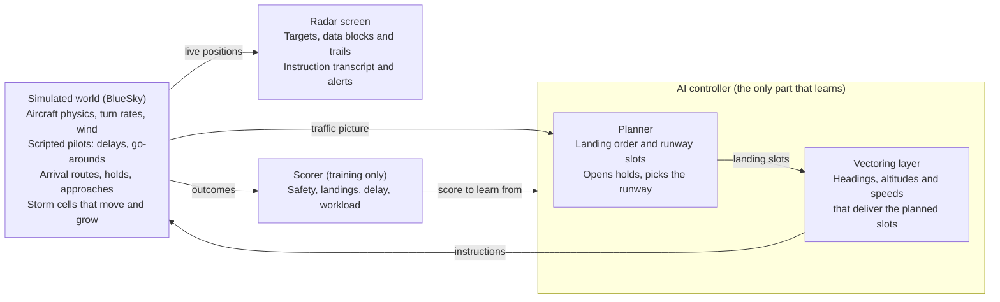

# AI Approach Controller — Project Plan

Snapshot of the shared project plan, 5 November 2026 · James Le Cuirot

We build a simulated approach radar where an AI controller works arrival traffic from the arrival fixes onto final, and we watch it on a radar screen. It starts with two aircraft and speed control only, then grows stage by stage to wake spacing, holds, go-arounds, runway changes and storms.

**End goal:** an AI approach controller that safely and efficiently manages all the arrival traffic into a real, busy airport, starting with Gatwick, which you can watch working on a radar screen and compare against real controllers handling the same traffic.

## What you'll watch

The finished demo is a radar scope showing an approach sector during a busy hour, with the AI working every arrival from the arrival fixes to the runway. Each target has a data block (callsign, altitude, speed) and a trail. The AI's instructions scroll in a transcript, for example "DAL123, turn left heading 250, descend and maintain 4,000". Conflict alerts and storm cells are drawn on the scope.

Everything on screen is either a problem the world creates or a decision the AI makes. Keeping the two apart is also how we build and test it: the world's behaviour is scripted, and the AI is the part being trained.

| The world throws at it | The AI decides |
| --- | --- |
| Arrivals in a steady stream, sometimes in bunches | The landing order and each aircraft's slot |
| An aircraft that ends up too high or too fast | Re-vectoring it for a longer path or another try |
| A go-around (the simulated pilot calls it when the approach is unstable) | Where to slot that aircraft back into the sequence |
| More traffic than the runway can take | When to open a published hold, then pulling aircraft from the stack in order |
| Heavy aircraft with a large wake | Bigger gaps behind them on final |
| A wind shift that favours the other runway | When to change runways, and how to re-sequence |
| A storm cell drifting across the approach | Vectoring around it, or delay vectors |

A later nice-to-have is a synthetic voice reading the instructions aloud, so the demo sounds like a real frequency.

## Prior work and what's new

Others have built pieces of an AI approach controller, but we found no work that combines vectoring, sequencing, holds, go-arounds, wake spacing, runway changes and weather in one controller at a real airport. The closest are NTU Singapore's arrival-sequencing research and the UK's Project Bluebird, which targets en-route airspace.

### NTU Singapore (ATMRI)

The Air Traffic Management Research Institute, led by Sameer Alam, is the most active group on AI for terminal-area control. Its work has two strands: automating arrival sequencing, and learning from how human controllers decide.

| Work | What it does | What it leaves open |
| --- | --- | --- |
| [Jiang, Lim, Pham, Dhief, Alam et al., SESAR 2024](https://www.sesarju.eu/sites/default/files/documents/sid/2024/papers/SIDs_2024_paper_072%20final.pdf) | Reinforcement learning suggests direct-to routes to the initial approach fix, for conflict-free arrival sequencing in the Tianjin multi-airport terminal area. A training speed-up cut training time by 82% | One kind of instruction, advisory only. No vectoring to final, holds or go-arounds |
| Dhief, Feroskhan, Alam et al., CEC 2023 † | Optimises the landing sequence under RECAT-EU wake categories, then generates vectors so each flight absorbs its delay before the final approach fix. 50 arrivals sequenced in 16 seconds, 85% of delay absorbed | Optimisation, not learning. No live re-planning around go-arounds or weather |
| Lim, Alam, Dhief, Schultz, J. Air Transport Management 2022 † | Predicts holding and terminal-area delay with machine learning, then slows flights en route so less holding is needed | Works upstream of the approach controller, not on it |
| Guleria, Pham, Alam et al., 2021 and 2024 † | Learns which aircraft controllers move to resolve conflicts, from human-in-the-loop simulations (about 95% accuracy), then copies their strategies by behaviour cloning | Conflict resolution only, not approach sequencing |
| Pham, Alam, Duong, Complexity 2020 † | Extracts controller instructions (heading, speed, vertical changes) from surveillance data and predicts them | Prediction, not control |

### Others

| Work | What it does | What it leaves open |
| --- | --- | --- |
| [Project Bluebird](https://www.nats.aero/about-us/research/n/project-bluebird/): NATS, Alan Turing Institute, University of Exeter, 2021–2026 | AI agents for tactical control on BluebirdDT, a digital twin of UK airspace, with a shadow trial against human controllers planned for 2026. Its 2026 papers cover a [rules-based agent for en-route airspace](https://arxiv.org/abs/2601.04285) and [reinforcement-learning agents that bundle small actions into fewer clearances](https://arxiv.org/abs/2601.04287) | En-route, not approach. Built on NATS data, so not open |
| [Zhu et al., Transportation Research Part E, 2026](https://research.polyu.edu.hk/en/publications/priority-driven-reinforcement-learning-for-multi-aircraft-traject/) (Hong Kong PolyU) | Reinforcement learning plans arrival trajectories around moving weather from radar data, on Hong Kong's approach procedures | Plans trajectories rather than giving controller instructions. No holds or runway changes |
| [Vella, Gauci, Dingli, J. Open Aviation Science, 2025](https://journals.open.tudelft.nl/joas/article/view/7890) (University of Malta) | Predicts holding times in the London terminal area for Heathrow from OpenSky data, to about 1.5 minutes average error | Prediction only |
| Brittain and Wei, 2019 † | Multi-agent reinforcement learning resolves conflicts in a busy en-route sector in BlueSky | En-route, no landings |
| BlueSky-Gym (TU Delft) | Small training environments for merging, obstacles and descent | Building blocks, not an airport |
| BeyondATC and SayIntentions.AI † | Commercial AI air traffic control for flight-sim pilots | Talks to the person flying. Does not learn to manage traffic |

† Details from abstracts and listings found in search, not yet read in full.

### What this project adds

1. **The whole approach job in one controller**, learned stage by stage: vectoring, sequencing, holds, go-arounds, wake spacing, runway changes and weather. Each work above covers one or two of these.
2. **A busy real airport, fully open.** An open Gatwick approach environment that anyone can test a controller against. Bluebird is closed and most papers release no code.
3. **AI against human controllers on identical scenarios, published openly**, using VATSIM controllers and possibly Gatwick's own.
4. **Moving a trained controller to a new airport** (Gatwick to Geneva), which none of the works above attempt.

### What we can reuse

- **AI training:** Bluebird's bundling of small actions into fewer clearances, to cut instruction counts. NTU's behaviour cloning, to warm-start the AI from real controllers before practice.
- **Data and baselines:** the Malta holding-time method, already applied to London airspace with OpenSky data, for Gatwick's WILLO and TIMBA stacks. NTU's extraction of controller instructions from surveillance data, to recover how Gatwick controllers actually vectored.
- **A stronger baseline:** NTU's sequencing-and-vectoring optimiser is a tougher non-AI bar than our hand-written rules controller.

This is a targeted search from 5 November 2026, not a systematic review. Reading the NTU papers in full is the next step before claiming any of the above is a first.

## How it works

Three pieces run together: the simulated world, the AI controller and the radar screen. The controller has two layers, matching how a real controller thinks: first the plan, then the instructions that deliver it.

Both layers start as hand-written rules. The vectoring layer is replaced by a learned model first (stages 1–3) and the planner once holds arrive (stage 4), so there is a working controller to watch at every stage.

## How the AI learns

The AI learns by practising: it works thousands of simulated sessions, each one is scored, and over time it keeps doing what scores well. At first its instructions are close to random. A simulated hour of traffic runs in seconds, so millions of practice decisions are realistic on a laptop.

| Scored item | Effect on score | Why |
| --- | --- | --- |
| Loss of separation (under 3 NM and 1,000 ft, or under the wake minimum on final) | Large penalty | Safety comes before everything else |
| Entering a storm cell | Large penalty | Aircraft must be kept clear of weather |
| Unstable approach or go-around | Medium penalty | Teaches it to deliver aircraft at the right height and speed |
| Aircraft landed | Reward | The point of the job |
| Each minute an aircraft spends in the sector | Small cost | Stops it parking everyone in a hold forever |
| Each instruction issued | Small cost | Rewards fewer, cleaner instructions, as a good controller gives |

Design choices made up front, so later stages don't force a rewrite:

- **Any number of aircraft.** Each aircraft is described separately and the model looks across them, instead of a fixed list of slots.
- **Realistic timing.** The AI decides every 10 seconds or so, aircraft turn at the standard 3° per second, and simulated pilots take a few seconds to respond.
- **Same physics in training and on screen.** The world the AI practises in is the world we watch. This is the main flaw in atc_app today.
- **Small model.** Tens of thousands of parameters, trained with PPO (a standard reinforcement-learning method). No GPU needed for the early stages.
- **Scaled scores.** Raw scores are scaled down before training, the fix atc_app needed when its training became unstable.
- **Any airport.** Airports plug in as data (runways, arrivals, holds, approaches), so Gatwick is the first airport rather than the only one. Naveen's JFK data and Geneva in stage 7 use the same code.

## Measuring success

The AI succeeds when it is never unsafe and lands traffic at least as efficiently as a hand-written rules controller, and gets close to what real controllers achieve. Every measure is tracked across many sessions, never a single run.

| Measure | Target | Compared against |
| --- | --- | --- |
| Separation losses per 100 sessions | 0 | Hard requirement at every stage |
| Arrival pairs meeting the wake minimum on final | 100% | Hard requirement from stage 3 |
| Approaches stable at 1,000 ft | 95% or more | Rules controller |
| Average gap above the minimum at the runway | Smaller than the rules controller | Rules controller and real controllers |
| Landings per hour at a given demand | Equal to or above the rules controller | Rules controller and real controllers |
| Extra track miles and delay per arrival | Below the rules controller | Rules controller and real controllers |
| Instructions per arrival | Below the rules controller | Rules controller |

Four baselines put the numbers in context:

1. **Random controller.** A sanity floor: if the AI can't beat random instructions, something is broken.
2. **Rules controller.** Hand-written in stage 0. It assigns landing slots and vectors tactically to hit them. This is the bar the AI must clear.
3. **Real controllers, recorded.** Measured from real ADS-B arrivals at Gatwick: spacing achieved on final, track miles flown, time in holds. Because the AI works the same recorded arrivals from the boundary, each replayed day is a direct comparison: identical traffic, handled once by the AI and once by real controllers.
4. **Real controllers, live.** If Gatwick's approach controllers at NATS agree, they work the same scenarios on our radar screen and are scored exactly as the AI is. This is the strongest comparison, and the hardest to arrange.

The targets are starting points, to be tuned once we see real numbers.

## Roadmap

Eight stages take the project from two aircraft to the full demo, then to a second airport. Each stage adds one new thing to watch and ends in a gate: a test from Measuring success that must pass before the next stage starts.

| Stage | What's new on screen | Gate to pass |
| --- | --- | --- |
| 0 · Foundations | Simulator, radar screen and a rules controller flying two arrivals to the runway | The rules controller lands two arrivals safely, start to finish, on screen |
| 1 · Speed-only spacing | 2–4 arrivals on one arrival route; the AI only adjusts their speeds | The AI's spacing on final beats the rules controller's |
| 2 · Vectoring onto final | Downwind, base and intercept, using headings, altitudes and speeds | 95% of approaches stable at 1,000 ft, every intercept at 45° or less |
| 3 · Traffic and wake | A busy hour of arrivals in mixed sizes, with bigger gaps behind heavy aircraft | No separation losses and every pair at its wake minimum, over 100 sessions |
| 4 · Holds and go-arounds | Holds stack up at peak demand and empty in order; go-arounds are re-sequenced | Stacks built and emptied in order, with no separation losses |
| 5 · Runway change | A wind shift mid-session; the AI switches runways and re-sequences the traffic | Runway change completed with no separation losses |
| 6 · Storms: the end vision | Moving storm cells; aircraft vectored around them or given delay vectors | No aircraft enters a storm cell, with no separation losses |
| 7 · Second airport: Geneva (earmarked) | The Gatwick-trained AI moved to Geneva, with terrain and a new airspace layout | — |

Stage 1 can start from BlueSky-Gym's MergeEnv and stage 6 from its StaticObstacleEnv, which shortens both. Stage 2's gate uses the European limit of joining final at an angle of 45° or less (EASA AMC2 ATS.TR.155). How long each stage takes depends on who joins the team, one of the open questions.

## First steps

The first four steps turn atc_app into the foundation, prove it on Naveen Mathew's own benchmark, then add Gatwick. Steps 1–3 make up stage 0, and step 4 runs alongside.

1. **Build the closed-loop environment.** Replace atc_app's replay-based training with a world run by BlueSky, where instructions take effect at real turn and climb rates, and fix the BlueSky connection. Done when the AI's "turn left 30°" turns the aircraft at about 3° a second and its track changes. Airports plug in as data, so Naveen's JFK data works as well as Gatwick.
2. **Retrain Naveen's agent on it and rerun his benchmark.** Same AI, same scoring, and his three scenarios (head-on, crossing, high density), compared with his published results. This answers the open question in his README: does fixing the mismatch improve his agent? The environment and results go back to atc_app as a contribution.
3. **Add Gatwick.** Enter its arrival routes, holds and approaches from the UK AIP and VATSIM material. Replay real arrivals from OpenSky data up to the edge of the approach airspace, and hand each aircraft to the controller as it crosses. Then write the rules controller and show it on the radar screen. This completes stage 0.
4. **Start the data side in parallel.** Run FlightPathAnalysis on Gatwick OpenSky data to get real arrival routes for realistic traffic, and start the WILLO and TIMBA holding-time study.

Entering Gatwick's procedures for step 3 can start straight away, so every workstream has work from day one.

## Gatwick stage 0 spec

The full spec is in [stage0-gatwick-spec.md](stage0-gatwick-spec.md). Stage 0 hands each real arrival to the AI at the WILLO or TIMBA release point and ends when the aircraft is established on the ILS for 26L or 08R. It is built from VATSIM UK's Gatwick procedures and the UK AIP.

## Tools and data

Everything needed is free and open source, so the project runs on a laptop with no paid data or licences.

| Piece | Tool | What it gives us |
| --- | --- | --- |
| Simulator | [BlueSky](https://github.com/TUDelft-CNS-ATM/bluesky) 1.1.1 (TU Delft), MIT licence | Aircraft physics and autopilot, navigation data, wind, and a built-in radar display |
| Starter environments | [BlueSky-Gym](https://pypi.org/project/bluesky-gym/) 0.2.0, MIT licence | Ready-made training worlds: MergeEnv (arrivals merging, a head start on stage 1), StaticObstacleEnv (routing around no-go areas, a head start on storms), DescentEnv |
| Training | Stable-Baselines3 and PyTorch | A tested PPO implementation, so we write the world and scoring, not the learning algorithm |
| Radar display | BlueSky's radar first, then our own browser radar scope | BlueSky's display is enough for stages 0–2. The demo gets a custom scope with data blocks, trails, the instruction transcript and storm overlays, plus a mode where a person gives the instructions instead of the AI |
| Procedures | Gatwick's published procedures from the UK AIP (NATS) | Arrivals, the WILLO and TIMBA holds, and approaches to 26L and 08R |
| Airspace data | [VATSIM UK sector file](https://github.com/VATSIM-UK/UK-Sector-File), GPL-3 | Fix coordinates, vectoring-area and minimum-altitude shapes, arrival routes and runways, already in coordinates. Downloaded by script, not committed |
| Controller procedures | VATSIM UK controller guides and forums | How Gatwick traffic is vectored in practice: speed control, when holds are used. Written for the simulation network, so check details against the UK AIP |
| Real traffic | OpenSky Network ADS-B history, cleaned with [FlightPathAnalysis](https://github.com/SNaveenMathew/FlightPathAnalysis) | Realistic arrival streams to feed the simulator, and the real-controller baseline. Free for non-commercial research, with an account |
| Weather | Simulated storm cells first | Moving no-go shapes that grow and drift. Real weather data is a later option |

## Relationship to atc_app

This project lives in its own repo and contributes fixes back to [atc_app](https://github.com/SNaveenMathew/atc_app), whose author invites collaborators. Building on it directly would mean rewriting its core first. Two problems found when reading its code:

- **Turns and speed changes have no effect in training.** The training world replays recorded tracks, so a heading or speed instruction changes the number on the aircraft but not where it goes next. Only altitude instructions have any effect.
- **The BlueSky connection has probably never run.** It calls BlueSky functions by names that don't exist in BlueSky 1.1.1 (`selhdg` instead of `selhdgcmd`, and so on), and it ignores the 10-second time step it is given.

The simulated world built in stage 0, where aircraft actually respond to instructions, fixes both. Offering it upstream as a pull request is a real contribution and costs little extra work. Open an issue with the author first, so the change fits their plans.

Neither atc_app nor FlightPathAnalysis has a licence file yet, so their code is not copied into this repo until the author adds one or gives permission.

The project also stays separate from CitadelAero for now, as an independent research project. Both BlueSky and BlueSky-Gym are MIT licensed, so nothing stops the work moving closer later if it proves useful.

## Risks

The biggest risk is that one AI can't learn the whole job at once. The two-layer design and stage-by-stage plan exist to contain it.

| Risk | Why it matters | Fallback |
| --- | --- | --- |
| The AI can't learn the full job end to end | Holds, sequencing and vectoring together is research-level hard | Keep the planner and vectoring layers separate. Either can stay rules-based while the other is learned |
| The AI games the score | It may find tricks such as holding everyone to avoid conflicts, or sending aircraft out of the sector | Time costs and landing rewards in the score. Watch replays of every new model, not just its numbers |
| The simulator is too perfect | Simulated pilots that never lag or overshoot make the AI look better than it is | Add response delays and small speed and altitude errors. Check against real ADS-B arrivals |
| Training is too slow on a laptop | Later stages need far more practice sessions | Keep the model small and run many simulations in parallel. Rent a cloud machine only for the late stages |
| It runs out of steam as a side project | Months of evenings with nothing to show | Every stage ends in something watchable. Stopping after any stage still leaves a demo |
| Controllers can't take part in live sessions | Live sessions need their employer's agreement and their own time | Compare against recorded ADS-B traffic instead, or invite volunteer controllers from VATSIM, the online flight-simulation network |

## Team

The work splits into four workstreams that one person each can own, so a team of three or four can work in parallel. Possible fits so far:

| Workstream | What it covers | Possible fit |
| --- | --- | --- |
| Simulated world | Gatwick airspace and procedures, scripted pilots, wind and storms | James, using the UK AIP and VATSIM material |
| AI training | Scoring, the model, training runs | Naveen Mathew, author of atc_app and FlightPathAnalysis (to approach) |
| Data and baselines | OpenSky ADS-B for Gatwick, the real-controller baseline, the metrics | A data scientist in Jersey (to approach) |
| Radar screen | The scope, the instruction transcript, the mode for human controllers | Open |

The atc_app fixes described above make a natural opener with Naveen Mathew: they solve that project's top open issue.

## Decisions

| Question | Decision |
| --- | --- |
| Airport | London Gatwick: one of the busiest single-runway airports, with daily holding at WILLO and TIMBA and runway changes between 26L and 08R. Geneva is earmarked for stage 7, a test of whether the AI copes with terrain and a new layout |
| Repo | A personal GitHub repo, `jameslecuirot/ai-approach-controller`, private until the stage 0 prototype works |
| Synthetic voice | Not now. A possible nice-to-have later |
| Arrival traffic | Real Gatwick arrivals from OpenSky ADS-B data, replayed up to the edge of the approach airspace. The AI takes over each aircraft as it crosses that boundary |
| The AI model | A small neural network trained locally with reinforcement learning. No paid APIs |

## Open questions

- [ ] **Who joins the team, and with how much time?** This sets the timeline. Candidates and workstreams are listed in Team.
- [ ] **Laptop or cloud?** Start on laptops. A shared cloud machine for training becomes worth it once several people are training models.
- [ ] **Licence for this repo.** MIT keeps it widest open; GPL-3 would allow bundling the VATSIM UK sector file. Decide before going public.

## Sources

- [Building an ATC RL agent](https://snaveenmathew.github.io/tech_non_tech_blog/2026/09/12/Building-an-ATC-RL-agent.html), Naveen Mathew, Sep 2026
- [Flight Path Templates](https://snaveenmathew.github.io/tech_non_tech_blog/2026/10/31/Flight-Path-Templates.html), Naveen Mathew, Oct 2026
- [atc_app](https://github.com/SNaveenMathew/atc_app) repo (code read at its latest commit, Sep 11 2026)
- [FlightPathAnalysis](https://github.com/SNaveenMathew/FlightPathAnalysis) repo
- [BlueSky](https://github.com/TUDelft-CNS-ATM/bluesky): package 1.1.1 inspected for function names and licence
- [BlueSky-Gym](https://pypi.org/project/bluesky-gym/): package 0.2.0 inspected for its environments and licence
- [Jiang et al., Direct-to Initial Approach Fix](https://www.sesarju.eu/sites/default/files/documents/sid/2024/papers/SIDs_2024_paper_072%20final.pdf), SESAR Innovation Days 2024
- [Project Bluebird](https://www.nats.aero/about-us/research/n/project-bluebird/), NATS
- [A Future Capabilities Agent for Tactical Air Traffic Control](https://arxiv.org/abs/2601.04285), arXiv, Jan 2026
- [Online Action-Stacking Improves Reinforcement Learning Performance for Air Traffic Control](https://arxiv.org/abs/2601.04287), arXiv, Jan 2026
- [Priority-driven reinforcement learning under dynamic weather hazards](https://research.polyu.edu.hk/en/publications/priority-driven-reinforcement-learning-for-multi-aircraft-traject/), Hong Kong PolyU, 2026
- [Data-Driven Prediction of Aircraft Holding Times Using OpenSky Data](https://journals.open.tudelft.nl/joas/article/view/7890), J. Open Aviation Science, 2025
- [The Hybrid AI-Human Air Traffic Management](https://www.eurocontrol.int/sites/default/files/2021-03/fly-ai-webinar-2-ntu.pdf), Sameer Alam, EUROCONTROL FLY AI webinar, 2021
