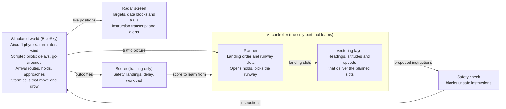

# AI Approach Controller — Project Plan

Snapshot of the shared project plan, 6 November 2026 · James Le Cuirot

We build an open benchmark for AI approach control at Gatwick, and an AI controller that works arrival traffic onto final while we watch it on a radar screen. It starts with speed control only, then grows stage by stage to vectoring, wake spacing, holds, go-arounds, runway changes and storms.

**End goal:** an open benchmark for AI approach control at a real, busy airport, starting with Gatwick, with our AI controller as its first entrant. The controller safely and efficiently manages all the arrival traffic, you can watch it working on a radar screen, and the benchmark scores it against real controllers handling the same traffic. The aim is for it to match, and ideally beat, those controllers.

## What you'll watch

The finished demo is a radar scope showing an approach sector during a busy hour, with the AI working every arrival from the moment it is handed over to the runway. Each target has a data block (callsign, altitude, speed) and a trail. The AI's instructions scroll in a transcript, for example "DAL123, turn left heading 250, descend and maintain 4,000". Conflict alerts and storm cells are drawn on the scope, and so is the AI's plan: its landing sequence, the gap it is aiming for behind each aircraft and where it expects each one to go.

Everything on screen is either a problem the world creates or a decision the AI makes. Keeping the two apart is also how we build and test it: the world's behaviour is scripted, and the AI is the part being trained.

| The world throws at it | The AI decides |
| --- | --- |
| Arrivals in a steady stream, sometimes in bunches | The landing order and each aircraft's slot |
| An aircraft that ends up too high or too fast | Re-vectoring it for a longer path or another try |
| A go-around (the simulated pilot calls it when the approach is unstable) | Where to slot that aircraft back into the sequence |
| More traffic than the runway can take | When to open a published hold, then pulling aircraft from the stack in order |
| Heavy aircraft with a large wake | Bigger gaps behind them on final |
| A wind shift that favours the other runway | When to change runways, and how to re-sequence |
| A storm cell drifting across the approach | Vectoring around it, or delay vectors |

A later nice-to-have is a synthetic voice reading the instructions aloud, so the demo sounds like a real frequency.

## Prior work and what's new

Others have built pieces of an AI approach controller, but we found no work that combines vectoring, sequencing, holds, go-arounds, wake spacing, runway changes and weather in one controller at a real airport. The closest are a 2026 comparison of rule-based and reinforcement-learning control in terminal airspace, a 2025 Taiwanese thesis that automates approach control at Tokyo Haneda, NTU Singapore's arrival-sequencing research, and the UK's Project Bluebird, which targets en-route airspace.

### NTU Singapore (ATMRI)

The Air Traffic Management Research Institute, led by Sameer Alam, is the most active group on AI for terminal-area control. Its work has two strands: automating arrival sequencing, and learning from how human controllers decide.

| Work | What it does | What it leaves open |
| --- | --- | --- |
| [Jiang, Lim, Pham, Dhief, Alam et al., SESAR 2024](https://www.sesarju.eu/sites/default/files/documents/sid/2024/papers/SIDs_2024_paper_072%20final.pdf) | Reinforcement learning suggests direct-to routes to the initial approach fix, for conflict-free arrival sequencing in the Tianjin multi-airport terminal area. A training speed-up cut training time by 82% | One kind of instruction, advisory only. No vectoring to final, holds or go-arounds |
| Dhief, Feroskhan, Alam et al., CEC 2023 † | Optimises the landing sequence under RECAT-EU wake categories, then generates vectors so each flight absorbs its delay before the final approach fix. 50 arrivals sequenced in 16 seconds, 85% of delay absorbed | Optimisation, not learning. No live re-planning around go-arounds or weather |
| Lim, Alam, Dhief, Schultz, J. Air Transport Management 2022 † | Predicts holding and terminal-area delay with machine learning, then slows flights en route so less holding is needed | Works upstream of the approach controller, not on it |
| Guleria, Pham, Alam et al., 2021 and 2024 † | Learns which aircraft controllers move to resolve conflicts, from human-in-the-loop simulations (about 95% accuracy), then copies their strategies by behaviour cloning | Conflict resolution only, not approach sequencing |
| Pham, Alam, Duong, Complexity 2020 † | Extracts controller instructions (heading, speed, vertical changes) from surveillance data and predicts them | Prediction, not control |

### Others

| Work | What it does | What it leaves open |
| --- | --- | --- |
| [Han Lu, 2026](https://www.researchgate.net/publication/403995945_Assessment_of_Rule-Based_and_Reinforcement_Learning_Control_Methods_with_Evaluation_of_Reward_Parameters_in_Terminal_Space_Empirical_Comparison_Using_ADS-B_Data), "Assessment of Rule-Based and Reinforcement Learning Control Methods with Evaluation of Reward Parameters in Terminal Space: Empirical Comparison Using ADS-B Data" † | Compares rule-based and reinforcement-learning control in terminal airspace using ADS-B data, including how reward settings matter | Not yet read. Probably the closest single paper to stages 1–3 |
| [Chen, "Auto-ATC", master's thesis, National Taiwan University, 2025](https://tdr.lib.ntu.edu.tw/jspui/handle/123456789/98584) | Predicts each aircraft's trajectory with a diffusion-transformer trained on OpenSky data, then turns the predictions into instructions with rules. Tested in a modified OpenScope simulator on a Tokyo Haneda scenario, landing about 95% of aircraft | Copies past trajectories rather than learning from practice. One aircraft at a time, and no comparison with real controllers |
| Groh and Lehrmann, "ApproachNet: Physics-Grounded Safety Layers for Data-Driven Aircraft Approach Control", 14th OpenSky Symposium, 2026 † | Safety layers based on physics around a data-driven approach controller | Not yet read. Its safety-layer idea may suit our design |
| [Jager and Szabo, Applied Sciences, 2025](https://www.mdpi.com/2076-3417/15/12/6414), "Air Traffic Simulation Framework for Testing Automated Air Traffic Control Solutions" † | A simulation framework for testing automated air traffic control | Not yet read. Must be compared with our open environment |
| Fustagueras, Waltert, Olive and Jarry, "Inferred Tactical Command Sampling for Stochastic Vertical Profile Generation Using ADS-B Data", 14th OpenSky Symposium, 2026 † | Infers controllers' tactical commands from ADS-B to generate realistic vertical profiles | A route to learning from real controllers |
| [Project Bluebird](https://www.nats.aero/about-us/research/n/project-bluebird/): NATS, Alan Turing Institute, University of Exeter, 2021–2026 | AI agents for tactical control on BluebirdDT, a digital twin of UK airspace, with a shadow trial against human controllers planned for 2026. Its 2026 papers cover a [rules-based agent for en-route airspace](https://arxiv.org/abs/2601.04285) and [reinforcement-learning agents that bundle small actions into fewer clearances](https://arxiv.org/abs/2601.04287). In 2026 it released [BluebirdATC](https://github.com/project-bluebird/BluebirdATC) as open source (AGPL-3.0): the digital twin, a REST API, Gymnasium environments for single and multiple agents, and a radar display, with a probabilistic aircraft model and synthetic en-route sectors and scenarios, plus a [geometric safety filter](https://github.com/project-bluebird/geometric_safety) (MIT) | En-route, not approach: the public release has no runways, ILS, holds or arrival streams, and its sectors and scenarios are synthetic. The NATS data behind it is not public |
| [Zhu et al., Transportation Research Part E, 2026](https://research.polyu.edu.hk/en/publications/priority-driven-reinforcement-learning-for-multi-aircraft-traject/) (Hong Kong PolyU) | Reinforcement learning plans arrival trajectories around moving weather from radar data, on Hong Kong's approach procedures | Plans trajectories rather than giving controller instructions. No holds or runway changes |
| Holding studies: [Vella, Gauci, Dingli, J. Open Aviation Science, 2025](https://journals.open.tudelft.nl/joas/article/view/7890); Olive, Basora, Sun and Spinielli, 12th OpenSky Symposium, 2024 †; Dalmau, Very and Jarry, 11th OpenSky Symposium, 2023 † | Predict Heathrow holding times from OpenSky data (about 1.5 minutes average error), detect holding patterns with machine learning, and explain the causes and environmental cost of holding | Holding prediction on its own is well covered |
| Brittain and Wei, 2019 † | Multi-agent reinforcement learning resolves conflicts in a busy en-route sector in BlueSky | En-route, no landings |
| BlueSky-Gym (TU Delft) | Small training environments for merging, obstacles and descent | Building blocks, not an airport |
| BeyondATC and SayIntentions.AI † | Commercial AI air traffic control for flight-sim pilots | Talks to the person flying. Does not learn to manage traffic |

† Details from abstracts and listings found in search, not yet read in full.

### What this project adds

1. **The whole approach job in one controller**, learned stage by stage: vectoring, sequencing, holds, go-arounds, wake spacing, runway changes and weather. Each work above covers one or two of these. Auto-ATC comes closest, but works one aircraft at a time and turns its predictions into instructions with fixed rules.
2. **An open benchmark at a busy real airport.** The same real traffic, scoring and baselines for every controller, so results can be compared. Today each paper tests in its own simulator and scenarios, Bluebird's open release covers synthetic en-route sectors, and most papers release no code.
3. **AI against human controllers on identical scenarios, published openly**, using VATSIM controllers and possibly Gatwick's own.
4. **Moving a trained controller to a new airport,** which none of the works above attempt.

### What we can reuse

- **AI training:** Bluebird's bundling of small actions into fewer clearances, to cut instruction counts. NTU's behaviour cloning, to warm-start the AI from real controllers before practice.
- **From Project Bluebird:** ideas rather than code, since BluebirdATC's AGPL-3.0 licence would carry over to this MIT-licensed project. How its Gymnasium environments represent the airspace, actions and rewards (for stage 2's design, see Before stage 2 under Roadmap); how its probabilistic aircraft model predicts trajectories (for stage 2's learned model); and its geometric safety filter, which is MIT-licensed, for the safety check. Bluebird is also a natural contact (see Team).
- **Data and baselines:** the Malta holding-time method, already applied to London airspace with OpenSky data, for Gatwick's WILLO and TIMBA stacks. NTU's extraction of controller instructions from surveillance data, to recover how Gatwick controllers actually vectored.
- **A stronger baseline:** NTU's sequencing-and-vectoring optimiser is a tougher non-AI bar than our hand-written rules controller.

This comes from a targeted search on 5 November 2026 and OpenSky's list of publications using its data, not a systematic review. Reading the closest papers in full is the next step before claiming any of the above is a first.

## How it works

Three pieces run together: the simulated world, the AI controller and the radar screen, with a fixed safety check between the controller and the aircraft. The controller has two layers, matching how a real controller thinks: first the plan, then the instructions that deliver it.

Both layers start as hand-written rules. The vectoring layer is replaced by a learned model first (stages 1–3) and the planner once holds arrive (stage 4), so there is a working controller to watch at every stage.

**One controller, and logs it can't touch.** A single AI controller works all the traffic, as one approach controller does today. A team of agents, one per aircraft, is a later comparison (see Roadmap). The session log is written only by the simulated world and the safety check, never by the controller, like a flight data recorder the crew can't switch off. Each log's checksum is saved with its scores, so a log changed afterwards would show.

**Two real jobs.** At Gatwick the work is split between two controllers. The Intermediate Director takes aircraft off the WILLO and TIMBA stacks and merges them into one stream, around Mayfield for westerlies and just north of WILLO for easterlies. Traffic is turned onto base and handed on descending to 4,000 ft at 210 kt or less. The Final Director puts the stream onto the ILS. Our planner and vectoring layers follow the same split, and our single AI does both jobs, which the benchmark says when it compares it with the real controllers. These details come from controller guides and are to be confirmed by a Gatwick controller.

## Why have an agent if code can do it?

It's a fair question, and it's the central question of the project. Stage 0's hand-written rules controller handled about 30 arrivals an hour of clean, made-up traffic, then broke at about 40 an hour (scenarios `busy_30_per_hour` and `busy_40_per_hour`). Hand-written rules work well for the situations you think of in advance. The trouble is that each new thing needs its own rules, and those rules start interfering with each other:

- The stress test broke for two reasons, no holds and running out of altitudes. Each fix is another rule.
- Then add wind, go-arounds that need slotting back in, a runway change mid-session, a storm across the downwind, a heavy that needs a bigger gap, and an aircraft that's slow to respond. Every combination needs handling, and in practice rule-based systems get brittle and full of special cases.
- Rules are also "good enough" rather than best: first come, first served, a fixed pattern and a fixed safety margin. A learned controller might find tighter spacing, a better landing order or fewer track miles. At Gatwick, even one or two extra landings an hour would matter a lot.
- An agent that learns from practice rather than by copying people isn't limited to what controllers already do. Game-playing AIs such as AlphaGo found moves no human played, and an approach controller might likewise find spacing or sequencing that controllers don't use. It is also tested on situations real days rarely show, such as rescuing a sequence that has gone wrong.

## How the AI learns

The AI learns by practising: it works thousands of simulated sessions, each one is scored, and over time it keeps doing what scores well. At first its instructions are close to random. A simulated hour of traffic runs in seconds, so millions of practice decisions are realistic on a laptop.

| Scored item | Effect on score | Why |
| --- | --- | --- |
| Loss of separation (under 3 NM and 1,000 ft, or under the wake minimum on final) | Large penalty | Safety comes before everything else |
| Entering a storm cell | Large penalty | Aircraft must be kept clear of weather |
| Unstable approach or go-around | Medium penalty | Teaches it to deliver aircraft at the right height and speed |
| Aircraft landed | Reward | The point of the job |
| Each minute an aircraft spends in the sector | Small cost | Stops it parking everyone in a hold forever |
| Each instruction issued | Small cost | Rewards fewer, cleaner instructions, as a good controller gives |
| Instruction blocked by the safety check | Medium penalty | Teaches it not to lean on the safety net |
| Spacing on target and aircraft on profile, every few seconds | Small reward along the way | The result of a decision can take minutes to show: a descent started late at 30 NM only goes wrong at 5 NM. Small rewards along the way make it easier to learn which decision was to blame |

The score is a number, and the AI will do whatever pushes it up, even something silly (reward hacking). Only punish separation losses and it leaves everyone in the hold: no conflicts, no landings. Only reward landings and it rushes aircraft in too close. So the terms pull against each other, the safety check stops the worst actions outright, and every run is checked as described under Training process. The costs for time and track miles stay small: at a busy airport, sending aircraft the long way round is how a good sequence is built, and the score mustn't punish it.

Design choices made up front, so later stages don't force a rewrite:

- **Relative inputs.** The AI sees each aircraft as a controller does: the gap to the one ahead and how fast it is closing, the gap it needs, track miles to touchdown, height and speed against the profile, and its margins above the minimum altitude and inside the RMA. Positions are measured from the runway in use, not as latitude and longitude. "A medium 4 NM behind a heavy and closing" then means the same thing wherever it happens, which helps the AI cope with traffic it hasn't seen and keeps a move to another airport possible. Which inputs work best is tested, not assumed: each stage compares the chosen set with a fuller one on the test days.
- **Any number of aircraft.** Each aircraft is described the same way and the model looks across the whole list, so it works the same with 2 aircraft or 30, and the order of the list doesn't matter. The alternative, a fixed view of the nearest few aircraft, is simpler but caps how many it can see.
- **Realistic timing.** In stage 1 the AI looks at the traffic every 10 seconds. "Do nothing" is always a valid choice and every instruction has a small cost, so it learns its own rhythm: quiet when the picture is fine, busy when it isn't, as a controller works. Shorter intervals are tried once training works. Aircraft turn at the standard 3° per second, and simulated pilots take a few seconds to respond.
- **Realistic instructions.** Speeds in 10 kt steps and headings in 5° steps, as controllers give them. Finer steps (2–3 kt, 2°) are a later experiment: aircraft can't hold speed that precisely, and unusual values such as heading 247 bring more readback errors, which the simulated pilots will make.
- **Same physics in training and on screen.** The world the AI practises in is the world we watch.
- **Model-free first, model-based later.** Stage 1 uses PPO (a standard reinforcement-learning method), with a small network of tens of thousands of parameters and no GPU. The long-term direction is model-based learning, which is closest to a controller's mental picture of where the traffic will be: a learned model predicts how each aircraft will move after an instruction, and the AI plans ahead with it. That model arrives in stage 2, then a fully model-based method such as DreamerV3 is compared with PPO. Project Bluebird's probabilistic, physics-informed aircraft model (trained on NATS flight records, open in BluebirdATC) is the closest published example of such a model, and its design is read before ours is built: what it predicts, how it represents uncertainty, and how it was checked against real tracks.
- **Scaled scores.** Raw scores are scaled down before training, the fix atc_app needed when its training became unstable.
- **Any airport.** Airports plug in as data (runways, arrivals, holds, approaches, minimum altitudes), so Gatwick is the first airport rather than the only one. Local facts are never learned: the safety check enforces them and the AI sees them as inputs, such as "800 ft above the minimum altitude".
- **A safety check outside the AI.** A fixed, rule-based check sits between the AI and the aircraft and blocks any instruction that would break separation, terrain or airspace limits. The AI trains with it in place, and every block is counted and reported, so it is clear how much the AI relied on it. It knows each runway's RMA (radar manoeuvring area): once inside it, an aircraft may not be vectored out, and outside it an aircraft may only be turned towards it, sent direct to a fix or held. It also applies the minimum altitude for where each aircraft is, and keeps vectored arrivals south of the extended centreline, away from the departure routes to the north. Real controllers do the same: in our data, over 99% of 26L arrivals and about 97% of 08R arrivals never went more than 1 NM north of it. When vectoring arrives in stage 2, the check's look-ahead is compared with Project Bluebird's [geometric safety filter](https://github.com/project-bluebird/geometric_safety), which uses reachability (every position an aircraft could reach under any allowed instruction) to rule out unsafe instructions. It is MIT-licensed, so its code can be used with credit if it does better.

## Training process

The AI learns mostly by trial and error in the simulator, with a head start from the rules controller. Real data supplies the traffic it practises on and the controllers it is compared with.

**What the AI sees and does.** Every 10 seconds in stage 1, and more often later, it gets the traffic picture in relative terms (see Relative inputs above), plus the runway in use, the wind and the airspace limits. Once pilots can make mistakes it also sees the last few moments, so it can notice an aircraft that isn't doing what it was told. It answers with instructions (heading, altitude, speed, hold, cleared for the approach) or with nothing. The scoring above tells it afterwards how well that went.

1. **Start small and build up.** Each roadmap stage adds one thing and starts from the previous stage's model, the way a trainee builds up (curriculum learning).
2. **Head start from the rules controller.** At the start of each stage the AI briefly copies the rules controller (behaviour cloning), so it doesn't begin from random instructions.
3. **Practice.** Many simulations run in parallel. In each one the AI makes its own decisions and is scored, and training nudges it towards what scored well (PPO). This is where it can overtake the rules controller.
4. **Check.** Test it on days it never practised on, and watch replays as well as scores.

**Never the same session twice.** An agent that practises the same traffic learns that traffic, not the job. So training takes a different real hour each time, from the training days, with that hour's or another hour's real winds, varied pilots and a varied start time. The test days are never used for practice. There is plenty of real data: adsb.lol has every day since late December 2023, so more days can be added whenever training needs them.

**Two test sets.** One day in four of each kind (storms, strong wind, easterlies, fog, busy summer, ordinary) is kept back for testing only (14 of the first 60 days; 16 of the 76 now). Both storm days fell into training, so a storm day still needs adding to the test set. And because new days keep arriving, the most recent weeks make a second test set (14 days so far) that rolls forward and that no version of the agent has ever seen, which is closest to real use. Before it is used, it is checked for a spread of weather and both runway directions, since recent weeks can all look alike.

**Tuning the score, and catching tricks.** The score is a small function with a weight for each term. Each round goes the same way: train, test on the held-back days, look at each measure on its own and at the replays, close any loophole that has appeared, and train again. Separate measures stop a good total from hiding one that got worse: landings per hour, time in the hold and separation losses are always tracked on their own. A brilliant score whose traffic flow looks nothing like real Gatwick's is treated as suspicious. Every training run is recorded with its weights, seed, code version and results, alongside the diary's scores.

Where real data fits:

- **Traffic:** real Gatwick arrival streams for practice and testing: their times, types, mixes and bunching. Each arrival is handed to our controller the first time it is within 40 NM and at or below FL150. That handover point is our assumption: in reality it depends on what the previous sector has arranged, so it is one of the questions for a Gatwick controller. Guides describe it this way: London Terminal Control offers each arrival at the stack, at the level above the highest aircraft holding (or minimum stack level plus 1,000 ft if nobody is holding), and tells it to hold; approach cancels the hold when it takes the aircraft off. In heavy holding, Terminal Control keeps the upper levels and passes aircraft down as they descend.
- **Comparison:** the same days, as handled by real controllers.
- **Optional teacher:** controller instructions inferred from ADS-B (turns, level-offs, speed changes), as NTU Singapore has done, as an extra head start. It is not the main teacher. ADS-B shows what aircraft did, not what controllers said, so instructions have to be guessed. Copying people caps the agent at their level and brings their habits with it. And real days are mostly tidy, so they rarely show a messy sequence being rescued.

Copying alone can only match the controllers it watched, and never learns what happens after a bad decision. Trial and error alone starts slow and random, and may find odd strategies. Practice in the simulator does the main teaching, with the real controllers as the yardstick.

## Simulated pilots

The agent will exploit any flaw in the simulator, such as pilots who respond instantly or descend better than real aircraft. So the simulated pilots are built to be as imperfect as real ones:

- **How they fly, from real arrivals** (from stage 2): pilots respond after 3 to 6 seconds, and each has its own bank angle, descent rate and rates of slowing down and speeding up, drawn from what real Gatwick arrivals do, with less bank in small turns as real autopilots fly them ([diary entry of 11 November](../diary/2026-11-11-stage2-01-how-aircraft-respond/README.md)). Until then this line said speed drift and real descent rates were already in. They weren't: every stage 1 result used BlueSky's own values, the same for every aircraft (25° of bank, 1,500 ft/min, and speed changes of 2 to 3 kt a second, four to five times faster than real aircraft). Holding an assigned speed only within ±10 kt isn't in yet: it can't be measured from ADS-B, which doesn't show the speed a pilot was given.
- **Occasional mistakes, at realistic rates:** turning the wrong way, a level bust (cleared to 3,000 ft but descending to 2,000 ft), and readback errors, more often on unusual values. The rates come from published studies, not guesses.
- **Readbacks.** Pilots read each instruction back, sometimes wrongly, and the controller hears the readback. Our simulator doesn't have readbacks yet, so this is new work. The agent needs to hear them as an input too.

Controllers catch these by watching that each aircraft does what it was told (conformance monitoring), and the agent has to learn the same. A new measure, how long it takes to spot and correct a deviation, counts it. Every controller, human or AI, gets the same mistakes in the same session, because they come from the session's seed. Mistakes start in stage 2, once the agent gives headings and levels.

## Controller tools

Real controllers work with support tools, and the benchmark gives the same tools to a human and to the AI, since removing them would handicap the human and make the comparison meaningless:

The tools work on two horizons: a last-minute safety net about two minutes ahead, and medium-term planning tools ten minutes ahead.

| Tool | Horizon | What it does |
| --- | --- | --- |
| STCA (short-term conflict alert) | About 2 minutes | Flags a pair of tracks likely to conflict, laterally and vertically, with a flashing border round their labels. A separate alert fires if separation is actually lost. It also covers traffic the sector doesn't control, and brings a filtered-out track back onto the display |
| Sector conflict tool | 10 minutes, 10 NM | A chart of time against closest distance for every pair of the sector's flights, with a dotted line at the separation minimum. Pairs that would break it show red, the rest green. For a red pair the time shown is when separation is first lost, since that is when action is needed |
| Vertical assistance window | 10 minutes | For the selected flight, a side view of time against level: its own profile, and the flights that come within 10 NM of it (green) or within the separation minimum (red), including traffic the sector doesn't control |
| Traffic probe | While a clearance is being chosen | The two medium-term tools re-run for a clearance being considered, before it is given, so the controller sees what it would cause |
| Vector lines and halos | A few minutes | Where each aircraft will be, and a ring of the separation minimum around a chosen aircraft |

All of these reuse one prediction: "if this aircraft did X, who would it come close to?" Each tool is mostly a different display of it. The medium-term tools describe how it works: a flight's path follows its heading if it is on one and its route if not, and vertically it covers the band from its current level to its cleared level. Two flights conflict when their paths come within 10 NM in the next 10 minutes and their level bands overlap. We build that prediction on the safety check's existing look-ahead, which already handles a proposed heading, the wind and holds, and add cleared levels and routes. BlueSky has conflict detection built in, but it is switched off by default and projects every aircraft in a straight line at its current track and vertical speed (default 5 NM, 1,000 ft, 5-minute look-ahead, adjustable per aircraft). It doesn't know about cleared levels, turns, the ILS or holds, so an aircraft descending to level off 1,000 ft above another would set it off. It is used as a cross-check.

For the AI, the tools become inputs, such as the predicted closest approach to each other aircraft, and the probe lets it check a clearance before giving it. For people, they double as the controller explainability layer below. The benchmark can be run with and without the tools. STCA alerts per hour become a measure for our controllers, not a large penalty: STCA can alert even when separation is already assured, and a heavy penalty would teach the AI to be over-cautious. They aren't computed for the real controllers, because the real STCA settings aren't known; that is a question for a Gatwick controller. STCA comes first, in stage 2, when the AI starts vectoring, and the medium-term tools follow.

## Explainability

People need to see why the AI made each call, at three levels:

- **Developers.** Plot the AI's own running estimate of how well the session is going (the critic's value) along each replay, to see when it "thought" things were going wrong. Change one input, such as the wind, and see whether its decisions change, to find what it relies on.
- **Controllers.** Show intent, not maths: the planned landing sequence, the gap it is aiming for behind each aircraft, and where it expects each one to go. A controller can then spot a bad plan before anything happens and step in. The radar screen gets a mode where a person takes over one aircraft or the whole session from the AI. Model-based learning helps here, since there is a real prediction to show.
- **Regulators.** Logs the AI can't touch, exact replay of any session from its seed, and a safety check small and simple enough to verify on its own. Even if the network is hard to explain, the part guaranteeing safety isn't.

## Measuring success

The AI succeeds when it is never unsafe, lands traffic at least as efficiently as a hand-written rules controller, and matches or beats what real controllers achieve. Every measure is tracked across many sessions, never a single run.

| Measure | Target | Compared against |
| --- | --- | --- |
| Separation losses per 100 sessions | 0 | Hard requirement at every stage |
| Arrival pairs meeting the wake minimum on final | 100% | Hard requirement from stage 3 |
| Approaches stable at 1,000 ft | 95% or more | Rules controller |
| Average gap above the minimum at the runway | Smaller than the rules controller | Rules controller and real controllers |
| Landings per hour at a given demand | Equal to or above the rules controller | Rules controller and real controllers |
| Extra track miles and delay per arrival | Below the rules controller | Rules controller and real controllers |
| Instructions per arrival | Below the rules controller | Rules controller |
| STCA alerts per hour | Below the rules controller | Rules controller, from stage 2 |
| Time to spot and correct a pilot's deviation | Shorter than the rules controller | Rules controller, from stage 2 |

Five baselines put the numbers in context:

1. **Random controller.** A sanity floor: if the AI can't beat random instructions, something is broken.
2. **Rules controller.** Hand-written in stage 0. It assigns landing slots and vectors tactically to hit them. This is the bar the AI must clear.
3. **Imitation controller.** Copies how aircraft were actually flown in the ADS-B data, as Auto-ATC does. Shows whether learning from practice beats copying, and puts the work directly alongside the closest existing system.
4. **Real controllers, recorded.** Measured from real ADS-B arrivals at Gatwick: spacing achieved on final, track miles flown, time in holds. Because the AI works the same recorded arrivals from the boundary, each replayed day is a direct comparison: identical traffic, handled once by the AI and once by real controllers.
5. **Real controllers, live.** If Gatwick's approach controllers at NATS agree, they work the same scenarios on our radar screen and are scored exactly as the AI is. This is the strongest comparison, and the hardest to arrange. It comes late in the project, and is set up as controllers are assessed in training simulators:
   - **The same scenario and seed** for the human and the AI, with the same tools.
   - **Several controllers,** since people vary, each given a scenario they haven't seen before, which the AI then flies too. Repeating a scenario inflates a person's score.
   - **Varied conditions:** weather, emergencies, go-arounds and low visibility. These are where the most will be learned, since that is where the AI is likely weakest and people strongest.
   - **Fallbacks:** VATSIM UK's volunteer controllers if Gatwick's aren't available, or controllers at another airport such as Jersey if a Gatwick simulator isn't.

The targets are starting points, to be tuned once we see real numbers.

## Roadmap

Eight stages take the project from two aircraft to the full demo, then to a second airport. Each stage adds one new thing to watch and ends in a gate: a test from Measuring success that must pass before the next stage starts.

| Stage | What's new on screen | Gate to pass |
| --- | --- | --- |
| 0 · Foundations | Simulator, safety check, radar screen and rules controller; real controllers scored | The rules controller lands two arrivals safely, start to finish, on screen |
| 1 · Speed, then base turns | 1a: the AI adjusts only speeds. 1b: it also chooses when each aircraft turns base. Wind, pilot speed (±10 kt) and descent rates vary | The AI's spacing on final beats the rules controller's |
| 2 · Vectoring onto final | Downwind, base and intercept, using headings in 5° steps, altitudes and speeds. First a learned model of how each aircraft moves after an instruction, which the AI then plans with. STCA on the scope, and pilots who sometimes make mistakes | 95% of approaches stable at 1,000 ft, every intercept at 45° or less |
| 3 · Traffic and wake | A busy hour of arrivals in mixed sizes, with bigger gaps behind heavy aircraft (time-based on days from March 2025), and the other real traffic (Gatwick departures, Heathrow, overflights) replayed around them | No separation losses, with each other or with the other traffic, and every pair at its wake minimum, over 100 sessions |
| 4 · Holds, go-arounds and emergencies | Holds stack up at peak demand and empty in order; go-arounds are re-sequenced; an emergency or priority aircraft is moved to the front | Stacks built and emptied in order, every priority aircraft landed first, with no separation losses |
| 5 · Runway change and low visibility | A wind shift mid-session; the AI switches runways and re-sequences the traffic. Low visibility procedures, with their larger spacing | Runway change completed, and low-visibility spacing kept, with no separation losses |
| 6 · Storms: the end vision | Moving storm cells; aircraft vectored around them or given delay vectors | No aircraft enters a storm cell, with no separation losses |
| 7 · Second airport (still open) | The Gatwick-trained AI moved to another airport, with a new layout. Geneva, with its terrain, and Jersey, with less traffic, more turboprops and one runway, are both candidates | — |

**Before stage 2.** Stage 2 is where the AI starts giving headings and altitudes, so its design starts from what has been learned and from the nearest open work:

- **What stage 1 taught.** Time everything with the wind; count only the choices that have an effect; test on enough sessions to tell a real difference from chance; and check, before training, how much room the new controls leave above a good rule. And build the AI as an adjustment to the planner: each choice has "as planned" as its default, so copying the rule is exact, and the AI learns when to depart from the plan. Copying a rule step by step fails as soon as the AI meets a moment the rule never showed it (stage 1b's second run). A departure the AI can only take at one moment is too rarely tried to be learned (stage 1b's "not yet"), so each alternative needs enough chances to be tried. Stage 1 ended level with the rules on both speed and base turns ([diary entry of 11 November](../diary/2026-11-11-stage1-08-base-turn-ai/README.md)).
- **BluebirdATC's training environments.** How Project Bluebird's Gymnasium environments represent the airspace and each aircraft, which actions their agents can take, and how their rewards are built, all read before ours are designed. Its code is AGPL-3.0, which would carry over to this MIT-licensed project, so the ideas are used and the code isn't.
- **A learned model of how aircraft respond**, and **the safety check's look-ahead** compared with Bluebird's geometric safety filter (both under How the AI learns).

**Other traffic.** The real data already holds the aircraft we don't control: Gatwick's departures, Heathrow's traffic and overflights. They come in three steps. First, replay them along their real tracks as traffic we can't instruct, so the safety check and the scores see any conflict with them; they don't react to us, so this measures risk rather than modelling it. Second, mark the areas and levels they use (departure routes, Heathrow's airspace to the north) as no-go volumes in the safety check, once a Gatwick controller has said which matter. Guides give a start: Gatwick's departures fly their routes through the RMA and normally stay below 6,000 ft until they have left it, so arrivals stay at or above minimum stack level until clear of the departure routes, and on easterlies the Seaford departures are worked by approach and climbed to 6,000 ft. Third, with the runway model, simulate Gatwick's departures on their real departure routes and times, so they also take their real slots on the runway. The gaps real controllers leave for departures behave as times, not distances, both before and after March 2025: about 2.5 minutes for one departure and 3.5 for two, so in a headwind the distance closes up.

**Moving to another airport.** Only the skill should carry over, not local knowledge. Runway directions, stack levels, minimum altitudes and holds are loaded as data for each airport, and the safety check enforces them. The skill (spacing, energy, sequencing) carries over if the AI's inputs are relative, which is why they are relative from the start. Expect a short top-up of practice at the new airport, like a controller's local validation but much shorter. A true generalist would practise on many airspaces from the start, even made-up ones, so it can't memorise Gatwick. For now the project trains at Gatwick only.

**Later comparisons and ideas,** once the single AI controller works:

- **A team of agents** against the single controller. The natural first team is two, an Intermediate and a Final Director, as Gatwick splits the job today; one agent per aircraft is a further step. This could change how AI air traffic control is done, but is much harder to train stably.
- **A fully model-based method** (such as DreamerV3) against PPO with a learned prediction model.
- **Finer instruction steps** (2–3 kt, 2°) against the standard 10 kt and 5°, with the extra readback errors counted.
- **The benchmark with and without controller tools,** for both the AI and people.

Stage 1 can start from BlueSky-Gym's MergeEnv and stage 6 from its StaticObstacleEnv, which shortens both. Stage 2's gate uses the European limit of joining final at an angle of 45° or less (EASA AMC2 ATS.TR.155). How long each stage takes depends on who joins the team, one of the open questions.

## How stage 0 was built

The first plan was to rebuild atc_app's training world on BlueSky, retrain its agent and rerun its benchmark, then add Gatwick. Stage 0 went straight to Gatwick instead, which got to a working benchmark sooner:

1. **A closed-loop world on BlueSky,** where instructions take effect at real turn and climb rates, with simulated pilots, holds and the ILS.
2. **Gatwick as data:** its airspace, holds, RMAs and minimum-altitude areas from VATSIM UK's sector file, and its procedures from VATSIM UK's guides and the UK AIP.
3. **The rules controller, the safety check and the radar replay.**
4. **The data side:** every arrival on 76 chosen days from adsb.lol (60 at first), real winds from NOAA's GFS, and the real controllers scored on every hour with the same code.

The [project diary](../diary/README.md) records each step. Retraining atc_app's agent in our world, and offering the world back to atc_app, remain open to its author if he is interested. Nothing depends on them.

## Gatwick stage 0 spec

The full spec is in [stage0-gatwick-spec.md](stage0-gatwick-spec.md). Stage 0 hands each real arrival to the AI the first time it is within 40 NM of Gatwick and at or below FL150, and ends when the aircraft is established on the ILS for 26L or 08R. It is built from VATSIM UK's Gatwick procedures and the UK AIP.

## Stage 1: speed, then base turns

Stage 1 puts the first learning agent in charge of one thing at a time: speed in 1a, then speed and when to turn base in 1b. The rules controller keeps the routing, altitudes, landing order and ILS clearances. The agent's job is to deliver each aircraft exactly the required gap behind the one ahead: 3 NM, or the wake minimum if larger. Departures aren't modelled yet, so there are no 6 or 8 NM gaps to leave for them. Speed first keeps the learning problem small and proves the training setup, but it isn't how controllers mainly space traffic: they mostly use vectors, which is why 1b follows quickly.

### A less tidy world

Stage 0's world had no variation, so timing was easy. Stage 1 adds the following, and the rules controller faces exactly the same conditions:

| Variation | Range | Why it matters |
| --- | --- | --- |
| Wind | Real winds at every height from NOAA's GFS weather model: the same hour as the real traffic for benchmark sessions, hours from past years for training | Changes ground speed, so timing that works in still air comes out wrong |
| Pilot speed | Assigned speed held only within ±10 kt | Gaps drift, so the controller has to keep correcting |
| Descent rate | From real Gatwick arrivals: typically 800–1,000 ft/min when descending, with the slowest tenth of flights near 550 and the fastest near 1,300, varying by type | A slow descender can reach the intercept too high and have to go around, so its descent must start earlier |
| Release times and aircraft types | Real arrival streams from the training days, a different hour each session, plus random made-up traffic for extra variety | The agent can't memorise one traffic pattern |

The wind needs no made-up range: it is whatever Gatwick actually had. Strong wind is rare (since mid-2023 Gatwick's reported surface wind reached 15 kt only 4% of the time), so training includes extra windy hours. Descent rates come from real arrivals too; start with the real spread, then widen it once the agent copes.

**What stage 1 actually ran with.** Only the wind and the real arrival streams. The pilot speed and descent rate rows were planned but never built (found at the start of stage 2): every aircraft descended at 1,500 ft/min and changed speed at 2 to 3 kt a second. Speed control therefore took effect much faster in stage 1 than it would in reality, for the AI and the rules alike. Stage 2 builds real descent rates, speed changes and bank angles in (see Simulated pilots).

### First: the rules controller in the new world

Before any learning, the stage 0 rules controller flies stage 0's scenarios in the new conditions, about 200 sessions each, and the results go in the diary. Stage 0's own results stand: every variation is a switch, off by default, so they still reproduce.

Then the rules controller gets the fixes any competent programmer would make, such as timing with the wind rather than still air and starting descents earlier with a margin, and is frozen. That frozen version is what the agent has to beat: beating a rules controller that ignores the wind would prove nothing. Recording both versions also adds to the case for an agent, since every fix is another rule.

### 1a: speed only

- **What the agent does:** every 10 seconds, for each aircraft, it chooses a speed as a controller says it ("speed 180"), from 160 to 250 kt in 10 kt values. Choosing the aircraft's current speed means leaving it alone, and every speed instruction has a small cost. Speeds stay within the published bands (up to 250 kt on the downwind, 160–180 kt on base and intercept, the pilot's own speeds inside 7 NM), and everything goes through the safety check. (The first runs offered "10 or 20 kt faster or slower, or leave it": the AI learned to leave every speed alone.)
- **What it sees, for each aircraft, in relative terms:**
  - planned track miles to touchdown, from the rules controller's path, updated whenever that path changes, and the time to go
  - its speed, and how fast it is closing on the aircraft ahead
  - the gap to the aircraft ahead, the gap it needs (3 NM, or the wake minimum if larger), and the gap to the aircraft behind
  - its wake category
  - its height and speed against the planned descent (its energy, like a controller's three-to-one check). The planned descent follows a controller's rule of thumb: continuous descent to be established on the ILS at 3,000 ft, normally no lower than 6,000 ft at 20 NM from touchdown. It is a rough guide to whether an aircraft is on the right path, not a target or a gate
  - its margins: height above the minimum altitude, and distance inside the RMA
  - its position measured from the runway in use, and the wind along its path

  No memory of past moments yet: pilots don't make mistakes until stage 2. The gaps are distances: time-based spacing only changes the gaps behind heavy and super aircraft (see Open questions), which come in stage 3.
- **Paths are fixed,** with every downwind south of the extended centreline, so speed is the only lever. The traffic is arranged so that speed alone can make the gaps, which is up to about 2 minutes of delay per aircraft.
- **Competitor:** a speed-only rules controller on the same paths.
- **Holding stacks work like real ones** (from run `stage1a-04`): the lowest aircraft leaves first, no aircraft is given a level until the one below it has left it, and an aircraft that would arrive at a taken level is climbed to its own. Before this, about a third of the speed-only controller's separation losses involved the stack, which no speed controller could prevent.
- **Runs so far** are in [the training runs log](../diary/training-runs.csv). The first full run (`stage1a-03`, a million decisions) ended no better than its head start and more random, because the reward for keeping its options open counted every aircraft place, including empty ones (diary entry [2026-11-09](../diary/2026-11-09-stage1-05-first-training/README.md)).

### 1b: speed plus when to turn base

Stage 1a showed why this comes next: with paths fixed, the AI matched a good speed rule but couldn't beat it, because most separation losses are decided by the gap each aircraft joins final with, which speed can't change ([diary entry of 10 November](../diary/2026-11-10-stage1-06-speed-alone/README.md)). In 1b the AI sets that gap.

- **Adds one decision per aircraft:** every 10 seconds, for each aircraft on the downwind, "turn base now" or "not yet". A later turn lengthens the path and an earlier one shortens it, which is how controllers set the gap and absorb larger delays. It can't turn so early that the final is shorter than 11 NM, and it must turn before the base would leave the RMA; if it hasn't by then, the turn is made for it. It keeps choosing speeds as in 1a. The rules controller still does the headings, descents and ILS clearance, and the planner still decides when aircraft leave the hold (one new control at a time; hold release is a candidate for a stage 1c).
- **Adds to what it sees,** for each aircraft on the downwind: how far behind the aircraft ahead it would land if it turned base now, and how much room is left before it must turn.
- **Allows real bunches of arrivals,** up to the busy-hour stress tests.
- **The world it works in, from the checks.** Everything is timed with the wind, which on its own cut the rules controller's separation losses by about 40% ([diary entry](../diary/2026-11-10-stage1-07-base-turn-checks/README.md)). The planner releases aircraft from the hold as soon as their slot can be made with the longest downwind and speed. The rules then sit at two ends of a trade-off: releasing carefully gives 113 losses and 1,695 landings on the test sessions, releasing eagerly and stretching downwinds gives 1,752 landings but 160 losses. The agent's job is to make eager release safe.
- **Competitor:** the rules controller with the same controls and the same eager release: speed first, then a longer downwind when speed can't absorb the delay, timed with the wind. The careful version is reported alongside as the safety reference. Stage 0's controller timed everything for still air, and the agent must beat a rules controller that has been given the obvious fixes.
- **Two checks before any training.** How much the base turn matters (the same test sessions with every aircraft turning at a fixed point, against base turns planned to the slot), and how good the competitor is (it must beat stage 1a's speed-only controller, or the comparison is too easy).
- **Time-boxed.** What carries into stage 2 is what the agent sees, the competitor, the head start and the testing; the base-turn decision itself is replaced by headings there. If one or two runs don't beat the competitor beyond chance, 1b is written up and the project moves on to stage 2.

### Training and testing

1. A head start: the agent first copies the rules controller (in 1a the speed-only one), with its speed changes counting more than the times it leaves a speed alone.
2. Practice with PPO, many simulations in parallel, never the same session twice. Only the aircraft whose speed the agent gives count, both in what it learns from and in its reward for keeping its options open, and a penalty for moving away from its head start fades over the run, so it changes only where practice shows clearly that it should.
3. Scoring:
   - a reward per landing
   - a penalty for how far each gap is from the target, much larger if too close
   - small rewards along the way for gaps on target and aircraft on profile
   - small costs per instruction and per minute in the sector
   - large penalties for separation losses, blocked instructions and go-arounds, including those caused by arriving too high
4. Testing on sessions the agent never practised on, from the 14 held-back days and the most recent weeks: 120 for each saved copy, with every total given as the agent minus the competitor and a 95% range, because separation losses swing so much from session to session that 40 sessions could not tell a real difference from chance; about 200 for the final word.
5. Every run recorded with its reward weights, seed, code version and results, so each change to the score can be traced to its effect.

**Gates.** 1a: across the test sessions, gaps closer to the target than the speed-only rules controller, with no separation losses, no wake infringements and no more speed instructions. No speed controller can pass it: most losses happen at the holding stacks and on final inside 7 NM, where speed can't reach. 1b, rewritten so that it asks only for what the agent's controls can reach, and judged on the 120 test sessions: as many landings as the competitor (no fewer beyond chance), with fewer separation losses away from the holding stacks and fewer gaps inside the minimum, both beyond chance, and no more go-arounds; the nearer its losses come to the careful rule's, the better. On the busy-hour stress tests, at least as many landings per hour. Losses at the stacks are reported apart.

**Diary.** "Watching it learn": the same scenario recorded at 0, 10,000, 100,000 and 1 million practice decisions, from near-random speed changes to clean, even gaps.

**Training time, measured.** With BlueSky stepping every 0.5 s (which gives the same results as its default 0.05 s on the tests and the Storm Darragh hour), the training world makes about 25 decisions a second on one core and 57 on four, while downloads shared the processor. A million decisions is about 5 hours of simulation on a 4-core computer, a little more with the learning. Data: a million decisions at one every 10 seconds is about 2,800 hours of traffic, nearly three times the 1,050 hours on the 46 training days. Each hour is varied every time it is used (winds, pilots, start time), and more days can be downloaded from adsb.lol if the agent starts to learn the traffic rather than the job.

**How stage 1 ended.** Level with the rules on both speed and base turns, the gates not passed ([1a](../diary/2026-11-10-stage1-06-speed-alone/README.md), [the checks](../diary/2026-11-10-stage1-07-base-turn-checks/README.md), [1b](../diary/2026-11-11-stage1-08-base-turn-ai/README.md)). What carries forward is listed under Before stage 2.

## Stage 2: vectoring onto final

Stage 2 hands the AI the controller's real job: the headings, levels and speeds that take each aircraft from the hold or the handover onto final. It is where the room to improve is largest. On the busy hour of 30 May 2026 the real controllers had no separation losses and 17.5 minutes per arrival; the rules controllers timed with the wind had 3 to 5, and 18.4 to 18.8 minutes. Stage 1 found little room above a good rule for speed or the base turn alone. The real controllers show there is room for vectoring.

### What the AI does

- **The planner proposes, the AI adjusts.** The rules controller (timed with the wind, its holding stacks working like real ones) still plans the sequence, releases aircraft from the hold and proposes a heading, level and speed for every aircraft. Every 10 seconds, for each aircraft in the sequence, the AI chooses:
  - heading: as planned, or 5° or 10° left or right of the planned heading
  - level: as planned, or 1,000 ft above or below it
  - speed: as planned, or 10 or 20 kt slower or faster, inside the published limits

  "As planned" is always choice 0, so copying the planner is exact, and every alternative can be taken at every step. In stage 1b, "not yet" could only be taken in the 10 seconds before a planned turn and was almost never tried.
- **One instruction, not many.** A choice is said to the pilot only when the clearance it gives differs from the one the aircraft already has, and choices that agree over several steps make one instruction, the way Project Bluebird adds up small turns into one clearance (in their tests this halved the commands, with no loss in safety). Each instruction has a small cost, and the AI sees how long it is since each aircraft's last one.
- **The safety check stays.** Every instruction still goes through it. Its look-ahead is compared with Project Bluebird's geometric safety filter (MIT licence), which tests a heading or level against each other aircraft, and every case where the two disagree is recorded.

### What it sees

Stage 1b's picture of each aircraft, plus what vectoring needs: its heading and track against the planned path, how far off that path it is, the distance and angle to the intercept, its height against the descent profile, and the time since its last instruction. Its neighbours stay in the transformer, which already looks across every aircraft at once, with the gap, bearing and closing speed to each.

### First: a model of how aircraft respond

Before the AI vectors, a learned model predicts where each aircraft will be over the next 2 minutes after a heading, level or speed instruction, trained on the simulator and checked against real Gatwick tracks. Like Project Bluebird's aircraft model, it gives a spread of whole futures for a flight, not one guess, and it is scored against a constant-velocity guess on held-back days. It serves the safety check's look-ahead and the AI's inputs first, and model-based planning later (How the AI learns).

**Built (11 November, [diary entry](../diary/2026-11-11-stage2-01-how-aircraft-respond/README.md)).** First the measurements it needed: how the 16,000 arrivals on the training days turn, descend and change speed. They showed the simulator's pilots were far too good (see Simulated pilots), so the simulator now has pilots who fly like real arrivals (`World(pilots="measured")`). The model (`approach.response`) flies each draw with its own pilot from the same measurements. Two minutes after an instruction:

- **In the simulator** (320 random instructions), its best guess is typically 0.06 NM out after a turn and 0.05 NM after a speed change, against 0.28 and 0.52 NM for the safety check's old look-ahead and 2.6 and 0.5 NM for constant velocity. The truth is inside the middle 80% of its draws 79% of the time.
- **On real tracks from the test days** (2,306 turns, descents and speed changes, taken from where each change starts, with the heading, level and speed the aircraft ended with), it is 0.69 NM out against 1.01 for the old look-ahead and 5.6 for constant velocity, and heights are 330 ft out against 1,176. Heights are well calibrated; sideways the draws are too narrow for real aircraft (the truth is inside their middle 80% only 45% of the time even with a forecast-wind error), which matters for the live feed, not the simulator.
- **As the safety check's look-ahead,** on 500 close encounters with real winds and measured pilots, 101 of which lost separation: the old look-ahead missed 11 and raised 4 false alarms; the model missed 3 and raised 3. Bluebird's filter certified 364 pairs safe, and none of them lost separation, so it can clear most pairs cheaply before the model looks at the rest. The safety check can use the model (`lookahead="model"`); it makes a session about a third slower.

**What realistic pilots do to the rules controllers.** On the busy hour of 30 May 2026 the eager rule still lands all 28, but with 7 separation losses instead of 5, 6 go-arounds instead of 3 and 22.3 minutes per arrival instead of 18.8 (the real controllers took 17.5). On a first run over the 120 test sessions (before the bank angle was refined), the fixed-turn rule's go-arounds went from 51 to 316 and its losses from 113 to 285. Its descents were planned for 1,500 ft/min, so aircraft reach the localiser too high to capture the glide path, and the holding stacks empty slowly because aircraft take longer to vacate each level. The competitor needs the fixes any competent programmer would now make before stage 2's checks mean anything.

### Competitor, checks and gate

- **Competitor:** the rules controller doing all the vectoring, timed with the wind, planning its descents for real descent rates, with speed first and then a longer downwind and aircraft released from the hold as soon as their slot can be made (on the 120 test sessions with measured pilots it landed 1,717 with 81 losses of separation away from the stacks, against 1,613 and 82 with the base turn planned to the slot), flown through the same path as the AI with "as planned" everywhere (`rules_vector`). "As planned" is then the competitor exactly. Sent the usual way the rules controller repeats clearances the aircraft already has, which the safety check blocks.
- **Checks before training:** that "as planned" flies exactly like the competitor; and the real controllers on the same 120 test sessions as a target, scored with the same code.
- **Gate:** the roadmap's (95% of approaches stable at 1,000 ft, every intercept at 45° or less), plus, beyond chance on the 120 test sessions, fewer separation losses away from the holding stacks than the competitor, with as many landings and no more go-arounds.
- **Time box:** two training runs. Pilots who sometimes make mistakes, and STCA on the scope, come once the first runs work.

### Steps

1. The model of how aircraft respond, and the comparison with Bluebird's safety filter. **Done**, with pilots who fly like real arrivals.
2. The competitor for realistic pilots. **Done, except the stacks.** The rules controller now plans height as well as time (`descent="plan"`): an aircraft leaves the hold only if a path inside the RMA is long enough to reach its join point a little below the glide path, its downwind runs long enough for the height still to lose, and its descent comes as soon as the distance left needs it. Measured pilots now also slow to their approach speed from 5 NM at the rates real ones do (most of the remaining go-arounds were small aircraft still too fast at 1,000 ft). The holding stacks are left as they are: at real descent rates they hold aircraft longer and lose more separations, but the gate counts losses away from the stacks, which the AI doesn't control, and three attempts to rework them made things worse. Running stacks well at real descent rates moves to stage 4, which is about holds.
3. The vectoring choices, inputs and instruction counting in the training world, with measured pilots and the new look-ahead. **Built** (`approach.ai.vector`): see What the AI does and What it sees.
4. The checks: "as planned" against the competitor; the real controllers as the target.
5. Head start (copying "as planned", with a little of each choice's weight left on the others so practice tries them) and two training runs, tested on 120 sessions.
6. Replays of the AI vectoring the busy hours with the real tracks underneath, the diary, and the stage 2 post.

The live demo can be built alongside, with the rules controller first: adsb.lol's live feed, aircraft handed to the simulator as they cross 40 NM, the radar in a browser, the real tracks continuing in grey. The AI takes over once stage 2 works.

### Where the minutes go (15 November)

The look-ahead controller (forked copies of the simulator, each small change tried before it is made) is far safer than the competitor, but no quicker, and the real controllers are much quicker than both.

**Three simulator bugs, fixed first.** Chasing one practice hour in which 8 of 22 aircraft never landed found:

- a pilot stuck on its outbound turn in a hold: it turned in calm air, descended into a 37 kt wind, and BlueSky's autopilot crabbed to keep the track, so the heading never came within the 5 degrees the pilot waited for. It flew 85 NM out, blocking the queue behind it for 25 minutes. A turn in a hold now ends on the heading or the track.
- two airframes broadcasting one callsign in the same hour (5 times in 76 days): the second took over the first, which flew off 139 NM. Each now has its own name.
- no wind above about 13,400 ft, the weather model's top level, where arrivals are handed over: they flew in calm air, then met the full wind lower down. The top level's wind now holds above it, as the planner and the safety check already assumed.

The first two are rare (about 1 holding aircraft in 3,000); the third touched every arrival. Minutes per arrival also counted only aircraft that landed before the session ended; a second figure now counts every aircraft to its landing or the end. Results before 15 November used the old simulator.

**On the fixed simulator** (12 practice hours, every aircraft counted):

| | Minutes per arrival | Landed (of 182) | Losses of separation | Go-arounds | Gaps inside the minimum |
| --- | --- | --- | --- | --- | --- |
| Competitor (the planner alone) | 25.9 | 176 | 30 | 8 | 8 |
| Look-ahead | 25.7 | 182 | 2 | 1 | 1 |
| Look-ahead releasing early from the stacks | 25.5 | 180 | 1 | 1 | 0 |

Releasing early saved 3 minutes per arrival on the old simulator, but with 9 go-arounds in the same hours: aircraft released too high to get down in time. With the planner's height check on every early release, and a veto on any release whose copies show new trouble over the next 15 minutes, it makes 25 releases and turns down 164, and the saving is gone.

**Against the real controllers** on the 120 test sessions (old simulator): 17.8 minutes per arrival, the competitor 24.7. The gap is there even in the quietest hours (13.5 against 18.8 with 1 to 6 arrivals) and grows with traffic (19.7 against 28.0 with 19 or more).

- **Quiet traffic.** The same aircraft, holding in neither world (388 of them): the simulated one takes 1.9 minutes longer. It flies 3 NM less to reach final but 30 kt slower, and establishes 2.2 NM further out (13.1 NM against 11.0), with its final flown slower; the longer final is mostly the planner stretching it to lose height. Real arrivals that never hold fly 59.8 NM in 16.0 minutes.
- **Holding.** 72% of the competitor's arrivals hold, 13% of the real ones. Only 3% of its holding happens with nothing on the downwind, base or final: it holds because it believes the approach is full.
- **Busy spells.** Time between landings: the competitor's median 3.03 minutes and mean 3.76, the real controllers' 2.52 and 2.81, with a long tail (a quarter of its gaps over 4.8 minutes, against 3.2). The gap was already planned when the follower left its stack (3.43 minutes on average; it then lands 0.2 minutes later than planned). In the long gaps the follower left its stack 7.8 minutes before the leader landed, against 10.8 in the short ones.
- **Why followers leave late.** In idle-runway spells with aircraft holding, the next to land was held back by being too high to get down in time in 36% of the minutes, by an aircraft ahead of it in the queue still holding in 30%, and by not yet being inside the RMA in 19%. Each release also waits for the stack to step down: the next aircraft may descend into a level only once the one below is 950 ft clear of it, then descend 1,000 ft itself.

**What was tried on the competitor** (120 training sessions, every aircraft counted, 26.19 minutes per arrival as it is): judging "can it get down in time" by time at the planned speeds in the wind instead of by miles at the ground speed of the moment (which in a hold swings with the wind from leg to leg), 25.85, better in 71 sessions and worse in 29, safety the same; keeping 250 kt on the way to the stack when there is no wait, 26.38 (aircraft that arrive sooner hold longer). The two release orders tried on 14 November were no better either (in `RulesController`'s documentation).

**What this means.** The AI adjusts the competitor's vectors, and adjusting them can't recover minutes that are lost before an aircraft leaves its stack. The time is in how the stacks are run and when aircraft leave them, which the roadmap left to stage 4 after three hand-written reworks made things worse. The next step is to bring that forward: let the look-ahead decide releases from the stacks with the time-based height check, including from above the lowest level when an aircraft can be taken off laterally clear of the one below, as real controllers do, and adopt the competitor improvements that hold up into a new competitor before the 120-session tests are re-run on the fixed simulator.

### The test on the fixed simulator, and why high arrivals hold (16 November)

**The 120 test sessions** (1,785 arrivals), every aircraft counted:

| | Minutes per arrival | Landed | Losses of separation (away from the stacks) | Go-arounds | Gaps inside the minimum | Wake infringements |
| --- | --- | --- | --- | --- | --- | --- |
| Look-ahead (early releases, time-based height check) | 23.8 | 1,777 | 10 (7) | 2 | 2 | 1 |
| Its competitor (the planner with the same check) | 25.4 | 1,711 | 251 (101) | 63 | 60 | 9 |
| The planner as it was | 25.9 | 1,713 | 258 (104) | 65 | 64 | 9 |
| Real controllers | 17.8 | 1,776 | 4 (4) | 14 | 0 | 0 |

Against its competitor every difference is beyond chance (95% intervals from resampling the sessions): 1.6 minutes per arrival quicker (0.7 to 2.6), 66 more landed, 241 fewer losses of separation, 61 fewer go-arounds, 58 fewer gaps inside the minimum, 8 fewer wake infringements. It released 323 aircraft early and turned down 1,318 early releases its copies showed trouble from. Against the real controllers it has fewer go-arounds (2 against 14, beyond chance) and a similar number of losses of separation (10 against 4, within chance), but takes 6.0 minutes per arrival longer (4.8 to 7.2), slower in 108 of the 120 sessions.

**The gap is there at every level of traffic.** On these sessions: 18.6 minutes against the real controllers' 13.5 with 1 to 6 arrivals in the hour, 25.7 against 19.5 with 19 or more (the competitor 18.7 and 28.5: the look-ahead's gains are in the busy hours). On 120 training sessions, aircraft the planner did not hold took about as long as the real flights, even in quiet hours (16.8 minutes from handover to landing against 16.2); those it held took 22.2 against 16.2. What decides whether it holds is height at handover: in quiet hours 12% of the aircraft handed over below 9,000 ft held, and 67% of those above 12,000 ft, against about 1 in 10 real ones. They reach their stack still at a median 10,200 ft, and "too high to get down in time" is the first reason in two thirds of the quiet-hour holds.

**How real controllers bring high arrivals in.** Real arrivals handed over above 12,000 ft in quiet hours, not held, fly a nearly direct path from handover to a base or a short final, joining at about 10 to 12 NM, at 300 kt and more over the ground at first, descending at 1,500 to 2,000 ft/min early on: 58 NM in 14.4 minutes, where the simulated ones held and took 22.4. Real descents are faster higher up: the typical rate per flight is 832 ft/min between 3,500 and 7,000 ft and 1,024 above 7,000, with the fastest quarter over 1,400 between 11,000 and 15,500. The simulated pilots fly one rate, drawn from the 3,500 to 11,000 ft measurements (median 901), at every height.

**Tried on the planner** (120 training sessions, the planner alone with the time-based height check: 24.65 minutes per arrival, 295 losses of separation):

- checking a stack level against the whole stack before clearing an aircraft down into it, rather than only aircraft within 6 NM (36 of 63 of the planner's losses on 24 training sessions were at a stack, most just under 3 NM apart): it froze the stacks (27.8 minutes, 190 fewer landed); within 10 NM of the fix only, 25.15 minutes and more losses at the stacks (162 against 147);
- letting the first aircraft of a stack with no wait descend below the stack on the way in: no difference (24.53, better in 37 sessions and worse in 46), since the aircraft that hold are still above the stack when they reach it;
- pilots who descend at the real rate for their height (each keeping its place in the spread): 24.07 minutes, better in 79 sessions and worse in 34, safety about the same; and with the planner also trusting the faster rates it sees, 24.43, no better.

**What this means.** Descent rates by height are a fidelity fix worth about half a minute per arrival; they go into the simulator (measured with `approach.data.response`) before the next full test. The rest is in decisions no planner setting reached: real controllers take high arrivals straight in, release from any level of a stack when there is room, and take whichever aircraft can make the next slot. The next step is to give those decisions to the look-ahead: releases from above the lowest level when laterally clear, and a route straight to base for an aircraft that can make its slot.

### Descent rates by height, and the stack moves (17 November)

**Pilots who descend at the real rate for their height.** Measured on the training days (16,000 flights, `approach.data.response`, `descent.by_height_ft`), the typical rate per flight is 783 ft/min between 3,500 and 7,000 ft, 1,010 between 7,000 and 11,000 and 1,287 between 11,000 and 16,000; the fastest tenth 1,118, 1,536 and 1,977. The simulated pilots now descend at the rate for their height, each keeping its place in the spread at every height, and the response model (the safety check's) and the look-ahead's redrawn pilots do the same. Before, a pilot flew one rate, drawn from the 3,500 to 11,000 ft measurements, at every height.

**Two new look-ahead moves** (`--stack-moves`): taking an aircraft off a stack above the lowest when it is at least 4 NM from every aircraft below it there, and bringing an aircraft on its way to its stack straight onto its downwind. Both judge whether the aircraft can get down in time at the real rates for each height, are judged in copies over 20 minutes (long enough to see the aircraft land), are made only where every copy shows no new trouble, and wait two minutes before another try once tried and not made.

| Every aircraft counted | Minutes per arrival | Landed | Losses of separation | Go-arounds |
| --- | --- | --- | --- | --- |
| **12 dev training sessions** (182 arrivals) | | | | |
| Planner, earlier simulator | 25.0 | 179 | 44 | 13 |
| Look-ahead, earlier simulator | 23.6 | 181 | 2 | 1 |
| Planner, descents by height | 22.6 | 182 | 26 | 10 |
| Look-ahead, descents by height | 22.4 | 181 | 1 | 1 |
| Look-ahead with the stack moves (first version) | 21.6 | 182 | 2 | 0 |
| **24 fresh training sessions** (401 arrivals) | | | | |
| Planner, descents by height | 23.9 | 397 | 57 | 11 |
| Look-ahead, descents by height | 22.8 | 401 | 1 | 0 |
| Look-ahead with the stack moves (first version) | 23.1 | 401 | 3 | 0 |
| Look-ahead with the stack moves (as revised) | 22.6 | 401 | 1 | 0 |
| Real controllers | 19.9 | 401 | 0 | 4 |

- Realistic descents are worth most to the planner: 2.4 minutes per arrival on the dev hours, with fewer losses of separation and go-arounds, since fewer aircraft are too high to leave their stack. The look-ahead's time advantage over it shrinks (much of what it saved was rescuing aircraft that were too high); its safety advantage stays.
- The first version of the stack moves judged every release, the ordinary ones too, over 20 minutes and retried it only after two: it made 20 ordinary releases instead of 80 on the fresh hours and lost more than the new moves gained. As revised, ordinary releases are judged as before and the new moves only add to them: 0.21 minutes per arrival quicker (within chance: the 95% interval is -0.56 to +0.15), quicker in 7 sessions and slower in 9, the gains of 1.3 to 1.6 minutes all in four busy hours, with the same safety. It took 10 aircraft off a stack above the lowest and brought 27 straight in.
- On these fresh hours the look-ahead is now 2.7 to 2.9 minutes per arrival behind the real controllers, against 4.2 on the earlier simulator.

**Running the experiments.** The session's container restarts every few hours, and is also reclaimed when the session looks idle (a background process alone does not keep it alive); a session in progress is lost at a restart. The look-ahead now flies its copies several at once within a session (`--copy-workers`, the same choices since the copies are seeded and kept in order), so with one session at a time on four processors each finishes about three times sooner and a restart loses less.

### The test on the updated simulator (18 November)

**The 120 test sessions** (1,785 arrivals) on the simulator with descents by height, the look-ahead with the stack moves, every aircraft counted:

| | Minutes per arrival | Landed | Losses of separation (away from the stacks) | Go-arounds | Gaps inside the minimum | Wake infringements |
| --- | --- | --- | --- | --- | --- | --- |
| Look-ahead with the stack moves | **22.1** | **1,781** | 17 (8) | **2** | 2 | **0** |
| Its competitor (the planner, time-based height check) | 24.2 | 1,727 | 213 (85) | 51 | 62 | 8 |
| Real controllers | 17.8 | 1,776 | 4 (4) | 14 | 0 | 0 |
| *16 November, earlier simulator:* look-ahead | 23.8 | 1,777 | 10 (7) | 2 | 2 | 1 |
| *16 November, earlier simulator:* competitor | 25.4 | 1,711 | 251 (101) | 63 | 60 | 9 |

- **Against its competitor** every difference is beyond chance: 2.1 minutes per arrival quicker (1.2 to 3.0), quicker in 71 sessions and slower in 32, 54 more landed, 196 fewer losses of separation, 49 fewer go-arounds, 60 fewer gaps inside the minimum, 8 fewer wake infringements.
- **Against the real controllers** the gap is now 4.4 minutes per arrival (3.3 to 5.5), against 6.0 on 16 November. It has fewer go-arounds (2 against 14, beyond chance). It has more losses of separation, 17 against 4, and that difference is now beyond chance (3 to 24 more). Away from the stacks it is 8 against 4, within chance.
- **Against itself on the earlier simulator** it is 1.6 minutes per arrival quicker (1.3 to 2.0). The competitor gained 1.2 from the realistic descents alone, so the stack moves add a few tenths, as on the fresh practice hours. It made 268 ordinary early releases, took 21 aircraft off a stack above the lowest and brought 117 straight in.
- **Its losses of separation rose from 10 to 17**, within chance (2 fewer to 17 more), and the rise is at the stacks: 9 against 3. Away from the stacks it is 8 against 7. Three of the nine stack losses came in sessions where it made neither new move, so they are not all from the new moves.

**Tracing the losses at the stacks.** The nine test sessions with a loss at a stack were flown again exactly as in the test, for diagnosis only, and each came out the same. None of the nine stack losses involved either new move. Almost all were a climb or descent past another aircraft just under 3 NM away (2.0 to 2.9 NM), with 800 to 900 ft between them as one settled toward its level:

- 5 came within 3 minutes of the look-ahead holding one of the pair at another level in its stack, or taking that back. Neither move had to pass the "no new trouble in any copy" veto that releases pass, and taking a hold back needed no gain at all;
- 3 were an aircraft leaving a stack on its downwind and descending close to one still in or arriving at a stack (once over the other stack), with no look-ahead move on either;
- 1 was two aircraft settling into adjacent levels of the same stack.

The two losses away from the stacks in these sessions were two aircraft released from the same stack 30 seconds apart, and a base and a downwind both just adjusted by the look-ahead.

**Next, on training hours (not the test):** holding at another level, and taking it back, made only where every copy shows no new trouble (`--careful-stacks`), first on the 24 fresh training sessions and then on 48 new ones with and without it.

On the 24 fresh training sessions (401 arrivals) it made no difference: 22.6 minutes per arrival both ways (within chance, 0.15 quicker to 0.12 slower), all 401 landed, 2 losses of separation against 1 (1 at a stack both ways), no go-arounds. It vetoed about twice as many moves (1,105 against 572) but still held at another level about as often (183 against 174): those moves are mostly made when the copies already see trouble, and they rarely add new trouble in a copy. These hours have too few losses to show an effect either way. The 48 new sessions were dropped on 19 November, when landing in release order (below) took away most of the planner's losses; they are flown instead without and with the new planner settings.

**Two changes to how the planner lets aircraft leave a stack**, tried on the planner alone, where losses are common enough to show an effect quickly (96 other training sessions, 1,587 arrivals, every aircraft counted). On the 24 fresh sessions, the planner alone had 57 losses of separation: about a third inside the stacks as aircraft settle into levels, a fifth an aircraft leaving a stack, a fifth aircraft merging on the downwind, the rest on base and final.

| Planner alone | Minutes per arrival | Landed | Losses of separation (at the stacks) | Go-arounds | Gaps inside the minimum |
| --- | --- | --- | --- | --- | --- |
| As it is | 25.08 | 1,517 | 243 (119) | 72 | 58 |
| Lowest leaves first, also for aircraft on their way to the stack within 10 NM of it | 25.22 | 1,517 | 250 (123) | 78 | 61 |
| ... wherever they are | 25.18 | 1,520 | 251 (122) | 79 | 61 |
| The way out flown 4 minutes ahead before a release; it waits if it would pass too close to another aircraft | 25.37 | 1,514 | 229 (128) | 72 | 65 |

Neither helped. Holding back aircraft not yet in the stack changed only about 10 of the 96 sessions, and within 10 NM it added 6 go-arounds (beyond chance). Checking the way out changed 46 sessions but moved the losses rather than removing them: 14 fewer in all and 9 more at the stacks, both within chance, and 0.3 minutes per arrival slower (within chance). Both stay as options (`lowest_first`, `release_check`), off. Like the three stack reworks before them, rules written by hand for the stacks move trouble around; the look-ahead's copies remain the way the stacks are made safer.

**Faster when nothing ahead is waiting.** The planner's slot speeds only ever slowed an aircraft down: with nothing ahead it flew the standard 220 kt on its downwind and 170 on final, where 250 and 180 are allowed. With `free_speed`, an aircraft whose landing is at least a minute later than the gap behind the one ahead needs flies the top of its band. On the same 96 training sessions, the planner alone:

| Planner alone | Minutes per arrival | Landed | Losses of separation (at the stacks) | Go-arounds | Gaps inside the minimum |
| --- | --- | --- | --- | --- | --- |
| As it is | 25.08 | 1,517 | 243 (119) | 72 | 58 |
| Top of the band on the downwind and final (`fast`) | **23.65** | **1,545** | 297 (125) | 97 | 77 |
| ... on the downwind only (`downwind`) | 24.03 | 1,546 | 305 (122) | 112 | 74 |
| ... on the downwind only while it could still get down in time at that speed (`fast_safe`) | 23.90 | 1,539 | 297 (135) | 96 | 72 |

The time saved is large and beyond chance: 1.4 minutes per arrival (0.9 to 2.0), quicker in 81 sessions and slower in 13, and 28 more landed. But the planner alone can't fly the faster traffic safely: 54 more losses of separation (beyond chance, 6 to 108), almost all away from the stacks, and 25 more go-arounds (within chance). Neither keeping final at the standard speed nor the height check helped. Away from the stacks is where the look-ahead's copies do best, so `fast` was then tried with the look-ahead on the 24 fresh training sessions (23 with traffic, 401 arrivals), against the same look-ahead at standard speeds ([`runs/lookahead/fresh24_sim4_fast.json`](../runs/lookahead/fresh24_sim4_fast.json)):

| Look-ahead | Minutes per arrival | Landed | Losses of separation (at the stacks) | Go-arounds | Gaps inside the minimum |
| --- | --- | --- | --- | --- | --- |
| Standard speeds | 22.58 | 401 | 1 (1) | 0 | 0 |
| Top of the band when nothing ahead waits (`fast`) | **21.70** | 401 | 3 (2) | 0 | 0 |

With the look-ahead flying it, `fast` keeps most of the time it saves: 0.9 minutes per arrival quicker (beyond chance, 0.1 to 1.7), quicker in 18 sessions and slower in 5. Its 2 extra losses of separation are within chance (0 to 5), with no go-arounds or gaps inside the minimum either way; the planner it adjusts, alone, had 63 losses against 57. It goes into the bundle of fixes for the next 120-session test, with its extra losses watched there.

### Shadow mode on the live feed (18 November)

The end goal is an AI that controls real arrivals as they happen. The first step is shadow mode: the AI controls today's real Gatwick arrivals in the simulator, in real time, while the real controllers control the real ones, and the two are compared afterwards.

- **The live feed.** adsb.lol serves every aircraft its receivers can see now, free and without a key. A recorder (`approach.live.feed`) polls it every 5 seconds and keeps every aircraft within 50 NM below 20,000 ft, in the same form as an archived day, so the real arrivals are found in a recording exactly as in the 76 days.
- **Which aircraft are Gatwick arrivals.** The feed doesn't say where an aircraft is going, and most aircraft entering the handover region (40 NM, 15,000 ft) are not Gatwick arrivals: Heathrow arrivals and departures, Gatwick departures, aircraft passing through. As each one enters, the spotter (`approach.live.spotter`) compares its position, height, ground speed, track and vertical rate with every aircraft that entered the region on the training days, and calls it an arrival if most of the 25 most like it landed at Gatwick. Judged on the 14 recent days (none in its table), it found 98.7% of the 4,409 arrivals as they entered, and 2% of the aircraft it called arrivals were not; waiting up to 5 minutes before deciding found 99.5%. For live use the table holds the training and recent days (191,065 entries, 20,399 arrivals).
- **The AI in real time.** Each arrival spotted is handed to the simulator where it really is, at its real height, speed and track, as in the benchmark's sessions, in the hour's GFS forecast winds, and the look-ahead flies it with the settings of the latest 120-session test, keeping pace with the clock (`approach.live.shadow`). Unlike the benchmark, its copies see only aircraft already handed over, not those due in the next few minutes, and the runway is the one in use when it starts.
- **The comparison.** Afterwards the real arrivals are found in the recording, the real controllers are scored on them with the same code, and each aircraft's minutes from handover to landing are set side by side, with a radar replay of the AI's hour and the real tracks behind it.

**A first 6-minute trial** (18:00 UTC, runway 26L): both real arrivals in the window were spotted, none was missed and nothing else was handed over. The AI flew both with no losses of separation, never more than 10 seconds behind the clock; the Emirates 777 took 14.7 minutes from handover to landing against 12.0 in reality, and the easyJet A320, held at WILLO, was on short final when the trial ended.

**The first full hour** (18:22 to 19:22 UTC, runway 26L, in the GFS forecast for 18:00; [`runs/shadow/2026-11-18T1822`](../runs/shadow/2026-11-18T1822/)):

| | AI | Real controllers |
| --- | --- | --- |
| Arrivals handed over in the hour | 14 | 14 |
| Landed | 14 | 14 |
| Losses of separation | 0 | 0 |
| Go-arounds | 0 | 0 |
| Minutes per arrival, handover to landing | 20.5 | 15.0 |
| Track miles per arrival | 72 | 57 |
| Aircraft held in a stack | 8 | 0 |

- **Spotting.** Of the 145 aircraft that entered the handover region in the hour, the spotter called 14 Gatwick arrivals, each at least 92% sure. All 14 were real arrivals, and no real arrival was missed.
- **Keeping up.** The AI was never more than 52 seconds behind the clock.
- **Where the 5.5 minutes went.** About 2.2 minutes per arrival were holds: the real controllers held nobody, and the AI sent 8 of the 14 to the WILLO and TIMBA stacks. About 1.1 minutes were a longer final: the AI joined it 16 NM out against 15, and spent 6.7 minutes on it against 5.6. The rest was a longer way round before final. Even the first arrival, with nothing ahead of it, took 17.9 minutes against 15.6.
- **What it means.** The gap is the same kind as on the benchmark's test sessions: 4.4 minutes there, in busier hours, with the copies seeing the aircraft due next. So the next job is the same: find out why the planner holds aircraft that the real controllers brought straight in, on an hour this quiet.

### Why the live hour's aircraft were held: expedite descent (18 November)

The live hour was re-flown offline from the arrivals the shadow run handed over, as fast as the computer goes. The planner alone (no look-ahead, and nothing seen before handover in either case) held 7 aircraft and took 21.5 minutes per arrival, so the holds come from the planner, not from the look-ahead's missing foresight. Tracing its release conditions every 30 seconds found three causes:

- **Not yet inside the RMA.** An aircraft on its way to its stack is released only once inside the RMA, so the first arrival, with nothing ahead of it, flew 5 minutes towards WILLO first.
- **Too high.** Aircraft reached their stack too high to get down in time on any path inside the RMA, and held to lose height. EZY86ZG, handed over at 15,000 ft, descended at about 750 ft/min in the simulator and about 1,300 in reality, and reached WILLO at 11,000 ft.
- **Overtaken while holding.** While one held to lose height, a lower aircraft behind it was released first, so it waited longer still. Each such hold left a gap in the landings that every later arrival inherited: the AI's first landing came 2.4 minutes after the real one, and its last 7 minutes after.

Releasing aircraft before they enter the RMA made things worse (`release_where`): those released far out took the first landing slots, and the aircraft nearer the runway, handed over just after, held behind them. On 96 training sessions (the planner alone), releasing within 10 NM of the RMA took 26.45 minutes per arrival against 26.02 (within chance), and anywhere 27.54 (beyond chance).

**Real arrivals descend faster when they must.** The simulated pilots each descend at one rate for each height, drawn from the spread of real rates, whatever their distance to go. Real arrivals don't. On the 16 training days measured, their rate rises with the height they have to lose for every mile still to fly:

| Height to lose per NM still to fly (ft) | Real descents | Median rate (ft/min) | Fastest tenth (ft/min) |
| --- | --- | --- | --- |
| Under 150 | 25,049 | 556 | 1,120 |
| 150 to 200 | 75,368 | 823 | 1,379 |
| 200 to 250 | 57,429 | 1,115 | 1,692 |
| 250 to 300 | 14,297 | 1,481 | 2,175 |
| 300 to 350 | 991 | 1,935 | 2,600 |

Per flight, on all 46 training days, arrivals higher than a 3 degree path to touchdown descended at a median 1,664 ft/min between 11,000 and 16,000 ft (against 1,287 for every descent there) and 1,286 between 7,000 and 11,000 (against 1,010). Below 7,000 ft, where they are slowing down too, they descended no faster. As an upper bound, with every simulated pilot drawn from the fastest quarter of real rates, the planner alone took 24.27 minutes per arrival against 26.02 on the 96 training sessions, with 167 losses of separation against 260.

Controllers get this with an instruction, so the simulator now has one: **"expedite descent"**. A measured pilot told to expedite descends at the rate real arrivals short of distance reach, at the same place in that spread as its usual rate and never slower, until it reaches the level it is cleared to. The look-ahead's copies redraw it with the pilot, the model of how aircraft respond predicts an expedited aircraft at those rates, and the safety check vets the instruction for separation like a new level. The planner (`expedite`) tells an aircraft to expedite when it is too high to get down in time on any path and expediting would get it down: on its way in with its slot free, or as it is released, instead of holding it to lose height. It is asked for only above 6,000 ft.

| Planner alone, 96 training sessions | Minutes per arrival | Landed | Losses of separation (at the stacks) | Go-arounds | Gaps inside the minimum |
| --- | --- | --- | --- | --- | --- |
| As it is | 26.02 | 1,507 | 260 (129) | 99 | 65 |
| With expedite descent | **25.00** | 1,508 | **219** (113) | **66** | 67 |

It is better on all three counts, each beyond chance: 1.0 minutes per arrival quicker (0.6 to 1.5), quicker in 66 sessions and slower in 19; 41 fewer losses of separation (3 to 79); 33 fewer go-arounds (15 to 52). On the live hour, re-flown with three sets of pilots, the planner alone took 19.8 minutes per arrival with expedite against 21.0 without, and 17.9 with expedite and `free_speed="fast"` together, with 0 to 2 losses of separation; the real controllers took 15.0. On the 96 training sessions, expedite and `fast` together took 23.74 minutes per arrival, 2.3 quicker than the planner as it is (beyond chance, 1.7 to 2.9; quicker in 86 sessions, slower in 8) and 1.3 quicker than with expedite alone, landing 23 more; but as before, the planner alone can't fly the faster traffic safely: 274 losses of separation and 98 go-arounds, against expedite alone's 219 and 66 (both beyond chance), and about as many as the planner as it is (260 and 99). With the look-ahead, `fast` kept most of its time at little cost in losses, so expedite and `fast` together are now being tried with the look-ahead on the 24 fresh training sessions, before both go into the bundle for the next 120-session test.

### Landing in release order, and straight in (19 November)

**Seeing arrivals before handover makes no difference.** Live, the look-ahead's copies see only aircraft already handed over; in the benchmark they also see the arrivals due in the next few minutes. Re-flown with expedite descent and `free_speed="fast"`, the live hour took 19.15 and 18.35 minutes per arrival with the copies seeing only handed-over aircraft (two sets of pilots), and 18.84 and 18.59 with them seeing every arrival due, with no losses of separation either way. So predicting arrivals before handover from the live feed isn't worth building yet. On this quiet hour the look-ahead was slower than the planner it adjusts: 18.75 minutes against 18.0, which had 0 to 2 losses of separation in each of five sets of pilots against the look-ahead's none.

**Where the planner's time still goes on the live hour.** With expedite descent and `fast`, the planner alone took 18.0 minutes per arrival against the real controllers' 15.0. Holding is down to 0.3 minutes per arrival, and the time on final is about the same (5.9 minutes against 5.5). The rest is getting to final: 12.0 minutes and 49 NM against 9.4 minutes and 43 NM. Over the first six minutes after handover the simulated aircraft were about 30 kt slower over the ground (284 and 247 kt against 313 and 279), because the planner slows every arrival to 220 kt at once; but keeping 250 kt on the way in (`inbound_speed="keep"`) gained only 0.2 minutes on this hour, and choosing who goes next by who can land soonest (`sequence="soonest"` or `"skip"`) nothing.

**Arrivals already lined up with the runway.** Two arrivals were handed over 39 NM east, on the extended centreline: EJU95KL on it at FL104, EJU36EF 4 NM south of it at FL95. The real controllers had them on the localiser 2.1 and 4.2 minutes later, 30 and 22 NM out, and they landed 12.0 and 11.7 minutes after handover. The planner sent both towards TIMBA, 15 NM south of the final, held EJU36EF there, and they joined final 8.5 and 15.3 minutes after handover. EJU36EF also lost its place: the landing order is fixed by each aircraft's first estimated landing, and EZY76BZ, from the north-west, was first estimated at 15.6 minutes when it needed 20, so EJU36EF waited behind it. On the 46 training days, 3.4% of the arrivals on runway 26L (388) were handed over within 8 NM of the centreline more than 25 NM out; the real controllers landed them a median 12.1 minutes later, and held 2% of them.

So the planner can now bring such an arrival straight in (`straight_in`): one within 8 NM of the extended centreline on the final approach side, heading roughly the way of the final, goes direct to a short leg along the course on its own side of the centreline and then onto the localiser, joining at the shortest final that lets it get down (on an expedited descent if need be), with its intercept inside the RMA. It goes when its slot is free or speed alone can make it; it then lands behind every aircraft already released, and ahead of those still on their way to a stack or holding, which wait one slot more, as when a real controller brings one straight in.

**Landing in release order.** Re-flown with the straight-in, EJU78WM went around in 4 of 5 sets of pilots. It had held at TIMBA while RYR49FR, first estimated to land later, was released from WILLO; once EJU78WM was released, the planner put it back ahead of RYR49FR in the landing order, by their first estimates. By then RYR49FR was on its base turn and couldn't fall in behind: EJU78WM came within 1.3 NM of it on final and went around. This can happen whenever one aircraft holds while another leaves the other stack, with or without straight-ins. Now (`released_order`) an aircraft released from its stack lands behind every aircraft already released.

| Planner alone, 96 training sessions | Minutes per arrival | Landed | Losses of separation (at the stacks) | Go-arounds | Gaps inside the minimum | Wake infringements |
| --- | --- | --- | --- | --- | --- | --- |
| As it was on 18 November | 26.02 | 1,507 | 260 (129) | 99 | 65 | 14 |
| With expedite descent | 25.00 | 1,508 | 219 (113) | 66 | 67 | 14 |
| With expedite and `fast` | 23.74 | 1,530 | 274 (126) | 98 | 71 | 14 |
| ... and landing in release order | 22.72 | 1,539 | 159 (119) | 36 | 19 | 5 |
| ... and straight in | **22.66** | 1,539 | **153** (115) | 38 | **18** | 5 |

Landing in release order is what matters: against expedite and `fast` alone it is 1.0 minutes per arrival quicker (0.6 to 1.5; quicker in 56 sessions, slower in 12), with 115 fewer losses of separation (75 to 162), 62 fewer go-arounds (40 to 85), 52 fewer gaps inside the minimum and 9 fewer wake infringements, all beyond chance. The losses away from the stacks fall from 148 to 40: most of the planner's losses there, and most of its go-arounds, came from aircraft put back ahead of one already on its way in. The straight-in on top changed 22 sessions, by little (all within chance), since few arrivals are handed over on the final line. Together, against the planner as it was on 18 November, they are 3.4 minutes per arrival quicker (2.7 to 4.1), quicker in 89 of the 96 sessions, with 107 fewer losses of separation, 61 fewer go-arounds and 32 more landed, and still no aircraft leaving the RMA or going below a minimum altitude.

On the live hour, with both, the planner alone took 17.35 minutes per arrival (five sets of pilots) against 18.0 without them, with 3 losses of separation in all against 5 and no go-arounds; EJU95KL and EJU36EF took 11.5 to 13.0 minutes. The real controllers took 15.0. The look-ahead on top of the planner with all four changes, its copies seeing only aircraft already handed over as live, took 17.52 and 17.75 minutes per arrival (two sets of pilots) with no losses of separation or go-arounds, against 18.75 with expedite and `fast` alone and 20.5 in the live run.

**Next:** the look-ahead with all four changes (expedite descent, `fast`, straight in, landing in release order) on the 24 fresh training sessions and on 48 new ones, before they go into the next 120-session test and into shadow mode.

## Tools and data

Everything needed is free and open source, so the project runs on a laptop with no paid data or licences.

| Piece | Tool | What it gives us |
| --- | --- | --- |
| Simulator | [BlueSky](https://github.com/TUDelft-CNS-ATM/bluesky) 1.1.1 (TU Delft), MIT licence | Aircraft physics and autopilot, navigation data, wind, and a built-in radar display |
| Starter environments | [BlueSky-Gym](https://pypi.org/project/bluesky-gym/) 0.2.0, MIT licence | Ready-made training worlds: MergeEnv (arrivals merging, a head start on stage 1), StaticObstacleEnv (routing around no-go areas, a head start on storms), DescentEnv |
| Training | Stable-Baselines3 and PyTorch | A tested PPO implementation, so we write the world and scoring, not the learning algorithm |
| Model-based learning (later) | A learned prediction model in PyTorch, then an open-source implementation of a method such as DreamerV3 | Prediction of how each aircraft moves after an instruction, to plan with. May need a GPU |
| Conflict detection | Our own look-ahead, from the safety check, with BlueSky's built-in conflict detection as a cross-check | The single "if this aircraft did X" prediction behind STCA, the traffic probe and the other controller tools |
| Radar display | BlueSky's radar first, then our own browser radar scope | BlueSky's display is enough for stages 0–2. The demo gets a custom scope with data blocks, trails, the instruction transcript and storm overlays, plus a mode where a person gives the instructions instead of the AI. OpenScope, the open-source browser simulator Auto-ATC used, is worth checking as a ready-made scope |
| Procedures | Gatwick's published procedures from the UK AIP (NATS) | Arrivals, the WILLO and TIMBA holds, and approaches to 26L and 08R |
| Airspace data | [VATSIM UK sector file](https://github.com/VATSIM-UK/UK-Sector-File), GPL-3 | Fix coordinates, vectoring-area and minimum-altitude shapes, arrival routes and runways, already in coordinates. Downloaded by script, not committed |
| Controller procedures | VATSIM UK controller guides and forums | How Gatwick traffic is vectored in practice: speed control, when holds are used. Written for the simulation network, so check details against the UK AIP |
| Real traffic | [adsb.lol](https://www.adsb.lol)'s open ADS-B data (ODbL 1.0), with [FlightPathAnalysis](https://github.com/SNaveenMathew/FlightPathAnalysis) for cleaning if needed | Every Gatwick arrival every day since late December 2023, with tracks every few seconds: real arrival streams for the simulator, and the real-controller baseline. Its live feed could drive a live demo |
| Weather | Wind from [NOAA's GFS weather model](https://registry.opendata.aws/noaa-gfs-bdp-pds/) (public domain, free on NOAA's open data store). Simulated storm cells first | Real winds at every height for any hour since 2021, downloaded once and kept locally. Storms start as moving no-go shapes that grow and drift; real storm data is a later option |

## Relationship to atc_app

This project lives in its own repo and contributes fixes back to [atc_app](https://github.com/SNaveenMathew/atc_app), whose author invites collaborators. Building on it directly would mean rewriting its core first, because of one thing found when reading its code:

- **Turns and speed changes have no effect in training.** The training world replays recorded tracks, so a heading or speed instruction changes the number on the aircraft but not where it goes next. Only altitude instructions have any effect.

The simulated world built in stage 0, where aircraft actually respond to instructions, fixes this. Offering it upstream as a pull request is a real contribution and costs little extra work. Open an issue with the author first, so the change fits their plans.

Neither atc_app nor FlightPathAnalysis has a licence file yet, so their code is not copied into this repo until the author adds one or gives permission.

The project also stays separate from CitadelAero for now, as an independent research project. Both BlueSky and BlueSky-Gym are MIT licensed, so nothing stops the work moving closer later if it proves useful.

## Risks

The biggest risk is that one AI can't learn the whole job at once. The two-layer design and stage-by-stage plan exist to contain it.

| Risk | Why it matters | Fallback |
| --- | --- | --- |
| The AI can't learn the full job end to end | Holds, sequencing and vectoring together is research-level hard | Keep the planner and vectoring layers separate. Either can stay rules-based while the other is learned |
| The AI games the score | It may find tricks such as holding everyone to avoid conflicts, or sending aircraft out of the sector | Time costs and landing rewards in the score. Track each measure on its own, compare the traffic flow with the real controllers', and watch replays of every new model, not just its numbers |
| The AI learns one scenario, not the job | It looks good on the traffic it practised and fails on new days | Never the same session twice, held-back test days, and a rolling test set of the most recent weeks |
| The simulator is too perfect | Simulated pilots that never lag or overshoot make the AI look better than it is | Response delays, speed drift and real descent rates, then pilot mistakes and readback errors at realistic rates. Check against real ADS-B arrivals |
| Training is too slow on a laptop | Later stages need far more practice sessions, and model-based methods more computing power | Keep the model small and run many simulations in parallel. Rent a cloud machine once a training run takes longer than a night, or a method needs a GPU |
| It runs out of steam as a side project | Months of evenings with nothing to show | Every stage ends in something watchable. Stopping after any stage still leaves a demo |
| Controllers can't take part in live sessions | Live sessions need their employer's agreement and their own time | Compare against recorded ADS-B traffic instead, or invite volunteer controllers from VATSIM, the online flight-simulation network |

## Team

The work splits into four workstreams that one person each can own, so a team of three or four can work in parallel. Possible fits so far:

| Workstream | What it covers | Possible fit |
| --- | --- | --- |
| Simulated world | Gatwick airspace and procedures, scripted pilots, wind and storms | James, using the UK AIP and VATSIM material |
| AI training | Scoring, the model, training runs | Open |
| Data and baselines | Open ADS-B data for Gatwick, the real-controller baseline, the metrics | Open |
| Radar screen | The scope, the instruction transcript, the controller tools, the AI's plan on screen, and the modes for human controllers, including taking over from the AI | Open |

**People to contact.** [Project Bluebird](https://www.projectbluebird.ai/) (NATS, the Alan Turing Institute and the University of Exeter) builds AI controllers for en-route airspace, with a shadow trial against human controllers. An open approach-control benchmark on real traffic complements that work rather than competing with it, so it is a natural contact once stage 2's vectoring works: to compare methods, and possibly to compare their agents and ours on the same tests.

A controller is the biggest gap. [Questions for a Gatwick controller](questions-for-a-gatwick-controller.md) lists what the simulator, safety check and scoring currently guess at, starting with whether arrivals can ever be vectored outside the RMA. VATSIM UK's Gatwick controllers and mentors are the first people to ask; a real controller later, to check realism before the benchmark is published.

## Publications

Each stage produces a result worth publishing, so the project can put out papers as it goes rather than one at the end. Preprints go on arXiv first, with the code and environment open so others can reproduce the results.

| Paper | Comes from | Lead workstream | Possible venue |
| --- | --- | --- | --- |
| How well do real controllers do? Scoring Gatwick approach control from open ADS-B data: spacing at the threshold, track miles and holding, for every arrival | Data side, from the start | Data and baselines | OpenSky Symposium (proceedings in the Journal of Open Aviation Science) |
| An open Gatwick approach benchmark: real procedures, replayed real arrivals, standard scenarios and scoring, and rules and real-controller baselines | Stages 0–2 | Simulated world | SESAR Innovation Days, or the Journal of Open Aviation Science |
| Learning to vector arrivals onto final at Gatwick: RL against a rules controller and real controllers on identical traffic | Stages 1–3 | AI training | SESAR Innovation Days, or ICRAT (International Conference on Research in Air Transportation) |
| A two-layer AI approach controller handling holds, go-arounds, runway changes and storms | Stages 4–6 | AI training and simulated world | ICRAT, the USA/Europe ATM R&D Seminar, or a journal such as Transportation Research Part C |
| AI and human controllers on the same traffic: a live comparison with VATSIM controllers, and possibly NATS | Live baseline | Whole team | ICRAT or the ATM R&D Seminar |
| Does an approach controller trained at Gatwick work at another airport? | Stage 7 | AI training | Journal paper |

- **Authorship follows the workstreams.** Whoever leads a paper is first author, and everyone who contributed is a co-author.
- **Data and acknowledgements.** adsb.lol's data is under the ODbL, so any dataset we publish from it credits adsb.lol and stays under the same licence. VATSIM UK material and the sector file need acknowledging, and live sessions need each controller's consent.
- **Deadlines change each year,** so check the calls for papers once a result is close.
- **Not papers on their own.** The atc_app fix is a contribution to Naveen's repo and a blog post. Gatwick holding prediction is already well studied at other airports, so holding is measured inside the real-controller scoring paper instead.
- **Rigour decides the AI papers.** Many training runs, test days kept apart from practice days, and the same scoring for every controller. Without these they read as another reinforcement-learning air traffic control paper, and they must be positioned against Han Lu's paper and Auto-ATC.

## Decisions

| Question | Decision |
| --- | --- |
| Airport | London Gatwick only for now: one of the busiest single-runway airports, with daily holding at WILLO and TIMBA and runway changes between 26L and 08R. A second airport is left open for stage 7; Geneva and Jersey are candidates. The AI's inputs stay relative so a move remains possible |
| Repo | A personal GitHub repo, `jameslecuirot/ai-approach-controller`, public from November 2026 |
| Licence | MIT for the code. The real traffic data in `data/real/` stays under adsb.lol's ODbL. The VATSIM UK sector file (GPL-3) is fetched by script, not bundled |
| Synthetic voice | Not now. A possible nice-to-have later |
| Arrival traffic | Real Gatwick arrivals from adsb.lol's open ADS-B data (ODbL), every day since late December 2023. The AI takes over each aircraft the first time it is within 40 NM and at or below FL150, wherever it is: heading for a hold, on a direct or on a heading from the previous controller. OpenSky's full data is only for research institutions, and the EUROCONTROL PRC 2024 dataset covers only a few percent of Gatwick's flights |
| Live demo | Possible with adsb.lol's free live feed: aircraft arrive live and change colour when the AI takes them over, with the real track continuing in faint grey behind. The radar replay already does this for past days. It needs a live data link and a simulator running in real time, so it can be built with the rules controller first and the AI swapped in later |
| The AI model | A small neural network trained locally with reinforcement learning. No paid APIs. Model-free (PPO) first; model-based learning is the long-term direction, starting with a learned prediction model in stage 2 |
| One controller or many | One AI controller for all the traffic, as approach control works today. A team of agents is a later comparison |
| Role of real data | Realistic traffic and the yardstick, not the main teacher. The AI learns mainly by practice in the simulator; copying real controllers is an optional head start |
| Target | Match, and ideally beat, real controllers on the same traffic |
| Session logs | Written only by the simulated world and the safety check, never the AI, with a checksum saved alongside the scores |
| Controller tools | The same tools for people and the AI (STCA, traffic probe, sector conflict tool, vertical assistance window, vector lines, halos), with the option of running the benchmark without them |
| Decision interval | 10 seconds in stage 1, with "do nothing" always valid; shorter intervals tried once training works |
| Wake turbulence scheme | Each real day uses the scheme in force at Gatwick that day: the UK categories and final-approach minima (CAP 493) before 26 March 2025, and RECAT-EU from then, when NATS moved Gatwick to time-based separation. Made-up scenarios use the UK scheme. Types are categorised from the CAA's UK list, which covers every type in our data. Spacing is checked on final only |
| Project framing | Benchmark first: an open Gatwick benchmark with real traffic and real-controller scores, with our AI as its first entrant. Adds real-controller scoring as the first result, a safety check, and an imitation baseline. Decided after reviewing OpenSky's publication list |

## Open questions

- [ ] **Who joins the team, and with how much time?** This sets the timeline. Candidates and workstreams are listed in Team.
- [ ] **Laptop or cloud?** Start on laptops. A cloud machine becomes worth it once a training run takes longer than a night, a method needs a GPU, or several people are training models.
- [ ] **The learned prediction model and model-based learning:** what the prediction model predicts and how far ahead (stage 2), and which model-based method to compare with PPO afterwards.
- [ ] **A team of agents:** how they would coordinate, for the later comparison with the single controller.
- [ ] **Where does Gatwick take arrivals over?** We assume within 40 NM and at or below FL150, but it depends on what the previous sector has arranged. A question for a Gatwick controller.
- [ ] **STCA settings at Gatwick:** look-ahead and thresholds, before STCA alerts become a score. A question for a Gatwick controller; James is gathering details of how STCA and the vertical assistance window work.
- [ ] **Pilot mistakes:** realistic rates of wrong-way turns, level busts and readback errors, from published studies, and how readbacks are shown to the AI.
- [ ] **A storm day for the test set:** both storm days are training days.
- [ ] **Read the closest papers in full:** Han Lu (2026), ApproachNet (2026), Auto-ATC (2025), the Applied Sciences framework (2025), and NTU's arrival-sequencing work.
- [ ] **OpenScope as the radar screen?** Check its licence, whether it has Gatwick, and how it would connect to BlueSky.
- [ ] **Does Gatwick use 2.5 NM on final?** UK and EASA rules (AMC1 ATS.TR.210(c)(2)) allow 2.5 NM between aircraft established on the same final within 10 NM, where approved, and real Gatwick pairs at 2.5–3 NM appear in the data. The scoring allows it for every controller; confirm with a Gatwick controller.
- [ ] **Wake turbulence at Gatwick:** the exact date it moved from the UK scheme to RECAT-EU with time-based separation (we use 26 March 2025, the day NATS announced it), and whether wake minima matter anywhere but on final. Under the UK scheme the real controllers' spacing falls short ten times as often after that date as before, which supports the switch.
- [ ] **Time-based spacing behind heavy and super aircraft, for stage 3.** Checked against the real data with `scripts/time_based_check.py`, using the reported headwind along the runway. Behind a heavy or super, with no departure in between, the distance used to stay fixed as the headwind grew; since March 2025 it shrinks by about 1 NM for every 10 kt of headwind while the time stays level (86 pairs, so the range is wide: 0.1 to 1.9 NM). Lower medium behind lower medium, most of the traffic, behaves the same in both periods, as expected: its minimum is the 3 NM radar minimum, which is a distance, and its closest pairs sit just above 3 NM in any wind. So stage 1a keeps distances, and stage 3 adds time-based spacing for wake pairs on days from March 2025, its reference conditions set from this data.
- [ ] **Where real aircraft join final:** our downwinds join at 11–14 NM; a guide says 8–12 NM. Check against the ADS-B data before changing anything.

## Sources

- [Building an ATC RL agent](https://snaveenmathew.github.io/tech_non_tech_blog/2026/09/12/Building-an-ATC-RL-agent.html), Naveen Mathew, Sep 2026
- [Flight Path Templates](https://snaveenmathew.github.io/tech_non_tech_blog/2026/10/31/Flight-Path-Templates.html), Naveen Mathew, Oct 2026
- [atc_app](https://github.com/SNaveenMathew/atc_app) repo (code read at its latest commit, Sep 11 2026)
- [FlightPathAnalysis](https://github.com/SNaveenMathew/FlightPathAnalysis) repo
- [BlueSky](https://github.com/TUDelft-CNS-ATM/bluesky): package 1.1.1 inspected for function names, licence and its built-in conflict detection
- [Mastering Diverse Domains through World Models](https://arxiv.org/abs/2301.04104) (DreamerV3), Hafner et al., arXiv, 2023
- [UK wake turbulence categories](https://www.caa.co.uk/commercial-industry/airspace/air-traffic-management-and-air-navigational-services/air-navigation-services/uk-wake-turbulence-categories/), UK CAA, and its UK Wake Turbulence Categorisation list (V7, August 2025)
- [RA 3277 Wake Turbulence](https://assets.publishing.service.gov.uk/media/65770b32455822000d6e0d39/RA3277_Issue_3.pdf), Military Aviation Authority, Issue 3: reproduces CAP 493's UK categories and final-approach minima
- [NATS introduces world-first aircraft separation system at Gatwick](https://www.nats.aero/news/nats-introduces-world-first-aircraft-separation-system-at-gatwick-cutting-carbon-emissions-and-boosting-on-time-performance/), NATS, 26 March 2025, and [London Gatwick implementing time-based separation](https://flightglobal.com/air-transport/london-gatwick-implementing-time-based-separation-on-single-mixed-mode-runway/162383.article), FlightGlobal, 28 March 2025 (Eurocontrol's recategorised minima)
- [BlueSky-Gym](https://pypi.org/project/bluesky-gym/): package 0.2.0 inspected for its environments and licence
- [Jiang et al., Direct-to Initial Approach Fix](https://www.sesarju.eu/sites/default/files/documents/sid/2024/papers/SIDs_2024_paper_072%20final.pdf), SESAR Innovation Days 2024
- [Project Bluebird](https://www.nats.aero/about-us/research/n/project-bluebird/), NATS
- [A Future Capabilities Agent for Tactical Air Traffic Control](https://arxiv.org/abs/2601.04285), arXiv, Jan 2026
- [Online Action-Stacking Improves Reinforcement Learning Performance for Air Traffic Control](https://arxiv.org/abs/2601.04287), arXiv, Jan 2026
- [Priority-driven reinforcement learning under dynamic weather hazards](https://research.polyu.edu.hk/en/publications/priority-driven-reinforcement-learning-for-multi-aircraft-traject/), Hong Kong PolyU, 2026
- [Data-Driven Prediction of Aircraft Holding Times Using OpenSky Data](https://journals.open.tudelft.nl/joas/article/view/7890), J. Open Aviation Science, 2025
- [The Hybrid AI-Human Air Traffic Management](https://www.eurocontrol.int/sites/default/files/2021-03/fly-ai-webinar-2-ntu.pdf), Sameer Alam, EUROCONTROL FLY AI webinar, 2021
- [adsb.lol open historical data](https://www.adsb.lol/docs/open-data/historical/) (ODbL 1.0)
- [OpenSky Network: publications using OpenSky data](https://opensky-network.org/about/publications) and [scientific datasets](https://opensky-network.org/data/scientific)
- [Auto-ATC: A Diffusion-Transformer-Based Automatic Air Traffic Control System](https://tdr.lib.ntu.edu.tw/jspui/handle/123456789/98584), master's thesis, National Taiwan University, 2025
- [NOAA Global Forecast System on AWS open data](https://registry.opendata.aws/noaa-gfs-bdp-pds/): 0.25 degree winds, checked against Gatwick's METARs
- [Iowa State University METAR archive](https://mesonet.agron.iastate.edu/request/download.phtml): Gatwick's reported surface wind since mid-2023
