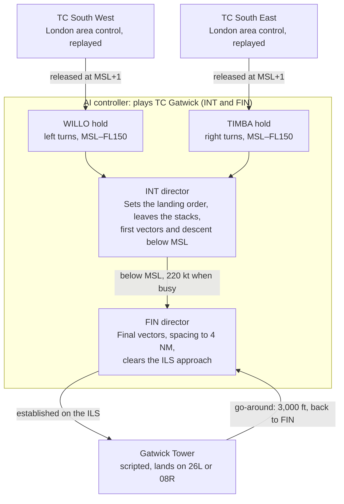

# Stage 0 spec: Gatwick

Snapshot of the shared spec, 5 November 2026 · James Le Cuirot

Stage 0 models Gatwick approach control from the edge of the approach area to the runway, on 26L or 08R. Real arrivals are replayed from ADS-B until each is within 40 NM of Gatwick and at or below FL150, then handed to the AI wherever it is: heading for a hold, on a direct or on a heading from the previous controller. The made-up stage 0 scenarios release arrivals at the WILLO and TIMBA holds instead. The procedures come from VATSIM UK's Gatwick and London vMATS, checked against the UK AIP. VATSIM material is written for flight simulation only, never for real-world use.

## Who controls what

The AI plays both Gatwick approach controllers: the intermediate director (INT), who works the stacks, and the final director (FIN), who lines aircraft up on final. London area control before it is replayed from ADS-B, and Gatwick Tower after it is scripted.

A go-around goes to Tower first, which restores separation before handing the aircraft back to the final director.

## Airspace and levels

The AI works inside Gatwick's Radar Manoeuvring Area (RMA), the airspace London control delegates to Gatwick. Its shape changes with the runway in use.

| Item | Value |
| --- | --- |
| Area of responsibility | Gatwick CTR and CTA, the RMA, and London airspace delegated to Gatwick within 40 NM of the Gatwick ATZ |
| Transition altitude | 6,000 ft |
| Minimum stack level (MSL) | Set by Heathrow QNH: FL70 at 1013 hPa and above, FL80 from 977 to 1012 hPa, FL90 from 940 to 976 hPa |
| Release level | London releases arrivals at MSL+1, or the lowest level available. London keeps aircraft holding at FL120 and above |
| Main Vectoring Area | Release level and below. Vectoring and descent below MSL can start here without coordinating with London |
| Area 6 | At or below 6,000 ft |
| Area 5 | At or below 5,000 ft (easterly operations only) |
| Area 4 | Below 4,000 ft, with no vectoring north of it, to protect Heathrow's DET departures |
| X–Y–Z line | Eastern edge. Once below MSL, aircraft must not cross it |
| A–B line | Splits the WILLO and TIMBA sides. Cross it only at or below MSL |
| Western edge | Westerly operations: the SHM–OCK line. Easterly: a line 5 NM east of the MID–BOGNA track |
| 30 NM range | East of points Y and Z. Only for vectoring and descending traffic from ARNUN and LARCK to MSL |
| Lowest assignable altitude | 2,000 ft. Near Biggin Hill (north-east) 2,300 ft, and in the north-west 2,100 ft |
| Minimum sector altitude within 25 NM | North-west 2,200 ft, north-east 2,300 ft, south-west 2,100 ft, south-east 2,000 ft |

One simplification for stage 0: the AI owns the whole holding stack. In reality London keeps aircraft holding at FL120 and above.

## Arrival routes and holds

Arrivals reach Gatwick on 12 standard arrival routes (STARs), each ending at the WILLO or TIMBA hold. Four more STARs switch a flight from one stack to the other. Stage 0 only needs the last few fixes of each, because the replay hands aircraft over at the hold.

| Stack | Released by | STARs | Last fixes |
| --- | --- | --- | --- |
| WILLO | London TC South West | ABSAV 1G, DISIT 1G, GWC 1G, KIDLI 1G, OTMET 1G, SIRIC 1G, VASUX 1G | All via HOLLY – WILLO |
| TIMBA | London TC South East | BARMI 1G, KONAN 2G, TEBRA 2G | ARNUN – KKE63 – LARCK – TIMBA |
| TIMBA | London TC South East | KUNAV 1G, NEVIL 1G | AMDUT – KKE64 – TIMBA |
| Switch to WILLO | — | AMDUT 1G, ARNUN 1G | Via SFD – WILLO |
| Switch to TIMBA | — | MID 1X, TELTU 1G | MID 1X via MAY – LARCK; TELTU 1G via SFD |

| Hold | Inbound course | Turns | Levels | Holding speed |
| --- | --- | --- | --- | --- |
| WILLO | 284° | Left | MSL to FL150 | 220 kt up to FL140 |
| TIMBA | 309° | Right | MSL to FL150 | 220 kt up to FL140 |
| MAY (Mayfield VOR) | 087° | Left, outbound leg ends at 5 DME | 3,000 to 6,000 ft | 220 kt |

How the stacks work:

- **Order.** The landing order follows the time each aircraft reaches its stack, adjusted tactically. No expected approach times are issued; holding aircraft get a delay estimate in 5-minute steps up to 20 minutes.
- **Separation.** Aircraft in WILLO and TIMBA are separated from each other up to FL150. MAY is not separated from them or from some departures, so stage 0 leaves MAY out.
- **Before the hold.** Vectoring may start before the release fix, under runway-dependent limits. TIMBA traffic stays west of the X–Y–Z line or inside the 30 NM range. WILLO traffic stays east of SHM–OCK on westerly operations, or east of a line 5 NM east of MID–BOGNA on easterly.
- **Takeover in the replay.** An aircraft becomes the AI's when it reaches WILLO or TIMBA, or enters the RMA, whichever comes first.

## Final approach

Arrivals on final must be at least 3 NM apart, and at least the RECAT-EU wake distance apart when the leader crosses the threshold. In routine traffic the target is 6 NM, leaving room for one departure between arrivals.

### Spacing

| Rule | Value |
| --- | --- |
| Minimum radar separation | 3 NM |
| Routine spacing target | 6 NM (one departure between arrivals) or 8 NM (two departures). Until departures are modelled, the rules controller spaces arrivals to the minimum: 3 NM, or the wake minimum if larger, plus a 1 NM margin |
| Who applies it | The final director, until 4 NM from touchdown. Radar and wake separation must hold until touchdown |
| If spacing is lost | The aircraft is taken off the approach and re-sequenced |
| Night | 22:30–23:30 local: 6 NM, or the wake minimum if larger. 23:30–06:00: 12 NM |
| Emergency aircraft | 15 NM to the aircraft behind |
| Low visibility | About 24 landings an hour with RVR above 1,000 m, falling to 12 or fewer below 300 m |

Real Gatwick has used time-based separation since March 2025, which reduces distances slightly in strong headwinds. Stage 0 uses distance tables; time-based separation can come later.

### Wake turbulence

Each real day is scored with the scheme in force at Gatwick that day, and every controller on that day's traffic uses it: the UK scheme before 26 March 2025, RECAT-EU from then. Made-up scenarios use the UK scheme. Spacing is checked on final only.

**UK scheme** (CAP 493 Section 1 Chapter 3, final approach, in NM). Types are categorised from the CAA's UK Wake Turbulence Categorisation list (V7, August 2025):

| Follower \ Leader | Super (J) | Heavy (H) | Upper Medium (U) | Lower Medium (M) | Small (S) | Light (L) |
| --- | --- | --- | --- | --- | --- | --- |
| Super (J) | 3 | 3 | 3 | 3 | 3 | 3 |
| Heavy (H) | 5 | 4 | 3 | 3 | 3 | 3 |
| Upper Medium (U) | 7 | 5 | 3 | 3 | 3 | 3 |
| Lower Medium (M) | 7 | 5 | 4 | 3 | 3 | 3 |
| Small (S) | 7 | 6 | 4 | 3 | 3 | 3 |
| Light (L) | 8 | 7 | 6 | 5 | 4 | 3 |

**RECAT-EU** (in NM), with J H U M S L standing for its categories A to F:

| Follower \ Leader | Super (J) | Heavy (H) | Upper (U) | Medium (M) | Small (S) | Light (L) |
| --- | --- | --- | --- | --- | --- | --- |
| Super (J) | 3 | 3 | 3 | 3 | 3 | 3 |
| Heavy (H) | 4 | 3 | 3 | 3 | 3 | 3 |
| Upper (U) | 5 | 4 | 3 | 3 | 3 | 3 |
| Medium (M) | 5 | 4 | 3 | 3 | 3 | 3 |
| Small (S) | 6 | 5 | 4 | 3 | 3 | 3 |
| Light (L) | 8 | 7 | 6 | 5 | 4 | 3 |

A 3 means no wake minimum applies, only the 3 NM radar minimum. The vMATS appendix maps common aircraft types to these categories.

### Speeds and descent

| Phase | Rule |
| --- | --- |
| Leaving the hold | 210–220 kt until about 6 NM before the heading to intercept the ILS. Final director may expect 220 kt at hand-over in busy traffic |
| Base and intercept | 160–180 kt, as fast as possible within the band, until established |
| Final | Established at 160 kt by 7 NM from touchdown, held until 4 DME. Assigned speeds are mandatory |
| Hand-over to final director | Once below MSL. If the final director has traffic ahead, not below 4,000 ft |
| On the extended centreline | At or below 4,000 ft (below 4,000 ft if north of it) |
| Below 3,000 ft | Only within 10 NM of touchdown |
| ILS clearance | Only at or below 3,000 ft and established on the localiser. Not below 2,000 ft before the glide path |
| Continuous descent | Join the localiser at or before the final approach point. No level segment longer than 2.5 NM below 7,000 ft. Track distance to touchdown is given on first descent below MSL and on first contact with the final director |
| Joining final | Not below 1,500 ft above the aerodrome. At night (23:30–06:00 local) not below 3,000 ft or closer than 10 NM |
| Intercept angle | 45° or less onto the final approach track, established before reaching the glide path from below. A vector through the final approach track is allowed if the pilot is told why (EASA AMC2 ATS.TR.155(c)(3)) |

### Runways and go-arounds

- **Runways in stage 0:** 26L and 08R only. The northern runway (26R/08L) is used only when the main runway is out, never at the same time.
- **Runway choice:** 26L is preferred in calm wind when the tailwind is under 5 kt and the runway is dry.
- **Geometry (from the AIP, matching VATSIM UK's sector file):** 08R threshold 51°08'45.12"N 000°12'24.52"W, true bearing 077.63°, landing distance 2,765 m. 26L threshold 51°09'02.42"N 000°10'19.00"W, true bearing 257.65°, landing distance 2,830 m. Both have a 3° ILS glide path, and DME reads zero at the threshold.
- **Missed approach:** climb straight ahead to 3,000 ft. After passing 2,000 ft or 1 DME, whichever is later, turn onto heading 178° (right off 08R, left off 26L). Tower restores separation, then hands the aircraft back to the final director for another approach.
- **Go-around triggers for the simulated pilots:** an unstable approach, spacing lost on final, or the aircraft ahead still on the runway. The AIP notes that long runway occupancy can send following aircraft around.

## The rules controller

The rules controller is a hand-written baseline that applies the procedures above the same way every time, and it is the bar the AI must beat. This is a proposed design, to be checked with a controller before it is built.

1. **Sequence.** Landing order is the order aircraft reach WILLO or TIMBA. Each aircraft's landing slot is the slot of the aircraft ahead plus the larger of the 6 NM target and the wake minimum, converted to time at 160 kt.
2. **Hold or go.** An aircraft that can't make its slot holds at its fix. A new arrival enters at the lowest free level. The lowest aircraft leaves first, and those above descend 1,000 ft as levels free up.
3. **Leave the stack.** Descend below MSL inside the Main Vectoring Area at 220 kt, giving the track distance to touchdown.
4. **Vector tactically.** There is no fixed pattern. Give headings towards an intercept point on the extended centreline, chosen so the aircraft meets its slot, joining at or before the final approach point at 3,000–4,000 ft. The closing heading gives an intercept of 45° or less. If that isn't possible, vector the aircraft through the localiser, telling the pilot why, and turn it back to intercept from the other side.
5. **Fix the gap.** Speed steps (220 kt from the stack, 160–180 kt on base, 160 kt by 7 NM until 4 DME) correct small gaps. A longer path before the turn onto final corrects larger ones.
6. **Break off if spacing is lost.** Take the aircraft off the approach and re-sequence it.
7. **Hand to Tower** once the aircraft is established on the localiser.

## Left out of stage 0

- Departures, including those routed through the vectoring area, and overflights
- The MAY hold, and the shortcut releases London can give at GWC and TELTU
- London keeping aircraft holding at FL120 and above (the AI owns the whole stack)
- The northern runway, RNP approaches and visual approaches
- Time-based separation, low-visibility procedures and night rules, which return from stage 3 onward

## Open tasks

- [x] Convert the RMA and minimum-altitude shapes in VATSIM UK's sector file (`Airports/EGKK/RMA.txt` and `SMAA.txt`, already in coordinates) into simulator polygons (`approach/airports/areas.py`). The safety check keeps vectoring inside the RMA. Still to do: check them against the AIP's ATC Surveillance Minimum Altitude chart (AD 2.EGKK-5-1).
- [x] Real traffic: OpenSky's full historical data is only for research institutions, so real arrivals come from adsb.lol's open data (ODbL) instead; see `data/real/README.md`.
- [x] Pick the replay days: 60 days in `data/real/egkk/days.csv`, chosen by `scripts/choose_days.py`.
- [x] Load fix coordinates from the sector file's `Navaids` folder. For example, WILLO is at 50°59'05.88"N 000°11'30.30"W and TIMBA at 50°56'43.99"N 000°15'42.25"E. The STAR fix sequences per runway are in `Airports/EGKK/Stars.txt`.
- [ ] Check the rules controller's vectoring logic with a controller or a VATSIM UK mentor.
- [ ] Confirm the UK version of the intercept rule. The EU text (EASA AMC2 ATS.TR.155(c)(3)) says 45° or less, and the roadmap now uses that.
- [x] Map aircraft to UK categories: done from the CAA's UK Wake Turbulence Categorisation list, which covers all 61 types in the real arrivals.
- [ ] Map aircraft to RECAT-EU categories from EUROCONTROL's RECAT-EU type list. The current mapping is provisional, from the vMATS appendix.
- [ ] Get historical METARs for each replayed day. Heathrow QNH sets the London stack levels. Gatwick QNH converts ADS-B pressure altitudes to real altitudes below 6,000 ft, and Gatwick wind gives the runway in use.
- [x] Verify the threshold coordinates: the sector file's runway data matches the AIP values for 08R and 26L.
- [ ] Decide how to handle the sector file's GPL-3 licence: download it separately at build time, or license the project repo under GPL-3.

## Sources

- London Gatwick vMATS Part 2, VATSIM UK, revision 2026/08 (effective 21 August 2026): GEN 1 and 4–5, ADC 3.13–3.15, APC 1–4. For use on the VATSIM network only; not stored in this repo.
- London FIR (EGTT) vMATS Part 2, VATSIM UK, revision 2026/04 (effective 29 April 2026): APT chapter 2, Gatwick RMA figures. Not stored in this repo.
- UK AIP, EGKK AD 2 (aerodrome section, AD 2.1–2.24). Values were read from scanned pages; not stored in this repo.
- [VATSIM UK sector file](https://github.com/VATSIM-UK/UK-Sector-File), open source under GPL-3, latest commit 28 October 2026: `Airports/EGKK` (RMA, SMAA, STARs, runways, fixes) and `Navaids`. Fetched by `scripts/fetch_sector_file.sh`, not committed.
- [EASA AMC2 ATS.TR.155(c)(3)](https://www.easa.europa.eu/en/document-library/easy-access-rules/easy-access-rules-air-traffic-managementair-navigation-services-provision-services), vectoring for approach control (EU, acceptable means of compliance), in force from 3 July 2020.
